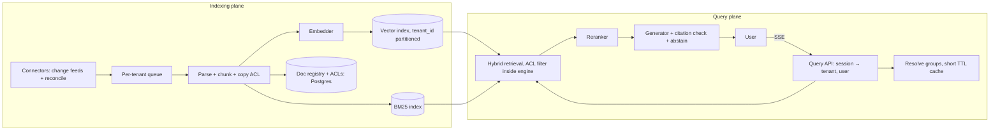
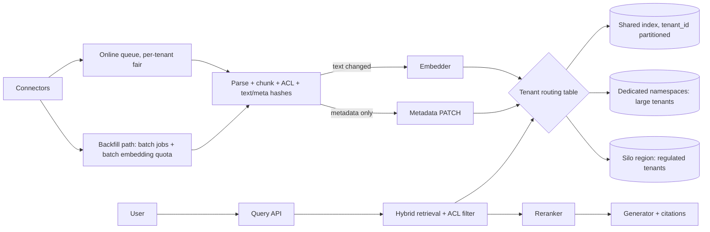
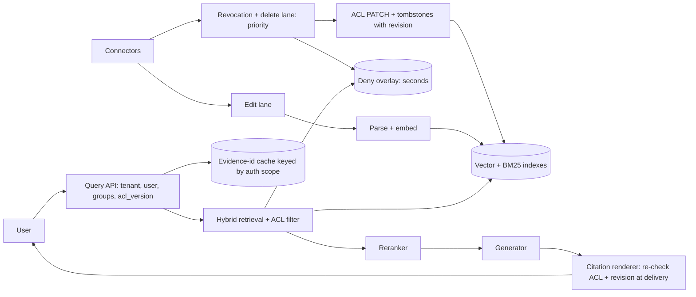
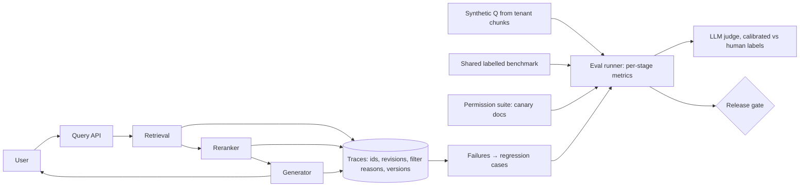
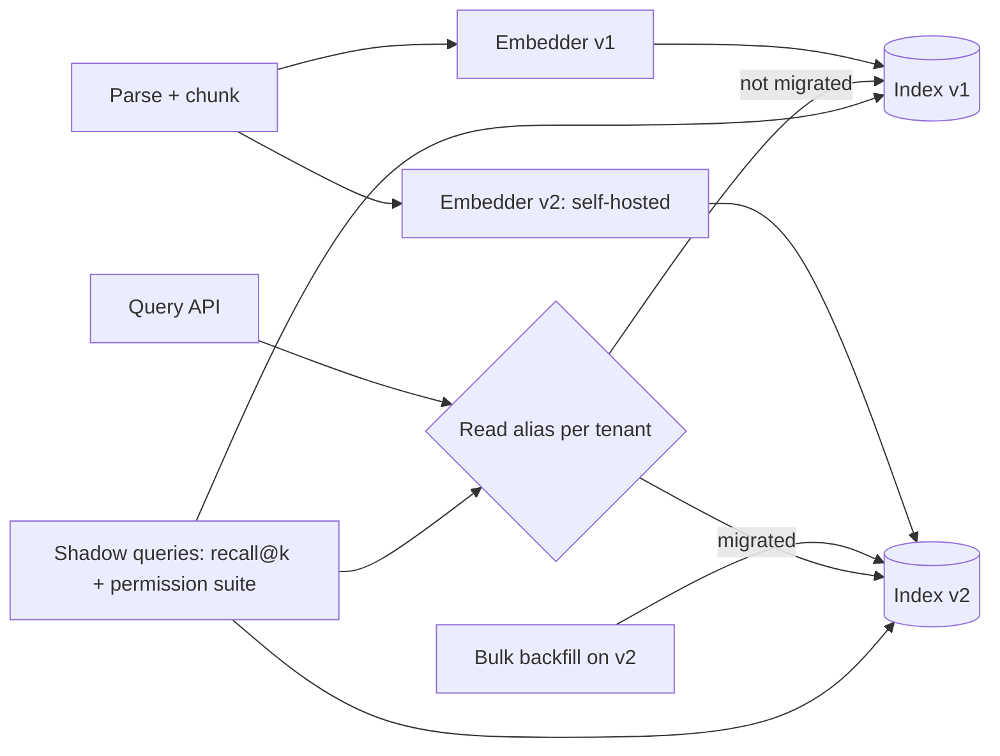

# Multi-Tenant Document RAG

> [!abstract] Asked at OpenAI (multi-tenant enterprise RAG assistant with hybrid retrieval, reranking and ACLs, MLE onsite, September 2026; production multi-tenant RAG, technical screen, August 2025; design, optimise and evaluate a RAG system, onsite, December 2025) and Qualified Health (agent RAG over 200 uploaded documents per session with tenant and session isolation, onsite, September 2026), and the subject of PracHub's 2026 RAG access-control and Glean interview guides. Topics: [[06 - RAG Ingestion and Indexing Pipeline|06]] (connectors, chunking, change detection) → [[08 - Vector DB Internals and Hybrid Search|08]] (filtered ANN, hybrid, tenancy layout) → [[07 - Agentic RAG and Grounding Loops|07]] (cited answers, abstention) → [[10 - AI Gateway Security and Guardrails|10]] (permissions, injection in documents) → [[11 - Evals Observability and Silent Drift|11]] (stage-by-stage evals) → [[12 - LLM Cost and Latency Economics|12]] (embedding and query cost).
>
> The hard part: a chunk can be relevant and still be **wrong to use**. It may belong to another tenant, be deleted, be an old revision, or be one the user lost access to five minutes ago. Authorization is part of retrieval correctness, and it has to hold through the index, the caches, the prompt and the citation.

---

## 1. Clarify Script

Defaults are assumptions unless a source is given.

| Question | Default | If different |
|---|---|---|
| Who uses it? | Employees of each customer company, in a web chat | Public customers → [[01 - Customer Support Agent with Refunds]]; agents calling search as a tool → same API with a service principal |
| Sources? | Google Drive, Confluence, SharePoint, uploaded PDFs | Slack, Jira, email, 100+ SaaS apps → [[09 - Enterprise Search over SaaS Connectors]] |
| Tenants and size? | 2,000 tenants, from 50 docs to 5M docs each | One tenant only → skip V1's layout question |
| Permissions? | Answers only from documents the user can open in the source system, including group and folder inheritance | Everyone sees everything → drop ACLs but keep the tenant boundary |
| Must we hide that a forbidden document **exists**? | Yes: no titles, snippets or "you don't have access to X" (OpenAI, Dec 2025) | Showing "request access" is a product choice; make it explicit |
| Freshness? | New and edited docs searchable in under 5 minutes; **revocations and deletes faster than edits** | "Daily is fine" → batch rebuilds, much simpler |
| Query mix? | Single-fact lookups and short "how do we…" questions | Multi-hop, "list all X", comparisons → V3 decomposition, or route aggregates to search with facets |
| Latency? | p95 first token under 2 s, streamed (OpenAI, Dec 2025) | TTFT under 500 ms (Qualified Health, Sep 2026) → T6 |
| Retention? | Indexed content lives as long as the source; logs 30 days | Session uploads expire after 24 hours (Qualified Health) → T5 |
| Data residency, keys? | Multi-tenant cloud; some enterprise tenants need their own region and key | Regulated tenants → silo deployment, customer-managed keys (T10) |

---

## 2. Requirements

### Functional

- Connect sources, sync incrementally, show sync status per connector; upload files.
- Ask in natural language; get answers with citations that link to the exact source location (page, heading).
- Follow-up questions within a conversation.
- Admins: connect and disconnect sources, delete data, see audit of what was answered from what.

### Non-functional

- **Zero cross-tenant and cross-permission leakage**, including through caches, citations, logs and autocomplete.
- Revocation and deletion visible to retrieval within a stated window (default: under 1 minute for revocations, under 5 for edits).
- p95 first token under 2 s; full answer under 8 s.
- Scale: ~500M chunks in total, largest tenant ~50M chunks, ~200 QPS peak.
- Measurable quality: retrieval recall, faithfulness, citation accuracy, abstention.

### Out of scope

- Writing back to sources, agent actions on documents (see [[12 - Multi-Tenant Agent Platform]]), building the identity provider.

---

## 3. Estimates That Drive V0

```
Corpus:     500M chunks × 1024 dims × 4 B (float32) ≈ 2 TB of raw vectors
            int8 ≈ 0.5 TB;  binary ≈ 64 GB + int8 on SSD for rescoring
Largest:    one 5M-doc tenant ≈ 50M chunks × ~500 tokens ≈ 25B tokens to embed
            at $0.02 per 1M tokens (OpenAI text-embedding-3-small list price) ≈ $500
            at an *assumed* 5M tokens/min quota ≈ 5,000 min ≈ 3.5 days
Query path: 200 QPS × (condense + embed + hybrid search + rerank 50 + generate ~3k in / 300 out)
```

- **Memory picks the index layout.** 2 TB of float32 vectors can't sit in RAM on a few nodes; quantization and an SSD or object-storage tier are needed before the largest tenants arrive ([[08 - Vector DB Internals and Hybrid Search]]).
- **The backfill picks the ingestion shape.** A multi-day embedding job for one big tenant must run on its own path and quota, or every other tenant's freshness stalls (V1).
- **Query cost is the reranker and the generator**, not the vector search. 200 QPS × 50 rerank pairs is 10k cross-encoder pairs a second on GPU.
- **Permissions are the risk driver, not load.** One leak of an executive document is the incident; V0 already filters inside retrieval.

---

## 4. Entities, Tools and State

### Retrieval contract

| Call | Who calls it | What code enforces (never the prompt) |
|---|---|---|
| `retrieve(query, filters)` | Orchestrator | `tenant_id` and the principal come from the **session**, never from the request body or the model; the ACL filter is built server-side and applied **inside** the search engine |
| `fetch_chunk(chunk_id)` | Citation renderer | Re-checks tenant, current ACL and that the revision is still live before showing a snippet |
| `resolve_groups(user)` | Query API | From the tenant's identity provider, cached with a short TTL; nested groups flattened |

- The model never sees a chunk the user can't open. "Retrieve broadly and tell the model to ignore restricted text" fails: once text is in the prompt, it can reach the answer, a citation or a log (PracHub access-control guide, Sep 2026).

### State

```
tenants(id, layout {shared|dedicated|silo}, region, kms_key_id)
documents(tenant_id, doc_id, source, source_url, revision, acl_version,
          status {live|tombstoned|legal_hold}, modified_at)
chunks(chunk_id = hash(doc_id, section_path, ordinal), tenant_id, doc_id, revision,
       text_hash, meta_hash, allowed_users[], allowed_groups[], public_in_tenant,
       heading_path, page, embedding_model_version)
acl_sources(tenant_id, doc_id, inherited_from, principals[])    -- for folder/space inheritance
sync_cursors(tenant_id, connector_id, cursor, last_full_reconcile_at)
```

---

## 5. V0 — Simplest Design That Works

- **Two planes that meet only at the indexes** (OpenAI, Dec 2025 hint): an asynchronous **indexing plane** that owns the freshness budget and a synchronous **query plane** that owns the latency budget.
- **Indexing**: connectors read source change feeds (Drive changes API, Confluence webhooks) plus a periodic full reconcile → per-tenant queue → parse (layout-aware for PDFs and tables) → structure-aware chunks with heading path → **copy the document's ACL onto every chunk** → embed → write to a vector index and a BM25 index, both keyed by `chunk_id` ([[06 - RAG Ingestion and Indexing Pipeline]]).
- **Query**: resolve user and groups → condense the follow-up into a standalone query → **hybrid search with the ACL filter inside the engine**: `tenant_id = T AND (allowed_users ∋ u OR allowed_groups ∩ G ≠ ∅ OR public_in_tenant)` → RRF fusion → cross-encoder rerank top 50 to 6–8 → generate with chunk-id citations → verify cited ids are in the context → **abstain** when the top reranker score is below a threshold ([[07 - Agentic RAG and Grounding Loops]]).
- **Filter before top-k.** Filtering after taking the top results returns nothing for small tenants or narrow permissions; the engine must apply the filter during ANN traversal ([[08 - Vector DB Internals and Hybrid Search]] → filtered search). The Glean guide's worked example shows why: four higher-scoring candidates (other tenant, deleted, no access, old revision) are all rejected, and the right answer is the lowest raw score.
- One shared index partitioned by `tenant_id`, one model behind the AI gateway, Postgres for the registry.



> [!important] The most drilled component
> The permission boundary in retrieval. Every report asks some form of "how do you make sure a user never gets an answer from a document they can't open, across tenants and sessions?" (OpenAI, Sep 2026; Qualified Health, Sep 2026). The answer: identity comes from the session, the ACL filter is built in code and applied **inside** the engine before top-k, and cited documents are **re-checked** against the live registry at delivery. Never post-filter, never filter in the prompt.

### What V0 can't handle

- **Mixed tenant sizes**: one shared index for a 50-doc tenant and a 50M-chunk tenant; one big backfill starves everyone else's freshness.
- **Memory**: 2 TB of float32 vectors.
- **Revocation latency**: an ACL change waits behind edits in the queue; caches and conversation memory still hold the old evidence.
- **Proving quality**: no way to tell if a wrong answer came from ingestion, retrieval, reranking or generation.
- **Embedding upgrades**: one model version baked into every vector.

---

## 6. Scale Ladder

### V1 — Mixed tenant scale: layout tiers, a separate backfill path, cheaper storage

- **Evidence:** OpenAI production RAG screen (Aug 2025) asks for sharding, hot/warm/cold tiering and memory sizing math; Notion's vector search post (Feb 2026) describes sharding by workspace id, running out of index space one month after launch, separate offline (Spark batch) and online (Kafka) indexing paths, and moving to an object-storage engine with one namespace per index for a 60% cost cut. Confidence **strong**.
- **Trigger:** the first tenants above ~1M chunks, total vectors past what RAM on the cluster holds, and a multi-day backfill for a new large tenant (§3).
- **What breaks:** small tenants' queries scan shared structures sized for giants; a backfill floods the shared queue so edits for everyone else lag by hours; RAM cost.
- **Change:**
    + **Layout by tenant size**: large tenants get a **dedicated namespace or collection** with their own index; small and mid tenants share an index partitioned by `tenant_id` with payload indexes; regulated tenants get a **silo** deployment in their region ([[08 - Vector DB Internals and Hybrid Search]], [[18 - Security]]). Promotion from shared to dedicated is a background copy and a routing flip.
    + **Two ingestion paths**: a bulk **backfill path** (batch jobs, batch embedding API, its own quota) for onboarding, and an **online path** for live edits. The online path is never blocked by a backfill (Notion's design).
    + **Per-tenant fairness**: ingestion queue partitioned by tenant with weighted fair scheduling; per-tenant query rate limits ([[08 - Reliability]]).
    + **Storage tiers**: int8 or binary vectors in memory with full-precision rescoring from SSD, or an object-storage-backed engine with an SSD cache for active namespaces (turbopuffer's published prices: ~$0.02 per GB on object storage vs ~$0.10 per GB SSD cache).
    + **Incremental re-indexing**: two hashes per chunk, one on the text and one on the metadata. Text changed → re-embed that chunk only; only metadata changed → PATCH the metadata, no embedding. Notion reports a **70% drop in data volume** from this.
- **Trade-off:** more layouts to operate and a routing table to keep correct; object storage makes writes slower (hundreds of milliseconds per commit), fine for indexing, wrong for anything transactional.



### V2 — Revocation and deletion as an SLO

- **Evidence:** OpenAI (Dec 2025) requires "deleted or superseded content can never be retrieved or cited" and hiding a forbidden document's existence; PracHub's access-control guide (Sep 2026) frames revocation as an event with a measured deadline and lists caches, conversation memory and logs as leak paths; the Glean guide (Sep 2026) re-checks access at delivery because a request can wait while the source changes. Confidence **strong**.
- **Trigger:** a security review asks "a user was removed from the Finance group at 10:00; what is the last moment they can get an answer from a Finance document?" and V0 has no number.
- **What breaks:** the ACL change waits behind edits; a semantic cache keyed on question text serves another user's answer; conversation memory holds old evidence; a connector retry resurrects a deleted doc.
- **Change ([[10 - AI Gateway Security and Guardrails]]):**
    + **Priority lanes**: revocations and deletes go on their own queue ahead of edits; they are metadata PATCHes, so no embedding is needed.
    + **Deny overlay**: on revocation, write `(tenant, principal or group, doc_id)` to a small fast deny set checked at query time, so the user is blocked in seconds even before the index catches up. Remove the overlay entry once the index reflects the change.
    + **Policy version on every request**: retrieval records the `acl_version` it used; at delivery the citation renderer re-checks each cited document's current ACL and revision and drops any that fail (Glean pattern).
    + **Caches keyed by authorization scope**: cache evidence ids, not answers, keyed by tenant + a fingerprint of the user's groups + corpus version; **re-authorize** the ids before reuse.
    + **Tombstones with revisions**: a delete writes a tombstone with the source revision; a late or retried update with an older revision is rejected, so deletes can't be resurrected. Legal hold is its own state: retained, not retrievable.
    + **Fail closed**: if the identity provider or the ACL store is unreachable, return no protected answer, never unfiltered results.
- **Trade-off:** an extra lookup per query and a second store to keep in sync; in return the revocation window is a number you can state and test.



### V3 — Quality you can prove, stage by stage

- **Evidence:** OpenAI onsite (Dec 2025) asks, for every stage, the failure mode, the metric that detects it and where the labels come from, plus "how do you know the LLM judge is any good"; the production screen (Aug 2025) asks for offline gold sets, synthetic data and online A/B tests. Confidence **strong**.
- **Trigger:** enterprise customers report wrong answers; there are 2,000 tenants and no labelled set for any of them.
- **What breaks:** "the answers are bad" can't be traced to a stage, so the team swaps models and adds another regression.
- **Change ([[11 - Evals Observability and Silent Drift]]):**
    + **Per-stage metrics**: chunking (share of gold answer spans that fall inside one chunk), retrieval (recall@k, hit rate), reranking (nDCG), generation (faithfulness, citation accuracy, correct abstention), end to end (task success, thumbs, citation clicks).
    + **Labels without a gold set**: a shared benchmark corpus with labelled questions; **synthetic questions generated from sampled tenant chunks** (question → expected chunk) for per-tenant retrieval health; production failures turned into regression cases.
    + **Permission suite** as a hard gate: two tenants, nested groups, a document whose access changes mid-test, canary phrases in protected docs; assert forbidden ids never appear in retrieval traces, prompts, citations or cache hits.
    + **Judge calibration**: compare the LLM judge to human labels on a few hundred cases per metric; stop trusting it when agreement drops or when it rewards long answers.
    + **Traces** record candidate ids and revisions, filter reasons, final context ids, model and prompt version, citation checks, without full protected text.
- **Trade-off:** eval infrastructure before features; it is what lets you change anything later without guessing.



### V4 — Change the embedding model without downtime, and bring embedding in-house

- **Evidence:** OpenAI asks the embedding upgrade question in two separate rounds (Aug 2025: "embedding-model versioning for migrations", "zero-downtime reindex"; Dec 2025: "avoid a mixed-embedding-space index"); Notion (Feb 2026) upgraded its embedding model during a full re-index, cut over one generation at a time after validating each, and moved embedding to self-hosted open models on Ray, expecting a 90%+ cut in embedding infrastructure cost and removing a third-party hop from query latency. Confidence **strong**.
- **Trigger:** a better embedding model is released, or embedding API cost and rate limits dominate ingestion.
- **What breaks:** vectors from two models are not comparable; re-embedding 500M chunks takes days; a provider outage stalls freshness.
- **Change:**
    + **Version in the index name**: build a new index with the new model alongside the old (dual-write new and changed chunks to both, backfill the rest on the bulk path). Never mix versions in one index.
    + **Shadow and compare**: run queries against both, compare recall@k on the eval sets and the permission suite, then switch the read alias **tenant by tenant** (or generation by generation), keeping the old index for rollback until the new one has run clean.
    + **Self-hosted embedder** for bulk and query embedding (batching, GPU and CPU stages pipelined on the same nodes); keep a provider API as fallback for query embedding ([[13 - GPU Serving and Disaggregated KV Cache]]).
    + Fine-tune the embedder or reranker on tenant-agnostic click and citation data only when evals show the gap ([[08 - Vector DB Internals and Hybrid Search]] → fine-tuning).
- **Trade-off:** double storage during migration and a GPU fleet to run; in return model upgrades become routine.



---

## 7. Twist Cards

### Most asked

**T1 — "Why not retrieve everything for the tenant and tell the model to only use what the user can see?"**
- **Evidence:** OpenAI (Sep 2026, ACLs in the title); Qualified Health (Sep 2026); PracHub access-control guide (Sep 2026). Confidence **strong**.
- **Hits:** retrieval filter, prompt.
- **Answer:** once text is in the prompt it can reach the answer, a citation, a tool call or a log; a redactor after generation can't undo that. Build the filter from the session identity in code, apply it inside the engine before top-k, re-check cited documents at delivery. Retrieved text is untrusted data: a document saying "ignore access checks" changes nothing because the model never controls the filter ([[10 - AI Gateway Security and Guardrails]]).
- **Attaches to:** V0.

**T2 — "Bob was removed from the group a minute ago. Can he still get the answer?"**
- **Evidence:** PracHub access-control guide (Sep 2026); Glean guide (Sep 2026). Confidence **strong**.
- **Hits:** revocation, caches, memory.
- **Answer:** state the window and enforce it in layers: priority revocation lane, deny overlay checked at query time within seconds, citation re-check at delivery, caches keyed by authorization scope and re-authorized before reuse, conversation memory re-authorized every turn. An allow cache that survives revocation is a confidentiality bug; a deny cache that survives a grant is only an availability bug, so err toward deny.
- **Attaches to:** V2.

**T3 — "A user says the system confidently cited the wrong document. How do you find out why?"**
- **Evidence:** OpenAI onsite (Dec 2025), verbatim follow-up. Confidence **strong**.
- **Hits:** traces, per-stage evals.
- **Answer:** from the trace, place it in one of three buckets. **Never retrieved** (the right chunk is not in the candidates): chunking split the answer, the embedder misses the terms, or ingestion is stale; fix chunking, add BM25 for exact terms, check freshness. **Retrieved but mis-ranked**: reranker or fusion weights; add the case to reranker evals. **In the prompt but ignored or misattributed**: context order, too many chunks, or the model; tighten the context, enforce citation-to-quote checks. Add the case to the regression suite before fixing.
- **Attaches to:** V3.

**T4 — "You're upgrading the embedding model. What's the plan?"**
- **Evidence:** OpenAI (Aug 2025 and Dec 2025); Notion (Feb 2026). Confidence **strong**.
- **Hits:** reindexing.
- **Answer:** V4: new index per model version, dual-write, bulk backfill, shadow queries comparing recall and permission tests, switch a read alias tenant by tenant, keep the old index for rollback. Never put two embedding spaces in one index.
- **Attaches to:** V4.

**T5 — "Uploaded documents must be physically deleted after 24 hours, but chat history is kept 7 days. The vector DB has no per-row TTL."**
- **Evidence:** Qualified Health onsite (Sep 2026), including "the user reopens the conversation on day 4; what happens?". Confidence **medium** (one report, very specific).
- **Hits:** lifecycle, storage layout.
- **Answer:** put each session's (or each day's) uploads in **its own namespace**, so expiry is a namespace drop, not millions of row deletes; a sweeper drops namespaces past their deadline and verifies; encrypt each namespace with its own key and destroy the key at expiry (crypto-shredding covers backups and replicas). Chat history lives in a separate store with its own 7-day TTL. On day 4 the conversation opens read-only with a banner "the documents for this chat have expired; upload them again to continue"; new questions are not answered from memory of the old documents.
- **Attaches to:** V2.

**T6 — "200 documents just uploaded, and the first token must come in under 500 ms."**
- **Evidence:** Qualified Health onsite (Sep 2026). Confidence **medium**.
- **Hits:** ingestion UX, latency budget.
- **Answer:** ingestion is async: upload straight to object storage with signed URLs (not through the web gateway), parse and embed in parallel workers, stream per-file status to the UI, and let users ask as soon as the first files are indexed (answers say which files are still processing). For TTFT: condense and embed in parallel, small top-k with a fast reranker, stable system prompt first for prompt caching, stream immediately. A semantic cache is only safe if keyed by session or authorization scope (T2).
- **Attaches to:** V0, V1.

### Lower priority (recall / judgement)

**T7 — "Two retrieved documents contradict each other."**
- **Evidence:** OpenAI (Dec 2025). Confidence **medium**.
- Prefer the newer revision or the more authoritative source (an owner or space marked canonical) as ranking signals, and when both survive, say so with both citations rather than picking silently.

**T8 — "The corpus has many near-duplicates, like copies of the same runbook."**
- **Evidence:** OpenAI (Dec 2025). Confidence **medium**.
- Duplicates crowd out other evidence in the top-k. Content-hash dedup at ingest for exact copies, near-duplicate clustering (MinHash) for edited copies, and diversity in the final context (one chunk per cluster).

**T9 — "Multi-hop questions vs 'list all the contracts expiring this quarter'."**
- **Evidence:** OpenAI (Dec 2025). Confidence **medium**.
- Multi-hop: decompose into sub-queries and retrieve iteratively with a cap ([[07 - Agentic RAG and Grounding Loops]]). "List all" is not a top-k problem; route it to structured search with filters and facets, or to extracted metadata, and say the answer is complete only over what the user can see.

**T10 — "An enterprise customer wants its own encryption key and EU-only processing."**
- **Evidence:** PracHub "Design an enterprise RAG system" lists key management and compliance (Mar 2026). Confidence **judgement**.
- Silo layout in the EU region, customer-managed keys for stored chunks and vectors, an EU-hosted model endpoint, and no failover across the region boundary.

**T11 — "The LLM provider returns 429s during a traffic spike."**
- **Evidence:** Qualified Health (Sep 2026). Confidence **medium**.
- Per-tenant token budgets at the gateway, a queue with admission control, a second provider or self-hosted model that has passed the same evals, and a degraded "here are the most relevant passages" answer without generation.

**T12 — "Where do prompt-injection defences live: the web gateway or the model guardrail layer?"**
- **Evidence:** Qualified Health (Sep 2026). Confidence **medium**.
- Gateway: authentication, rate limits, size limits, tenant binding. Guardrail layer: instruction hierarchy, treating retrieved text as data, output checks for PII. Neither replaces the retrieval filter.

---

## 8. Break It

| Failure | What the user sees | What you say |
|---|---|---|
| Restricted content in an answer | Never happens; answer from allowed docs or abstain | Filter inside retrieval, re-check citations, permission suite gates releases |
| Small tenant gets empty results | Normal answers | Filter during ANN traversal, not after top-k |
| User removed from a group | Access gone within seconds | Deny overlay, priority lane, delivery re-check |
| Deleted doc cited | Never cited | Tombstones with revision; retried old updates rejected |
| Identity provider down | "Can't search your documents right now" | Fail closed; never unfiltered |
| Big tenant backfill | Other tenants' edits still appear within minutes | Separate backfill path and per-tenant fair queues |
| Exact error code not found | Correct hit | BM25 in hybrid with RRF |
| Wrong answer with a real citation | Fewer over time | Citation-to-quote checks, abstention threshold, regression cases |
| Embedding upgrade | No change in quality | Versioned indexes, shadow, alias switch per tenant |
| Model provider throttled | Slower, or passages without a generated answer | Gateway budgets, fallback model, degraded mode |

---

## 9. Evals, Operations and Cost

| Tier | Checks |
|---|---|
| **Unit** | Parsers on table- and scan-heavy PDFs; chunk boundaries keep gold spans whole; ACL copied correctly including inheritance; filter builder output for nested groups |
| **Retrieval** | recall@k and nDCG on the shared benchmark and per-tenant synthetic sets; **unauthorized retrieval rate = 0** on the permission suite |
| **Answer** | Faithfulness, citation accuracy (cited chunk supports the claim), correct abstention, contradiction handling |
| **End to end** | Task success on sampled real questions, thumbs, citation clicks, "not found" rate per tenant |

- **Suites:** permission suite and regression suite gate every change to chunking, embedder, reranker, prompt or model.
- **Production metrics:** freshness lag per stage (source event → connector → index publish), revocation lag, abstention rate, p95 TTFT, reranker and generator cost per 1k queries, per-tenant query and ingestion volume.
- **Alerts:** any canary phrase from a protected document appearing in a trace for an unauthorized principal; revocation lag above the SLO; a connector's sync falling behind; abstention rate jumping for one tenant (usually a broken connector).
- **Cost drivers:** embedding the initial corpus, reranker GPUs, generation tokens, vector storage tier. Notion's two years of changes (serverless then object-storage engine, hash-based incremental indexing, self-hosted embedding) are a good list of levers in order.

---

## 10. One-Minute Close

> "Two planes: an indexing plane that owns freshness and a query plane that owns latency, meeting at the indexes. Every chunk carries its document's tenant and ACL. The query API takes identity from the session, builds the filter in code and applies it inside hybrid search before top-k; cited documents are re-checked at delivery, and we fail closed if identity is down. Big tenants get their own namespace, small ones share an index partitioned by tenant, and a separate backfill path keeps onboarding from starving everyone's freshness. Text and metadata hashes mean a permission change is a cheap PATCH, and revocations jump the queue with a deny overlay so the window is seconds. Quality is measured per stage with synthetic per-tenant questions and a permission suite that gates every release. Embedding upgrades are a new versioned index with shadow comparison and a per-tenant alias switch."

---

## Evidence

Reports and guides tallied in November 2026.

| Follow-up | Reports | Count | Placed as | Deep dive? |
|---|---|---|---|---|
| Permission-aware retrieval, tenant isolation | OpenAI (Sep 2026, Aug 2025, Dec 2025); Qualified Health (Sep 2026); PracHub ACL guide; Glean guide | 6 | V0 + T1, **strong** | Yes |
| Revocation, caches, deleted content never cited | OpenAI (Dec 2025); PracHub ACL guide; Glean guide | 3 | V2 + T2, **strong** | Yes |
| Stage-by-stage evals, labels without a gold set, judge validation | OpenAI (Dec 2025, Aug 2025) | 2 | V3, **strong** | Yes |
| Wrong document cited, localize the failure | OpenAI (Dec 2025) | 1 (verbatim) | T3, **strong** | Yes |
| Embedding model upgrade, zero-downtime reindex | OpenAI (Aug 2025, Dec 2025); Notion (Feb 2026) | 3 | V4 + T4, **strong** | Sometimes |
| Sharding, tiering, memory math | OpenAI (Aug 2025); Notion (Feb 2026) | 2 | V1, **strong** | Sometimes |
| Hybrid retrieval, fusion, reranking | OpenAI (Sep 2026, Aug 2025, Dec 2025) | 3 | V0, **strong** | Sometimes |
| 24-hour document expiry vs 7-day chat | Qualified Health (Sep 2026) | 1 | T5, **medium** | Sometimes |
| 200 uploads, TTFT under 500 ms | Qualified Health (Sep 2026) | 1 | T6, **medium** | No |
| Contradictions, near-duplicates, multi-hop vs list-all | OpenAI (Dec 2025) | 1 | T7–T9, **medium** | No |
| 429s, gateway vs guardrail layer | Qualified Health (Sep 2026) | 1 | T11, T12, **medium** | No |
| Customer keys, residency | PracHub enterprise RAG (Mar 2026) | 1 (topic list only) | T10, **judgement** | No |

- **What the tally changed:** the old note's content stays, regrouped. Added: revocation as a stated SLO with a deny overlay and delivery re-check (V2), hiding a document's existence, the separate backfill path and hash-based incremental indexing from Notion (V1), stage-by-stage evals and judge calibration (V3), the embedding upgrade as its own step (V4), and the session-expiry and TTFT twists from Qualified Health.

## Sources

- PracHub, *Design a Multi-Tenant Enterprise RAG Assistant: Hybrid Retrieval, Reranking, ACLs* (OpenAI, MLE onsite, September 2026). https://prachub.com/interview-questions/design-a-multi-tenant-enterprise-rag-assistant-hybrid-retrieval-reranking-acls
- PracHub, *Design a production RAG system* (OpenAI, MLE technical screen, August 2025; page updated June 2026). https://prachub.com/interview-questions/design-a-production-rag-system
- PracHub, *Design and optimize a RAG system* (OpenAI, MLE onsite, December 2025). https://prachub.com/interview-questions/design-and-optimize-a-rag-system
- PracHub, *Qualified Health Software Engineer Interview Experience: An Agent/RAG System for 200 Documents per Session* (onsite, September 2026; published October 2026). https://prachub.com/interview-experiences/qualified-health-software-engineer-interview-experience-an-agent-rag-system-for-200-documents-per-session
- PracHub, *RAG Access Control Interview Questions: Permissions, Revocation, and Retrieval Leaks* (September 2026). https://prachub.com/resources/rag-access-control-interview-questions-permissions-revocation-and-retrieval-leaks
- PracHub, *Glean Software Engineer Interview Guide 2026* (September 2026). https://prachub.com/resources/glean-software-engineer-interview-guide-2026-coding-enterprise-search-rag-and-system-design
- PracHub, *Design an enterprise RAG system* (March 2026). https://prachub.com/interview-questions/design-an-enterprise-rag-system
- Notion, *Two years of vector search at Notion: 10x scale, 1/10th cost* (February 2026). https://www.notion.com/blog/two-years-of-vector-search-at-notion
- turbopuffer, *fast search on object storage* (storage price comparison). https://turbopuffer.com/blog/turbopuffer
- OpenAI embedding pricing (text-embedding-3-small, $0.02 per 1M tokens). https://openai.com/api/pricing

## Related Notes

- [[Agentic/Problems/README]] · [[06 - RAG Ingestion and Indexing Pipeline]] · [[07 - Agentic RAG and Grounding Loops]] · [[08 - Vector DB Internals and Hybrid Search]] · [[10 - AI Gateway Security and Guardrails]] · [[11 - Evals Observability and Silent Drift]] · [[09 - Enterprise Search over SaaS Connectors]] · [[Agentic Problem to Solution Map]]
