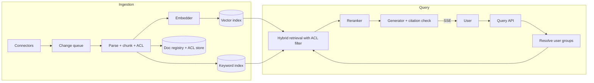

# Multi-Tenant Document RAG

> [!abstract] The prompt
> "Design a B2B 'chat with your company's documents' product. Each customer connects Google Drive, Confluence and uploaded PDFs; employees ask questions and get cited answers. 2,000 tenants, from 50 docs to 5M docs each." The hard parts: **permission-correct retrieval**, **freshness**, **tenant isolation at very different scales**, and **answer quality you can prove**.

---

## 1. Requirements

**Functional**
- Connectors: Drive, Confluence, SharePoint, file upload; incremental sync.
- Ask questions in natural language; answers with citations linking to the exact source location.
- Respect source permissions: a user only gets answers from documents they can open in the source system.
- Admin: connect sources, see sync status, delete data.

**Non-functional**
- **Zero cross-tenant or cross-permission leakage.**
- Freshness: edits and permission changes reflected within ~5–15 minutes; deletions within minutes.
- p95 answer start < 2 s, complete < 8 s.
- Scale: total ~500M chunks; largest tenants ~50M chunks; query load ~200 QPS peak.

---

## 2. Estimation

- 500M chunks × 1024-dim float32 ≈ **2 TB** of raw vectors; int8 ≈ 500 GB; binary + int8 rescoring ≈ 64 GB binary + int8 on disk/RAM tiers ([[08 - Vector DB Internals and Hybrid Search]]).
- Initial ingestion of a 5M-doc tenant: ~50M chunks → embedding cost and time dominate; batch embedding API / self-hosted embedder with a throughput budget; contextual headers via batch LLM API ([[12 - LLM Cost and Latency Economics]]).
- Query path: ~200 QPS × (rewrite + embed + hybrid search + rerank 50 + generate) → reranker GPU capacity and LLM tokens are the main runtime costs.

---

## 3. Architecture

---

## 4. Deep Dive: Permissions

- **Copy source ACLs onto every chunk** at ingestion: `tenant_id`, `allowed_users`, `allowed_groups`, `is_public_in_tenant` ([[06 - RAG Ingestion and Indexing Pipeline]]).
- At query time:
    1. Resolve the user's identity and **group memberships** from the tenant's identity provider (cached, short TTL).
    2. Apply the filter **inside the retrieval engine**: `tenant_id = T AND (allowed_users ∋ u OR allowed_groups ∩ G ≠ ∅)`, using filter-aware ANN (never post-filtering) ([[08 - Vector DB Internals and Hybrid Search]]).
    3. Re-check permissions for the final cited documents against the registry (defence in depth).
- **Permission changes are freshness events**: connectors watch sharing changes, update chunk ACL metadata without re-embedding.
- Why not "filter in the prompt": the model has already seen the content; leakage is then a matter of luck ([[10 - AI Gateway Security and Guardrails]]).

---

## 5. Deep Dive: Tenant Isolation at Mixed Scale

| Tenant size | Layout |
|---|---|
| Largest (millions of chunks) | **Dedicated collection / shard**; own HNSW or IVF-PQ index; can be on dedicated nodes |
| Mid and small | **Shared index** partitioned by `tenant_id` with filter-aware search and payload indexes |
| Enterprise "silo" contracts | Separate deployment / region for data residency ([[18 - Security]]) |

- Noisy-neighbour control: per-tenant query and ingestion rate limits; ingestion queue partitioned by tenant so one big backfill doesn't starve others ([[08 - Reliability]]).
- Deletion: tenant offboarding drops their collection or all rows by `tenant_id`, plus caches, keyword index and logs.

---

## 6. Deep Dive: Freshness

- Connectors use source change feeds/webhooks (Drive changes API, Confluence webhooks) into a per-tenant queue; periodic full reconciliation catches missed events.
- Per document: re-parse, re-chunk with deterministic ids, re-embed only changed chunks (content hash), delete vanished ids ([[06 - RAG Ingestion and Indexing Pipeline]]).
- Deletes and permission revocations are prioritised over edits.

---

## 7. Deep Dive: Query Quality

- Query condensation for follow-ups; extract filters ("in the 2025 sales deck") ([[07 - Agentic RAG and Grounding Loops]]).
- Hybrid BM25 + dense with RRF (exact product codes and acronyms matter in enterprises), rerank top 50 → top 6–8, parent-section expansion.
- Generation: cite chunk ids → map to source URL + heading/page; verify ids and quotes; abstain when unsupported.
- Agentic extras only where evals show need: decomposition for comparison questions; capped corrective retrieval (max 2 rewrites).

---

## 8. Evals

- Per-tenant golden sets are impractical for 2,000 tenants, so:
    + A **shared benchmark corpus** with labelled questions for retrieval (recall@k) and answer quality (faithfulness, citation accuracy, abstention).
    + **Synthetic questions** generated from sampled tenant chunks (question → expected source) for per-tenant retrieval health.
    + **Permission tests**: automated "user without access asks about restricted doc" cases must return no content and no citation.
    + Online: citation click-through, thumbs, "answer not found" rate per tenant ([[11 - Evals Observability and Silent Drift]]).

---

## 9. Failure Modes

| Failure | Mitigation |
|---|---|
| Restricted content in an answer | ACL filters inside retrieval; re-check cited docs; permission eval suite |
| Small tenants get empty results | Filter-aware ANN, not post-filtering |
| Stale or deleted docs cited | Change feeds + reconciliation; prioritised deletes |
| One tenant's backfill slows everyone | Per-tenant ingestion queues and rate limits |
| Exact codes not found | Hybrid search with BM25 |
| Embedding model upgrade | Dual-write new index, backfill, shadow compare, switch |
| Wrong answer confidently | Citation verification; abstention; reranker |

---

## Interview Lines

> [!tip] Say it like this
> - "Permissions are copied onto every chunk and enforced inside the retrieval query, then re-checked on cited documents."
> - "Big tenants get dedicated collections; small ones share an index with filter-aware ANN, never post-filtering."
> - "Freshness comes from source change feeds plus periodic reconciliation, and revocations are processed before edits."
> - "Hybrid search with RRF plus a cross-encoder reranker, then cited answers that abstain when unsupported."

## Related Notes

- [[Agentic/Problems/README]] · [[06 - RAG Ingestion and Indexing Pipeline]] · [[07 - Agentic RAG and Grounding Loops]] · [[08 - Vector DB Internals and Hybrid Search]]
