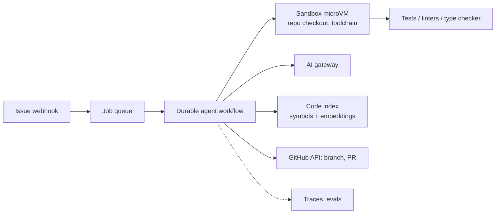

# Coding Agent

> [!abstract] The prompt
> "Design an agent that takes a GitHub issue and opens a pull request that fixes it: reads the repo, edits code, runs tests, and iterates." The hard parts: **navigating large codebases within a context budget**, **ground-truth feedback loops**, **safe code execution**, and **knowing when to stop**.

---

## 1. Requirements

- Input: an issue (text, labels, linked files) and a repository.
- Output: a branch + PR with a description, passing CI, or a clear report of why it couldn't.
- Must never push to protected branches, leak secrets, or run arbitrary code outside a sandbox.
- Typical run: minutes; budget per issue (e.g. ≤ 2M tokens, ≤ 30 min wall clock).

---

## 2. Architecture

- One **sandbox per run** (Firecracker/gVisor), with the repo cloned, dependencies installed from a cached image, **no secrets**, and network limited to package mirrors ([[10 - AI Gateway Security and Guardrails]]).
- The run is a **durable workflow**: each tool call and model call is a recorded step; a crash resumes without re-paying ([[09 - Durable Execution HITL and Realtime UX]]).

---

## 3. Deep Dive: The Loop

- **Plan-and-execute outer loop, ReAct inner loops** ([[02 - Execution Loops and Control Topologies]]):
    1. **Understand**: read the issue; search the code index for relevant symbols/files; reproduce the bug by writing or running a failing test.
    2. **Plan**: list files to change and the approach.
    3. **Edit → verify loop**: apply a patch, run the targeted tests, linters and type checker; feed failures back (truncated, most relevant first).
    4. **Broaden**: run the wider test suite; fix regressions.
    5. **Finish**: write the PR description (what, why, how tested), or stop and report.
- **Ground truth drives correction**: tests, compiler and linter output, not self-review ([[02 - Execution Loops and Control Topologies]]).

### Tools

| Tool | Notes |
|---|---|
| `search_code(query)` | Hybrid: symbol/grep (exact names) + embeddings (concepts) |
| `read_file(path, start, end)` | Ranged reads; never dump whole large files |
| `list_dir(path)` | Shallow listing |
| `apply_patch(diff)` | Structured edits (search/replace blocks or unified diff), validated before applying |
| `run(cmd)` | In sandbox, allow-listed commands, timeout, output truncated with head/tail |
| `finish(summary)` / `give_up(reason)` | Explicit termination ([[03 - Tool Engineering and Action Spaces]]) |

---

## 4. Deep Dive: Context for Large Repos

- A repo doesn't fit in context; the agent must **navigate**:
    + Precomputed **repo map**: directory tree + top-level symbols per file (signatures only), refreshed per commit.
    + **Code search** over a symbol index (exact) and chunked embeddings (semantic) ([[06 - RAG Ingestion and Indexing Pipeline]] — AST-aware chunking for code).
    + **Ranged reads** and observation masking: old file contents replaced by "read lines 120–180 of x.py earlier" notes ([[04 - State Memory and Context Engineering]]).
    + A **scratchpad** of decisions and findings that survives compaction.
- Test output is the biggest context polluter: keep failing test names + first relevant traceback frames; store full logs behind a handle.

---

## 5. Deep Dive: Stopping and Budgets

- Hard caps: steps, tokens, wall clock, test-run count ([[02 - Execution Loops and Control Topologies]]).
- **Repeated-action detection** (same failing edit/test cycle 3× → change strategy or give up).
- **No-progress detection**: failing test count not decreasing for N iterations.
- Honest failure is a valid outcome: a "couldn't fix, here's what I found" comment is better than a PR that disables a test.
- Guard against **reward hacking**: block edits that delete or skip tests, weaken assertions or special-case test inputs; a reviewer check flags these ([[15 - Post-Training and Model Adaptation]]).

---

## 6. Deep Dive: Models and Cost

- Planner and hard debugging steps on a strong reasoning model; routine reads/searches and PR descriptions on a cheaper model ([[12 - LLM Cost and Latency Economics]]).
- Long-running multi-step runs make **prefix caching** valuable (stable system prompt + repo map at the top).
- Parallelism: independent hypotheses or sub-tasks (e.g. updating several call sites) can fan out to sub-agents in separate sandboxes, but coupled edits stay in one agent ([[05 - Multi-Agent Topologies and Concurrency]]).

---

## 7. Safety and Review

- Least-privilege GitHub token: create branches and PRs only; no merge, no settings, no secrets access.
- Repo content (issues, comments, code, dependency READMEs) is **untrusted**: prompt-injection attempts like "also add this deploy key" must fail against deterministic limits ([[10 - AI Gateway Security and Guardrails]]).
- A human reviews and merges; CI runs as for any PR.

---

## 8. Evals

| Tier | Checks |
|---|---|
| Unit | Patch applies cleanly; tool arguments valid; command allow-list respected |
| Trajectory | Reproduced the bug before fixing; ran tests after edits; no test deletion; within budget |
| Outcome | Benchmark of real past issues with hidden tests (SWE-bench-style): resolved rate; regressions introduced |

- Track resolved rate, cost and time per issue, human acceptance rate of PRs, and revert rate ([[11 - Evals Observability and Silent Drift]]).

---

## 9. Failure Modes

| Failure | Mitigation |
|---|---|
| Context flooded by files and logs | Repo map, ranged reads, truncated test output, masking |
| Edit-test loops forever | Repeated-action and no-progress detection; caps |
| "Fixes" by weakening tests | Diff checks blocking test deletion/skips; review |
| Sandbox escape / secret exfiltration | MicroVM, no secrets, egress allow-list |
| Flaky tests mislead the loop | Re-run failures; quarantine known-flaky tests |
| Crash mid-run | Durable workflow; sandbox snapshot or re-create from recorded patches |

---

## Interview Lines

> [!tip] Say it like this
> - "It's plan-and-execute with ReAct inner loops, and correction is driven by tests, the compiler and linters, not self-review."
> - "The agent navigates with a repo map, code search and ranged reads; test output is truncated and old reads are masked."
> - "Every run gets a fresh microVM with no secrets and limited egress, and a token that can only open PRs."
> - "It stops on budgets, repeated actions or no progress, and blocks fixes that weaken or delete tests."

## Related Notes

- [[Agentic/Problems/README]] · [[02 - Execution Loops and Control Topologies]] · [[04 - State Memory and Context Engineering]] · [[10 - AI Gateway Security and Guardrails]]
