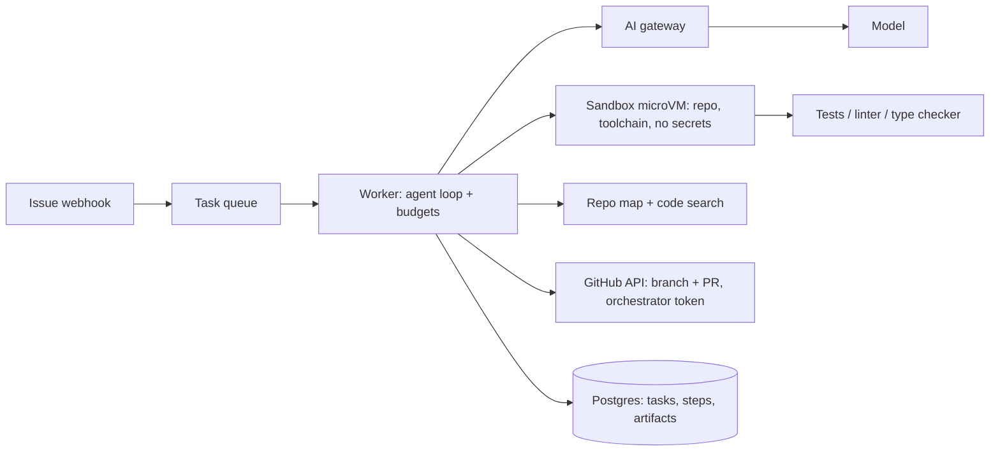
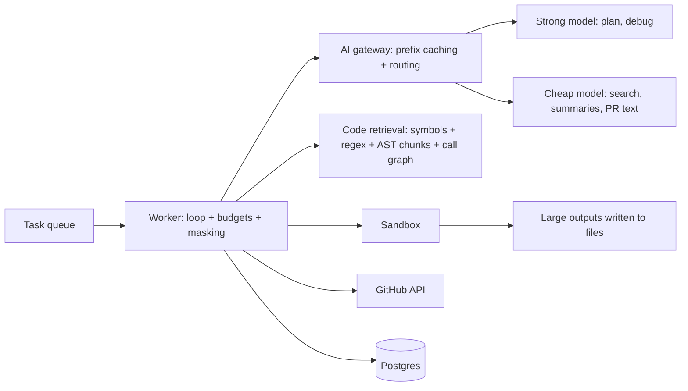
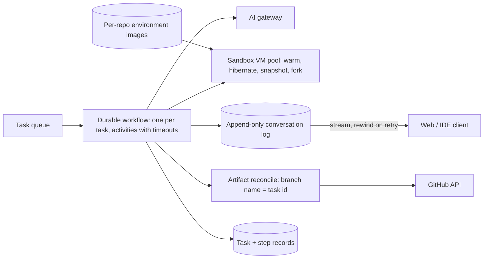
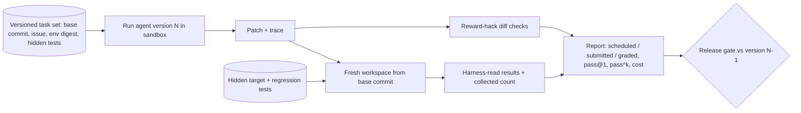
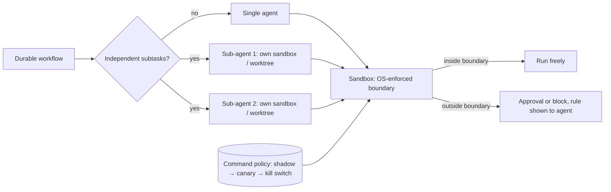

# Coding Agent

> [!abstract] Asked at OpenAI (agent harness and evaluation system, MLE onsite, April 2026), Databricks (retrieval for a coding agent: what to index, noise, metrics, onsite, September 2026), Meta (code review agent in the AI-enabled design round, onsite, March 2026), and as "Design Claude Code" or "Design a coding agent" in 2026 prep courses (Exponent, AlgoMaster, System Design School) and PracHub's coding-assistant, coding-agent-evaluation and Cursor guides (August–October 2026). Topics: [[02 - Execution Loops and Control Topologies|02]] (loop driven by tests) → [[03 - Tool Engineering and Action Spaces|03]] (tools, patch format, termination) → [[04 - State Memory and Context Engineering|04]] (repo context in a budget) → [[10 - AI Gateway Security and Guardrails|10]] (sandbox, secrets, injection) → [[09 - Durable Execution HITL and Realtime UX|09]] (long runs, crash recovery) → [[11 - Evals Observability and Silent Drift|11]] (independent tests, reward hacking).
>
> The hard part: the agent's claim "all tests pass" is an observation to verify, not the result. The design has to give it real feedback (tests, compiler, linters) inside a sandbox it can't escape, keep a large repo inside a context budget, and judge the patch with tests the agent couldn't touch.

---

## 1. Clarify Script

Defaults are assumptions unless a source is given.

| Question | Default | If different |
|---|---|---|
| Where does it run? | Cloud: takes a GitHub issue, opens a PR | Local CLI in the developer's terminal (Claude Code style) → the sandbox is the OS (T7); approvals are interactive |
| What may it do **alone**? | Read, edit, run allow-listed commands in its sandbox, push a branch, open a PR | Merge or deploy → out of scope; a human merges |
| Repo size and languages? | Up to ~1M lines, a few languages, has a test suite | No tests → the agent must write a reproducing test first, and confidence is lower |
| Network? | Package mirrors and GitHub only | Open internet for docs → egress proxy with an allow-list and logging |
| Secrets? | None in the sandbox | Integration tests need credentials → scoped short-lived test credentials via a broker, never in env files the model can print |
| Budget per task? | ≤ 2M tokens, ≤ 30 min wall clock (*assumed*) | Multi-hour tasks → V2 durability matters from day one |
| Scale? | *Assumed* 20k tasks a day across customers, ~10% concurrent at peak | One team → a single worker pool is fine |
| Success metric? | PRs merged without major rework; resolved rate on held-out tasks; cost per merged PR | "Lines generated" → push back (T6) |

---

## 2. Requirements

### Functional

- Input: an issue (text, labels, linked files) and a repository at a commit.
- Output: a branch and PR with a description (what, why, how tested) and passing CI, **or** a clear report of why it couldn't.
- Show progress while running; the user can cancel, comment, or take over.

### Non-functional

- Never push to protected branches, read secrets, or run code outside the sandbox.
- Every run reproducible from its record: base commit, environment digest, agent and model version, tool calls, patch.
- Survives worker and provider failures without redoing side effects (branch, PR, comments).
- Cost and time per task within budget; honest failure is an acceptable outcome.

### Out of scope

- Model training, CI infrastructure itself, code review by humans (consumed as a signal).

---

## 3. Estimates That Drive V0

```
Per task:    ~40 steps × (stable prefix ~8k + growing history ~20–60k) input, ~1k output
           → ~1.5M input tokens, ~40k output tokens (*assumed*, typical long-loop agent)
Prefix:      system prompt + tool schemas + repo map ≈ 8–15k tokens, same every step → cacheable
Load:        20k tasks/day ≈ 0.25 tasks/s, but each holds a sandbox for ~15–30 min
           → ~2,000 concurrent sandboxes at peak (*assumed* 10%)
Sandbox:     2 vCPU, 4–8 GB RAM each → the VM fleet, not the model API, is the capacity plan
```

- **Input tokens dominate cost**, and most of them are the same prefix re-sent every step. Prefix caching and old-observation masking are the first levers (V1).
- **Sandboxes are long-lived and stateful**, so capacity is "concurrent VMs", not requests per second. Start time matters: a warm pool with cached dependency images.
- **Risk driver is the sandbox and the token**, not load: one escaped command or leaked secret is the incident.

---

## 4. Entities, Tools and State

### Tools the model can call

| Tool | Kind | What code enforces (never the prompt) |
|---|---|---|
| `search_code(query)` | read | Hybrid: symbol and regex search for exact names, embeddings for concepts; scoped to this repo and revision |
| `read_file(path, start, end)` | read | Ranged reads; path must resolve inside the workspace (no symlink escape); ignored files (`.env`, secrets) unreadable |
| `list_dir(path)` | read | Shallow listing |
| `apply_patch(diff)` | write | Search/replace blocks or unified diff, validated before applying; edits to protected paths (CI config, `.git/hooks`, test-runner config) flagged |
| `run(cmd)` | exec | Inside the sandbox only; timeout, CPU and memory limits; output truncated head and tail, full log stored behind a handle |
| `open_pr(title, body)` | external | Branch name derived from the task id, so a retry finds the existing PR instead of opening a second one |
| `finish(summary)` / `give_up(reason)` | control | Explicit termination ([[03 - Tool Engineering and Action Spaces]]) |

- The GitHub token belongs to the **orchestrator**, not the sandbox. The model asks for `open_pr`; code with a least-privilege token (create branch and PR only, no merge, no settings) does it.

### State

```
tasks(id, repo, base_commit, issue_ref, status, budget_tokens, budget_seconds, agent_version, model_id)
steps(task_id, seq, kind {model|tool}, input_ref, output_ref, tokens, started_at, ended_at)   -- append-only
artifacts(task_id, kind {branch|pr|comment}, external_id, created_at)   -- for reconcile on retry
sandboxes(id, task_id, image_digest, snapshot_ref, status)
scratchpad(task_id, notes)   -- decisions and findings that survive compaction
```

---

## 5. V0 — Simplest Design That Works

- **Plan-and-execute outer loop, ReAct inner loops** ([[02 - Execution Loops and Control Topologies]]):
    1. **Understand**: read the issue, search the code, and **reproduce**: write or run a test that fails on the base commit for the reason the issue describes.
    2. **Plan**: files to change and the approach, written to the scratchpad.
    3. **Edit → verify**: apply a patch, run the targeted tests, linter and type checker; feed failures back (failing test names and the first relevant traceback frames, not the whole log).
    4. **Broaden**: run the wider suite; fix regressions.
    5. **Finish**: PR with what, why and how tested; or `give_up` with what was found.
- **Ground truth drives correction**: tests, compiler and linter output, not self-review.
- **One sandbox per task**: microVM (Firecracker or gVisor) with the repo at the base commit, dependencies from a cached image, **no secrets**, egress limited to package mirrors ([[10 - AI Gateway Security and Guardrails]]).
- **Context for a large repo**: a precomputed **repo map** (directory tree plus signatures per file, refreshed per commit), code search, ranged reads, and **masking** of old file contents and test logs once used ([[04 - State Memory and Context Engineering]]).
- **Stopping**: caps on steps, tokens, wall clock and test runs; repeated-action detection (same failing edit and test 3×); no-progress detection (failing count not dropping for N iterations).
- One worker runs the loop; Postgres holds task and step records.



> [!important] The most drilled component
> The verify loop and what counts as "done". Reports and guides keep returning to "how do you validate what the agent generates?" (Meta, Mar 2026) and "the agent says all tests pass; did it solve the task?" (PracHub coding-agent evaluation guide, Oct 2026). The answer: a **target test** that fails on the base commit and passes after the patch, **regression tests** that passed before and still pass, run by the harness (not by text the agent printed), plus diff checks that block deleted tests, skipped tests and weakened assertions.

### What V0 can't handle

- **Cost**: ~1.5M input tokens per task, mostly a repeated prefix and stale observations.
- **Crashes and long runs**: a worker dies mid-task; the loop state lives in its memory; retrying may open a second PR.
- **Environment gaps**: the sandbox lacks a service or tool the tests need, and quality drops quietly instead of failing loudly.
- **Proving it works**: no independent evaluation; can't tell a real fix from a test hack.
- **Approval fatigue** if every command needs a human click.

---

## 6. Scale Ladder

### V1 — Context and cost: caching, masking, model routing

- **Evidence:** Meta (Mar 2026) asked "how to calculate the cost of each LLM inference call" and "which parts need an LLM and which don't"; Databricks (Sep 2026) asked what to index for a coding agent and how to handle noise. Confidence **medium**.
- **Trigger:** cost per task in the dollars (§3) and context windows filling with file dumps and test logs by step 20.
- **What breaks:** cost; and quality, because the relevant lines are buried under old observations.
- **Change ([[12 - LLM Cost and Latency Economics]], [[04 - State Memory and Context Engineering]]):**
    + **Stable prefix first** (system prompt, tool schemas, repo map) so prompt caching hits on every step.
    + **Observation masking**: replace old file reads with "read lines 120–180 of x.py at step 7" and old test logs with the summary line; keep the scratchpad.
    + **Large outputs to files**: write long command output to a file the agent can search, instead of into context (Cursor's CI Autofix change, Jun 2026).
    + **Code retrieval tuned for code**: symbol index and regex for exact names, AST-aware chunks with embeddings for concepts, plus call sites, imports and the tests that cover a file; measure recall@k of "files the merged fix touched" on past tasks ([[06 - RAG Ingestion and Indexing Pipeline]]).
    + **Routing**: planning and hard debugging on a strong model; searches, summaries and PR text on a cheaper one. Deterministic steps (lint, format, apply patch, run tests) use no model at all.
- **Trade-off:** masking can hide something the agent needs again; it can re-read by range, which costs a step but not a context overflow.



### V2 — Long runs: durable workflow, decoupled state, warm environments

- **Evidence:** Cursor's cloud agents post (Jun 2026): an early work-stealing design ran at "one 9" of reliability; moving the loop to Temporal took it past two 9s, now >50M actions a day across >7M workflows; they decoupled the agent loop, the machine and the conversation state, and found the **development environment** was the biggest factor in output quality. PracHub's Cursor guide (Aug 2026) asks what happens when a tool call succeeds but the worker loses its checkpoint. Confidence **strong**.
- **Trigger:** tasks running hours, worker and node failures, provider outages mid-run, and sandbox start time dominating short tasks.
- **What breaks:** a crash loses the loop; a retry opens a second PR; a half-streamed step shows stale output; agents fail quietly because the sandbox is missing a database or toolchain.
- **Change ([[09 - Durable Execution HITL and Realtime UX]]):**
    + **The loop is a durable workflow**: each model call and tool call is a recorded activity with its own timeout and retry policy. Prefer short workflows per task over "eternal" ones, so version upgrades are easy (Cursor).
    + **Three decoupled pieces**: the loop (in the workflow engine), the machine (sandbox VM, which can hibernate, resume, snapshot and fork), and the conversation (an append-only log streamed to clients; on a retried step the client rewinds and replaces the partial output).
    + **Side effects reconciled, not repeated**: before `open_pr`, look up the task's deterministic branch name; if the PR exists, reuse it. Unknown outcome → read back first.
    + **Environment as a product**: per-repo environment definitions (services, toolchains, seed data) built into images; a warm pool of VMs; the agent can report "tests need Postgres and it's not running" instead of degrading silently.
- **Trade-off:** a workflow engine and VM snapshot pipeline to run; in return a node failure costs seconds, not the task.



### V3 — Prove it works: independent evaluation harness

- **Evidence:** OpenAI onsite (Apr 2026) asked for a harness and eval platform with isolated execution, versioned task sets, trajectory traces, deterministic and rubric graders, repeated trials, regression gates, and follow-ups on what to replay vs mock vs run live and how to detect reward hacking; PracHub's coding-agent evaluation guide (Oct 2026) covers target vs regression tests, evaluator independence, denominators and benchmark leakage. Confidence **strong**.
- **Trigger:** comparing two models or prompt versions; customers asking "how often does it actually work?"; a PR that passed by deleting an assertion.
- **What breaks:** the agent grades itself; a reported "80% resolved" hides tasks that never produced a patch.
- **Change ([[11 - Evals Observability and Silent Drift]]):**
    + **Task = repo at a base commit + issue + environment digest + hidden tests.** Built from real past issues with their merged fixes (SWE-bench style), plus fresh tasks after the model's training cutoff to limit leakage.
    + **Independent scoring**: rebuild a fresh workspace from the base commit, apply only the patch, inject the hidden target and regression tests, and read results through the harness, not the agent's output. Check that tests were actually collected (zero collected ≠ pass).
    + **Reward-hacking checks**: diffs that delete or skip tests, weaken assertions, special-case test inputs, catch-all exceptions, or edit test-runner config are flagged and graded as failures unless the task allows them.
    + **Honest denominators**: report resolved over **scheduled** tasks, over submitted patches and over graded patches, separately; infrastructure failures re-run under a fixed rule for every system.
    + **Repeated trials**: pass@1 and pass^k beside pass@k, with cost and time per task; paired comparisons on the same tasks.
    + **Leakage control**: the sandbox can't reach the future merged fix (no open internet, repo history cut at the base commit).
- **Trade-off:** building and maintaining task environments is real work; without it every change is a guess.



### V4 — Autonomy without approval fatigue, and parallel agents

- **Evidence:** Cursor's sandboxing post (Feb 2026): per-command approval leads to approval fatigue; sandboxed agents run freely inside the boundary and ask only to step outside it (mostly network), and **stop 40% less often**; a common failure was the agent retrying the same blocked command, fixed by showing which sandbox rule caused the failure. PracHub's Cursor guide (Aug 2026) works through a command-risk policy with shadow evaluation and a kill switch. Confidence **strong**.
- **Trigger:** users run several agents at once and stop reading approval prompts; enterprises want unattended runs.
- **Change:**
    + **Boundary, not per-command approval**: inside the sandbox (workspace files, local tests, package mirrors) commands run freely; leaving it (other network hosts, writes outside the workspace, credentials) needs approval or is blocked. Enforce at the OS (Landlock and seccomp on Linux, Seatbelt on macOS, a microVM in the cloud), never by classifying command text.
    + **Sandbox-aware tool results**: when a command fails because of a rule, the tool result says which rule and how to request escalation, so the agent doesn't loop.
    + **Roll out policy changes in shadow** (record what a new policy would have allowed without granting it), then canary with a kill switch per command class.
    + **Parallel sub-agents** for independent work (separate call-site updates, competing hypotheses) in separate sandboxes or worktrees; coupled edits stay in one agent ([[05 - Multi-Agent Topologies and Concurrency]]).
- **Trade-off:** a sandbox that is too strict breaks normal builds; one that is too loose is a breach. Measure both: dangerous actions allowed (target zero) and unnecessary stops.



---

## 7. Twist Cards

### Most asked

**T1 — "The agent says all tests pass. Did it solve the issue?"**
- **Evidence:** PracHub coding-agent evaluation guide (Oct 2026); Meta "how to validate what the agent generates" (Mar 2026); OpenAI reward-hacking follow-up (Apr 2026). Confidence **strong**.
- **Hits:** verify loop, evaluation.
- **Answer:** not by its word. The target test must fail on the base commit and pass after the patch; regression tests must still pass; the harness runs them in a fresh workspace and reads results itself, checking how many tests were collected. Then diff checks: no deleted or skipped tests, no weakened assertions, no special-casing of test inputs. A patch that returns a constant to satisfy the visible example passes the target test and fails the regressions.
- **Attaches to:** V0, V3.

**T2 — "How do you stop it running something dangerous, or leaking secrets?"**
- **Evidence:** PracHub coding-assistant guide (Aug 2026); Cursor guide and sandboxing post (Feb and Aug 2026). Confidence **strong**.
- **Hits:** sandbox, tokens, injection.
- **Answer:** the boundary is enforced by the OS or VM, not by a model or a string allow-list (shell substitution, symlinks and install hooks defeat string checks). No secrets in the sandbox; ignored files unreadable; egress only to mirrors through a proxy; the GitHub token lives with the orchestrator and can only open PRs. Repo text, issues and dependency READMEs are untrusted: "also add this deploy key" fails because the agent has no way to do it ([[10 - AI Gateway Security and Guardrails]]).
- **Attaches to:** V0, V4.

**T3 — "What do you index so the agent finds the right code, and how do you know retrieval works?"**
- **Evidence:** Databricks onsite (Sep 2026); PracHub coding-assistant guide (Aug 2026). Confidence **medium**.
- **Hits:** context.
- **Answer:** symbols and regex for exact names, AST-aware chunks with embeddings for concepts, plus the structure the agent navigates by: imports, call sites, tests per file, recent changes and owners. Noise: exclude generated, vendored and lock files; dedupe. Keep the index current with incremental updates per commit (Merkle-tree diff of file hashes, a common Cursor screen question). Metric: recall@k of files the merged fix touched on past tasks, and end-to-end resolved rate with and without retrieval changes.
- **Attaches to:** V1.

**T4 — "The worker crashes right after creating the branch. What happens on restart?"**
- **Evidence:** PracHub Cursor guide (Aug 2026); Cursor cloud agents post (Jun 2026). Confidence **strong**.
- **Hits:** durability, idempotency.
- **Answer:** the step was recorded as intended but not confirmed, so the outcome is unknown. Branch names derive from the task id; on resume, look it up and reuse it, never create "fix-2". Same for the PR and comments. Commands whose effect can't be checked after a crash (writes outside the workspace) are exactly the ones the sandbox forbids.
- **Attaches to:** V2.

**T5 — "Which parts need an LLM, and what does each call cost?"**
- **Evidence:** Meta AI-enabled design round (Mar 2026). Confidence **medium**.
- **Hits:** cost.
- **Answer:** LLM: understanding the issue, planning, writing the patch, reading failures, PR text. No LLM: applying patches, running tests and linters, collecting results, diff checks, branch and PR creation. Cost per call = (cached prefix × cached rate) + (uncached input × input rate) + output × output rate; per task, multiply by steps and add retries. Say the number for §3: ~1.5M input, most of it cacheable.
- **Attaches to:** V1.

**T6 — "What's your success metric?"**
- **Evidence:** PracHub coding-assistant guide (Aug 2026). Confidence **medium**.
- **Hits:** metrics.
- **Answer:** PRs merged without major rework, revert rate within 30 days, reviewer time per PR, resolved rate on the held-out task set, cost and time per merged PR, security findings. Not lines generated or tokens.
- **Attaches to:** §9.

### Lower priority (recall / judgement)

**T7 — "Make it a local CLI like Claude Code instead."**
- **Evidence:** "Design Claude Code" in Exponent and System Design School courses (2026). Confidence **medium**.
- The loop runs on the developer's machine and inherits their environment; the sandbox is OS-level (Seatbelt, Landlock and seccomp), approvals are interactive, and context comes from the open workspace. Durability matters less; permissions and approval UX matter more.

**T8 — "Make it a code review agent."**
- **Evidence:** Meta (Mar 2026). Confidence **medium**.
- Read-only: diff plus surrounding context, static analysis and tests as tools, comments as output. Validate each comment against evidence (a line, a failing check) and rank by severity to keep noise down; measure accepted vs dismissed comments.

**T9 — "Flaky tests mislead the loop."**
- **Evidence:** none specific. Confidence **judgement**.
- Re-run failures once; quarantine known-flaky tests from the target set; record flakiness per test and exclude it from grading equally for every system.

**T10 — "How do you evaluate long tasks whose environment changes over time?"**
- **Evidence:** OpenAI (Apr 2026). Confidence **medium**.
- Snapshot the environment (image digest, seeded services, frozen package mirror); replay recorded external responses where live calls are non-deterministic; mock only what you can't freeze; re-validate the snapshot set periodically.

**T11 — "The editor sends a stream of file events. How do you keep the index current without re-indexing on every keystroke?"**
- **Evidence:** PracHub Cursor guide (Nov 2026), worked example; Cursor's Merkle screen. Confidence **medium**.
- **Coalesce events per path** between flushes: track whether the file existed at the last flush, whether it exists now, and whether its content was touched; created-then-deleted is nothing, deleted-then-created is modified, a rename is delete plus create. Flush after a short quiet period with a maximum wait. If the watcher overflows or a branch checkout touches thousands of files, drop the batch and rescan by comparing Merkle hashes ([[AI Engineer Round Drills#Drill 10: Merkle tree over a repository, and a diff]]); re-embed only chunks whose content hash changed.

---

## 8. Break It

| Failure | What the user sees | What you say |
|---|---|---|
| Patch passes by deleting a test | PR flagged or not opened | Hidden tests in a fresh workspace; diff checks |
| Edit-test loop never converges | "Couldn't fix; here's what I found" | Repeated-action and no-progress detection, caps |
| Context flooded by logs and files | Agent stays on track | Masking, large outputs to files, ranged reads |
| Malicious instruction in an issue | Nothing happens | No secrets, OS-enforced boundary, orchestrator token |
| Worker crash mid-task | Run resumes | Durable workflow; reconcile branch and PR by task id |
| Sandbox missing a service | "Tests need Postgres; environment lacks it" | Per-repo environment images; agent reports gaps |
| Blocked command retried forever | Agent asks for escalation | Tool result names the rule |
| Provider outage | Task pauses, then continues | Activity retries with backoff; fallback model that passed the same evals |
| Two PRs for one task | One PR | Deterministic branch name, look up before create |

---

## 9. Evals, Operations and Cost

| Tier | Checks |
|---|---|
| **Unit** | Patch applies; tool arguments valid; paths stay inside the workspace; command policy decisions on a fixed fixture of allowed and dangerous commands |
| **Trajectory** | Reproduced the bug before fixing; ran tests after each edit; no test deletion or skip; no repeated blocked command; within budget |
| **Outcome** | Hidden target and regression tests in a fresh workspace; resolved over scheduled tasks; pass@1 and pass^k; regressions introduced |

- **Suites:** a regression set of past tasks gating every model, prompt, tool or environment change; a fresh-task set refreshed monthly against leakage.
- **Production metrics:** merge rate, rework and revert rate, reviewer time, cost and wall clock per task, stops per task (approval prompts), sandbox start time, workflow failure rate.
- **Alerts:** dangerous command allowed by policy (any); merge rate drop for one repo (usually an environment break); cost per task above budget; cache hit rate drop.
- **Cost drivers:** input tokens across steps, sandbox VM minutes, and retries during provider incidents.

---

## 10. One-Minute Close

> "A durable workflow per task runs a plan-and-execute loop whose feedback is tests, the compiler and linters in a microVM with no secrets and egress only to mirrors. The agent first reproduces the bug with a failing test, then edits and verifies, then runs the broader suite, and finishes with a PR or an honest report. Context stays in budget with a repo map, symbol and semantic search, ranged reads and masking, and a stable prefix for caching. The GitHub token lives with the orchestrator and can only open PRs; branch names derive from the task id so a crash never opens a second PR. Quality is judged by a separate harness: hidden target and regression tests in a fresh workspace, diff checks against test hacking, honest denominators and pass^k. Autonomy grows by widening an OS-enforced sandbox boundary, not by clicking approvals."

---

## Evidence

Reports and guides tallied in November 2026.

| Follow-up | Reports | Count | Placed as | Deep dive? |
|---|---|---|---|---|
| Validate generated code; "tests pass" isn't proof; reward hacking | Meta (Mar 2026); OpenAI harness (Apr 2026); PracHub eval guide (Oct 2026) | 3 | V0 + V3 + T1, **strong** | Yes |
| Sandbox, secrets, dangerous commands | PracHub coding-assistant guide (Aug 2026); Cursor guide (Aug 2026); Cursor sandboxing (Feb 2026) | 3 | V0 + V4 + T2, **strong** | Yes |
| Harness, traces, replay vs mock, repeated trials | OpenAI (Apr 2026); PracHub eval guide | 2 | V3 + T10, **strong** | Yes |
| Durable execution, crash after side effect | Cursor cloud agents (Jun 2026); PracHub Cursor guide | 2 | V2 + T4, **strong** | Sometimes |
| What to index, retrieval noise and metrics | Databricks (Sep 2026); PracHub coding-assistant guide | 2 | V1 + T3, **medium** | Sometimes |
| Which parts need an LLM, cost per call | Meta (Mar 2026) | 1 | V1 + T5, **medium** | No |
| Approval fatigue, sandbox-aware agents | Cursor sandboxing (Feb 2026) | 1 (vendor) | V4, **strong** (measured) | No |
| Local CLI variant, code review variant | Exponent / System Design School courses; Meta | 2 | T7, T8, **medium** | No |
| Flaky tests | none | 0 | T9, **judgement** | No |

- **What the tally changed:** the old note's loop, tools, context, stopping and safety content stays, regrouped. Added: target vs regression tests and evaluator independence (V3, T1), durable workflow with decoupled loop, machine and conversation state and artifact reconcile (V2, T4), the environment as the main quality factor, the boundary-based sandbox instead of per-command approval (V4), and the code retrieval metric (T3).

## Sources

- PracHub, *Design an Agent Harness and Evaluation System* (OpenAI, MLE onsite, April 2026). https://prachub.com/interview-questions/design-an-agent-harness-and-evaluation-system
- PracHub, *Design Retrieval for a Coding Agent: What to Index, Handling Noise, and Metrics* (Databricks, onsite, September 2026). https://prachub.com/interview-questions/design-retrieval-for-a-coding-agent-what-to-index-handling-noise-and-metrics
- PracHub, *Meta Software Engineer Interview Experience: Two AI Coding Rounds… and an AI-Enabled Design Round* (onsite, March 2026; published August 2026). https://prachub.com/interview-experiences/meta-software-engineer-interview-experience-two-ai-coding-rounds-a-leetcode-system-design-and-an-ai-enabled-design-round-with-no-ai
- PracHub, *AI Coding Assistant System Design Interview* (August 2026). https://prachub.com/resources/ai-coding-assistant-system-design-interview-repository-context-tool-calls-sandboxing-and-diff-review
- PracHub, *Coding Agent Evaluation Interview Questions: Tests, Sandboxes, and Benchmark Leakage* (October 2026). https://prachub.com/resources/coding-agent-evaluation-interview-questions-tests-sandboxes-and-benchmark-leakage
- PracHub, *Cursor (Anysphere) Software Engineer Interview Guide 2026* (August 2026). https://prachub.com/resources/cursor-anysphere-software-engineer-interview-guide-2026-coding-systems-and-ai-product-sense
- Cursor, *Implementing a secure sandbox for local agents* (February 2026). https://cursor.com/blog/agent-sandboxing
- Cursor, *What we've learned building cloud agents* (June 2026). https://cursor.com/blog/cloud-agent-lessons
- Exponent, *Design Claude Code* (course). https://www.tryexponent.com/courses/system-design-interviews-v2/design-claude-code
- AlgoMaster, *Design a Coding Agent* (2026). https://algomaster.io/learn/genai-system-design-interviews/design-coding-agent
- SWE-bench evaluation guide. https://www.swebench.com/SWE-bench/guides/evaluation/

## Related Notes

- [[Agentic/Problems/README]] · [[02 - Execution Loops and Control Topologies]] · [[03 - Tool Engineering and Action Spaces]] · [[04 - State Memory and Context Engineering]] · [[09 - Durable Execution HITL and Realtime UX]] · [[10 - AI Gateway Security and Guardrails]] · [[11 - Evals Observability and Silent Drift]] · [[AI Assisted Coding Rounds/README|AI Assisted Coding Rounds]] · [[Agentic Problem to Solution Map]]
