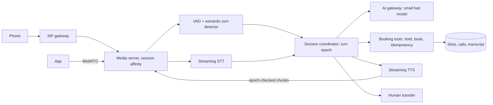
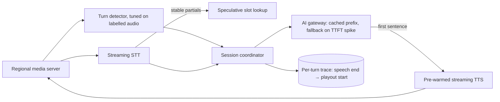
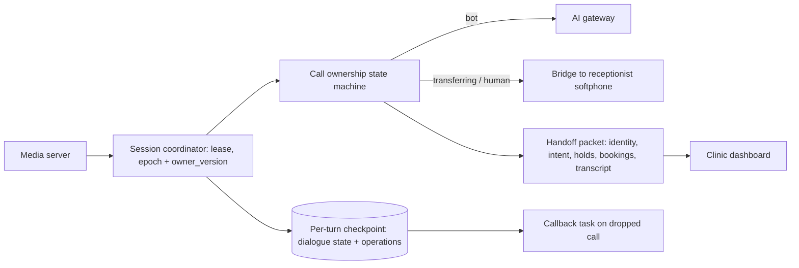
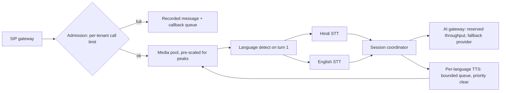
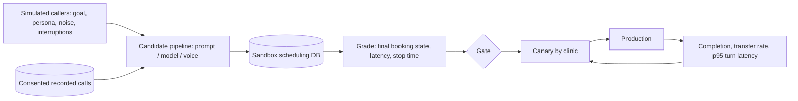

# Voice Booking Agent

> [!abstract] Asked at ElevenLabs (voice assistant for a sneaker retailer's website, product-decomposition onsite, November 2026), Microsoft (multi-tenant voice and chat AI receptionist with real human takeover, onsite, September 2026), voice-agent companies such as Superdial (real-time phone agents, 2026 guide), and in PracHub's voice AI design guide (September 2026). Topics: [[09 - Durable Execution HITL and Realtime UX|09]] (streaming, barge-in, handoff) → [[00 - LLM Fundamentals for Engineers|00]] (TTFT, small models) → [[03 - Tool Engineering and Action Spaces|03]] (booking tool, idempotency) → [[04 - State Memory and Context Engineering|04]] (dialogue state, honest history) → [[12 - LLM Cost and Latency Economics|12]] (per-minute cost) → [[11 - Evals Observability and Silent Drift|11]] (simulated callers).
>
> The hard part: **who owns the right to speak**, and how every component learns when that changes. A fast model doesn't help if seconds of queued audio keep playing after the caller says "actually, Tuesday", or if the history claims the caller heard a sentence that was cut off. And a booking made before the interruption still happened.

---

## 1. Clarify Script

Defaults are assumptions unless a source is given.

| Question | Default | If different |
|---|---|---|
| Channel? | Phone (PSTN via SIP) and in-app voice (WebRTC) | Website widget only (ElevenLabs, Nov 2026) → WebRTC only, sign-in already known |
| Who and what? | Patients of a 300-clinic chain: book, reschedule, cancel; answer timings, location, doctor availability | Retail (stock, sizes, orders) → same loop, different tools |
| Languages? | English, Hindi, Hinglish | More Indian languages → per-language STT/TTS choice (V3) |
| Identity? | Caller ID plus date of birth, or an OTP, before any change | Signed-in app user → skip |
| Actions alone? | Book, reschedule, cancel after a spoken read-back and "yes" | Payments by voice → out of scope (PCI), hand to a secure flow |
| Concurrency? | 2,000 concurrent calls at peak | A launch or campaign surge (ElevenLabs "limited sneaker release") → T5 |
| Latency target? | Median under ~900 ms from end of caller speech to first agent audio; p95 alert at 1.5 s (Fora Soft guidance, 2026) | — |
| Humans? | Receptionists per clinic during opening hours | No staff after hours → take a message and call back |
| Recording? | Consent prompt; transcripts kept 30 days; audio not kept by default | Regulated health data → stricter retention, regional processing |

---

## 2. Requirements

### Functional

- Answer basic questions from approved clinic data (hours, location, doctors).
- Book, reschedule, cancel; SMS confirmation.
- Identify the patient before changes.
- Transfer to a human on request or failure, **taking over the live call**, not "please call this number" (Microsoft, Sep 2026).

### Non-functional

- Turn latency as in §1; barge-in stops agent audio within ~200 ms of real caller speech.
- **No double-booked slots, no booking the caller didn't confirm.**
- Facts about slots and clinics come only from tools, never from the model.
- 99.9% call handling; if the AI path fails, route to a human or voicemail.

### Out of scope

- Telephony carrier contracts, EHR internals, payments.

---

## 3. Estimates That Drive V0

```
Turn budget (serial path, illustrative):
  end-of-turn decision   200–350 ms   (VAD + semantic turn detector)
  final STT              ~50–150 ms
  LLM to first sentence  ~200–400 ms  (small model, cached prefix)
  TTS first audio        ~100–200 ms
  transport + playout    ~50–100 ms
  ------------------------------------------------
  ≈ 650–1,200 ms        → target median < 900 ms
Load:   2,000 concurrent calls × ~1 LLM call per turn every ~8 s ≈ 250 LLM calls/s at peak
Cost:   per minute = STT + LLM + TTS + telephony; TTS and telephony usually dominate (*assumed*)
```

- **Turn detection is the biggest single slice**, not the model. Halving LLM time saves ~100–200 ms; a silence timer set to 700 ms costs more than that on every turn (PracHub voice guide makes the same point with a 750 ms worked budget).
- **Concurrency, not QPS**: media sessions are stateful and long; capacity is "concurrent calls per media node", and calls need session affinity.
- **The model must be small and fast in the turn loop.** A reasoning model's first token alone can exceed the whole budget.

---

## 4. Entities, Tools and State

### Tools the model can call

| Tool | Kind | What code enforces (never the prompt) |
|---|---|---|
| `find_slots(clinic, doctor?, date_range)` | read | Returns ≤ 3 options, already filtered by clinic hours and doctor schedule |
| `hold_slot(slot_id)` | write | Conditional update `status = free → held, hold_until = now + 2 min, held_by = call_id`; fails if taken |
| `book(slot_id)` | write | Patient verified; hold belongs to this call; idempotency key `call_id:slot_id`; only after the confirmed flag is set by the dialogue code |
| `cancel(appointment_id)` / `reschedule(...)` | write | Appointment belongs to the verified patient; idempotency key |
| `verify_patient(phone, dob or otp)` | auth | Sets `patient_id` on the session; the model never supplies it |
| `transfer(reason)` | control | Moves call ownership to the human queue (V2) |

### State

```
calls(call_id, tenant/clinic, caller_number, patient_id?, owner {bot|human:<id>}, owner_version,
      turn_epoch, language, status)
dialogue_state(call_id, intent, clinic, doctor, date, slot_id, confirmed, last_readback)
transcript(call_id, seq, role, text, stt_confidence, epoch,
           played {full|partial|cleared}, played_until_ms)       -- what the caller actually heard
slots(slot_id, clinic, doctor, start_at, status {free|held|booked}, hold_until, held_by, version)
operations(idempotency_key PK, call_id, kind, result, created_at)
```

---

## 5. V0 — Simplest Design That Works

- **Cascaded pipeline** STT → LLM → TTS, every stage streaming. Chosen over speech-to-speech models for tool reliability, logging, guardrails and Hindi support; revisit as native audio models mature ([[09 - Durable Execution HITL and Realtime UX]]).
- **Session coordinator per call** owns a monotonic **turn epoch**. STT events carry an input revision; LLM text and TTS audio carry the epoch that authorized them; the output stage **rejects chunks from an old epoch** (PracHub voice guide). Cancelling a request is not enough, because a cancelled call can still finish and deliver.
- **Turn detection**: VAD plus a semantic end-of-turn model ("for… next Tuesday" is not done; "No." is). Interim transcripts may start a slot lookup speculatively, discarded if the caller keeps talking.
- **Barge-in**: on real caller speech during agent audio → bump the epoch, **clear the transport's playback buffer** (e.g. Twilio Media Streams `clear`), cancel LLM and TTS in parallel, keep listening. Backchannels ("hmm", "okay") don't interrupt.
- **Honest history**: the transcript stores only what was played (from transport playback marks), not everything generated. If the caller cut in after "Your appointment is Monday", the history doesn't claim they heard the rest.
- **Booking**: the LLM fills slots in `dialogue_state`; code validates; `find_slots` → `hold_slot` on the offered slot → spoken read-back ("Tuesday the 14th at 4:30 with Dr. Mehta, correct?") → explicit yes sets `confirmed` → `book` with an idempotency key → SMS.
- **Fillers** for slow tools ("Let me check Dr. Mehta's schedule…") start immediately while the lookup runs.
- Regional media servers with session affinity; Postgres for slots and calls.



> [!important] The most drilled component
> Interruption. "The shopper interrupts mid-sentence to change the size. What happens in each component, and what goes into the history?" (ElevenLabs, Nov 2026); interruption handling is in the Microsoft receptionist prompt (Sep 2026). The answer, in order: VAD fires → coordinator bumps the epoch → transport buffer cleared → LLM and TTS cancelled in parallel, late chunks rejected by epoch → history keeps only what was played → any tool call already completed (a hold, a booking) stays in the operations ledger and is reconciled, not silently redone.

### What V0 can't handle

- **Human takeover** of a live call without a race between the bot's last reply and the receptionist.
- **Crashes**: a media node or coordinator dies mid-call.
- **Peaks**: a campaign or outage at one clinic floods calls; providers rate-limit.
- **Language and noise** at scale: Hindi STT accuracy, noisy lines, names.
- **Testing** new prompts or voices before they talk to patients.

---

## 6. Scale Ladder

### V1 — Make the latency real: measure at the ear, overlap stages

- **Evidence:** ElevenLabs (Nov 2026) asks for every step between the shopper finishing and hearing the first word, and which can run at the same time; the PracHub voice guide (Sep 2026) insists on measuring from playback, not server logs; vendors publish p50 targets around 400–600 ms (Vapi, Retell, Bland; Twilio reports 491 ms median for ConversationRelay, per a 2026 comparison). Confidence **strong**.
- **Trigger:** p95 turn latency above 1.5 s in production; callers talking over the agent or hanging up.
- **What breaks:** the conversation feels robotic; premature turn ends cut callers off.
- **Change ([[12 - LLM Cost and Latency Economics]]):**
    + **Trace per turn** with named events: speech end, turn commit, final transcript, LLM request, first usable sentence, first audio, playout start. Stages overlap, so don't sum standalone durations.
    + **Overlap**: start retrieval and slot lookup on stable interim transcripts; send the LLM's first sentence to TTS while the rest generates; pre-warm TTS voices.
    + **Prompt discipline**: stable system prompt and tool schemas first for prompt caching; short outputs (one or two sentences per turn).
    + **Tune turn detection on labelled audio**, separately counting premature and late endpoints, sliced by language, accent and line noise; never optimise delay alone, because that rewards cutting people off.
    + **Co-locate**: media, STT, LLM and TTS in the same region as the caller; a faster fallback model when the primary's TTFT spikes.
- **Trade-off:** speculative work wastes compute when the caller keeps talking; cap it per turn.



### V2 — Real human takeover and crash recovery

- **Evidence:** Microsoft (Sep 2026): "a human handoff must transfer control of the live conversation, not merely suggest that the customer contact someone else"; ElevenLabs (Nov 2026): when to hand off and what the agent receives; PracHub voice guide: keep the session owner explicit during reconnects so two workers can't both speak. Confidence **strong**.
- **Trigger:** "talk to a person", repeated recognition failures, or an angry caller; and media or coordinator node failures during calls.
- **What breaks:** the bot speaks after the receptionist joins; the receptionist re-asks everything; a node crash drops the call and the half-made booking.
- **Change ([[09 - Durable Execution HITL and Realtime UX]]):**
    + **Call ownership with a version**: `bot → transferring → human:<id>`. The coordinator fences outputs by `owner_version` as well as epoch; the bot's audio path is closed the moment ownership moves.
    + **Warm transfer**: the call is bridged to the receptionist's softphone in the clinic dashboard; they see a **handoff packet** (identity status, intent, slots discussed, holds and bookings already made with ids, transcript) before saying hello. A hold already placed is extended, not lost.
    + **Checkpoint per turn**: dialogue state and operations are in Postgres; a new coordinator can take over a live media session (single owner via a lease), or on a dropped call the system calls back: "Sorry, we got disconnected; you were booking Tuesday 4:30."
    + **After hours**: take a structured message and schedule a callback task instead of transferring to nobody.
- **Trade-off:** a dashboard and softphone integration for every clinic; worth it because "transfer" that loses context is the most common complaint about phone bots.



### V3 — Peaks, languages and noisy lines

- **Evidence:** ElevenLabs (Nov 2026): a surge of shoppers after a limited release; what to scale ahead and what to degrade; the PracHub voice guide covers bounded audio queues and admission control under load; Superdial's guide (2026) describes managing real-time state machines over phone calls. Confidence **medium**.
- **Trigger:** Monday-morning peaks, a clinic's phone campaign, or a provider throttling; a large share of Hindi and Hinglish callers with lower STT accuracy.
- **What breaks:** queues of stale audio grow; new calls wait in silence; Hindi names and dates misheard.
- **Change:**
    + **Admission control per tenant**: concurrent-call limits per clinic chain; when full, a short recorded message and callback queue rather than everyone getting laggy turns. Audio queues bounded by **duration**, and control signals (clear, cancel) on a priority path.
    + **Pre-scale** media and STT/TTS capacity for known peaks; reserve provider throughput; a second STT/TTS provider behind the gateway.
    + **Per-language models**: detect language on the first turn, choose STT and TTS per language, keep the prompt and tools the same; read back names and numbers digit by digit, spell-out flows for names, SMS a link for anything long (addresses).
    + **Low confidence**: ask once to repeat, then offer transfer after two failures.
- **Trade-off:** refusing calls at the edge feels harsh, but a clear callback beats 2 s of silence on every turn for everyone.



### V4 — Change prompts, voices and models safely

- **Evidence:** ElevenLabs (Nov 2026): "How would you test a new prompt or model version before it talks to real shoppers?"; Retell and similar platforms ship simulated-call testing and live-call scoring (2026 comparisons). Confidence **medium**.
- **Trigger:** every prompt, model, STT, TTS or turn-detector change can break bookings or latency.
- **Change ([[11 - Evals Observability and Silent Drift]]):**
    + **Simulated callers**: an LLM-driven caller with a goal and persona, speaking through TTS with injected noise, accents, pauses and interruptions, against a sandbox scheduling DB; grade on **final state** (exactly one booking for the confirmed slot) plus per-turn latency and interruption stop time.
    + **Replay** of recorded, consented real calls through the new pipeline to compare transcripts and decisions.
    + **Canary** by clinic and traffic share, watching task completion, transfer rate and p95 turn latency; rollback is a config flip.
- **Trade-off:** simulated audio isn't real phone audio; calibrate the simulator against a sample of real calls.



---

## 7. Twist Cards

### Most asked

**T1 — "The caller interrupts mid-sentence to change the date. Walk through every component."**
- **Evidence:** ElevenLabs (Nov 2026), verbatim with size instead of date; Microsoft (Sep 2026); PracHub voice guide (Sep 2026). Confidence **strong**.
- **Hits:** epoch, transport, history.
- **Answer:** VAD detects speech while agent audio plays (echo cancellation so it doesn't hear itself) → the coordinator bumps the epoch → the transport buffer is cleared → LLM and TTS are cancelled in parallel, without waiting for their acknowledgements → any late chunk from the old epoch is rejected at the output → the transcript marks the agent turn as played up to the last playback mark → the new utterance is processed with the corrected date. If `hold_slot` already ran for Monday, the hold is released or left to expire; if a booking had completed, it's in the operations ledger and gets rescheduled, not duplicated. Measure the stop time at playout: detection plus coordination plus transport (the guide's worked trace: 160 ms, not the 100 ms when "clear" was sent).
- **Attaches to:** V0.

**T2 — "Two callers want the same 4:30 slot."**
- **Evidence:** "Design a Real-Time AI Voice System" style prompts with appointment booking (PracHub guide, Sep 2026). Confidence **medium**.
- **Hits:** concurrency.
- **Answer:** offering a slot places a short hold with a conditional update (`WHERE status = 'free'`); the second caller gets "that one was just taken; 4:45 or 5:00?". Booking converts only a hold owned by this call; holds expire after ~2 minutes; idempotency key `call_id:slot_id` so a retried `book` returns the first result (the same hold-then-confirm pattern as [[06 - Seat Booking]]).
- **Attaches to:** V0.

**T3 — "When do you hand off, and what does the human get?"**
- **Evidence:** ElevenLabs (Nov 2026); Microsoft (Sep 2026). Confidence **strong**.
- **Hits:** ownership.
- **Answer:** on request, after two recognition failures, on frustration signals, on anything outside the allowed actions, or when the model is unavailable. The human gets the live call bridged in, plus identity status, intent, slots discussed, holds and bookings with ids, and the transcript; the bot's audio path is closed by the ownership version.
- **Attaches to:** V2.

**T4 — "Where do prices, slots and clinic hours come from? How do you stop it making things up?"**
- **Evidence:** ElevenLabs (Nov 2026): "which system must be the source of each statement"; Microsoft (Sep 2026): approved knowledge. Confidence **strong**.
- **Hits:** grounding.
- **Answer:** facts only from tools (`find_slots`, clinic data); the prompt tells the model to say "let me check" rather than guess, and output checks catch times or dates not present in the last tool result. Approved FAQ text is versioned per tenant. Off-topic or injected requests ("ignore your rules") get a short refusal; actions still go through code checks.
- **Attaches to:** V0.

**T5 — "A surge hits. What do you scale ahead, and what do you degrade?"**
- **Evidence:** ElevenLabs (Nov 2026). Confidence **medium**.
- **Hits:** capacity.
- **Answer:** V3: pre-scale media, STT and TTS; reserve LLM throughput; admission control per tenant with a callback queue; degrade by shortening responses and dropping speculative work before degrading latency for everyone.
- **Attaches to:** V3.

### Lower priority (recall / judgement)

**T6 — "Why not a speech-to-speech model?"**
- **Evidence:** vendor comparisons (2026) list realtime speech-to-speech models alongside cascaded pipelines. Confidence **judgement**.
- Lower latency and better prosody, but weaker tool calling, harder logging and guardrails, and fewer languages. Use cascaded for booking; consider speech-to-speech for open conversation once evals show tool accuracy holds.

**T7 — "The caller says 'uh-huh' while the agent is talking."**
- **Evidence:** PracHub voice guide (LiveKit adaptive interruption docs). Confidence **medium**.
- A backchannel classifier or minimum-duration rule; if unsure, pause briefly rather than clearing, then resume from a sentence boundary.

**T8 — "What does a minute cost, and how do you cut it?"**
- **Evidence:** vendor cost comparisons (2026). Confidence **judgement**.
- STT + LLM + TTS + telephony per minute; cut TTS by caching common phrases (greetings, fillers), keep LLM outputs short, end calls cleanly, and use SMS for long content.

**T9 — "Is call audio personal data?"**
- **Evidence:** ElevenLabs (Nov 2026) asks about consent and retention. Confidence **medium**.
- Yes: consent prompt, transcripts with PII redaction in logs, audio not stored by default, retention per tenant, regional processing for health data ([[18 - Security]]).

---

## 8. Break It

| Failure | What the caller hears | What you say |
|---|---|---|
| Agent talks over the caller | Agent stops within ~200 ms | Epoch bump, buffer clear, late chunks rejected |
| Long silence before reply | A filler, then the answer | Streaming everywhere, small model, speculative lookup |
| Cut off mid-thought | Agent waits | Semantic turn detector tuned on labelled audio |
| Same slot taken twice | "That one was just taken" | Conditional hold, idempotent book |
| Misheard date or name | Read-back catches it | Confirm before booking; spell-out flows |
| Media node crash | Callback within a minute | Per-turn checkpoint, lease-based takeover |
| Bot speaks after transfer | Only the receptionist | Ownership version closes bot audio |
| Surge | "We'll call you back in 5 minutes" | Admission control, callback queue |
| LLM provider slow | Slightly slower, still answers | Fallback model on TTFT spike |

---

## 9. Evals, Operations and Cost

| Tier | Checks |
|---|---|
| **Unit** | Slot extraction and date normalisation ("next Tuesday", Hindi dates); intent; turn-end labels on a fixed audio set |
| **Trajectory** | Identity verified before changes; read-back and explicit yes before `book`; transfer when asked; no facts outside tool results |
| **Outcome** | Simulated callers with noise and interruptions → exactly one correct booking in the sandbox DB |
| **Latency** | Per-turn trace percentiles; interruption stop time at playout; premature and late endpoint rates |

- **Production metrics:** task completion per intent, transfer rate and reasons, p50/p95 turn latency at playout, barge-in stop time, double bookings (target zero), STT confidence per language, cost per minute.
- **Alerts:** p95 turn latency over 1.5 s; transfer rate jump for one clinic; any double booking; one language's completion rate dropping.
- **Cost drivers:** TTS characters, telephony minutes, STT minutes, LLM tokens (smallest share if prompts stay short).

---

## 10. One-Minute Close

> "A cascaded, fully streaming STT, LLM and TTS pipeline, with a session coordinator per call that owns a turn epoch. Turn ends come from VAD plus a semantic detector; on barge-in the coordinator bumps the epoch, clears the transport buffer and cancels generation, rejects late audio, and the history keeps only what was actually played. Facts come only from tools; slots are held with conditional updates, read back and booked with an idempotency key. Latency is traced at the caller's ear, with speculative lookups and first-sentence TTS to stay under 900 ms median. Human takeover bridges the live call with a handoff packet, fenced by an ownership version; per-turn checkpoints make crashes a callback, not a lost booking. Peaks get admission control and per-language models, and every change is tested with simulated noisy callers before a canary."

---

## Evidence

Reports and guides tallied in November 2026.

| Follow-up | Reports | Count | Placed as | Deep dive? |
|---|---|---|---|---|
| Interruption: what each component does, what goes in history | ElevenLabs (Nov 2026); Microsoft (Sep 2026); PracHub voice guide (Sep 2026) | 3 | V0 + T1, **strong** | Yes |
| Latency budget, overlap, measuring at playout | ElevenLabs; PracHub guide; vendor p50 figures | 3 | §3 + V1, **strong** | Yes |
| Human handoff that takes over the live call | Microsoft; ElevenLabs | 2 | V2 + T3, **strong** | Yes |
| Facts only from tools, confirmation before actions | ElevenLabs; Microsoft | 2 | V0 + T4, **strong** | Sometimes |
| Surge: scale ahead, degrade | ElevenLabs; PracHub guide (overload) | 2 | V3 + T5, **medium** | Sometimes |
| Testing a new prompt or model | ElevenLabs; vendor simulation features | 2 | V4, **medium** | No |
| Slot double booking | PracHub guide (appointment exercise) | 1 | T2, **medium** | Sometimes |
| Backchannels | PracHub guide (LiveKit docs) | 1 | T7, **medium** | No |
| Speech-to-speech vs cascaded, cost per minute | vendor comparisons only | 0 interviews | T6, T8, **judgement** | No |
| Consent and retention | ElevenLabs | 1 | T9, **medium** | No |

- **What the tally changed:** the old note's latency table, barge-in, slot holds, language handling and handoff stay, regrouped. Added: the turn epoch and output fencing (V0), playback-aware honest history (V0, T1), measuring latency at the ear (V1), live-call takeover with an ownership version (V2), admission control and bounded audio queues (V3), simulated-caller testing (V4), and facts-from-tools grounding (T4).

## Sources

- PracHub, *Design an AI Voice Chat Assistant for a Sneaker Retailer's Website* (ElevenLabs, onsite, November 2026). https://prachub.com/interview-questions/design-an-ai-voice-chat-assistant-for-a-sneaker-retailers-website
- PracHub, *Design a Voice and Chat AI Receptionist Platform* (Microsoft, onsite, September 2026). https://prachub.com/interview-questions/design-a-voice-and-chat-ai-receptionist-platform
- PracHub, *Voice AI System Design Interview: Turn Detection, Interruptions, and Latency* (September 2026). https://prachub.com/resources/voice-ai-system-design-interview-turn-detection-interruptions-and-latency
- PracHub, *Superdial Software Engineer Interview Questions* (2026). https://prachub.com/interview-guide/superdial-software-engineer-interview-questions-guide-2026
- Fora Soft, *Voice Assistant Development* (2026): under 900 ms median speech-to-speech, alert on p95 over 1,500 ms. https://www.forasoft.com/blog/article/ai-voice-assistant-development
- Cody, *AI phone call agents latency comparison* (2026): published vendor p50 targets. https://meetcody.ai/blog/ai-phone-call-agents-latency-comparison/
- LiveKit, *Turns overview* and *Turn-taking tuning*. https://docs.livekit.io/agents/logic/turns/
- Twilio, *Media Streams WebSocket messages* (`clear` and `mark`). https://www.twilio.com/docs/voice/media-streams/websocket-messages

## Related Notes

- [[Agentic/Problems/README]] · [[09 - Durable Execution HITL and Realtime UX]] · [[03 - Tool Engineering and Action Spaces]] · [[04 - State Memory and Context Engineering]] · [[12 - LLM Cost and Latency Economics]] · [[01 - Customer Support Agent with Refunds]] · [[06 - Seat Booking]] · [[Agentic Problem to Solution Map]]
