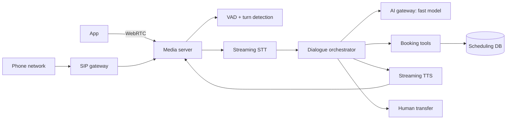

# Voice Booking Agent

> [!abstract] The prompt
> "Design a phone/voice agent for a clinic chain that books, reschedules and cancels appointments in English and Hindi. 300 clinics, up to 2,000 concurrent calls at peak." The hard parts: **sub-second turn latency**, **natural turn-taking and barge-in**, **correct slot booking under concurrency**, and **graceful handoff**.

---

## 1. Requirements

- Callers phone a number (PSTN) or use in-app voice (WebRTC).
- Book, reschedule or cancel appointments; answer basic questions (timings, location, doctor availability).
- Identify the patient (phone number + date of birth / OTP).
- Transfer to a human receptionist on request or failure.
- Latency: agent starts speaking within ~0.8–1 s after the caller stops (heuristic target); barge-in stops speech within ~200 ms.
- No double-booked slots; confirmations by SMS.

---

## 2. Architecture

- **Cascaded pipeline** (STT → LLM → TTS) chosen over speech-to-speech for tool reliability, guardrails, logging and language support; revisit as native audio models mature ([[09 - Durable Execution HITL and Realtime UX]]).
- Media servers are stateful per call: route calls with session affinity; scale by concurrent calls.

---

## 3. Deep Dive: Latency Budget

| Stage | Budget (illustrative) | Technique |
|---|---|---|
| End-of-turn detection | 200–300 ms | VAD + semantic turn detector (don't wait for long silences) |
| STT final | ~100–200 ms after speech ends | Streaming STT; use partials to start retrieval early |
| LLM first token | 200–400 ms | Small fast model; cached stable prefix; short prompts; no reasoning model in the turn loop |
| TTS first audio | ~100–200 ms | Streaming TTS starting on the first clause |
| Network / jitter | ~50–100 ms | Regional media servers; WebRTC |

- Every stage streams; the LLM's first sentence goes to TTS before the rest is generated ([[00 - LLM Fundamentals for Engineers]]).
- Slow tool calls (availability search) get a **filler** ("Let me check Dr. Mehta's schedule…") spoken immediately while the tool runs.

---

## 4. Deep Dive: Turn-Taking and Barge-In

- VAD runs continuously on caller audio, including while the agent speaks (with echo cancellation so the agent doesn't hear itself).
- On caller speech during agent speech: **flush all audio buffers**, cancel TTS and LLM, truncate the assistant turn to what was actually spoken, and listen ([[09 - Durable Execution HITL and Realtime UX]]).
- Short backchannels ("hmm", "okay") shouldn't always count as interruptions: a classifier or minimum-duration rule distinguishes them.

---

## 5. Deep Dive: Booking Correctness

- Structured dialogue state: `patient_id`, `clinic`, `doctor`, `date`, `slot`, `intent`, `confirmed` ([[04 - State Memory and Context Engineering]]). The LLM fills slots; code validates (date in future, clinic exists, doctor works that day).
- **Confirm before committing**: read back the slot ("Tuesday 14th at 4:30 with Dr. Mehta, correct?") and require explicit yes.
- **Slot holds**: when offering a slot, place a short hold (`status = held, hold_until = now + 2 min`) with a conditional `UPDATE`; booking converts the hold; holds expire automatically. Two callers can't book the same slot ([[08 - Reliability]], [[04 - Concurrency and Correctness]]).
- Idempotent booking tool keyed by `call_id:slot_id` so retries don't create duplicates ([[03 - Tool Engineering and Action Spaces]]).
- Speech-specific: confirm names and numbers by reading them back; spell-out flows for names STT gets wrong.

---

## 6. Deep Dive: Language and Robustness

- STT/TTS models chosen per language; detect language in the first turn and switch voice/prompt; Hinglish code-mixing handled by the LLM.
- Noisy lines: low STT confidence → ask to repeat; after two failures → offer human transfer.

---

## 7. Handoff and Durability

- Transfer packet to the receptionist dashboard: transcript summary, patient identity status, intended action, slots discussed.
- Call state checkpointed per turn; a media or orchestrator crash can resume with "Sorry, we got disconnected — you were booking Tuesday 4:30" on callback.

---

## 8. Evals

| Tier | Checks |
|---|---|
| Unit | Slot extraction from transcripts; date normalisation ("next Tuesday"); intent classification |
| Trajectory | Confirmation before booking; identity check before changes; transfer when asked |
| Outcome | Simulated callers (scripted + LLM-driven, with noise and interruptions) → correct booking state in a test scheduling DB |
| Latency | Per-stage and end-to-end turn latency percentiles; barge-in stop time |

- Production: task completion rate, transfer rate, average handle time, turn latency p95, double-booking incidents (target zero) ([[11 - Evals Observability and Silent Drift]]).

---

## 9. Failure Modes

| Failure | Mitigation |
|---|---|
| Agent talks over the caller | VAD-triggered buffer flush and cancellation |
| Long pauses before replies | Streaming every stage; small model; fillers during tool calls |
| Premature turn end | Semantic turn detection; tuned silence thresholds |
| Double booking | Slot holds with conditional updates; idempotent booking |
| Misheard details | Read-back confirmation; spell-out flows |
| Provider latency spike | Gateway routing to a faster fallback; per-stage timeouts |
| Model failure mid-call | Transfer to human with context |

---

## Interview Lines

> [!tip] Say it like this
> - "I'd use a cascaded STT, LLM, TTS pipeline for tool reliability and guardrails, with every stage streaming to stay under a second."
> - "Barge-in flushes every audio buffer and cancels generation the moment VAD detects caller speech."
> - "Offered slots get short database holds with conditional updates, and bookings are confirmed by read-back and idempotent."
> - "Slow lookups get a spoken filler, and repeated recognition failures transfer to a human with context."

## Related Notes

- [[Agentic/Problems/README]] · [[09 - Durable Execution HITL and Realtime UX]] · [[03 - Tool Engineering and Action Spaces]] · [[12 - LLM Cost and Latency Economics]]
