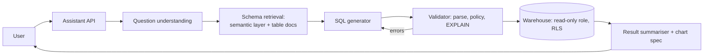

# Text-to-SQL Analytics Assistant

> [!abstract] The prompt
> "Design an assistant that lets business users ask questions like 'what was GMV by city last month vs the month before?' over the company warehouse, returning a table, a chart and an explanation." The hard parts: **correct SQL on a large, messy schema**, **governance and row-level security**, **query safety and cost**, and **trust** (users must see how numbers were computed).

---

## 1. Requirements

- Natural-language questions over a warehouse with ~2,000 tables; answers as table + chart + short explanation + the SQL used.
- Follow-up questions ("now only for Bengaluru").
- Respect data permissions (some users can't see revenue; regional managers see only their region).
- Queries must not overload the warehouse; p95 answer < 15 s for typical questions.

---

## 2. Architecture

- An **evaluator-optimizer workflow** with external ground truth (parser, `EXPLAIN`, dry run), not a free-roaming agent ([[01 - Workflows vs Agents]]).

---

## 3. Deep Dive: Getting the Right Schema into Context

- 2,000 tables don't fit; retrieval over **schema knowledge**:
    + A **semantic layer** (metrics like `GMV`, `active_user` with canonical SQL definitions, dimensions, join paths) is the best grounding: the model composes approved metrics instead of reinventing them.
    + Table and column descriptions, sample values, and **verified example queries** (question → SQL pairs) indexed with hybrid search ([[06 - RAG Ingestion and Indexing Pipeline]], [[08 - Vector DB Internals and Hybrid Search]]).
    + Retrieve the top relevant tables/metrics, include their columns and join keys, plus 3–5 similar verified examples (few-shot).
- Business vocabulary ("GMV", "Tier-1 cities") mapped via a glossary.

---

## 4. Deep Dive: Generation and Validation

1. Condense the question with conversation context; extract time ranges and filters ([[07 - Agentic RAG and Grounding Loops]]).
2. Generate SQL as **structured output** (`sql`, `tables_used`, `assumptions`) ([[00 - LLM Fundamentals for Engineers]]).
3. Validate deterministically:
    + Parse with a SQL parser; only `SELECT`; allow-listed schemas/tables.
    + Policy checks: forbidden columns for this user's role.
    + `EXPLAIN` for estimated cost; reject or ask to narrow if it would scan too much.
4. On failure, feed the exact error back and retry (max 2–3) ([[02 - Execution Loops and Control Topologies]]).
5. Execute with a **read-only role**, statement timeout, row limit, and the **user's identity** so warehouse **row-level security** applies.
6. Sanity checks on results (empty result, suspicious totals) → explain or ask a clarifying question.

---

## 5. Deep Dive: Governance

- Permissions enforced by the **warehouse**, not by the prompt: RLS policies and column masking keyed on the end user (via role or session attributes) ([[10 - AI Gateway Security and Guardrails]]).
- The model never sees data it isn't allowed to query; sample values in schema docs are filtered per role too.
- Every answer shows the SQL and the metric definitions used, so analysts can verify and users learn to trust the numbers.
- Results may contain PII; summarisation runs only on aggregated results by default; raw row output is capped and logged.

---

## 6. Deep Dive: Cost and Caching

- Warehouse cost is often larger than LLM cost: `EXPLAIN` gates, partition-pruning hints (always filter on date partitions), result caching for identical SQL.
- LLM: one strong call for SQL generation, small model for condensation and summarisation ([[12 - LLM Cost and Latency Economics]]).
- **Don't semantically cache** answers: "GMV last month" and "GMV last week" are close embeddings with different answers; cache by exact normalised SQL + data freshness instead ([[11 - Evals Observability and Silent Drift]]).

---

## 7. Evals

- Golden set of question → expected result (not expected SQL: many SQLs are correct); compare **result sets** on a fixed snapshot.
- Categories: simple aggregates, joins, time comparisons, ambiguous questions (should ask), forbidden data (should refuse).
- Track execution accuracy, validation-failure rate, retries per question, user corrections ([[11 - Evals Observability and Silent Drift]]).

---

## 8. Failure Modes

| Failure | Mitigation |
|---|---|
| Plausible but wrong SQL | Semantic-layer metrics; verified examples; result-set evals; show SQL |
| Wrong table among similar ones | Schema retrieval with descriptions and usage stats; deprecated tables excluded |
| Data leakage | Warehouse RLS and column masking on the end user's identity |
| Expensive full scans | `EXPLAIN` gate, partition filters, timeouts, row limits |
| Destructive SQL | Read-only role; parser allows only `SELECT` |
| Ambiguous questions answered confidently | Clarifying questions when assumptions are significant; list assumptions |

---

## Interview Lines

> [!tip] Say it like this
> - "It's an evaluator-optimizer loop with real ground truth: parse, policy checks and EXPLAIN, with the error fed back for a bounded retry."
> - "A semantic layer of approved metrics is the best grounding; the model composes metrics instead of inventing revenue logic."
> - "Permissions live in the warehouse as row-level security on the end user's identity, never in the prompt."
> - "I evaluate on result sets over a fixed snapshot, because many different SQL queries are correct."

## Related Notes

- [[Agentic/Problems/README]] · [[01 - Workflows vs Agents]] · [[07 - Agentic RAG and Grounding Loops]] · [[20 - Data Processing and Analytics]]
