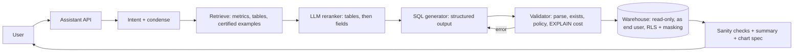
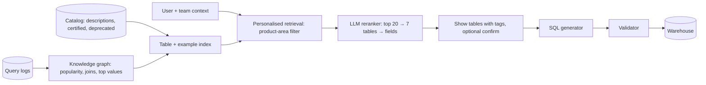
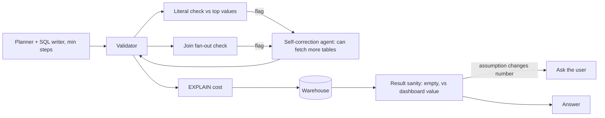
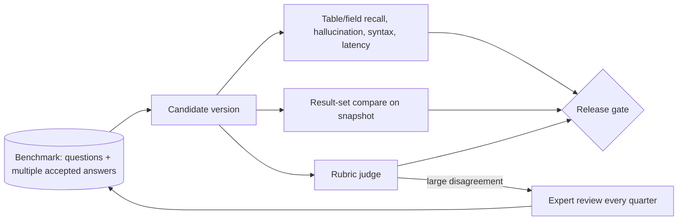
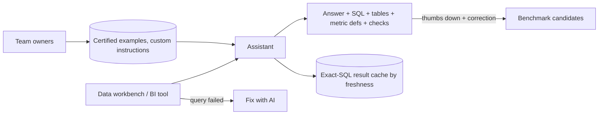

# Text-to-SQL Analytics Assistant

> [!abstract] Asked at NVIDIA (guarded natural-language SQL assistant as Part 3 of a GPU telemetry analytics design, data engineer technical screen, May 2026) and Databricks (RAG retrieval for data assets; retrieving and reranking tables and notebooks for a data-aware coding agent, 2026 question bank), and built in production at LinkedIn (SQL Bot, December 2024), Uber (QueryGPT) and Pinterest. Topics: [[01 - Workflows vs Agents|01]] (evaluator-optimizer with real validation) → [[06 - RAG Ingestion and Indexing Pipeline|06]] (schema and example-query retrieval) → [[08 - Vector DB Internals and Hybrid Search|08]] (table reranking) → [[10 - AI Gateway Security and Guardrails|10]] (warehouse-enforced permissions) → [[11 - Evals Observability and Silent Drift|11]] (benchmarks with multiple correct answers) → [[12 - LLM Cost and Latency Economics|12]] (warehouse cost).
>
> The hard part: plausible SQL that runs and returns the **wrong number**. NVIDIA's hint states it directly: treat the assistant as an **untrusted query author** and put policy and query controls outside the model. The real difficulty is picking the right table among thousands, using the right metric definition, and proving correctness when many different queries are right.

---

## 1. Clarify Script

Defaults are assumptions unless a source is given.

| Question | Default | If different |
|---|---|---|
| Who asks? | Business users and PMs; analysts as power users | Analysts only → SQL in an editor with "Fix with AI" may be the highest-value feature (T6) |
| Warehouse size? | ~2,000 tables in use, a long tail of tens of thousands | Millions of tables (LinkedIn) → popularity filter and personalised retrieval first (V1) |
| Is there a semantic layer? | Partly: core metrics (GMV, active users) defined; the rest raw tables | None → table docs and certified example queries carry the load |
| Output? | Table + chart + short explanation + the SQL and metric definitions used | Dashboards or scheduled reports → T9 |
| Permissions? | Dataset ACLs plus row-level security (regional managers see their region) and column masking (revenue hidden for some roles) | No RLS in the warehouse → can't ship safely; build it there first |
| Latency? | p95 under 15 s for typical questions | Interactive under 3 s → precomputed aggregates and caching |
| Warehouse cost limits? | Per-query scan cap; per-user daily budget | — |
| Follow-ups? | Yes ("now only for Bengaluru") | — |

---

## 2. Requirements

### Functional

- Answer natural-language questions with a table, chart, explanation and the SQL used.
- Follow-ups that modify the previous query.
- Show which tables and metric definitions were used; let users pick tables when unsure.
- Also: find tables, explain a table, fix a failing query (users ask these as often as "write SQL", per LinkedIn).

### Non-functional

- **Never return data the user can't query directly**; no writes, ever.
- No runaway scans: per-query cost cap, timeouts, row limits.
- Measurable accuracy on a benchmark; every answer auditable.

### Out of scope

- Building the warehouse, ETL, the BI tool.

---

## 3. Estimates That Drive V0

```
Context:    2,000 tables × ~30 columns × ~10 tokens ≈ 600k tokens of schema → must retrieve, not paste
            per question: ~7 tables × full schema + descriptions + 3–5 example queries ≈ 8–15k tokens
LLM:        ~3–5 calls per question (condense, table pick, write, maybe 1–2 fixes) → cents per question
Warehouse:  one bad query scanning a 50 TB fact table costs more than thousands of LLM calls
            (on-demand scan pricing, *assumed* ~$5 per TB)
Load:       *assumed* 5k questions/day → trivial QPS
```

- **Schema retrieval picks V0**: 600k tokens of schema can't go in the prompt; table selection is a retrieval and ranking problem.
- **Warehouse cost, not LLM cost, is the money risk**: the `EXPLAIN` gate and partition filters are in V0.
- **Load is trivial**; correctness and governance are the design.

---

## 4. Entities, Tools and State

### Tools and checks

| Step | Kind | What code enforces (never the prompt) |
|---|---|---|
| `search_tables(q)` / `search_metrics(q)` | read | Only datasets the user can read; deprecated tables excluded |
| `get_schema(table)` | read | Columns, descriptions, partition keys, **top-K values** for categorical columns (so the model uses `'Completed'`, not `'Finished'`); sample values filtered by the user's role |
| `validate(sql)` | check | Parser: single `SELECT`, allow-listed schemas; tables and columns exist; forbidden columns for the role; `EXPLAIN` cost under the cap; date-partition filter present on large tables |
| `run(sql)` | exec | Read-only role **as the end user** (so warehouse RLS and masking apply), statement timeout, row limit |
| `save_example(question, sql)` | write | Only by certified users; goes to the example-query index |

### State

```
conversations(id, user_id, turns[], last_sql, last_tables[])
catalog(table_id, description, certified, popularity, deprecated, partition_keys, owner)
metrics(name, definition_sql, dimensions[], owner, version)          -- semantic layer
examples(id, question, sql, tables[], certified_by, last_run_ok_at)
benchmark(id, question, accepted_answers[], product_area)
audit(question_id, user_id, sql, tables[], rows_returned, bytes_scanned, created_at)
```

---

## 5. V0 — Simplest Design That Works

- **A workflow with an evaluator-optimizer loop**, not a free agent ([[01 - Workflows vs Agents]]):
    1. **Classify intent**: write a query, find a table, explain a table, fix my query.
    2. **Condense** the question with conversation context; extract time ranges and filters.
    3. **Retrieve**: metrics from the semantic layer first; tables by hybrid search over descriptions and certified example queries; then an **LLM reranker** picks the top few tables (LinkedIn: top 20 by embeddings → LLM picks 7), then fields.
    4. **Generate** structured output: `sql`, `tables_used`, `assumptions`.
    5. **Validate** deterministically (§4); on failure feed the exact error back, max 2–3 retries ([[02 - Execution Loops and Control Topologies]]). Validators work best when they know something the writer didn't: existence checks and `EXPLAIN` (LinkedIn).
    6. **Run** as the user; sanity-check results (empty, suspicious totals) and explain or ask.
    7. **Answer** with table, chart spec, explanation, and the SQL plus metric definitions.
- **Permissions in the warehouse**, keyed on the end user: dataset ACLs, row-level security, column masking. The model never sees data the user can't query ([[10 - AI Gateway Security and Guardrails]]).
- **Prefer metrics over raw SQL**: if "GMV" is in the semantic layer, the model composes the approved metric rather than reinventing revenue logic.



> [!important] The most drilled component
> The guardrail around generated SQL. NVIDIA's Part 3 asks exactly this: "only query data the user is allowed to access and avoid dangerous or extremely expensive generated queries". The answer: the model is an untrusted author; permissions are enforced by the warehouse on the end user's identity, not by the prompt; a parser allows only single `SELECT` statements; `EXPLAIN` gates cost before execution; timeouts and row limits bound the rest.

### What V0 can't handle

- **Thousands of similar tables**: `orders`, `orders_v2`, `orders_clean`; the right one depends on who's asking.
- **Wrong but valid SQL**: wrong enum value, wrong join grain, double counting.
- **Proving accuracy** when many queries are correct.
- **Trust**: users can't tell whether to believe a number.

---

## 6. Scale Ladder

### V1 — Pick the right table: metadata, popularity, personalisation

- **Evidence:** LinkedIn (Dec 2024): millions of tables narrowed to a few thousand by access popularity; a certification effort for table descriptions; default datasets inferred from the org chart and access history so "average CTR yesterday" means ads for one user and email for another; deprecated tables offboarded automatically; table recall rose as rerankers, descriptions and example queries were added. Pinterest (per 2026 summaries): identifying the right table among hundreds of thousands was the main challenge, solved by a vector index of table summaries and historical queries with an LLM picking the final few, shown to the user to confirm. Databricks's 2026 question bank asks to retrieve and rerank tables and notebooks for a data-aware agent. Confidence **strong**.
- **Trigger:** table recall on the benchmark below ~80%; users reporting "it used the wrong orders table".
- **What breaks:** valid SQL on the wrong source.
- **Change ([[06 - RAG Ingestion and Indexing Pipeline]], [[08 - Vector DB Internals and Hybrid Search]]):**
    + **Catalog quality**: owners write descriptions for important tables; AI-drafted descriptions from docs and query logs, reviewed; certified and deprecated flags.
    + **Knowledge graph from query logs**: table popularity, common joins, top values per column, partition keys.
    + **Personalised retrieval**: filter to the user's product area by default (team, past access); let them change it.
    + **Show and confirm** the chosen tables with "certified", "popular" and "commonly joined with" tags; in guided mode the user ticks tables before the SQL is written.
- **Trade-off:** curation work by data owners; without it no model picks the right table.



### V2 — Wrong numbers from valid SQL

- **Evidence:** Uber's QueryGPT reported generated filters with an enum value that didn't exist (`'Finished'` instead of `'Completed'`), giving a successful run with no rows, and queries with non-existent tables or columns (via 2026 summaries of the Uber post); LinkedIn's plan-then-solve query writer, with validators and a self-correction agent that can fetch more tables. Confidence **medium**.
- **Trigger:** benchmark shows queries that run but return wrong results: empty results, totals off by a multiple (join fan-out), wrong time zone.
- **Change:**
    + **Top values in the schema context** for categorical columns; validator flags literals not in the column's known values.
    + **Grain checks**: warn when a join on a non-unique key precedes `SUM` (fan-out); compare row counts before and after joins on a sample.
    + **Result sanity**: empty result → re-check filters and say so; compare the answer with the same metric's dashboard value where one exists.
    + **Plan for complex questions** (break into CTE steps), but tell the planner to minimise steps so simple questions stay simple (LinkedIn).
    + **Ask instead of guess** when an assumption changes the number (fiscal vs calendar month, gross vs net).
- **Trade-off:** more validator rules and a little latency; each catches a class of silent error.



### V3 — Measure accuracy when many queries are right

- **Evidence:** LinkedIn (Dec 2024): 130+ benchmark questions from domain experts across 10 product areas; ~60% have more than one accepted answer, and without them recall was under-reported by 10–15%; LLM judge within 1 point of the human score 75% of the time, with larger gaps often revealing a correct answer missing from the benchmark; experts add accepted answers every 3 months. Confidence **strong** (one detailed production source).
- **Trigger:** changing prompts, models, retrieval or rerankers without knowing whether accuracy moved.
- **Change ([[11 - Evals Observability and Silent Drift]]):**
    + **Cheap metrics first**: table and field recall vs ground truth, hallucinated table or field rate, syntax validity, latency.
    + **Result-set comparison** on a fixed warehouse snapshot where data access allows (order-insensitive, tolerance for floats).
    + **Judge with a rubric** (tables, columns, joins, filters, aggregations, efficiency) where running isn't possible; calibrate against experts and treat big disagreements as candidate new accepted answers.
    + **Categories**: simple aggregates, joins, time comparisons, ambiguous (should ask), forbidden data (should refuse).
- **Trade-off:** expert time to build and refresh the set.



### V4 — Trust and self-serve improvement

- **Evidence:** LinkedIn: SQL Bot inside the data workbench raised adoption 5–10× over a standalone app; "Fix with AI" on failed queries was easy to build and became ~80% of sessions; users customise by product-area datasets, custom instructions and certified example queries; ~95% rated query accuracy "passes" or above. Confidence **medium**.
- **Trigger:** accuracy is fine on the benchmark but adoption is low and analysts still get the same questions.
- **Change:**
    + **Meet users where they write SQL**: integrate into the workbench or BI tool; "Fix with AI" on every failed query.
    + **Explain every answer**: SQL, tables with certification tags, metric definitions, assumptions, validation checks passed.
    + **Self-serve context**: teams add certified examples and instructions for their area; thumbs-down with a correction becomes a benchmark candidate.
    + **Exact-SQL result cache** keyed by normalised SQL + data freshness; never a semantic answer cache ("GMV last month" and "last week" embed close together).
- **Trade-off:** user-supplied context can be wrong; certification and periodic benchmark runs keep it honest.



---

## 7. Twist Cards

### Most asked

**T1 — "How do you make sure it only queries data the user is allowed to see?"**
- **Evidence:** NVIDIA (May 2026), verbatim requirement; LinkedIn (dataset ACLs per group). Confidence **strong**.
- **Hits:** governance.
- **Answer:** the warehouse enforces it, on the **end user's** identity: dataset ACLs, row-level security policies, column masking. The assistant runs queries as that user (or a role carrying their attributes), never as a shared service account with broad access. Schema retrieval also filters to datasets they can read, and sample values in context are filtered per role. Prompt rules are not a control ([[10 - AI Gateway Security and Guardrails]]).
- **Attaches to:** V0.

**T2 — "How do you stop dangerous or very expensive generated queries?"**
- **Evidence:** NVIDIA (May 2026). Confidence **strong**.
- **Hits:** validator.
- **Answer:** read-only role; parser allows one `SELECT` (no DDL, DML, multi-statement); `EXPLAIN` estimate under a per-query scan cap, otherwise ask to narrow; mandatory date-partition filter on large fact tables; statement timeout, row limit, per-user daily budget; queue with concurrency limits so the assistant can't starve dashboards.
- **Attaches to:** V0.

**T3 — "It returned a confident wrong number. How do you find out why?"**
- **Evidence:** Uber QueryGPT enum example; LinkedIn validators. Confidence **medium**.
- **Hits:** traces, V2 checks.
- **Answer:** from the trace: wrong table (retrieval or reranking, V1), wrong filter literal (top values, V2), join fan-out (grain check), wrong metric definition (should have used the semantic layer), or a wrong assumption (should have asked). Add the case to the benchmark with the accepted answer.
- **Attaches to:** V2, V3.

**T4 — "How do you evaluate it? Exact-match SQL?"**
- **Evidence:** LinkedIn (Dec 2024). Confidence **strong**.
- **Hits:** evals.
- **Answer:** no: many SQLs are correct. V3: table and field recall, hallucination rate and syntax as cheap metrics; result-set comparison on a snapshot; rubric judge calibrated to experts; multiple accepted answers per question (LinkedIn's recall was 10–15% under-reported without them).
- **Attaches to:** V3.

### Lower priority (recall / judgement)

**T5 — "Why not cache answers semantically?"**
- **Evidence:** none specific. Confidence **judgement**.
- "GMV last month" and "GMV last week" are near neighbours with different answers. Cache by exact normalised SQL plus data freshness, and only for the same permission scope.

**T6 — "What would you build first?"**
- **Evidence:** LinkedIn: "Fix with AI" was ~80% of sessions. Confidence **medium**.
- Table discovery and "fix my failing query" inside the existing editor, then NL-to-SQL for certified areas with a semantic layer, then wider coverage.

**T7 — "Should it be an agent that explores the warehouse?"**
- **Evidence:** LinkedIn routes open-ended follow-ups to an agent, the rest to fixed flows. Confidence **medium**.
- Mostly a workflow with a bounded fix loop; an agent with schema tools only for open exploration, with the same validator and cost caps ([[01 - Workflows vs Agents]]).

**T8 — "The result contains customer emails."**
- **Evidence:** none specific. Confidence **judgement**.
- Column masking handles it at the warehouse; summarise only aggregates by default; raw row output capped and logged.

**T9 — "Turn the answer into a scheduled report."**
- **Evidence:** none. Confidence **judgement**.
- Save the validated SQL (not the question) with its owner; re-validate on schema change; run as the owner with the same caps.

---

## 8. Break It

| Failure | What the user sees | What you say |
|---|---|---|
| Wrong table among similar ones | Correct table, shown with tags | Popularity, certification, personalised retrieval, reranker |
| Non-existent enum value | Correct filter, or a flagged assumption | Top values in context, literal check |
| Join double-counts | Correct total | Grain check before aggregation |
| User asks for data they can't see | "You don't have access to that dataset" | Warehouse ACLs, RLS, masking on the end user |
| Full scan of a 50 TB table | "Narrow the date range?" | `EXPLAIN` gate, partition filter rule |
| `DROP TABLE` in output | Never runs | Read-only role, parser |
| Ambiguous question | A clarifying question | Ask when the assumption changes the number |
| Model provider down | "Fix with AI" unavailable, editor still works | Fallback model or graceful degradation |

---

## 9. Evals, Operations and Cost

| Tier | Checks |
|---|---|
| **Unit** | Intent classification; validator rules on a fixture of good and bad SQL; filter builder for RLS attributes |
| **Retrieval** | Table and field recall vs benchmark; hallucinated table or field rate |
| **Outcome** | Result-set match on a snapshot; rubric judge; correct refusals and clarifications |

- **Production metrics:** answers accepted without edit, user edits to SQL, validation failure and retry rate, bytes scanned per answer, p95 latency, thumbs and corrections per product area.
- **Alerts:** any query rejected by RLS that the validator passed (permissions drift); bytes scanned per day above budget; table recall drop after a catalog change.
- **Cost drivers:** warehouse scans first, then LLM calls (a few per question).

---

## 10. One-Minute Close

> "A workflow with a bounded evaluator-optimizer loop. Classify the intent, condense the follow-up, retrieve semantic-layer metrics, tables and certified example queries, let an LLM reranker pick a handful of tables and fields, write SQL as structured output, then validate it with things the writer didn't know: parse to a single SELECT, check tables, columns and enum values exist, and gate cost with EXPLAIN. Run it as the end user so the warehouse's ACLs, row-level security and masking apply, with timeouts and row limits. Table choice is the hardest part, so the catalog has certified descriptions, popularity from query logs and personalised defaults. Accuracy is measured with table recall plus result-set comparison and a calibrated judge over a benchmark with multiple accepted answers, and every answer shows its SQL and metric definitions."

---

## Evidence

Reports and engineering posts tallied in November 2026.

| Follow-up | Sources | Count | Placed as | Deep dive? |
|---|---|---|---|---|
| Only data the user may access | NVIDIA (May 2026); LinkedIn (Dec 2024) | 2 | V0 + T1, **strong** | Yes |
| Dangerous or expensive generated queries | NVIDIA (May 2026) | 1 (verbatim) | V0 + T2, **strong** | Yes |
| Table and asset retrieval and reranking | Databricks question bank (2026); LinkedIn; Pinterest | 3 | V1, **strong** | Yes |
| Valid SQL, wrong result | Uber QueryGPT (via summaries); LinkedIn | 2 | V2 + T3, **medium** | Sometimes |
| Benchmarks with multiple correct answers, judge calibration | LinkedIn | 1 (detailed) | V3 + T4, **strong** | Sometimes |
| Adoption, Fix with AI, self-serve context | LinkedIn | 1 | V4 + T6, **medium** | No |
| Semantic cache, PII, scheduled reports | none | 0 | T5, T8, T9, **judgement** | No |

- **What the tally changed:** the old note's evaluator-optimizer loop, semantic layer, validation, governance and result-set evals stay, regrouped. Added: popularity filtering and personalised table retrieval with an LLM reranker (V1), enum and join-grain checks for valid-but-wrong SQL (V2), multiple accepted answers and judge calibration (V3), and the adoption lessons (V4). Interview evidence for this exact prompt is thinner than for 01–05, so more of the ladder rests on production posts.

## Sources

- PracHub, *Design a GPU Telemetry Collection and Analytics Platform* (NVIDIA, data engineer technical screen, May 2026; Part 3 is the guarded SQL assistant). https://prachub.com/interview-questions/design-a-gpu-telemetry-collection-and-analytics-platform
- PracHub, *Design Retrieval for a Coding Agent* (Databricks, September 2026), whose related questions include retrieving tables and notebooks for a data-aware coding agent and RAG retrieval for data assets. https://prachub.com/interview-questions/design-retrieval-for-a-coding-agent-what-to-index-handling-noise-and-metrics
- LinkedIn Engineering, *Practical text-to-SQL for data analytics* (December 2024). https://www.linkedin.com/blog/engineering/ai/practical-text-to-sql-for-data-analytics
- Sequel, *How Text-to-SQL Works* and *Text-to-SQL: The Complete Guide* (2026), summarising Pinterest's table retrieval and Uber QueryGPT's 10 → 3 minute authoring time. https://sequel.sh/blog/how-text-to-sql-works
- Research report gist quoting Uber QueryGPT's enum and non-existent column failures. https://gist.github.com/Julius-mercator/b78185acb27329feb3508768444bd583

## Related Notes

- [[Agentic/Problems/README]] · [[01 - Workflows vs Agents]] · [[06 - RAG Ingestion and Indexing Pipeline]] · [[07 - Agentic RAG and Grounding Loops]] · [[10 - AI Gateway Security and Guardrails]] · [[11 - Evals Observability and Silent Drift]] · [[20 - Data Processing and Analytics]] · [[Agentic Problem to Solution Map]]
