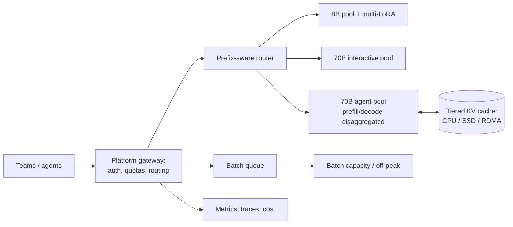

# LLM Inference Platform

> [!abstract] The prompt
> "Design an internal platform that serves open-weight LLMs (an 8B and a 70B model, plus per-team LoRA adapters) to 50 internal teams: chat, agents and batch jobs. Peak 5,000 requests/minute, mostly agent traffic with long prompts." The hard parts: **GPU efficiency**, **latency SLOs per traffic class**, **prefix-cache-aware routing**, **multi-tenancy** and **capacity planning**.

---

## 1. Requirements

- OpenAI-compatible API; models: 8B (fast tier), 70B (quality tier), team LoRA adapters on the 8B base.
- Traffic classes: interactive (TTFT p95 < 1 s, ITL p95 < 50 ms), agentic (long prompts, many calls per run), batch (throughput, deadline in hours).
- Per-team quotas and cost attribution; 99.9% availability; safe rollout of new model versions.

---

## 2. Estimation (illustrative)

- 5,000 req/min ≈ 83 req/s; average prompt 6k tokens (agents), output 400 tokens.
    + Prefill: ~500k prompt tokens/s at peak before caching; with ~70% prefix-cache hits ≈ 150k tokens/s actually computed.
    + Decode: ~33k output tokens/s.
- 70B in FP8 on 2×80 GB GPUs leaves ~75 GB for KV ≈ ~240k tokens in flight per replica ([[14 - Quantization Decoding and VRAM Math]]); KV memory, not compute, caps concurrency per replica.
- Size replicas from measured per-replica goodput at target SLOs (load tests), plus 30–40% headroom ([[02 - Fundamentals]]).

---

## 3. Architecture

---

## 4. Deep Dive: Serving Engine Configuration

- Engine: vLLM or SGLang with continuous batching, PagedAttention / RadixAttention, chunked prefill ([[13 - GPU Serving and Disaggregated KV Cache]]).
- 70B: FP8 weights (and FP8 KV cache after evals confirm quality), tensor parallel across 2 GPUs in a node; 8B: BF16 or FP8 on single GPUs with multi-LoRA serving ([[15 - Post-Training and Model Adaptation]]).
- Speculative decoding (EAGLE or n-gram) on the interactive pool where batch sizes are moderate ([[14 - Quantization Decoding and VRAM Math]]).
- Structured outputs via a grammar engine with cached compiled schemas.

---

## 5. Deep Dive: Routing and Prefix Reuse

- Agent runs re-send long, growing prompts; the router keeps a run's calls on nodes with its **prefix cached** (hash of prefix blocks / session id), scored against load ([[13 - GPU Serving and Disaggregated KV Cache]]).
- Platform guidance to teams: stable system prompts and tool definitions first, no timestamps at the top; provide a prompt linter.
- Tiered KV cache (CPU/SSD, optionally shared via RDMA) keeps popular long prefixes (shared system prompts, big tool schemas) warm beyond GPU memory.

---

## 6. Deep Dive: Disaggregation for the Agent Pool

- Agent traffic is **prefill-heavy** (long prompts, short outputs); interactive traffic is decode-sensitive. On the agent pool, separate prefill and decode workers, transfer KV over RDMA, and scale prefill capacity independently ([[13 - GPU Serving and Disaggregated KV Cache]]).
- Optimise for **goodput**: requests meeting both TTFT and ITL SLOs.
- Keep the interactive pool combined (simpler) unless measurements show interference.

---

## 7. Deep Dive: Multi-Tenancy and Fairness

- Gateway enforces per-team **token** rate limits and monthly budgets ([[10 - AI Gateway Security and Guardrails]]); priority classes: interactive > agent > batch.
- Fair scheduling inside the engine (per-tenant queues / weighted fair queuing) so one team's burst doesn't starve others ([[08 - Reliability]]).
- **Batch** work fills idle capacity (off-peak and between bursts), preemptible, which raises utilisation and lowers effective cost ([[12 - LLM Cost and Latency Economics]]).
- Cost attribution per team from gateway token counts × internal price per model tier.

---

## 8. Deep Dive: Capacity, Autoscaling and Rollouts

- Autoscale on **queue depth, KV cache utilisation and SLO attainment**, not GPU utilisation alone; GPU nodes and model loading take minutes, so keep warm headroom and pre-scale for known peaks ([[19 - Deployment and Infrastructure]]).
- Model weights cached on local NVMe / fast object storage to cut cold-start time.
- New model or quantization: shadow traffic → eval comparison → canary by team → full rollout; pinned versions per team so upgrades don't silently change behaviour ([[11 - Evals Observability and Silent Drift]]).

---

## 9. Failure Modes

| Failure | Mitigation |
|---|---|
| Prefix cache misses for agents | Prefix-aware routing; prompt linting; tiered KV |
| KV exhaustion and preemption storms | Admission control; FP8 KV; context limits per tier |
| Long prefills stall interactive decodes | Separate pools; chunked prefill; disaggregation for agents |
| One team starves others | Token quotas; priority classes; fair scheduling |
| Slow scale-up | Warm headroom; pre-scaling; local weight caches |
| Quality regression from new quantization | Shadow + evals + canary; pinned versions |
| GPU node failure | Replicas across nodes; router health checks; retry idempotent requests |

---

## Interview Lines

> [!tip] Say it like this
> - "KV memory caps concurrency, so I size replicas from measured goodput at SLO and use FP8 weights and KV once evals confirm quality."
> - "Agent traffic is prefill-heavy, so it gets prefix-aware routing, tiered KV caching and, at scale, disaggregated prefill and decode."
> - "Traffic classes get separate pools and priorities; batch fills idle capacity to keep utilisation high."
> - "Autoscaling keys on queue depth, KV usage and SLO attainment, with warm headroom because GPU cold starts take minutes."

## Related Notes

- [[Agentic/Problems/README]] · [[13 - GPU Serving and Disaggregated KV Cache]] · [[14 - Quantization Decoding and VRAM Math]] · [[15 - Post-Training and Model Adaptation]]
