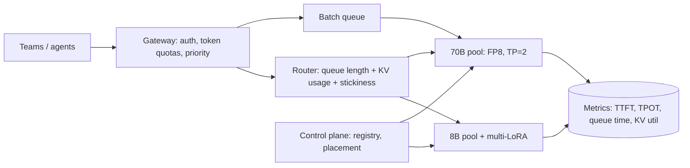
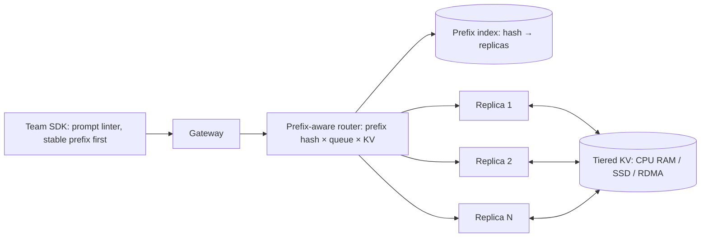
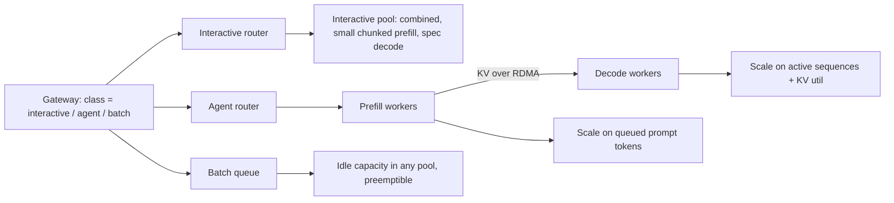
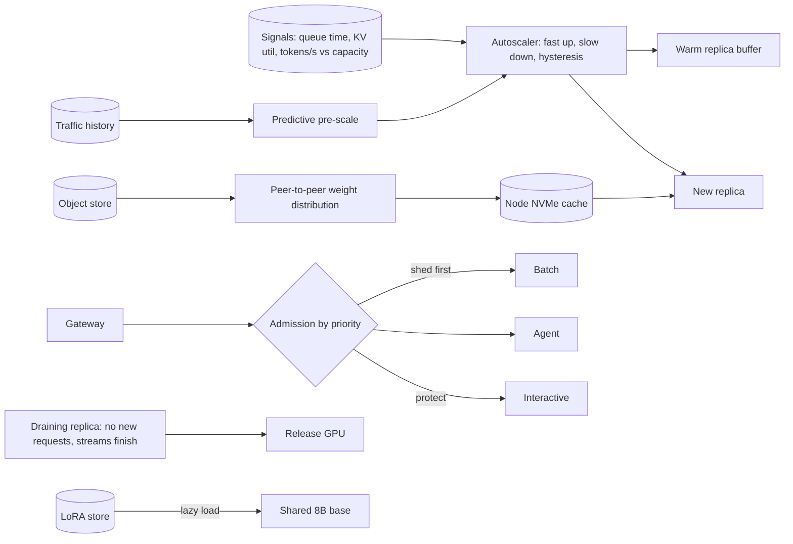
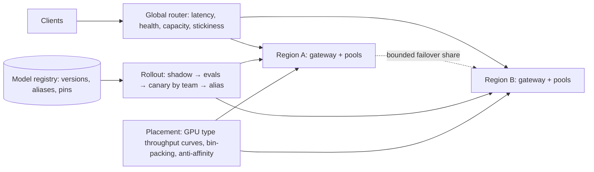

# LLM Inference Platform

> [!abstract] Asked at Anthropic (batched LLM inference service assuming each batch takes 100 ms, onsite, October 2026; multi-tenant GPU inference API with the "CPU low, GPUs saturated" probe, onsite, August 2025; route and batch inference with eight GPUs; model weight distribution), Crusoe (autoscaling LLM inference serving, inference-team onsite, November 2026; debugging a prefill latency spike at 23–24 QPS) and Atlassian (model deployment and inference platform, 2026). Topics: [[13 - GPU Serving and Disaggregated KV Cache|13]] (continuous batching, prefix reuse, disaggregation, cold starts) → [[14 - Quantization Decoding and VRAM Math|14]] (VRAM and KV math) → [[15 - Post-Training and Model Adaptation|15]] (multi-LoRA) → [[12 - LLM Cost and Latency Economics|12]] (goodput, cost per token) → [[10 - AI Gateway Security and Guardrails|10]] (quotas, tenants) → [[11 - Evals Observability and Silent Drift|11]] (model rollouts).
>
> The hard part: the GPU is the bottleneck and it doesn't behave like a CPU. Batch time depends on what's in the batch, KV memory (not compute) caps concurrency, a new replica takes minutes to load, and long prefills stall everyone's decodes. Every scaling and routing choice has to be driven by signals that predict missed latency targets, not by utilisation.

---

## 1. Clarify Script

Defaults are assumptions unless a source is given.

| Question | Default | If different |
|---|---|---|
| Models? | Open-weight 8B (fast tier) and 70B (quality tier), plus per-team LoRA adapters on the 8B | Long tail of rarely used models → V3 |
| Users? | 50 internal teams: chat, agents, batch jobs | External customers → billing, stronger isolation, multi-region (V4) |
| Traffic? | Peak 5,000 requests/min, mostly agent traffic with long prompts; daily cycle plus spikes | Fixed batch time given (Anthropic's 100 ms) → do the capacity math from it first (T1) |
| Latency targets? | Interactive: TTFT p95 < 1 s, time per output token p95 < 50 ms. Agent: TTFT p95 < 3 s. Batch: hours | — |
| GPU supply? | Fixed reserved pool of H100s plus some on-demand burst | Unlimited cloud → scale-out is easier, cost matters more |
| Streaming? | Yes, SSE for interactive; whole responses for batch | — |
| Prefill and decode? | Same replicas at first | Disaggregated → V2 and Crusoe's follow-up |
| Isolation? | Teams share GPUs; quotas per team | Hard isolation → dedicated pools or MIG (T7) |

---

## 2. Requirements

### Functional

- OpenAI-compatible API with model aliases (`stable`, `latest`) and exact version pins.
- Streaming and async batch jobs.
- Per-team LoRA adapters; structured outputs.

### Non-functional

- Per-class latency SLOs (§1); 99.9% availability.
- Per-team token quotas, fair sharing, cost attribution.
- Safe model rollouts; no silent behaviour changes for pinned teams.
- GPU cost: maximise **goodput** (requests that meet both TTFT and per-token targets) per GPU.

### Out of scope

- Training, the model registry's internals, the GPU cluster scheduler.

---

## 3. Estimates That Drive V0

```
Traffic:   5,000 req/min ≈ 83 req/s; average prompt 6k tokens (agents), output 400
           prefill ≈ 500k prompt tokens/s at peak before caching
           with ~70% prefix-cache hits (*assumed*) ≈ 150k tokens/s actually computed
           decode ≈ 33k output tokens/s
70B FP8:   weights ≈ 70 GB; on 2×80 GB GPUs ≈ 75–80 GB left for KV
KV/token:  80 layers × 8 KV heads × 128 dim × 2 (K,V) × 1 byte (FP8) ≈ 160 KB
           → ~500k tokens of KV per replica ≈ ~80 concurrent 6k-token sequences
Cold start: 70 GB of weights from object storage at ~1–2 GB/s ≈ 1 minute+, plus engine warm-up
```

- **KV memory caps concurrency per replica**, so replica count comes from measured goodput at the SLO in load tests, plus 30–40% headroom ([[14 - Quantization Decoding and VRAM Math]]).
- **Prefill dominates** for agent traffic: long prompts, short outputs. Prefix caching is the biggest lever (V1), and prefill-decode interference is the main tail-latency risk (V2).
- **Cold start is minutes**, so autoscaling must act before targets are missed (V3).

---

## 4. Entities, Tools and State

### API and control surfaces

| Surface | What code enforces |
|---|---|
| `POST /v1/chat/completions` (stream or not) | Tenant from the API key; model alias resolved to an exact version; token quota checked; request id for idempotent retries of non-streaming calls |
| `POST /v1/batches` | Async job with a deadline; preemptible; results to object storage |
| Router | Picks a replica by prefix-cache affinity, queue length, KV usage and prompt size, not round robin |
| Engine scheduler | Continuous batching with a token budget per step; per-tenant fair queues; priority classes |
| Control plane | Model registry, placement, autoscaling, rollouts |

### State

```
models(id, name, version, alias[], weights_uri, quant, tp_degree, min_replicas, max_replicas)
replicas(id, model_id, node, gpu_type, status {loading|warm|serving|draining}, kv_util, queue_len)
tenants(id, quota_tokens_per_min, monthly_budget, priority_class, pinned_versions{})
usage(tenant_id, model_id, minute, input_tokens, cached_tokens, output_tokens)
prefix_index(prefix_hash, replica_ids[])     -- router's view of which replica holds which prefix
```

---

## 5. V0 — Simplest Design That Works

- **One engine per model pool** (vLLM or SGLang): continuous batching, paged KV cache, chunked prefill, automatic prefix caching ([[13 - GPU Serving and Disaggregated KV Cache]]).
- **Continuous, not static, batching**: the scheduler admits new sequences at every decode step under a token budget, so a long response doesn't hold a batch hostage and short requests leave as soon as they finish (the answer to Anthropic's "one long response holds the whole batch" follow-up).
- **70B** in FP8 weights, tensor parallel over 2 GPUs in a node; **8B** in BF16 or FP8 on single GPUs, serving many LoRA adapters on one base ([[15 - Post-Training and Model Adaptation]]).
- **Gateway**: auth, per-team token rate limits, priority classes (interactive > agent > batch), cost attribution from token counts ([[10 - AI Gateway Security and Guardrails]]).
- **Router**: least-loaded by queue length and KV usage, with stickiness for prefix reuse (V1 makes this smarter).
- **Batch jobs** go to a queue and fill idle capacity, preemptible.
- **Admission control**: when queue time would break the SLO, return 429 with `Retry-After` rather than accept work that will time out.



> [!important] The most drilled component
> Batching and the capacity math behind it. Anthropic's onsite fixes "each batch takes 100 ms" and asks for the batching policy, worker count, how results reach the right caller, and then attacks the assumption: batch time depends on prompt and response length, and one long response holds the batch. The answer: the 100 ms is model time only (add network, queueing and wait-for-batch); throughput per worker = batch size / 0.1 s; close a batch on size, token budget or a short timer; then move to continuous batching with a per-step token budget so batch time stops being a constant and long requests don't block short ones.

### What V0 can't handle

- **Agent prefixes** recomputed on whichever replica the request lands on.
- **Long prefills** stalling decodes for interactive users.
- **Spikes**: traffic triples in a minute while replicas take minutes to start.
- **Long tail** of models and adapters each wanting a warm GPU.
- **Multi-region** and model rollouts across teams.

---

## 6. Scale Ladder

### V1 — Prefix-aware routing for agent traffic

- **Evidence:** Crusoe (Nov 2026): routing that accounts for queue length, prompt size and KV cache, not round robin; Anthropic (Aug 2025): sticky routing per tenant or model to keep caches warm, versus load balance. Confidence **strong**.
- **Trigger:** prefix-cache hit rate well below the share of repeated tokens (agents re-send a growing prompt every step); TTFT on agent traffic rising with load.
- **What breaks:** prefill compute grows ~3× (the 70% hit rate in §3 disappears).
- **Change ([[13 - GPU Serving and Disaggregated KV Cache]]):**
    + **Route on prefix**: hash the first N KV blocks (or a session id); send the request to a replica already holding that prefix, scored against its queue and KV usage, so one hot prefix doesn't overload one replica.
    + **Tiered KV cache**: CPU RAM and local SSD (optionally shared over RDMA) keep popular long prefixes (shared system prompts, big tool schemas) beyond GPU memory.
    + **Prompt guidance for teams**: stable system prompt and tools first, no timestamps or request ids at the top; a prompt linter in the SDK.
- **Trade-off:** stickiness fights load balance; the scoring function trades cache hits against queue time, tuned on goodput.



### V2 — Separate the traffic classes, then disaggregate prefill and decode

- **Evidence:** Anthropic (Aug 2025): continuous batching with prefill/decode separation, the "CPU low, GPUs saturated" diagnosis; Crusoe (Nov 2026): scaling prefill and decode servers independently in a disaggregated deployment; Crusoe's related screen debugs a prefill latency spike at 23–24 QPS. Confidence **strong**.
- **Trigger:** interactive time-per-token p95 above 50 ms whenever agent prompts arrive; a sharp TTFT knee at a specific QPS (prefill saturation).
- **What breaks:** long prefills in the same batch step delay every decode; one pool can't satisfy both prefill-heavy agents and decode-sensitive chat.
- **Change:**
    + **Separate pools** per class: interactive (combined prefill/decode, chunked prefill tuned small) and agent.
    + **Disaggregate the agent pool**: prefill workers and decode workers, KV transferred over RDMA/NVLink; scale prefill on queued prompt tokens and decode on active sequences and KV usage, independently.
    + **Measure goodput** per pool, not raw throughput.
    + **Speculative decoding** on the interactive pool where batch sizes are moderate ([[14 - Quantization Decoding and VRAM Math]]).
- **Trade-off:** more pools and a KV transfer path to run; keep the interactive pool combined unless measurements show interference.



### V3 — Autoscaling with minute-long cold starts, and the long tail

- **Evidence:** Crusoe (Nov 2026): "GPU utilization and CPU load are poor triggers"; "traffic triples within a minute, but new replicas need several minutes to start"; long tail of rarely used models; oscillation; safe scale-down that drains streams. Anthropic (Aug 2025): artifact cache hierarchy (object store → node NVMe → pinned host RAM → VRAM), warm pools, lazy LoRA loading; and a separate Anthropic question on model weight distribution. Confidence **strong**.
- **Trigger:** daily cycles waste reserved GPUs at night; spikes cause 429s for minutes.
- **What breaks:** reactive scaling on utilisation fires too late; replicas flap up and down.
- **Change ([[19 - Deployment and Infrastructure]]):**
    + **Scale on leading signals** tied to the SLO: queue time, KV cache usage, tokens per second against measured capacity; scale up fast, scale down slowly with hysteresis and cooldowns.
    + **Shrink cold start**: weights cached on node NVMe and pre-staged to likely nodes; pinned host RAM for hot models; peer-to-peer weight distribution instead of every node pulling from object storage; pre-captured engine graphs.
    + **Warm headroom and prediction**: a warm buffer of replicas sized to the worst minute-scale spike; pre-scale for known peaks from history.
    + **While capacity arrives**: admission control by priority (shed batch, then agent, protect interactive), shorter max output for low-priority traffic, `Retry-After`.
    + **Safe scale-down**: mark the replica draining, stop routing new requests, let streams finish up to a timeout, then release.
    + **Long tail**: LoRA adapters loaded lazily onto a shared base; rarely used full models scale to zero with an explicit "cold, ~2 min" contract or are served from a shared pool with swapping; batch-only models run on spot capacity.
- **Trade-off:** warm headroom costs money; it is cheaper than minutes of failed requests for interactive traffic.



### V4 — Many regions, heterogeneous GPUs, safe model rollouts

- **Evidence:** Anthropic (Aug 2025): multi-region routing with sticky placement and failover without hot-spotting the neighbour; heterogeneous GPU placement and bin-packing; model versioning, A/B, shadow, canary and rollback. Confidence **strong**.
- **Trigger:** external customers in several regions; a mix of H100, A100 and newer GPUs; a new model version for 50 teams.
- **Change ([[11 - Evals Observability and Silent Drift]]):**
    + **Global routing** by latency, health and capacity; sticky per tenant or model to keep caches warm; failover sheds a share to adjacent regions with capacity checks so one region's outage doesn't overload the next.
    + **Placement** by model–GPU compatibility and measured throughput curves per GPU type; bin-packing with VRAM headroom; anti-affinity for replicas of the same model.
    + **Rollouts**: shadow traffic → eval comparison → canary by team → alias move; teams pinned to exact versions are never moved silently.
- **Trade-off:** sticky routing and failover fight each other; capacity reservations in neighbour regions cost money.



---

## 7. Twist Cards

### Most asked

**T1 — "Each batch takes 100 ms. How many workers do you need, and what does the 100 ms leave out?"**
- **Evidence:** Anthropic onsite (Oct 2026). Confidence **strong**.
- **Hits:** capacity math, latency budget.
- **Answer:** one worker finishes B requests per 100 ms, so 10·B requests/s. For 2,000 req/s with B = 32: 2,000 / 320 ≈ 7 workers, plus ~40% headroom → 10. End-to-end latency = network + gateway + queueing + wait for the batch to close (≤ the batching timer, e.g. 10 ms) + 100 ms + response delivery. Close a batch on max size, max token budget, or the timer, whichever first. Each result maps back by request id to the waiting connection; if the client has gone, drop the result and cancel the sequence. Then challenge it: batch time grows with prompt and output length, so schedule by token budget, not request count, and use continuous batching so long outputs don't hold short ones.
- **Attaches to:** V0.

**T2 — "CPU utilisation is low, but the GPUs are saturated. What do you do?"**
- **Evidence:** Anthropic (Aug 2025), called the signature probe. Confidence **strong**.
- **Hits:** diagnosis.
- **Answer:** confirm which GPU resource is saturated: compute (prefill-heavy, high SM use), memory bandwidth (decode-heavy), or KV memory (preemptions, queue growth). Check the mix of prompt and output lengths, batch sizes and cache hit rate. Then in order: raise prefix-cache hits (routing, prompt layout), cap max output and context per tier, FP8 weights and KV after evals, tune chunked prefill and batch token budget, separate classes or disaggregate, speculative decoding for decode-bound pools, and only then add GPUs. Don't scale CPUs: they aren't the bottleneck.
- **Attaches to:** V1, V2.

**T3 — "Traffic triples in a minute, and replicas need several minutes to start."**
- **Evidence:** Crusoe (Nov 2026), verbatim. Confidence **strong**.
- **Hits:** autoscaling, admission.
- **Answer:** the warm buffer absorbs the first part; admission control by priority sheds batch and then agent traffic with `Retry-After`; low-priority requests get shorter max outputs; interactive traffic stays within SLO. Meanwhile new replicas start from NVMe-cached weights. Afterwards, raise the warm buffer or add predictive scaling if this spike shape repeats.
- **Attaches to:** V3.

**T4 — "How do you stop the autoscaler oscillating?"**
- **Evidence:** Crusoe (Nov 2026). Confidence **strong**.
- **Hits:** control loop.
- **Answer:** different thresholds for up and down (hysteresis), a cooldown after each action, scale-down only after the signal stays low for several minutes, scale on smoothed leading signals (queue time, KV usage) rather than instantaneous utilisation, and never scale down a replica with long streams in flight (drain first).
- **Attaches to:** V3.

**T5 — "A long tail of rarely used models. Do you keep a GPU warm for each?"**
- **Evidence:** Crusoe (Nov 2026); Anthropic (Aug 2025, lazy LoRA). Confidence **strong**.
- **Hits:** multi-model.
- **Answer:** no. Fine-tunes as LoRA adapters on shared bases, loaded lazily; small models colocated on shared GPUs; rarely used full models scale to zero with a stated cold-start time or run only as batch on spot capacity. Price the cold-start contract into the tier.
- **Attaches to:** V3.

### Lower priority (recall / judgement)

**T6 — "A worker dies mid-batch."**
- **Evidence:** Anthropic (Oct 2026). Confidence **medium**.
- Non-streaming requests are retried on another replica by request id (generation has no side effects); streaming requests fail with a clear error, or resume from the tokens already sent if the API supports it. A request that crashes every batch it joins is quarantined after N failures (a poison request).

**T7 — "Dedicated GPUs or colocation? MIG, MPS or time-slicing?"**
- **Evidence:** Anthropic (Aug 2025). Confidence **medium**.
- Big models get dedicated GPUs; small ones share. MIG gives hard memory and compute isolation at fixed slice sizes; MPS shares compute with weaker isolation; time-slicing is simplest with the worst tail latency. LoRA on a shared base beats all three for fine-tunes.

**T8 — "gRPC or HTTP + SSE? Sync or async?"**
- **Evidence:** Anthropic (Aug 2025). Confidence **medium**.
- SSE over HTTP for external streaming (works through proxies and browsers), gRPC streaming between internal services; async jobs with webhooks or polling for batch work and anything over a minute.

**T9 — "New FP8 quantization is 30% cheaper. Ship it?"**
- **Evidence:** none specific. Confidence **judgement**.
- Only after evals on each team's representative tasks; shadow, then canary by team; teams pinned to the old version stay there until they opt in.

---

## 8. Break It

| Failure | What callers see | What you say |
|---|---|---|
| Prefix cache misses | Slower agent TTFT | Prefix-aware routing, tiered KV, prompt linter |
| KV exhaustion | Preemptions, slower tokens | Admission control, FP8 KV, context caps per tier |
| Long prefills stall decodes | Choppy streaming | Separate pools, chunked prefill, disaggregation |
| One team's burst | Others unaffected | Token quotas, priority classes, fair queues |
| Spike faster than scale-up | 429 with Retry-After for batch first | Warm buffer, priority shedding |
| Autoscaler flapping | Stable latency | Hysteresis, cooldowns, drain before release |
| Worker crash mid-batch | Retry succeeds | Idempotent retry by request id; poison-request quarantine |
| New quantization regresses quality | Pinned teams unaffected | Shadow, evals, canary by team |
| Region outage | Slightly higher latency | Bounded failover share to neighbours |

---

## 9. Evals, Operations and Cost

| Tier | Checks |
|---|---|
| **Engine** | Load tests per model × GPU type: goodput at SLO vs QPS, the knee where TTFT jumps |
| **Model quality** | Per-team task evals for every quantization, engine or version change |
| **Control plane** | Autoscaler replay on recorded traffic: SLO misses, replica-minutes, oscillation count |

- **Production metrics:** TTFT and time per output token p50/p95 per class and model, queue time, KV utilisation, preemptions, prefix-cache hit rate, goodput per GPU, cold-start time, 429 rate per tenant, cost per million tokens per model.
- **Alerts:** SLO attainment below target for 5 minutes; cache hit rate drop (a team changed its prompt layout); queue time rising faster than replicas; replica load failures.
- **Cost drivers:** reserved GPU hours (utilisation and goodput per GPU), warm headroom, cross-region capacity reservations.

---

## 10. One-Minute Close

> "A gateway with token quotas and priority classes in front of per-class pools running continuous batching with paged KV and prefix caching. KV memory caps concurrency, so I size replicas from measured goodput at the SLO and use FP8 weights and KV after evals. Agent traffic is prefill-heavy and repeats its prefix, so the router scores replicas on prefix affinity against queue and KV usage, with a tiered KV cache behind them; at scale the agent pool is disaggregated so prefill and decode scale independently while the interactive pool stays combined. Autoscaling uses leading signals (queue time, KV usage) with hysteresis, warm headroom and NVMe-cached weights because cold starts take minutes, and admission control sheds batch first during spikes. LoRA adapters share bases and load lazily, rarely used models scale to zero, and model changes go shadow, evals, canary by team, with pinned versions never moved silently."

---

## Evidence

Reports tallied in November 2026.

| Follow-up | Reports | Count | Placed as | Deep dive? |
|---|---|---|---|---|
| Batching policy and capacity math; long requests holding the batch | Anthropic (Oct 2026); Anthropic batching question | 2 | V0 + T1, **strong** | Yes |
| Bottleneck diagnosis: CPU low, GPUs saturated | Anthropic (Aug 2025) | 1 (signature probe) | T2, **strong** | Yes |
| Autoscaling signals, cold start, spikes, oscillation, drain | Crusoe (Nov 2026); Anthropic (Aug 2025) | 2 | V3 + T3, T4, **strong** | Yes |
| Load-aware and cache-aware routing | Crusoe; Anthropic | 2 | V1, **strong** | Sometimes |
| Prefill/decode separation and independent scaling | Anthropic; Crusoe; Crusoe prefill-spike debug | 3 | V2, **strong** | Sometimes |
| Long tail of models, LoRA, colocation | Crusoe; Anthropic | 2 | V3 + T5, T7, **strong** | Sometimes |
| Multi-region, placement, rollouts | Anthropic (Aug 2025) | 1 | V4, **strong** | No |
| Worker failure mid-batch, poison requests | Anthropic (Oct 2026) | 1 | T6, **medium** | No |
| Weight distribution | Anthropic question bank | 1 | V3, **medium** | No |

- **What the tally changed:** the old note's engine configuration, prefix routing, disaggregation, multi-tenancy and rollout content stays, regrouped. Added: the fixed-batch-time capacity drill and its challenge (T1), the "CPU low, GPU saturated" diagnosis order (T2), autoscaling on leading signals with hysteresis, drain and predictive scaling (V3), peer-to-peer weight distribution and the long-tail model strategy (V3, T5), and multi-region placement (V4). The KV math now uses FP8 KV (~160 KB per token for a 70B model with 8 KV heads).

## Sources

- PracHub, *Design a Batched LLM Inference Service Assuming Each Batch Takes 100 ms* (Anthropic, onsite, October 2026). https://prachub.com/interview-questions/design-a-batched-llm-inference-service-assuming-each-batch-takes-100-ms
- PracHub, *Design a GPU inference API* (Anthropic, ML system design onsite, August 2025; updated September 2026). https://prachub.com/interview-questions/design-a-gpu-inference-api
- PracHub, *Design an Autoscaling LLM Inference Serving System* (Crusoe, onsite, November 2026). https://prachub.com/interview-questions/design-an-autoscaling-llm-inference-serving-system
- PracHub, related questions listed on those pages: *Route and Batch Inference with Eight GPUs* (Anthropic), *Design Model Weight Distribution* (Anthropic), *Debug an LLM Inference Bottleneck and a Prefill Latency Spike at 23 to 24 QPS* (Crusoe), *Design a Model Deployment and Inference Platform* (Atlassian).

## Related Notes

- [[Agentic/Problems/README]] · [[13 - GPU Serving and Disaggregated KV Cache]] · [[14 - Quantization Decoding and VRAM Math]] · [[15 - Post-Training and Model Adaptation]] · [[12 - LLM Cost and Latency Economics]] · [[08 - ChatGPT-Scale Consumer Chat]] · [[19 - Deployment and Infrastructure]] · [[Agentic Problem to Solution Map]]
