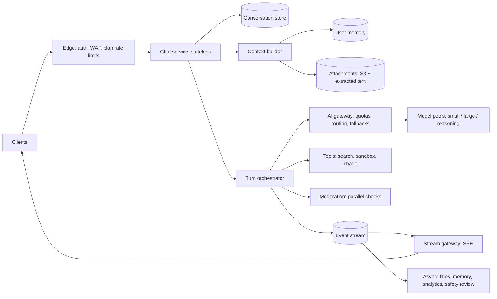

# ChatGPT-Scale Consumer Chat

> [!abstract] The prompt
> "Design a consumer AI chat product like ChatGPT: tens of millions of daily users, streaming answers, conversation history, file uploads, web search and a code tool, free and paid plans." The hard parts: **GPU capacity and quotas**, **streaming at scale**, **conversation storage and context assembly**, **routing between models**, **safety**, and **multi-region**.

---

## 1. Requirements

**Functional**
- Multi-turn chat with streamed responses; regenerate, edit, stop.
- Conversation history: list, search, rename, delete, share.
- Attachments (PDFs, images); tools: web search, code interpreter, image generation.
- Plans: free (smaller model, tight limits), paid (larger models, higher limits).
- Optional memory of user preferences across chats.

**Non-functional**
- p95 time to first token < 1 s for small models, < 2 s for large; smooth streaming.
- Availability 99.9%+ for chat; history never lost.
- Graceful behaviour at peak: degrade, don't fall over.
- Safety and abuse protection; privacy controls (history off, deletion).

---

## 2. Estimation

- **50M DAU × ~10 messages/day = 500M messages/day ≈ 5.8k/s average, ~15–20k/s peak.**
- Per message (heuristic): ~2k input tokens (system prompt + history + attachments) and ~400 output tokens.
- Peak output: ~17k msg/s × 400 ≈ **~7M output tokens/s**. At a few thousand output tokens/s per GPU replica (model- and batch-dependent), that is **thousands of GPUs** at peak, so GPU capacity, batching efficiency and routing *are* the system ([[13 - GPU Serving and Disaggregated KV Cache]]).
- Input dominates token count: multi-turn history re-sent per turn, so **prefix caching** across turns of the same conversation is a major saving ([[12 - LLM Cost and Latency Economics]]).
- Storage: 500M messages/day × ~2 KB ≈ **~1 TB/day** of conversation text, plus attachments in object storage.

---

## 3. Architecture

- **Turn = a run**: the orchestrator executes the turn (possibly with tool calls) and publishes events (tokens, tool status, done) to a stream; the client's SSE connection is just a subscriber, so a dropped connection doesn't lose the answer ([[09 - Durable Execution HITL and Realtime UX]]).

---

## 4. Deep Dive: Conversation Storage and Context Assembly

- **Store**: a wide-column or key-value store partitioned by `conversation_id`, messages clustered by sequence number ([[24 - Cassandra and DynamoDB]]); a per-user index of conversations by `updated_at` for the sidebar. Messages are append-only; edits create a new branch (a tree of messages, with the "current path" stored).
- **Context assembly** per turn:
    1. System prompt + tool definitions (**stable prefix**, identical across users of the same model and plan).
    2. Relevant memory facts (small).
    3. Conversation history: recent turns verbatim; older turns as a running summary once past a token threshold ([[04 - State Memory and Context Engineering]]).
    4. Attachment content: extracted text chunks retrieved for the question, not whole files.
- **Cache-friendly order**: stable prefix first, then history in the same order every turn, new message last; summaries refreshed in chunks so the prefix stays stable for many turns.

---

## 5. Deep Dive: Capacity, Quotas and Degradation

- **Per-plan token buckets** at the gateway: tokens per minute and messages per window per user, reserved before the call and reconciled after ([[10 - AI Gateway Security and Guardrails]]).
- **Admission and queueing**: when a model pool is saturated, queue briefly with a deadline rather than overloading GPUs; beyond the deadline, return a clear "busy" with retry-after.
- **Degradation ladder at peak**:
    1. Route free-tier traffic to a smaller model.
    2. Lower reasoning effort / max output tokens for free users.
    3. Disable expensive tools (image generation) for free tiers.
    4. Shed lowest-priority traffic ([[08 - Reliability]]).
- **Paid traffic isolation**: separate capacity pools or priority classes so free-tier spikes can't starve paying users.

---

## 6. Deep Dive: Routing and Inference

- **Model routing**: by plan, by user choice, and by request (a cheap classifier sends simple messages to a small model when the user hasn't pinned one) ([[12 - LLM Cost and Latency Economics]]).
- **Prefix-aware routing**: turns of the same conversation go to replicas that hold its KV prefix; the shared system-prompt prefix is warm everywhere ([[13 - GPU Serving and Disaggregated KV Cache]]).
- **Serving**: continuous batching, chunked prefill for long attachments, FP8 where quality allows, speculative decoding for latency; disaggregated prefill/decode pools at this scale ([[14 - Quantization Decoding and VRAM Math]]).
- **Fallbacks**: provider or pool failure fails over to another region's pool or a same-tier model, evaluated beforehand.

---

## 7. Deep Dive: Tools

- **Web search**: query → search API → fetch and extract top pages → cite. Fetched pages are untrusted: they go through a quarantined summarisation step and links/images in output are sanitised ([[10 - AI Gateway Security and Guardrails]]).
- **Code interpreter**: per-conversation microVM sandbox, no network or allow-listed egress, CPU/time/memory limits, files mounted from the conversation's attachments, destroyed after idle timeout.
- **Bounded loops**: max tool calls per turn, token budget per turn ([[02 - Execution Loops and Control Topologies]]).

---

## 8. Deep Dive: Safety and Abuse

- **Input and output moderation** run **in parallel** with generation (not before it), so they don't add latency; output checks run on streamed chunks and can stop the stream ([[11 - LLM Content Moderation Pipeline]]).
- **Abuse**: per-account and per-IP limits, bot detection at signup, anomaly detection on token usage (scraping, reselling API access).
- **Privacy**: "history off" mode writes nothing durable beyond abuse-retention windows; user deletion propagates to conversation store, search index, memory and analytics ([[18 - Security]]).

---

## 9. Deep Dive: Multi-Region

- **Home region per user** for conversation data (writes go to one region, avoiding conflicts) ([[17 - Consistency Time and Consensus]]).
- **Inference is region-flexible**: requests can run on GPUs in another region when the home region is saturated (latency cost of a few tens of ms is small next to generation time), subject to data-residency rules.
- Regional outage: fail users over to a secondary region; recent conversations may be briefly unavailable (async replication), chat itself keeps working.

---

## 10. Evals and Observability

- Per model and prompt version: offline eval suites (helpfulness, safety, refusal correctness, tool use) gating releases ([[11 - Evals Observability and Silent Drift]]).
- Online: thumbs, regenerate rate, stop rate, conversation length, safety flags, TTFT and tokens/s per pool, cost per DAU.
- Canary every model or system-prompt change to a small percentage before full rollout ([[19 - Deployment and Infrastructure]]).

---

## 11. Failure Modes

| Failure | Mitigation |
|---|---|
| GPU saturation at peak | Per-plan quotas, queue with deadlines, degradation ladder, paid-tier isolation |
| Dropped stream loses answer | Run decoupled from connection; resumable event ids; fetch final message |
| Long histories blow cost and latency | Running summaries, retrieval over attachments, prefix caching |
| Cache misses every turn | Stable prefix order; prefix-aware routing per conversation |
| Injected web content hijacks the turn | Quarantined page processing; sanitised links/images; no private-data tools on web turns |
| Code sandbox abuse | microVM isolation, egress control, limits, idle teardown |
| Regional outage | Home-region failover; inference rerouting |
| Model update changes behaviour | Pinned versions, eval gates, canaries |

---

## Interview Lines

> [!tip] Say it like this
> - "At ~17k messages a second with ~400 output tokens each, GPU capacity is the system, so quotas, batching, routing and prefix caching come first."
> - "A turn is a run that publishes events; the SSE connection is just a subscriber, so reconnects don't lose answers."
> - "Context is a stable system prefix, a few memory facts, recent turns verbatim and a running summary, in a cache-friendly order."
> - "At peak I degrade free tiers to smaller models and fewer tools before shedding, and isolate paid capacity."
> - "Conversation data has a home region; inference can run wherever GPUs are free, within residency rules."

## Related Notes

- [[Agentic/Problems/README]] · [[12 - LLM Cost and Latency Economics]] · [[13 - GPU Serving and Disaggregated KV Cache]] · [[09 - Durable Execution HITL and Realtime UX]]
