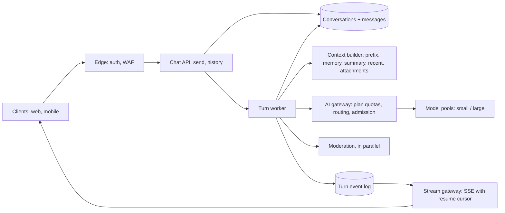
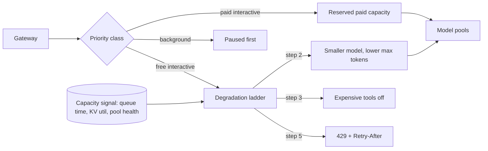
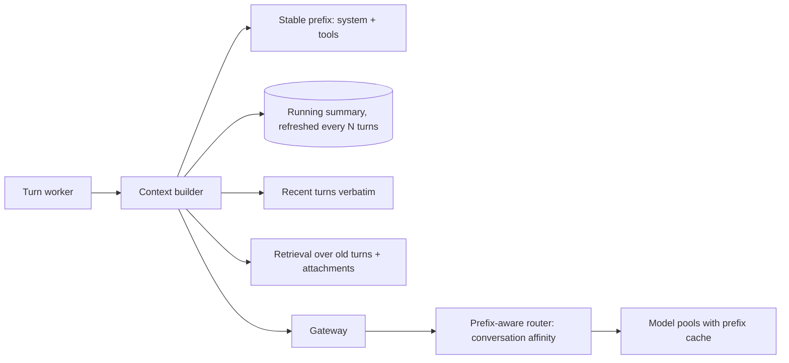
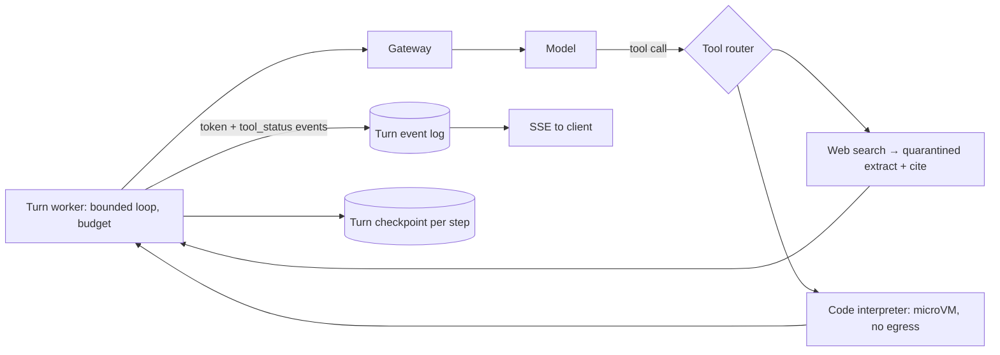
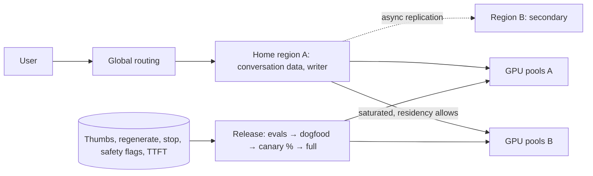

# ChatGPT-Scale Consumer Chat

> [!abstract] Asked at OpenAI ("Design ChatGPT", technical screen, October 2026; streaming replies over SSE and rendering long conversations, onsite, July 2026) and J.P. Morgan (large-scale ChatGPT-style assistant: serving, streaming and scaling, technical screen, August 2026), and in many 2026 question banks as "Design a ChatGPT-like assistant". Topics: [[09 - Durable Execution HITL and Realtime UX|09]] (streams that outlive connections) → [[04 - State Memory and Context Engineering|04]] (context assembly past the window) → [[12 - LLM Cost and Latency Economics|12]] (capacity in tokens, tiers, degradation) → [[13 - GPU Serving and Disaggregated KV Cache|13]] (prefix reuse, batching) → [[10 - AI Gateway Security and Guardrails|10]] (quotas, moderation, abuse) → [[11 - Evals Observability and Silent Drift|11]] (model rollouts).
>
> The hard part: a reply takes seconds and runs on scarce, expensive accelerators. Size everything in **tokens per second and concurrent streams**, not requests; make the reply **outlive the connection** so a refresh or a second device neither loses it nor shows it twice; and decide in advance **who gets served first** when capacity halves.

---

## 1. Clarify Script

Defaults are assumptions unless a source is given.

| Question | Default | If different |
|---|---|---|
| Scope: product around an existing model, or also serving it? | Both, but serving at the level of pools and routing; engine internals in [[07 - LLM Inference Platform]] | Product only (OpenAI's screen allows treating the model as a service) → spend the time on streaming, storage and quotas |
| Users? | 50M daily users, ~10 messages each | 1M DAU → one region, far fewer GPUs |
| Latency? | Time to first token p95 < 1 s (small model), < 2 s (large); smooth streaming | — |
| Tiers? | Free (smaller model, tight limits) and paid (larger models, higher limits, priority) | Single tier → no priority classes |
| Features? | History and search, edit and regenerate, stop, file uploads, web search and code tool, share links, many devices per user | Text only → drop V3 |
| Safety? | Input and output moderation; abuse prevention | — |
| Retention? | Kept until deleted; "history off" mode keeps nothing durable beyond an abuse window | Regulated users → regional storage |

---

## 2. Requirements

### Functional

- Multi-turn chat with streamed replies; regenerate, edit (branches), stop.
- History: list, search, rename, delete, share; the same conversation on every device.
- Attachments; tools (web search, code interpreter) that the model can call mid-reply.
- Plans with different models and limits; optional memory of preferences.

### Non-functional

- TTFT targets as above; **no reply lost or shown twice** on disconnect, refresh or device switch.
- Chat availability 99.9%+; history never lost.
- Degrade gracefully at peak or when GPU capacity drops; paid users protected.
- Moderation, abuse limits, deletion that reaches every copy.

### Out of scope

- Model training; the engine internals (see 07).

---

## 3. Estimates That Drive V0

```
Messages:   50M DAU × 10 = 500M/day ≈ 5.8k/s average, ~15–20k/s peak
Per turn:   ~2k input (system + history + attachments), ~400 output tokens
Output:     ~17k msg/s × 400 ≈ ~7M output tokens/s at peak
Streams:    each reply streams ~10–20 s → ~200–300k concurrent open streams at peak
GPUs:       at a few thousand output tokens/s per replica (model and batch dependent)
          → thousands of GPU replicas at peak
Input:      ~17k × 2k ≈ 34M input tokens/s, mostly repeated history → prefix caching matters
Storage:    500M messages × ~2 KB ≈ ~1 TB/day of text, plus attachments in object storage
```

- **GPU capacity is the system**: sized from output tokens per second, it decides quotas, batching, routing and the degradation order.
- **Concurrent streams, not requests**, size the streaming tier: hundreds of thousands of long-lived connections.
- **Input tokens dominate count** because history is re-sent every turn, so the context layout must keep a stable prefix that caches across turns.

---

## 4. Entities, Tools and State

### API

| Call | What code enforces |
|---|---|
| `POST /conversations/{id}/messages` | Auth; plan quota reserved (tokens per minute, messages per window); idempotency key from the client so a retried send doesn't create two turns; returns `turn_id` |
| `GET /turns/{turn_id}/stream?after=<seq>` (SSE) | Subscribes to the turn's event log from a sequence number; works from any device |
| `POST /turns/{turn_id}/stop` | Cancels generation; the partial reply is saved as final |
| `GET /conversations?cursor=` | Sidebar, ordered by `updated_at` |

### State

```
conversations(user_id, conversation_id, title, updated_at, current_leaf_message_id)  -- sidebar index by user
messages(conversation_id, message_id, parent_id, role, content, model, status {streaming|done|stopped|failed},
         created_at)                                                -- a tree: edits create branches
turn_events(turn_id, seq, type {token|tool_status|done|error}, payload)   -- short-lived log, minutes to hours
summaries(conversation_id, upto_message_id, text)                   -- running summary for long chats
quotas(user_id, plan, window, tokens_used, messages_used)
```

- Conversation data partitioned by `conversation_id` in a wide-column or key-value store; a per-user index for the sidebar ([[24 - Cassandra and DynamoDB]]).

---

## 5. V0 — Simplest Design That Works

- **A turn is a run, not a request.** The send call creates a `turn_id` and starts a turn worker; the worker assembles context, calls the model, runs any tools, and appends events (`token`, `tool_status`, `done`) to the turn's event log. The SSE connection is just a **subscriber** to that log with a resume cursor ([[09 - Durable Execution HITL and Realtime UX]]).
- **Why SSE**: replies flow one way from server to client; SSE works over plain HTTP through proxies and CDNs, has built-in reconnect with `Last-Event-ID`, and the send is a normal POST. WebSockets add bidirectional state you don't need (OpenAI's July 2026 onsite probes exactly this choice).
- **Persist as you go**: the assistant message row is created at turn start with `status = streaming` and updated in chunks; on `done` it's final. A refresh or a second device loads the message and resumes the stream from the last seq it has, so nothing is lost or duplicated.
- **Context assembly**, cache-friendly order: system prompt and tool definitions (identical for all users of a model and plan) → a few memory facts → running summary of old turns → recent turns verbatim → retrieved chunks of attachments → the new message ([[04 - State Memory and Context Engineering]]).
- **Gateway**: per-plan token buckets, reserved before the call and reconciled after; routing by plan and user choice; admission control with a short queue and deadline ([[10 - AI Gateway Security and Guardrails]]).
- **Moderation in parallel** with generation; output checks on streamed chunks can stop the stream ([[11 - LLM Content Moderation Pipeline]]).



> [!important] The most drilled component
> Replies that outlive connections. OpenAI's screen hint is literally "Replies outlive connections" and its follow-up: "a user closes the tab halfway through a reply and opens the conversation on a phone. What do they see?"; J.P. Morgan asks how a dropped connection gets the rest without regenerating. The answer: the turn runs independently of any connection and writes to an event log and the message row; the phone loads the conversation, sees the message with `status = streaming` and the text so far, and subscribes from its last seq. Generation is never restarted because a socket closed.

### What V0 can't handle

- **Capacity incidents**: GPUs drop by half or traffic doubles and the gateway has no order of who to serve.
- **Long conversations** past the context window.
- **Tools mid-reply** with untrusted web content and code execution.
- **Regions**: one home for data and inference.
- **Model changes** reaching 50M users at once.

---

## 6. Scale Ladder

### V1 — Capacity incidents: who is served first

- **Evidence:** OpenAI (Oct 2026): "Accelerator capacity drops by half during an incident. How does the service degrade, and who is served first?"; J.P. Morgan (Aug 2026): "Traffic doubles at peak and more GPUs cannot be added quickly. What degrades first?"; both ask for queueing, admission control, per-tier limits and graceful degradation. Confidence **strong**.
- **Trigger:** peak traffic above provisioned GPUs, or a GPU pool or region losing capacity.
- **What breaks:** every request queues; TTFT goes to tens of seconds for everyone; paying users churn.
- **Change ([[12 - LLM Cost and Latency Economics]], [[08 - Reliability]]):**
    + **Priority classes** at the gateway and in the engine scheduler: paid interactive > free interactive > background (titles, summaries, memory extraction) > batch.
    + **Degradation ladder**, applied in order and reversed in order:
        1. Pause background work (titles, memory, summaries can wait).
        2. Route free traffic to a smaller model; lower reasoning effort and max output tokens for free users.
        3. Disable expensive tools (image generation, long code runs) for free.
        4. Tighter free-tier rate limits with an honest "high demand" message.
        5. Shed free traffic with `Retry-After`; paid stays within SLO.
    + **Admission with deadlines**: a request that can't start within its TTFT budget is rejected fast rather than queued to time out.
    + **Separate capacity reservations** for paid tiers so free spikes can't starve them.
- **Trade-off:** free users see a worse product during peaks; the alternative is everyone seeing a broken one.



### V2 — Long conversations and prefix reuse

- **Evidence:** OpenAI (Oct 2026) and J.P. Morgan (Aug 2026) both ask "a conversation grows longer than the model's context window. What do you send?"; J.P. Morgan's hint: what does the model need to see on every turn, and what does that cost as the conversation grows. Confidence **strong**.
- **Trigger:** conversations past ~50 turns or with large attachments; input tokens per turn growing linearly.
- **What breaks:** cost and TTFT grow every turn; at the window limit requests fail.
- **Change ([[04 - State Memory and Context Engineering]], [[13 - GPU Serving and Disaggregated KV Cache]]):**
    + **Running summary** of older turns, refreshed in chunks (every N turns) so the prefix stays stable for many turns between refreshes; recent turns verbatim.
    + **Retrieval** over the conversation's own older turns and attachments for the current question, instead of pasting them.
    + **Prefix-aware routing**: turns of the same conversation go to replicas likely to hold its KV prefix; the shared system prompt is warm everywhere.
    + **Hard limits** per plan on context length; tell the user when older parts are summarised.
- **Trade-off:** summaries lose detail; retrieval over old turns brings it back when the question needs it.



### V3 — Tools mid-reply

- **Evidence:** OpenAI (Oct 2026): "How would you add tools, such as web search or running code, that the model can call in the middle of a reply?". Confidence **medium**.
- **Trigger:** web search and code interpreter launch.
- **What breaks:** a turn is no longer one model call; web pages can carry injected instructions; user code needs isolation.
- **Change ([[02 - Execution Loops and Control Topologies]], [[10 - AI Gateway Security and Guardrails]]):**
    + **The turn worker runs a bounded loop**: model → tool call → tool result → model, with max tool calls and a token budget per turn; `tool_status` events stream to the client ("Searching…", "Running code…").
    + **Web search**: fetched pages are untrusted; extract and summarise them in a quarantined step, cite sources, sanitise links and images in output so they can't exfiltrate data via URLs.
    + **Code interpreter**: per-conversation microVM, no network or allow-listed egress, CPU, memory and time limits, files mounted from the conversation, torn down after idle.
    + **Turn state is durable** across tool calls so a worker crash mid-turn resumes from the last completed step.
- **Trade-off:** tool turns cost more and take longer; limit them per plan.



### V4 — Multi-region and safe model rollouts

- **Evidence:** OpenAI (Oct 2026) lists scaling across regions and observability (TTFT, tokens/s, queue time); J.P. Morgan (Aug 2026): "How would you roll out a new model version safely?". Confidence **medium**.
- **Trigger:** users on several continents; a regional outage; a new model or system prompt for everyone.
- **Change ([[17 - Consistency Time and Consensus]], [[11 - Evals Observability and Silent Drift]]):**
    + **Home region per user** for conversation data (single writer, no conflicts); async replication to a secondary.
    + **Inference is region-flexible**: a turn can run on GPUs in another region when home is saturated, within data-residency rules; the extra network latency is small next to generation time.
    + **Regional outage**: users fail over to the secondary; the latest messages may be briefly missing (async replication) but chat keeps working.
    + **Model rollouts**: offline evals (helpfulness, safety, refusals, tool use) → internal dogfood → canary by percentage with online metrics (thumbs, regenerate and stop rates, safety flags, TTFT) → full; rollback is a routing change.
- **Trade-off:** cross-region inference sends prompts across regions, which residency rules may forbid for some users.



---

## 7. Twist Cards

### Most asked

**T1 — "The user closes the tab halfway through a reply and opens the conversation on a phone. What do they see?"**
- **Evidence:** OpenAI (Oct 2026), verbatim; J.P. Morgan (Aug 2026) "connection drops halfway". Confidence **strong**.
- **Hits:** streaming, storage.
- **Answer:** the turn keeps running; the phone loads the conversation, gets the assistant message with `status = streaming` and the text so far from the message row, then subscribes to the turn's SSE stream from that sequence number. When it ends, the row is final. No regeneration, no duplicate. If the user wants it stopped, closing the tab doesn't do that; the stop button does (decide whether to stop on "all subscribers gone for N minutes" to save GPUs on abandoned free-tier turns).
- **Attaches to:** V0.

**T2 — "GPU capacity halves. Who is served first?"**
- **Evidence:** OpenAI (Oct 2026); J.P. Morgan (Aug 2026). Confidence **strong**.
- **Hits:** degradation.
- **Answer:** V1's ladder: background work paused, free traffic to smaller models with shorter outputs, expensive tools off for free, tighter free limits, then shed free with `Retry-After`; paid interactive stays on reserved capacity. Reverse the steps as capacity returns, with hysteresis.
- **Attaches to:** V1.

**T3 — "The conversation is longer than the context window."**
- **Evidence:** OpenAI; J.P. Morgan. Confidence **strong**.
- **Hits:** context.
- **Answer:** V2: stable prefix, running summary of old turns refreshed in chunks, recent turns verbatim, retrieval over older turns and attachments for this question. Say how many tokens each part gets.
- **Attaches to:** V2.

**T4 — "SSE or WebSockets?"**
- **Evidence:** OpenAI onsite (Jul 2026). Confidence **strong**.
- **Hits:** transport.
- **Answer:** SSE: one-way server push is all a reply needs; plain HTTP through proxies and CDNs; automatic reconnect with `Last-Event-ID`; the send is a normal POST. WebSockets if you need true bidirectional low-latency messaging (voice, collaborative editing). At scale, the stream gateway holds hundreds of thousands of idle-ish connections, so it's a separate, connection-optimised tier.
- **Attaches to:** V0.

**T5 — "How does the frontend keep a 500-message conversation smooth?"**
- **Evidence:** OpenAI onsite (Jul 2026). Confidence **medium**.
- **Hits:** client.
- **Answer:** virtualised list (render only visible messages), load older messages by cursor on scroll, batch token appends per animation frame instead of re-rendering per token, incremental markdown rendering of only the streaming message, memoise finished messages.
- **Attaches to:** V0.

**T6 — "How do you roll out a new model?"**
- **Evidence:** J.P. Morgan (Aug 2026). Confidence **medium**.
- **Hits:** release.
- **Answer:** V4: offline evals, dogfood, canary by percentage with online metrics, rollback by routing.
- **Attaches to:** V4.

### Lower priority (recall / judgement)

**T7 — "A user double-clicks send."**
- **Evidence:** none specific. Confidence **judgement**.
- Client-generated idempotency key per send; the API returns the existing `turn_id` for a repeat.

**T8 — "Edit an earlier message."**
- **Evidence:** OpenAI lists edit and regenerate in scope. Confidence **medium**.
- Messages form a tree; an edit creates a sibling branch and the conversation's `current_leaf` moves; context is built from the path to the current leaf.

**T9 — "Abuse: scraping and reselling free access."**
- **Evidence:** OpenAI lists abuse prevention. Confidence **medium**.
- Per-account and per-IP token limits, bot detection at signup, anomaly detection on usage patterns, device and payment signals for paid tiers.

**T10 — "User deletes their account."**
- **Evidence:** OpenAI lists retention and deletion guarantees. Confidence **medium**.
- Deletion fans out to conversations, search index, memory, attachments, turn logs and analytics, with a tracked job and a deadline; abuse-retention copies kept only as policy allows ([[18 - Security]]).

---

## 8. Break It

| Failure | What the user sees | What you say |
|---|---|---|
| Connection drops mid-reply | Reply continues after reconnect | Turn decoupled from connection; resume by seq |
| Second device opens the chat | The same partial reply, streaming | Message row + event log with cursor |
| Double send | One turn | Idempotency key |
| GPU capacity halves | Paid fine; free gets smaller model or "busy" | Priority classes and degradation ladder |
| Long conversation | Still fast | Summary + recent + retrieval, prefix caching |
| Injected web page | Answer with citations, no hijack | Quarantined extraction, sanitised links |
| Code sandbox abuse | Run limited or stopped | microVM, no egress, limits |
| Regional outage | Chat works; newest messages may lag briefly | Home-region failover, async replication |
| Bad model release | Rolled back | Canary with online metrics |

---

## 9. Evals, Operations and Cost

| Tier | Checks |
|---|---|
| **Offline** | Helpfulness, safety, refusal correctness, tool use suites per model and system-prompt version |
| **Streaming** | Chaos tests: kill connections, workers and stream nodes mid-turn; assert no lost or duplicated replies |
| **Online** | Thumbs, regenerate rate, stop rate, conversation length, safety flags per model version |

- **Production metrics:** TTFT and tokens/s per pool, queue time, concurrent streams, reconnect rate, prefix-cache hit rate, degradation step currently active, cost per DAU per plan.
- **Alerts:** TTFT p95 above target for paid; queue time rising; cache hit rate drop after a prompt change; spike in stop or regenerate rate after a release.
- **Cost drivers:** output tokens on large models, input tokens from long histories, tool runs, idle streaming connections (small).

---

## 10. One-Minute Close

> "Sized in tokens: ~17k messages a second at peak with ~400 output tokens each is ~7M output tokens a second, so GPU capacity is the system. A send creates a turn that runs on its own worker, writes to the message row and a turn event log, and the SSE connection only subscribes with a resume cursor, so a closed tab or a second device never loses or duplicates a reply. Context is a stable shared prefix, a few memory facts, a running summary refreshed in chunks, recent turns and retrieved attachment chunks, routed with conversation affinity for prefix-cache hits. The gateway has per-plan token buckets and priority classes; when capacity halves, a fixed ladder pauses background work, moves free users to smaller models and fewer tools, and sheds free traffic before paid is touched. Tools run in a bounded loop with quarantined web content and microVM sandboxes. Data has a home region, inference can run where GPUs are free, and models roll out through evals and canaries."

---

## Evidence

Reports tallied in November 2026.

| Follow-up | Reports | Count | Placed as | Deep dive? |
|---|---|---|---|---|
| Reply outlives the connection; tab closed, phone opened | OpenAI (Oct 2026); J.P. Morgan (Aug 2026) | 2 | V0 + T1, **strong** | Yes |
| Capacity halves or doubles: who is served first | OpenAI; J.P. Morgan | 2 | V1 + T2, **strong** | Yes |
| Conversation longer than the context window | OpenAI; J.P. Morgan | 2 | V2 + T3, **strong** | Yes |
| Size in tokens and concurrent streams | OpenAI; J.P. Morgan | 2 | §3, **strong** | Sometimes |
| SSE vs WebSockets; rendering long conversations | OpenAI onsite (Jul 2026) | 1 | T4, T5, **strong** / **medium** | Sometimes |
| Tools mid-reply | OpenAI (Oct 2026) | 1 | V3, **medium** | Sometimes |
| Model rollout | J.P. Morgan | 1 | V4 + T6, **medium** | No |
| Multi-region, deletion, abuse | OpenAI scope list | 1 | V4, T9, T10, **medium** | No |
| Double send, edit branches | OpenAI scope list / none | 0–1 | T7, T8, **judgement** / **medium** | No |

- **What the tally changed:** the old note's turn-as-run design, context assembly, quotas, tools, safety and multi-region content stays, regrouped. Added: persisting the streaming message so a second device resumes it (V0, T1), an explicit ordered degradation ladder for "capacity halves" (V1), chunked summary refresh to keep the prefix cacheable (V2), the SSE vs WebSocket argument and long-conversation rendering (T4, T5), and idempotent sends (T7).

## Sources

- PracHub, *Design a ChatGPT-style chat service with streaming model replies* (OpenAI, technical screen, October 2026). https://prachub.com/interview-questions/design-a-chatgpt-style-chat-service-with-streaming-model-replies
- PracHub, *Design ChatGPT: Streaming Replies over SSE and Rendering Long Conversations* (OpenAI, onsite, July 2026). https://prachub.com/interview-questions/design-chatgpt-streaming-replies-over-sse-and-rendering-long-conversations
- PracHub, *Design a Large-Scale ChatGPT-Style Assistant: Serving, Streaming and Scaling* (J.P. Morgan, technical screen, August 2026). https://prachub.com/interview-questions/design-a-large-scale-chatgpt-style-assistant-serving-streaming-and-scaling

## Related Notes

- [[Agentic/Problems/README]] · [[07 - LLM Inference Platform]] · [[09 - Durable Execution HITL and Realtime UX]] · [[04 - State Memory and Context Engineering]] · [[12 - LLM Cost and Latency Economics]] · [[13 - GPU Serving and Disaggregated KV Cache]] · [[11 - LLM Content Moderation Pipeline]] · [[Agentic Problem to Solution Map]]
