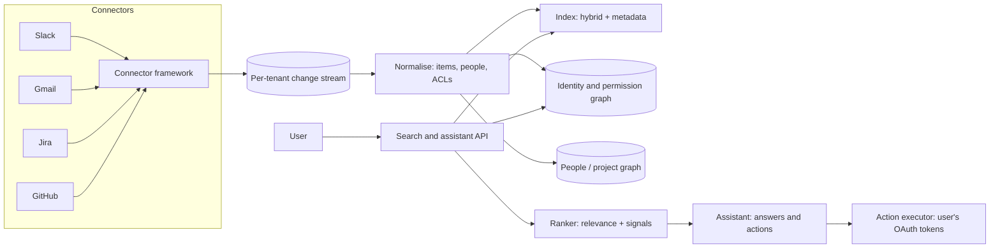

# Enterprise Search over SaaS Connectors

> [!abstract] The prompt
> "Design workplace search with an AI assistant (Glean / Copilot style): employees search and ask questions across Slack, Gmail, Drive, Jira, Confluence, GitHub and Salesforce, and can take actions like creating a ticket." Differs from [[02 - Multi-Tenant Document RAG]] in the hard parts: **dozens of connectors with hostile APIs**, **normalising identities and permissions across apps**, **indexed vs federated search**, **ranking with workplace signals**, and **acting on the user's behalf**.

---

## 1. Requirements

**Functional**
- Connectors for 20–100 SaaS apps: initial crawl plus incremental sync.
- Unified search (keyword + semantic) and an assistant that answers with citations across sources.
- Results respect each user's permissions in every source app.
- People and project awareness ("docs Priya wrote about the payments migration").
- Actions through the assistant: create a Jira ticket, draft a Slack message, using the user's own access.

**Non-functional**
- **No permission leakage**, including after access is revoked in a source app.
- Freshness: new content searchable in minutes; permission changes applied quickly.
- Search p95 < 500 ms; assistant answer start < 2 s.
- Scale: a 10k-employee customer with ~100M items (messages, emails, docs, tickets).

---

## 2. Estimation

- 100M items per large tenant; emails and Slack messages are small, docs are chunked: ~300–500M chunks for the largest tenants ([[08 - Vector DB Internals and Hybrid Search]] for memory math and quantization).
- Initial crawl is bounded by **source API rate limits**, not our compute: e.g. a few hundred requests per minute per app per tenant means a full backfill takes days, so prioritise recent and popular content first.
- Steady-state change volume: tens of millions of Slack messages and emails per day across tenants, so the ingestion pipeline is a high-throughput stream ([[07 - Async Messaging]]).

---

## 3. Architecture

---

## 4. Deep Dive: The Connector Framework

- Each source app has different APIs, limits and change models, so connectors share a framework:
    + **Change capture**: webhooks/events where available (Slack events, Gmail push), cursor-based incremental polling otherwise, plus **periodic full reconciliation** to catch missed events and deletions.
    + **Rate-limit aware scheduling**: per-app, per-tenant token buckets; honour `Retry-After`; exponential backoff with jitter ([[08 - Reliability]]).
    + **Checkpointed cursors** so crawls resume after crashes; idempotent upserts by `(source, external_id)`.
    + **Priority queues**: deletes and permission changes first, then recent edits, then backfill.
- Connector health per tenant (lag, error rate, last successful sync) is a first-class metric and admin UI.

---

## 5. Deep Dive: Identities and Permissions Across Apps

- The same person is `U024X` in Slack, `priya@corp.com` in Gmail and `priya-k` on GitHub. **Identity resolution** maps them to one internal person using the company's identity provider (SCIM/Okta/Azure AD) plus email matching.
- Permissions differ per app (Drive sharing, Slack channel membership, Jira project roles, GitHub repo teams). Normalise them into a **permission graph**: item → readable by {users, groups}; groups → members.

| Approach | How | Gains | Costs |
|---|---|---|---|
| **Expand ACLs onto items** (store every allowed user per item) | Simple filter at query time | Fast queries | Huge write fan-out when a big group changes |
| **Store groups on items; resolve user's groups at query time** | `item.allowed_groups ∩ user.groups` | Group changes are one update | Must keep group membership fresh and fast to resolve |
| **Hybrid** | Groups on items, small direct shares expanded | Balanced | More logic |

- Enforcement is **inside retrieval** with filter-aware search, then cited items are **re-checked** against the permission graph before display ([[06 - RAG Ingestion and Indexing Pipeline]], [[10 - AI Gateway Security and Guardrails]]).
- For the most sensitive sources, optionally re-check access **live** against the source API for the final few results.

---

## 6. Deep Dive: Indexed vs Federated Search

| | Indexed (copy content into our index) | Federated (query each app's search API live) |
|---|---|---|
| Latency | Fast, consistent | Slowest app sets latency |
| Ranking | Unified, tunable, semantic | Each app ranks its own results; merging is crude |
| Freshness | Minutes behind | Real-time |
| Permissions | We must mirror them correctly | Correct by construction (the app checks) |
| Rate limits | Paid at crawl time | Paid at query time, per search |
| Pick when | Default for core apps | Apps that forbid copying data, very sensitive sources, or long-tail connectors |

- Common design: **index the core apps, federate the long tail**, merge with rank fusion ([[08 - Vector DB Internals and Hybrid Search]]).

---

## 7. Deep Dive: Ranking with Workplace Signals

- Text relevance alone ranks a two-year-old draft above the current spec. Workplace search adds signals:
    + **Recency** and **activity** (recent edits, views, replies).
    + **Popularity** within the company (views, links, reactions).
    + **People graph**: content from people you work with, your team, your org.
    + **Authority**: official spaces, pinned docs, verified answers.
    + **Clicks**: learning-to-rank from which results users open, with position-bias correction.
- Pipeline: hybrid retrieval (BM25 + dense, RRF) → feature-based ranker with these signals → cross-encoder rerank of the top few for the assistant ([[09 - Storage Search and Geo]]).

---

## 8. Deep Dive: The Assistant and Actions

- Questions route to: search over the index, structured queries over Jira/Salesforce APIs ("open P1 bugs assigned to my team"), or people lookups (the graph) ([[07 - Agentic RAG and Grounding Loops]]).
- **Actions use the user's own delegated OAuth token** for that app, never a super-admin service account, so the source app enforces the user's real permissions ([[03 - Tool Engineering and Action Spaces]]).
- Write actions show a preview and require confirmation; tokens stored encrypted per user, scoped minimally, refreshable and revocable.
- Indirect injection is real here (emails and Slack messages from outsiders): content from untrusted senders is treated as data, and actions after reading external content require explicit user confirmation ([[10 - AI Gateway Security and Guardrails]]).

---

## 9. Evals

- Retrieval: labelled query sets per connector type; recall@k and click-based metrics.
- Permission suite: synthetic users with known access across apps; any leak fails the release.
- Assistant: faithfulness and citation accuracy; action correctness in a sandbox tenant ([[11 - Evals Observability and Silent Drift]]).
- Connector health SLOs: sync lag, error rates, reconciliation diffs.

---

## 10. Failure Modes

| Failure | Mitigation |
|---|---|
| Revoked access still searchable | Permission changes prioritised; reconciliation; live re-check for sensitive sources |
| Duplicate or wrong identities | IdP-backed identity resolution; email matching; admin overrides |
| Backfill blocked by rate limits | Priority crawl of recent/popular content; per-app token buckets; resumable cursors |
| Big group change fans out millions of writes | Groups on items, membership resolved at query time |
| Stale docs outrank current ones | Recency, activity and authority signals in ranking |
| Assistant acts with too much privilege | User-delegated OAuth tokens; confirmation for writes |
| Injection via inbound email or Slack | Treat as data; confirmations after untrusted reads |

---

## Interview Lines

> [!tip] Say it like this
> - "The hard part isn't search, it's mirroring permissions from dozens of apps correctly and keeping them fresh."
> - "I resolve one identity per person through the IdP, store groups on items, and resolve the user's groups at query time."
> - "Core apps are indexed for speed and ranking; long-tail or copy-restricted apps are federated and fused."
> - "Ranking adds recency, popularity, the people graph and click feedback on top of hybrid retrieval."
> - "Actions run with the user's own delegated token and need confirmation, so the source app enforces their real permissions."

## Related Notes

- [[Agentic/Problems/README]] · [[02 - Multi-Tenant Document RAG]] · [[06 - RAG Ingestion and Indexing Pipeline]] · [[08 - Vector DB Internals and Hybrid Search]]
