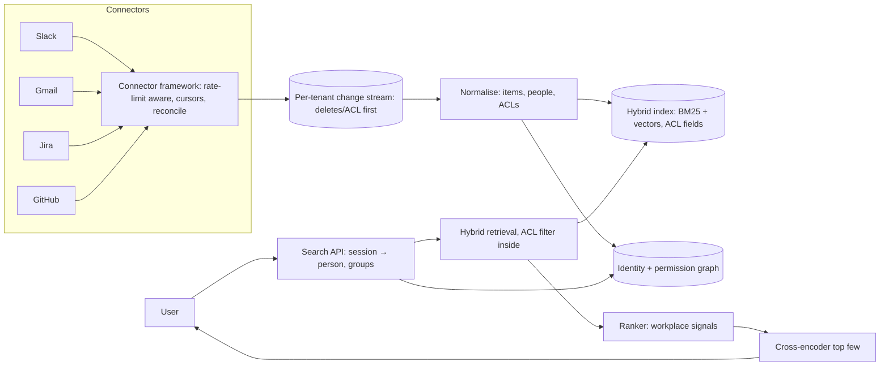
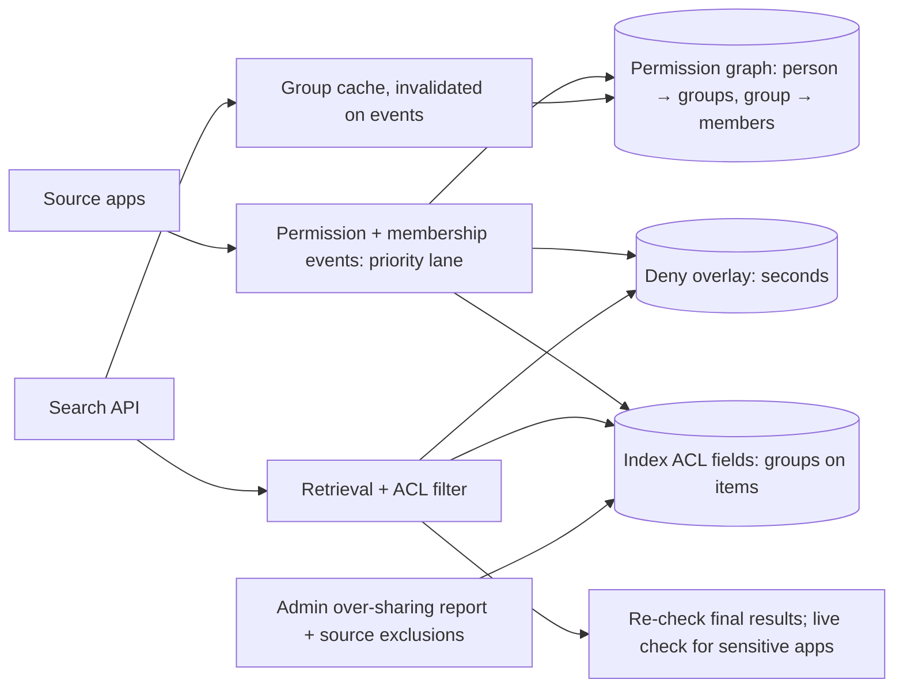
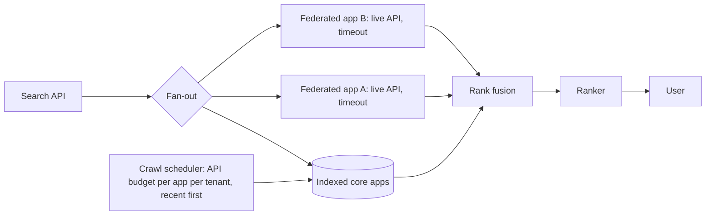
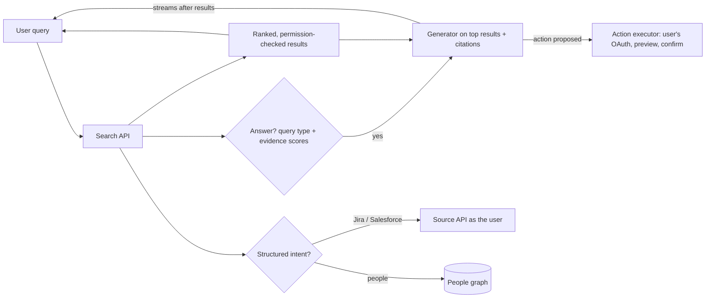
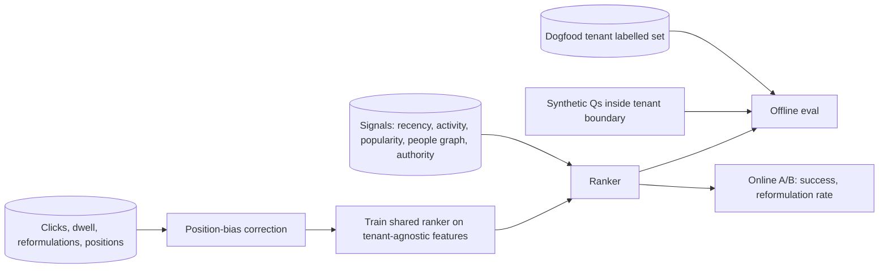

# Enterprise Search over SaaS Connectors

> [!abstract] Asked at Atlassian (enterprise search with ranked results plus AI answers, principal MLE technical screen, November 2026), Glean (real-time typeahead over history, people, docs, apps and filters, onsite, September 2026; permission-aware search is called "the signature Glean problem" in a 2026 Glean system design guide), Cohere (enterprise research agent, September 2026) and Microsoft (enterprise search product, PM, October 2025). Differs from [[02 - Multi-Tenant Document RAG]] in the hard parts: dozens of connectors with hostile APIs, identities and permissions normalised across apps, indexed vs federated search, ranking with workplace signals, and acting on the user's behalf. Topics: [[06 - RAG Ingestion and Indexing Pipeline|06]] (connectors, change capture) → [[08 - Vector DB Internals and Hybrid Search|08]] (hybrid retrieval, filtered search) → [[10 - AI Gateway Security and Guardrails|10]] (permission graph, delegated identity, injection) → [[07 - Agentic RAG and Grounding Loops|07]] (answers on the same evidence) → [[03 - Tool Engineering and Action Spaces|03]] (actions) → [[11 - Evals Observability and Silent Drift|11]] (relevance without reading customer data).
>
> The hard part: search itself is a solved problem; **mirroring permissions from 20–100 apps correctly and keeping them fresh** is not. On top of that, ranking needs workplace signals, labels have to come from content you're not allowed to read, and the AI answer must use the same permission-checked evidence as the result list.

---

## 1. Clarify Script

Defaults are assumptions unless a source is given.

| Question | Default | If different |
|---|---|---|
| Customers? | Many companies (multi-tenant SaaS), largest ~10k employees | Single company → no cross-tenant model questions |
| Sources? | Slack, Gmail, Drive, Jira, Confluence, GitHub, Salesforce; 20–100 connectors over time | Microsoft 365 only → one identity system, far easier |
| Freshness? | New content in minutes; **permission tightening faster** | — |
| Latency? | Results p95 < 500 ms; typeahead < 100 ms; AI answer may stream in after results (Atlassian's clarifier) | — |
| AI answers? | Yes, for queries that look like questions, grounded in the same results | Search only → drop V3 |
| Actions? | Create a ticket, draft a message, with confirmation | Read only → drop T6 |
| Cross-tenant models? | Shared ranking models trained on tenant-agnostic features only; no customer content in shared training | Customer allows → per-tenant fine-tunes |
| Can we read customer content for labels? | No (Atlassian and Microsoft both ask this) | — |

---

## 2. Requirements

### Functional

- Connectors: initial crawl plus incremental sync; per-connector health for admins.
- Unified search (keyword + semantic) with filters; typeahead over past searches, people, docs, apps.
- AI answers with citations when appropriate.
- People and project awareness ("docs Priya wrote about the payments migration").
- Actions through the assistant with the user's own access.

### Non-functional

- **No permission leakage**, including after revocation in a source app and through typeahead titles or AI answers.
- Freshness: content in minutes, permission changes faster.
- Latency as above; 99.9% availability.
- Scale: ~100M items for the largest tenant (messages, emails, docs, tickets).

### Out of scope

- The source apps' own search; identity provider internals.

---

## 3. Estimates That Drive V0

```
Items:     100M per large tenant; docs chunked → ~300–500M chunks for the largest tenants
Crawl:     source APIs allow a few hundred requests/min per app per tenant (*assumed*, varies by app)
         → a full backfill of a large tenant takes days; prioritise recent and popular content
Changes:   tens of millions of Slack messages and emails per day across tenants → a streaming pipeline
Queries:   10k employees × ~10 searches/day ≈ 100k/day per tenant; typeahead ~5–10 requests per search
```

- **Source rate limits, not our compute, bound ingestion.** The crawler is a scheduler of scarce API budget.
- **Typeahead multiplies query load** 5–10× and has the tightest latency, so it needs its own lightweight path.
- **Permissions are the risk**, and big group changes are the scaling problem for permission data (V1).

---

## 4. Entities, Tools and State

### Connector contract and query path

| Piece | What code enforces |
|---|---|
| Connector framework | Change capture (webhooks or cursor polling) plus periodic full reconciliation; per-app, per-tenant token buckets; `Retry-After` and backoff with jitter; checkpointed cursors; idempotent upserts by `(source, external_id, revision)` |
| Normaliser | One item format: text, metadata, author (resolved person), ACL (users and groups), source URL |
| Query API | Tenant and person from the session; user's groups resolved from the permission graph; filter applied **inside** retrieval |
| Action executor | Uses the **user's own delegated OAuth token** for that app; preview and confirmation for writes |

### State

```
people(tenant_id, person_id, emails[], app_identities{slack:U024X, github:priya-k, ...})   -- from IdP (SCIM/Okta/Entra) + email match
groups(tenant_id, group_id, source_app, members[])           -- Slack channels, Drive groups, Jira project roles, GitHub teams
items(tenant_id, item_id = (source, external_id), revision, author_person_id, allowed_people[], allowed_groups[],
      public_in_tenant, updated_at, activity_counts)
chunks(item_id, chunk_id, text, embedding, acl copied from item)
cursors(tenant_id, connector_id, cursor, last_reconcile_at, lag_seconds, error_rate)
oauth_tokens(tenant_id, person_id, app, encrypted_token, scopes, expires_at)
```

---

## 5. V0 — Simplest Design That Works

- **Connectors → per-tenant change stream → normalise → index** ([[06 - RAG Ingestion and Indexing Pipeline]]). Priority lanes: deletes and permission changes first, then recent edits, then backfill.
- **Identity resolution**: one internal person per human, from the tenant's identity provider plus email matching; app-specific ids map onto it.
- **Permission model**: groups stored on items, small direct shares expanded; the user's groups resolved at query time from the permission graph. Filter inside hybrid retrieval: `tenant = T AND (person ∈ allowed_people OR allowed_groups ∩ user_groups ≠ ∅ OR public_in_tenant)`; re-check the final results before display.
- **Retrieval and ranking funnel** (Atlassian's "shape the funnel"): BM25 + dense candidates (~1,000) → feature-based ranker with workplace signals (~100) → cross-encoder rerank of the top few ([[08 - Vector DB Internals and Hybrid Search]], [[09 - Storage Search and Geo]]).
- **Index the core apps**; the long tail comes later (V2).
- AI answers and actions come in V3; V0 is search.



> [!important] The most drilled component
> Permission-aware retrieval across apps. The Glean guide calls it the signature problem; Atlassian's follow-up is "a document's permissions are tightened: how quickly does search reflect it, and what stops a stale index from leaking it into an answer?"; Microsoft's is the over-shared salary spreadsheet. The answer: identities resolved to one person, groups on items, the user's groups resolved at query time, the filter applied inside retrieval, permission changes on a priority lane, a re-check of final results before display, and for the most sensitive sources a live check against the source app for the last few results.

### What V0 can't handle

- **Big group changes** (an all-hands channel, an org-wide Drive group) and fast revocation.
- **Apps that forbid copying** content or the long tail of rarely used connectors.
- **Ranking quality** without reading content, and personalisation.
- **AI answers and actions** with untrusted inbound content.
- **Typeahead** latency and leakage through titles.

---

## 6. Scale Ladder

### V1 — Permissions at scale: group changes, revocation, over-sharing

- **Evidence:** Atlassian (Nov 2026): permissions tightened, how fast, and what stops a stale index leaking into an answer; Microsoft (Oct 2025): a salary spreadsheet shared far too broadly surfaces in a pilot; Glean guide (2026): permission-aware search as the signature problem; Cohere (Sep 2026): revocation through caches and reports. Confidence **strong**.
- **Trigger:** a company-wide group membership change fans out to millions of items; a security review asks for the revocation window; a pilot surfaces over-shared content.
- **What breaks:** expanding ACLs per item turns one group change into millions of writes; revocations wait behind backfill; search makes old over-sharing visible for the first time.
- **Change ([[10 - AI Gateway Security and Guardrails]]):**
    + **Groups on items, membership in the graph**: a group change updates one membership record, not every item; query-time resolution of the user's groups is cached briefly and invalidated on membership events.
    + **Revocation SLO**: permission events on a priority lane; a small deny overlay checked at query time until the index catches up; final results re-checked; live source check for sensitive apps.
    + **Fail closed**: if the permission graph is unavailable, return no protected results.
    + **Over-sharing is a product feature, not only a bug**: admins get a report of broadly shared sensitive items (salary, HR, legal keywords; "anyone with the link" shares); an admin can exclude sources or folders, and sensitive classes can require explicit membership rather than link-sharing to be searchable. Search respected the source's permissions; the source's permissions were wrong, and the product helps fix them.
- **Trade-off:** query-time group resolution adds latency; the cache and the graph's layout (person → groups as one record) keep it to milliseconds.



### V2 — Indexed vs federated: the long tail and copy-restricted apps

- **Evidence:** Glean guide (2026): federated indexing across chat, docs and tickets under per-app rate limits; Microsoft (Oct 2025): breadth versus depth of connectors. Confidence **medium**.
- **Trigger:** customers want 60+ apps, some forbid copying data, some have rate limits too low to crawl.
- **Change:**

| | Indexed (copy into our index) | Federated (query the app live) |
|---|---|---|
| Latency | Fast, consistent | Slowest app sets latency |
| Ranking | Unified, semantic, tunable | Each app ranks its own; merging is crude |
| Freshness | Minutes behind | Real time |
| Permissions | We mirror them | Correct by construction |
| Rate limits | Paid at crawl time | Paid per search |
| Use for | Core apps | Copy-restricted, very sensitive, or long-tail apps |

- **Index the core, federate the tail**, with a per-app timeout (results from slow apps arrive later or are dropped) and rank fusion to merge.
- **Crawl scheduling**: recent and popular content first; spread API budget across tenants fairly; connector health (lag, errors, reconcile diffs) per tenant in the admin UI.



### V3 — AI answers on the same evidence, and actions

- **Evidence:** Atlassian (Nov 2026) Part 3: integrate AI answers with traditional results "rather than built as a separate LLM pipeline", decide when to answer, and an answer costs far more than ranking; Glean guide: assistant orchestration over search and tools; Cohere: injected instructions in retrieved content. Confidence **strong**.
- **Trigger:** product adds an answer box and an assistant that can create tickets.
- **What breaks:** a separate RAG pipeline drifts from search (different permissions, different results); answering every query is expensive; inbound emails and Slack messages from outsiders can carry instructions.
- **Change ([[07 - Agentic RAG and Grounding Loops]], [[03 - Tool Engineering and Action Spaces]]):**
    + **One evidence set**: the answer is generated from the top permission-checked results the user is already seeing, with citations to those results; streamed in after the list.
    + **When to answer**: a classifier on the query (question-like, informational) and on the evidence (reranker scores above a threshold, enough agreement); otherwise show results only. This also controls cost.
    + **Structured routes**: "open P1 bugs on my team" goes to the Jira API as the user; people questions go to the people graph.
    + **Actions with the user's delegated OAuth token**, minimal scopes, preview and confirmation; content from outside senders is data, and any action after reading external content needs explicit confirmation ([[10 - AI Gateway Security and Guardrails]]).
- **Trade-off:** sharing evidence limits the answer to what ranked well; that is the point, since it keeps answers consistent with results and permissions.



### V4 — Ranking that learns without reading customer content

- **Evidence:** Atlassian (Nov 2026): labels when you can't read customers' content; personalising with team and collaboration signals without overfitting to heavy users; Microsoft (Oct 2025): measuring quality without reading queries or documents. Confidence **strong**.
- **Trigger:** relevance plateaus; stale drafts outrank current specs.
- **Change ([[11 - Evals Observability and Silent Drift]]):**
    + **Workplace signals** as ranking features: recency and activity, popularity within the company, the people graph (your team, people you work with), authority (official spaces, verified answers).
    + **Labels from behaviour**: clicks, dwell, "found it" after query reformulation, with position-bias correction (randomised swaps on a small share of traffic).
    + **Tenant-agnostic features** for the shared model (scores, signal values, positions), never raw text; optional per-tenant calibration.
    + **Synthetic and consented sets**: an internal "dogfood" tenant with labelled queries; synthetic questions generated from sampled items **inside** the tenant boundary for per-tenant retrieval health, without humans reading the content.
    + **Personalisation caps**: limit the weight of personal signals and normalise per user so a few heavy users don't dominate.
- **Trade-off:** click labels are biased and sparse for small tenants; pool signals across tenants through features, not content.



---

## 7. Twist Cards

### Most asked

**T1 — "Permissions on a document are tightened. How fast does search reflect it, and what stops the AI answer leaking it?"**
- **Evidence:** Atlassian (Nov 2026), verbatim; Cohere (Sep 2026). Confidence **strong**.
- **Hits:** revocation, answer layer.
- **Answer:** V1: priority lane plus a deny overlay gives seconds; the index catches up in minutes. The answer is generated only from the final, re-checked result set, so a stale index entry that slips past retrieval is dropped at re-check before it can reach the model. For sensitive apps, a live check against the source API for the last few results.
- **Attaches to:** V1, V3.

**T2 — "A pilot user finds a salary spreadsheet that was shared far too broadly."**
- **Evidence:** Microsoft (Oct 2025), verbatim. Confidence **strong**.
- **Hits:** over-sharing, admin product.
- **Answer:** search followed the source's permissions; the sharing was the bug. Respond: help the admin fix the share at the source, exclude that folder now, and add an over-sharing report that flags sensitive items shared tenant-wide or by link before rollout. Consider requiring explicit membership (not link sharing) for sensitive classes to be searchable.
- **Attaches to:** V1.

**T3 — "How do you get relevance labels when you can't read customer content?"**
- **Evidence:** Atlassian (Nov 2026); Microsoft (Oct 2025). Confidence **strong**.
- **Hits:** evals, ranking.
- **Answer:** V4: behavioural labels (clicks, dwell, successful sessions, reformulations) with position-bias correction; tenant-agnostic features for shared models; a labelled dogfood tenant; synthetic questions generated from items inside each tenant's boundary for per-tenant retrieval checks.
- **Attaches to:** V4.

**T4 — "AI answers cost far more than ranking. Which queries get one?"**
- **Evidence:** Atlassian (Nov 2026). Confidence **strong**.
- **Hits:** cost, answer policy.
- **Answer:** a query classifier (question-like, informational) plus an evidence gate (top reranker scores and agreement); navigational queries ("Q3 roadmap doc") get results only. Measure answer accept rate and whether search success rises, not just answer volume.
- **Attaches to:** V3.

**T5 — "Typeahead over history, people, docs, apps and filters."**
- **Evidence:** Glean onsite (Sep 2026). Confidence **medium**.
- **Hits:** latency, leakage.
- **Answer:** client debounce (~100 ms), cancel in-flight requests, drop stale responses by request sequence; backend fans out to small per-source prefix indexes (user's own history, people directory, recent docs **filtered by permission**, apps, filter values) with a tight budget per source (~50 ms) and blends by type quotas. Titles are content: a doc title in typeahead must pass the same permission filter as results.
- **Attaches to:** V0.

**T6 — "The assistant creates a Jira ticket. Whose permissions?"**
- **Evidence:** Glean guide (2026) assistant orchestration. Confidence **medium**.
- **Hits:** delegated identity.
- **Answer:** the user's own delegated OAuth token for Jira, minimal scopes, preview and confirmation; never a super-admin service account. Jira then enforces the user's real permissions ([[03 - Tool Engineering and Action Spaces]]).
- **Attaches to:** V3.

### Lower priority (recall / judgement)

**T7 — "Index or federate?"**
- **Evidence:** Glean guide; Microsoft. Confidence **medium**.
- V2's table: index the core, federate copy-restricted, sensitive and long-tail apps.

**T8 — "Personalise ranking without overfitting to heavy users."**
- **Evidence:** Atlassian (Nov 2026). Confidence **medium**.
- Cap the weight of personal features, normalise per user, use team-level signals for sparse users, and A/B on per-user success rather than total clicks.

**T9 — "The same person has different ids in every app."**
- **Evidence:** none specific. Confidence **judgement**.
- IdP-backed identity resolution plus verified email matching; admin overrides; unresolved identities get no access beyond public-in-tenant items.

**T10 — "A connector's backfill would take two weeks under the rate limit."**
- **Evidence:** Glean guide (per-app rate limits). Confidence **medium**.
- Recent and popular content first, then backwards in time; tell admins the coverage; federate that app's search in the meantime.

---

## 8. Break It

| Failure | What the user sees | What you say |
|---|---|---|
| Revoked access still searchable | Gone within seconds | Priority lane, deny overlay, re-check, live check for sensitive apps |
| Org-wide group change | Correct results, no lag | Groups on items, membership resolved at query time |
| Over-shared salary sheet | Admin flagged before rollout | Over-sharing report, source exclusions |
| Typeahead shows a restricted title | Never | Same permission filter on typeahead sources |
| Stale draft outranks current spec | Current spec first | Recency, activity, authority signals |
| Inbound email says "forward this" | Nothing happens without confirmation | External content is data; confirm actions after untrusted reads |
| Slow federated app | Results without it, then late arrivals | Per-app timeouts, fusion |
| Permission graph down | "Search unavailable" | Fail closed |

---

## 9. Evals, Operations and Cost

| Tier | Checks |
|---|---|
| **Permission suite** | Synthetic people and groups across apps, revocations mid-test, typeahead and answers included; any leak blocks the release |
| **Relevance** | Dogfood labelled set; per-tenant synthetic retrieval checks; online success and reformulation rates |
| **Answers** | Faithfulness and citation accuracy; answer-shown vs search-success A/B |
| **Connectors** | Sync lag, error rate, reconcile diffs per connector per tenant |

- **Production metrics:** query p95 and typeahead p95, revocation lag, connector lag, answer rate and accept rate, click-through and successful-session rate, cost per 1k queries with and without answers.
- **Alerts:** any permission-suite failure; revocation lag over SLO; a connector stuck; abandoned-search rate jump for one tenant.
- **Cost drivers:** source API budget (time, not money), index storage, rerankers, AI answers.

---

## 10. One-Minute Close

> "Connectors run on a shared framework that schedules scarce API budget per app and tenant, with cursors, reconciliation and a priority lane for deletes and permission changes. Every person resolves to one identity through the IdP; items carry groups, and the user's groups are resolved at query time, so an org-wide membership change is one write. The ACL filter is applied inside hybrid retrieval, final results are re-checked, sensitive apps get a live check, and a deny overlay makes revocation take seconds. Core apps are indexed, copy-restricted and long-tail apps federated and fused. Ranking is a funnel with workplace signals, trained on debiased behavioural labels and tenant-agnostic features because we can't read customer content. AI answers are generated from the same permission-checked results, only when the query and evidence justify the cost, and actions run with the user's delegated token after confirmation."

---

## Evidence

Reports and guides tallied in November 2026.

| Follow-up | Reports | Count | Placed as | Deep dive? |
|---|---|---|---|---|
| Permission-aware retrieval across apps; revocation into answers | Atlassian (Nov 2026); Glean guide (2026); Cohere (Sep 2026); Microsoft (Oct 2025) | 4 | V0 + V1 + T1, **strong** | Yes |
| Over-shared sensitive content | Microsoft (Oct 2025) | 1 (verbatim) | V1 + T2, **strong** | Sometimes |
| Labels and evaluation without reading content | Atlassian; Microsoft | 2 | V4 + T3, **strong** | Yes |
| AI answers on the same search stack; when to answer | Atlassian | 1 (whole part) | V3 + T4, **strong** | Yes |
| Retrieval and ranking funnel with signals | Atlassian; Glean guide; Microsoft | 3 | V0 + V4, **strong** | Yes |
| Typeahead | Glean (Sep 2026) | 1 | T5, **medium** | Sometimes |
| Federated indexing, rate limits, connector breadth | Glean guide; Microsoft | 2 | V2 + T7, T10, **medium** | Sometimes |
| Assistant actions with user identity | Glean guide | 1 | V3 + T6, **medium** | No |
| Personalisation without overfitting | Atlassian | 1 | T8, **medium** | No |

- **What the tally changed:** the old note's connector framework, identity resolution, permission models, indexed vs federated table, ranking signals and delegated actions stay, regrouped. Added: the revocation SLO with a deny overlay and answer re-check (V1, T1), over-sharing as an admin feature (T2), labels without reading customer content (V4, T3), the answer-on-the-same-evidence rule and answer gating for cost (V3, T4), and typeahead (T5).

## Sources

- PracHub, *Design Enterprise Search That Combines Ranked Results With AI-Generated Answers* (Atlassian, principal MLE technical screen, November 2026). https://prachub.com/interview-questions/design-enterprise-search-that-combines-ranked-results-with-ai-generated-answers
- PracHub, *Design Real-Time Typeahead for Enterprise Search* (Glean, frontend onsite, September 2026). https://prachub.com/interview-questions/design-real-time-typeahead-for-enterprise-search-history-people-docs-apps-filters
- PracHub, *Microsoft Enterprise Search Product: Finding Work Content Across Company Tools* (Microsoft, PM, October 2025). https://prachub.com/interview-questions/microsoft-enterprise-search-product-finding-work-content-across-company-tools
- PracHub, *Design an Enterprise AI Research Agent With Internal and Web Retrieval and Citations* (Cohere, September 2026). https://prachub.com/interview-questions/design-an-enterprise-ai-research-agent-with-internal-and-web-retrieval-and-citations
- Design Gurus, *What to Expect in the Glean System Design Interview* (August 2026). https://www.designgurus.io/answers/detail/what-to-expect-in-the-glean-system-design-interview
- PracHub, *Glean Software Engineer Interview Guide 2026* (September 2026). https://prachub.com/resources/glean-software-engineer-interview-guide-2026-coding-enterprise-search-rag-and-system-design

## Related Notes

- [[Agentic/Problems/README]] · [[02 - Multi-Tenant Document RAG]] · [[05 - Deep Research Agent]] · [[06 - RAG Ingestion and Indexing Pipeline]] · [[08 - Vector DB Internals and Hybrid Search]] · [[10 - AI Gateway Security and Guardrails]] · [[Agentic Problem to Solution Map]]
