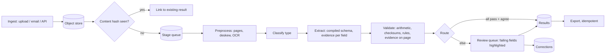
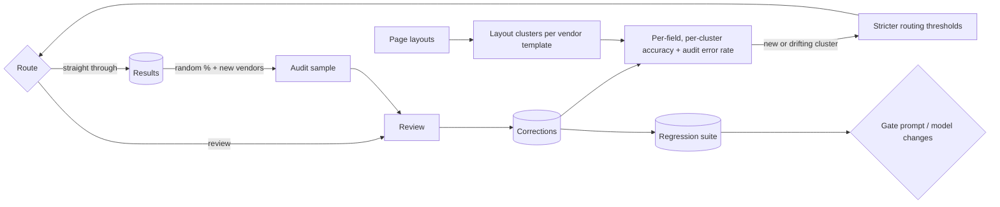
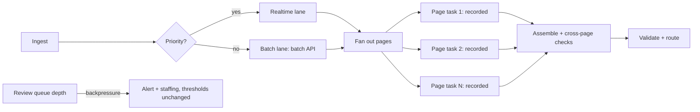
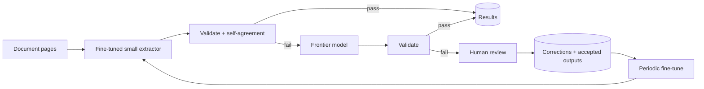
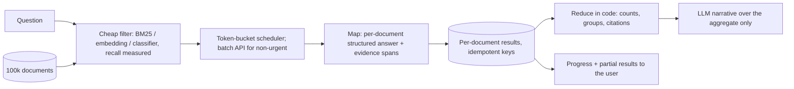
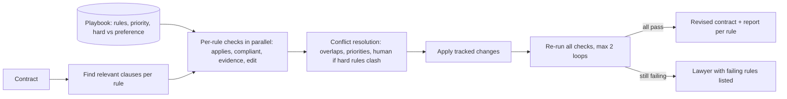

# Batch Document Extraction

> [!abstract] Asked at document-AI companies such as Reducto (reported prompts, 2026: schema extraction from highly variable layouts, guaranteeing JSON schema conformance, an eval framework across thousands of documents, an async pipeline for 10,000 multi-page PDFs at once, recovery when a worker crashes mid-document, debugging a silent extraction failure) and Harvey (rule-driven file review agent with per-component evaluation, 2026), and as the "intelligent document processing" design in 2026 AI interview guides. Interview evidence is thinner than for 01–09, so more of this note rests on design logic and vendor documentation. Topics: [[01 - Workflows vs Agents|01]] (gated workflow) → [[00 - LLM Fundamentals for Engineers|00]] (structured outputs, nullable fields) → [[07 - Agentic RAG and Grounding Loops|07]] (evidence per field) → [[11 - Evals Observability and Silent Drift|11]] (per-field metrics, silent drift) → [[12 - LLM Cost and Latency Economics|12]] (batch APIs) → [[15 - Post-Training and Model Adaptation|15]] (distilling a cheaper extractor).
>
> The hard part: the model returns valid JSON with a wrong number in it, confidently. The system has to **know when it's wrong** cheaply (evidence, arithmetic, checksums, agreement), send only those documents to people, and keep the error rate among documents that skip review low enough to trust, at a million documents a day.

---

## 1. Clarify Script

Defaults are assumptions unless a source is given.

| Question | Default | If different |
|---|---|---|
| Documents? | Invoices, receipts, credit notes from many vendors; PDFs and phone photos | KYC IDs → face match, liveness, stricter PII rules |
| Volume? | 1M docs/day, bursty at month-end (5–10×) | 10k at once (Reducto's prompt) → same pipeline, fan-out per page |
| Latency? | Most within hours; priority docs within minutes | Real time → no batch API, smaller model |
| Accuracy target? | Key fields ≥ 99% after review | Lower stakes → higher straight-through rate |
| Human reviewers? | Yes, a team with an SLA | None → abstain and return "needs review" to the customer |
| Output? | Typed JSON per type, exported to ERP | — |
| Data rules? | PII and financial data; India: GST invoices, data residency for some customers | — |

---

## 2. Requirements

### Functional

- Ingest (upload, email-in, API); dedupe; classify type.
- Extract a typed schema per type: vendor, GSTIN, invoice number, dates, line items, taxes, totals.
- Validate; route uncertain or invalid documents to human review; export.
- Reviewer corrections feed evals and training.

### Non-functional

- Key-field accuracy ≥ 99% after review; the **error rate among straight-through documents** is the trust metric.
- Exactly-once result per document; full audit trail of model, prompt and reviewer per field.
- Throughput 1M/day with month-end peaks; survives worker crashes mid-document.
- PII: encryption, access control on the review UI, retention limits.

### Out of scope

- The ERP itself; payment of invoices.

---

## 3. Estimates That Drive V0

```
Volume:    1M docs/day ≈ 12/s average, 60–120/s at month-end peaks → queues absorb bursts
Tokens:    ~2 pages × ~1.5–3k tokens per page image or OCR text ≈ ~5k input, ~500 output JSON per doc
Daily:     ~5B input + 0.5B output tokens → model choice and batch pricing dominate cost
           (OpenAI and Anthropic batch APIs are ~50% cheaper for results within 24 h)
Review:    8% to review × ~1 min each = 80k reviewer-minutes/day ≈ 170 eight-hour shifts
           raising straight-through from 92% to 96% halves that
```

- **Review cost is the main business lever**, and the reason to invest in knowing when the model is wrong.
- **Token cost picks the model path**: frontier model on the batch API first, then a distilled small model once corrections build a training set (V3).
- **Bursts and minutes-long documents** mean an async, staged, idempotent pipeline, not request/response.

---

## 4. Entities, Tools and State

### Stage contracts

| Stage | What code enforces |
|---|---|
| Ingest | Content hash (SHA-256 of bytes) dedupes the same invoice emailed twice; tenant from the API key |
| Preprocess | Split pages, deskew, OCR as a second view of the text |
| Classify | Doc type with confidence; unknown type → review |
| Extract | Per-type schema compiled once for constrained decoding; every field carries `source_text` and `page`; `null` allowed |
| Validate | Arithmetic, checksums, formats, business rules, evidence present on the page |
| Route | Straight through only if all checks pass and confidence signals agree |
| Export | Idempotent by `(doc_id, result_version)` |

```python
class Field(BaseModel, Generic[T]):
    value: T | None
    source_text: str | None      # verbatim text the value was read from
    page: int | None

class Invoice(BaseModel):
    vendor_name: Field[str]
    vendor_gstin: Field[str]
    invoice_number: Field[str]
    invoice_date: Field[date]
    line_items: list[LineItem]
    subtotal: Field[Decimal]
    tax_total: Field[Decimal]
    grand_total: Field[Decimal]
```

- `None` is preferred over guessing: missing beats hallucinated ([[00 - LLM Fundamentals for Engineers]] → nullable fields).

### State

```
documents(doc_id, tenant_id, content_hash UNIQUE per tenant, type, status, priority, received_at)
stage_runs(doc_id, stage, version, status, output_ref, attempts, lease_until)    -- idempotent per (doc, stage, version)
results(doc_id, result_version, fields_json, route {straight|review}, model_id, prompt_version)
reviews(doc_id, reviewer_id, corrected_fields_json, failing_checks[], lease_until, done_at)
corrections(doc_id, field, model_value, human_value, layout_cluster, created_at)   -- eval + training data
```

---

## 5. V0 — Simplest Design That Works

- **A gated workflow, not an agent**: fixed stages with checks between them ([[01 - Workflows vs Agents]]).
- **Extraction**: page images to a vision model plus OCR text as a second view (small print, numbers); schema-constrained JSON with evidence per field.
- **Knowing when it's wrong**, cheapest first:
    + **Deterministic checks**: line items sum to subtotal; subtotal + tax = total (within rounding); GSTIN and PAN formats and check digits; dates valid and not in the future; vendor exists in the master; duplicate invoice number for the vendor; amount within the PO range.
    + **Evidence check**: each `source_text` must appear in the OCR text of the cited page; a value with no matching evidence is likely made up ([[07 - Agentic RAG and Grounding Loops]]).
    + **Confidence signals**: token log-probabilities on key fields; agreement between two independent extractions (different prompt or model) on key fields.
- **Routing**: all checks pass + evidence found + agreement → straight through; anything else → review with the failing fields highlighted. Thresholds tuned **per field** on labelled data to hit the 99% target.
- **Review UI**: the document image with fields overlaid and failing checks highlighted; reviewers fix or confirm only those fields; leases so two reviewers don't take the same document.
- **Idempotent stages** keyed by `(doc_id, stage, version)` on a queue; retries are safe ([[07 - Async Messaging]]).



> [!important] The most drilled component
> Knowing when the model is wrong. Reported prompts ask how to guarantee schema conformance and how to debug a silent failure in an extraction pipeline (Reducto guide, 2026). Schema conformance is the easy half (constrained decoding with a compiled schema). The hard half is a valid JSON with a wrong value: evidence text verified against the page, arithmetic and checksum rules, and agreement between two extractions decide what skips review, and a sampled audit of straight-through documents measures whether that decision is right.

### What V0 can't handle

- **Silent drift**: a vendor changes its layout and accuracy on it drops without any check failing.
- **Month-end bursts** and crashes in the middle of long documents.
- **Cost**: frontier model on every page.
- **Long documents** past the context window (100-page statements, multi-tab spreadsheets).

---

## 6. Scale Ladder

### V1 — Catch silent drift: audits, layout clusters, per-field metrics

- **Evidence:** Reducto guide (2026): "debug a silent failure in an LLM-based extraction pipeline… how did you prevent it from recurring?" and "an evaluation framework to measure accuracy and regression of prompt changes across thousands of diverse test documents"; Harvey (2026): evaluate each component of a file review agent. Confidence **medium**.
- **Trigger:** a customer reports wrong totals from one vendor for two weeks; no validator fired because the arithmetic was consistent with a misread line.
- **What breaks:** trust; straight-through documents are assumed correct.
- **Change ([[11 - Evals Observability and Silent Drift]]):**
    + **Sampled audit of straight-through documents**: a small random share (plus more for new vendors) goes to review anyway; their correction rate is the measured error rate among straight-through documents.
    + **Layout clusters**: embed page images or layout features and cluster by vendor template; track accuracy, review rate and audit error per cluster; a new or shifted cluster gets stricter routing until it has a track record.
    + **Per-field metrics**: precision, recall and exact match per field and type; line-item matching accuracy.
    + **Regression suite** of labelled documents per type and top layouts, run on every prompt, model or schema change; corrections refresh it.
- **Trade-off:** audits cost reviewer time on documents that were probably fine; it is the only way to measure the number that matters.



### V2 — Bursts, long documents and crash recovery

- **Evidence:** Reducto guide (2026): an async pipeline for 10,000 multi-page PDFs at once; state and recovery when a worker crashes mid-document; context limits and token cost on very long spreadsheets. Confidence **medium**.
- **Trigger:** month-end peaks at 5–10× average; 100-page bank statements; workers lost mid-document.
- **What breaks:** one queue backs up priority documents; long documents exceed the context window; a crash re-runs every page.
- **Change:**
    + **Page-level fan-out**: a document becomes page tasks; each page's preprocess and extraction is a recorded step; the document assembles when all pages finish, so a crash re-runs only the unfinished pages ([[09 - Durable Execution HITL and Realtime UX]]).
    + **Long documents**: split by section or page; extract per section with a schema for that part (header fields from page 1, line items from table pages); merge with cross-page checks (totals on the last page equal the sum of all line items).
    + **Priority lanes**: realtime API for priority documents; batch API (cheaper, hours) for the rest.
    + **Rate-limit-aware dispatch** with token buckets per model; **backpressure** from the review queue raises an alert and staffing signal, never silently loosens thresholds.
- **Trade-off:** more orchestration state; page-level recovery is what makes 10,000-PDF bursts survivable.



### V3 — Cut cost: distil a smaller extractor from corrections

- **Evidence:** Reducto guide (2026): LLM call optimisation and token cost as core topics; no interview report found for distillation specifically. Confidence **judgement**.
- **Trigger:** ~5B input tokens a day on a frontier model; a few hundred thousand reviewed corrections accumulated.
- **Change ([[15 - Post-Training and Model Adaptation]]):**
    + **Cascade**: a fine-tuned small vision model extracts first; documents where it fails checks or disagrees with itself go to the frontier model; only then to humans.
    + **Training data**: frontier-model outputs that passed review or audit, plus human corrections, per type and layout cluster.
    + **Ship it like a model change**: per-field accuracy on the regression suite and per-cluster audits must match the frontier path before traffic moves; canary by tenant.
    + **Template cache** for top vendors: once a layout cluster is stable, deterministic or small-model extraction for it.
- **Trade-off:** a training pipeline to own and retrain as layouts drift; the cascade keeps the frontier model as a safety net.



### V4 — One question across 100,000 documents

- **Evidence:** Harvey (Oct 2026): "design a backend that answers one question across 100,000 documents with an LLM", a map-reduce over a corpus under provider rate limits (PracHub Harvey bank). Confidence **medium**.
- **Trigger:** a lawyer asks "which of these 100,000 contracts have a change-of-control clause that needs consent, and summarise the exceptions" over a data room, not a pre-built index.
- **What breaks:** retrieval misses documents (the question needs an exhaustive answer, not top-k); one giant prompt can't hold the corpus; naive fan-out hits rate limits and costs a fortune.
- **Change ([[05 - Multi-Agent Topologies and Concurrency#Map-reduce]], [[12 - LLM Cost and Latency Economics]]):**
    + **Map:** one small, structured call per document (or per relevant section after a cheap filter): `{relevant: bool, answer_fields, evidence_spans, confidence}` against a schema, so the reduce step is code, not another free-text summary.
    + **Cheap filter first:** BM25 or embedding filter plus a small classifier to skip clearly irrelevant documents; measure the filter's recall on a labelled sample because a miss is silent.
    + **Rate limits as a budget:** a token-bucket scheduler per provider and model; the batch API for anything not interactive (about half price, results within 24 hours); retries with idempotent per-document keys so a crash resumes instead of re-paying ([[09 - Durable Execution HITL and Realtime UX]]).
    + **Reduce:** aggregate structured results in code (counts, groupings, lists with citations); an LLM writes the final narrative only over the aggregated table, with every claim linked to document and span.
    + **Progress and partial results:** stream "4,120 of 100,000 processed, 312 matches so far"; let the user stop early.
    + **Arithmetic:** 100,000 documents × ~4,000 input tokens (sections after filtering, *assumed*) = 400M input tokens; at $0.15 per M on a small model ≈ $60, at $3 per M ≈ $1,200, halved on the batch API. Say which model tier the question needs.
- **Trade-off:** exhaustive map costs more than retrieval but is the only way to promise "every document was checked"; the filter trades cost for recall, so report its measured recall.



### V5 — Check or revise a document against dozens of rules

- **Evidence:** Harvey (Sep 2026): "an LLM agent system that revises a contract to comply with dozens of rules"; Harvey (Oct 2026): "a rule-driven file review agent, and evaluate each of its components" (PracHub ML system design list). Uber's redlining agent separates fixed policies from negotiable preferences (Uber engineering, Oct 2026). Confidence **medium**.
- **Trigger:** a customer's playbook of 40 rules ("liability cap at least 12 months of fees", "no exclusivity", "governing law India").
- **What breaks:** one prompt with 40 rules misses some and contradicts others; edits for one rule break another; nobody can say which rule failed.
- **Change:**
    + **One check per rule:** each rule becomes a structured check (`applies?`, `compliant?`, `evidence span`, `proposed edit`) run in parallel over the relevant clauses found by retrieval; deterministic checks (dates, amounts, governing law) in code where possible.
    + **Resolve conflicts before editing:** collect proposed edits, detect overlapping spans and contradictory rules, apply a priority order from the playbook (hard policy over preference), and ask a human when two hard rules conflict.
    + **Edit, then re-check everything:** apply edits as tracked changes, then re-run **all** rule checks on the revised text, because an edit for rule 7 can break rule 23. Loop at most twice, then hand to a lawyer with the remaining failures listed.
    + **Evaluate each component** (the Harvey follow-up): clause retrieval recall per rule, per-rule check precision and recall on labelled contracts, edit acceptance rate by reviewers, and end-to-end "contract compliant after review" ([[11 - Evals Observability and Silent Drift]]).
- **Trade-off:** 40 calls per document instead of one; parallel and cached by clause hash, it is still cheap next to a lawyer's hour, and it makes every failure attributable to one rule.



---

## 7. Twist Cards

### Most asked

**T1 — "How do you guarantee the output matches the JSON schema?"**
- **Evidence:** Reducto guide (2026). Confidence **medium**.
- **Hits:** structured outputs.
- **Answer:** constrained decoding against a compiled schema (provider structured outputs or a grammar engine), schema compiled once per type and cached; Pydantic validation after; a repair retry with the exact error, at most once; nullable fields so the model never has to invent a value to satisfy the schema. Conformance is necessary, not sufficient: the values still need V0's checks.
- **Attaches to:** V0.

**T2 — "The pipeline was silently wrong for two weeks. How do you find it and stop it recurring?"**
- **Evidence:** Reducto guide (2026). Confidence **medium**.
- **Hits:** drift, audits.
- **Answer:** find it from per-cluster metrics: which vendor layout, which field, since which date; check what changed (prompt, model version, the vendor's template). Fix, then add those documents to the regression suite and make sure the audit sample and layout-cluster alerts would have caught it (V1).
- **Attaches to:** V1.

**T3 — "A worker crashes in the middle of a 50-page document."**
- **Evidence:** Reducto guide (2026). Confidence **medium**.
- **Hits:** recovery.
- **Answer:** page tasks are recorded steps with leases; the lease expires, another worker picks up the unfinished pages only; results upsert by `(doc_id, stage, version)` so a late duplicate is harmless; assembly waits for all pages.
- **Attaches to:** V2.

**T4 — "How do you pick what goes to human review, and hit 99%?"**
- **Evidence:** design logic plus vendor docs (AWS IDP pipelines return confidence scores with extracted fields). Confidence **medium**.
- **Hits:** routing.
- **Answer:** deterministic checks and evidence first; then confidence signals (log-probs on key fields, two-extraction agreement); thresholds per field chosen on labelled data so the error rate among straight-through documents stays under target; verify with the audit sample, not with the model's own confidence.
- **Attaches to:** V0, V1.

### Lower priority (recall / judgement)

**T5 — "Reviewers are swamped at month-end. Lower the thresholds?"**
- **Evidence:** none. Confidence **judgement**.
- No: that silently raises the error rate. Prioritise review by deadline and value, let non-urgent documents wait, alert for staffing, and use the batch lane.

**T6 — "Same invoice arrives twice."**
- **Evidence:** none. Confidence **judgement**.
- Content-hash dedupe at ingest; plus a business-level duplicate check (same vendor and invoice number, different file) flagged for review.

**T7 — "A new vendor appears with a layout you've never seen."**
- **Evidence:** none specific. Confidence **judgement**.
- New layout cluster → stricter routing and more audits until accuracy is proven; corrections from it go into the next fine-tune and the regression suite.

**T8 — "PII in invoices and IDs."**
- **Evidence:** none specific. Confidence **judgement**.
- Encryption at rest, role-based access to the review UI with field masking, retention limits, model routing that respects residency, no PII in logs ([[18 - Security]]).

---

## 8. Break It

| Failure | What the customer sees | What you say |
|---|---|---|
| Valid JSON, wrong total | Sent to review, or caught by audit | Arithmetic and evidence checks; audits measure the rest |
| Made-up GSTIN | Sent to review | Checksum and evidence-on-page check |
| Vendor changes layout | Brief rise in review rate, no silent errors | Layout clusters, stricter routing for new clusters |
| Same invoice twice | One result | Content hash; vendor + invoice number check |
| Worker crash mid-document | Result arrives a bit later | Page tasks with leases; idempotent upserts |
| Month-end burst | Priority docs on time, others within SLA | Lanes, batch API, queues |
| Review backlog | Longer wait, same accuracy | Thresholds never loosened silently |
| Prompt change regresses a field | Never reaches production | Regression suite gate |

---

## 9. Evals, Operations and Cost

| Tier | Checks |
|---|---|
| **Unit** | Validators (arithmetic, checksums, dates) on a fixture; schema compile; evidence matcher |
| **Field** | Per-field precision, recall, exact match per type and layout cluster; line-item matching |
| **Pipeline** | Straight-through rate; **error rate among straight-through docs** from audits; review time per doc |

- **Production metrics:** straight-through rate per tenant and cluster, audit error rate, review queue depth and age, cost per document, tokens per page, stage failure and retry rates.
- **Alerts:** audit error rate above target; a cluster's review rate jumps; queue age above SLA; any duplicate export.
- **Cost drivers:** reviewer minutes first, then model tokens (batch API halves them), then OCR and compute.

---

## 10. One-Minute Close

> "A gated workflow: dedupe by content hash, preprocess with OCR as a second view, classify, extract with a compiled per-type schema where every field carries its source text and page and null beats a guess. Then decide cheaply whether to trust it: arithmetic and checksum rules, the evidence text must exist on that page, and two extractions must agree on key fields, with per-field thresholds tuned to the 99% target. Everything else goes to reviewers who fix only the flagged fields. A random audit of straight-through documents measures the error rate that matters, and layout clusters catch a vendor changing its template. Documents fan out to page tasks with leases so crashes and month-end bursts are routine, non-urgent work uses the batch API, and corrections become the regression suite and the training data for a cheaper small extractor in a cascade."

---

## Evidence

Reports and guides tallied in November 2026.

| Follow-up | Sources | Count | Placed as | Deep dive? |
|---|---|---|---|---|
| Schema conformance from variable layouts | Reducto guide (2026) | 1 | V0 + T1, **medium** | Sometimes |
| Silent failure, regression evals across thousands of docs | Reducto guide; Harvey per-component evals (2026) | 2 | V1 + T2, **medium** | Sometimes |
| Async pipeline for 10k PDFs, crash mid-document, long spreadsheets | Reducto guide | 1 | V2 + T3, **medium** | Sometimes |
| Confidence scores and review routing | AWS IDP pipeline post (2026, vendor) | 1 | V0 + T4, **medium** | Yes |
| Distillation, thresholds under backlog, duplicates, new layouts, PII | none | 0 | V3, T5–T8, **judgement** | No |

- **What the tally changed:** the old note's schema with evidence, deterministic validation, confidence routing, review UI, idempotent batch stages and eval metrics stay, regrouped. Added: audits of straight-through documents and layout clusters for silent drift (V1), page-level fan-out and cross-page checks for long documents and crashes (V2), and the cascade with a distilled extractor (V3). This problem has the weakest interview evidence of the twelve; treat the ladder order as judgement.

## Sources

- PracHub, *Reducto Software Engineer Interview Guide* (reported prompts, October 2026). https://prachub.com/interview-guide/reducto-software-engineer-interview-questions-guide-2026
- PracHub, *Design a Rule-Driven File Review Agent and Evaluate Each of Its Components* (Harvey, 2026; listed as a related question on the Databricks retrieval page). https://prachub.com/interview-questions/design-a-rule-driven-file-review-agent-and-evaluate-each-of-its-components
- AWS Machine Learning Blog, *From PDFs to insights: Architecting an intelligent document processing pipeline with AWS generative AI services* (2026): classification, extraction, normalisation, validation and confidence scores. https://aws.amazon.com/blogs/machine-learning/from-pdfs-to-insights-architecting-an-intelligent-document-processing-pipeline-with-aws-generative-ai-services/
- OpenAI Batch API and Anthropic Message Batches (about 50% discount for asynchronous results within 24 hours). https://platform.openai.com/docs/guides/batch
- PracHub, *Design a Rule-Driven File Review Agent and Evaluate Each of Its Components* (Harvey, Oct 2026) and *Design an LLM Agent System That Revises a Contract to Comply with Dozens of Rules* (Harvey, Sep 2026). https://prachub.com/interview-questions/design-a-rule-driven-file-review-agent-and-evaluate-each-of-its-components
- PracHub, Harvey question bank (2026): "answer one question across 100,000 documents with an LLM". https://prachub.com/companies/harvey
- Uber, *Scaling AI in Legal: Building Uber's Redlining Agent* (Oct 2026). https://www.uber.com/us/en/blog/building-ubers-redlining-agent/

## Related Notes

- [[Agentic/Problems/README]] · [[01 - Workflows vs Agents]] · [[00 - LLM Fundamentals for Engineers]] · [[11 - Evals Observability and Silent Drift]] · [[15 - Post-Training and Model Adaptation]] · [[12 - LLM Cost and Latency Economics]] · [[Agentic Problem to Solution Map]]
