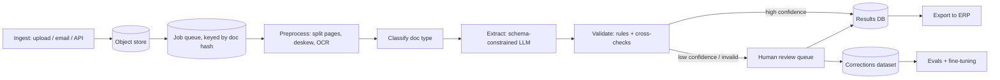

# Batch Document Extraction

> [!abstract] The prompt
> "Design a system that extracts structured data from 1 million invoices (or KYC documents) a day: PDFs and phone photos, many vendors and layouts. Key fields must be 99%+ accurate; uncertain documents go to human reviewers." The hard parts: **reliable structured outputs**, **knowing when the model is wrong**, **human review routing**, **cost at volume**, and **idempotent batch processing**.

---

## 1. Requirements

**Functional**
- Ingest documents (upload, email-in, API); classify type (invoice, receipt, credit note, KYC ID, bank statement).
- Extract a typed schema per type: vendor, GSTIN, invoice number, dates, line items, taxes, totals.
- Validate; route uncertain or invalid results to human review; export to ERP/accounting.
- Feedback: reviewer corrections improve the system over time.

**Non-functional**
- **Key-field accuracy ≥ 99%** after review; straight-through-processing (no human) rate as high as safely possible.
- Throughput 1M docs/day; most results within hours (not real-time), some priority docs within minutes.
- Exactly-once results per document; full audit trail; PII handled per regulation.

---

## 2. Estimation

- 1M docs/day ≈ 12 docs/s average; arrival is bursty (month-end), so design for 5–10× peaks with queues.
- Tokens per document (heuristic): ~1.5–3k input tokens per page image or OCR text, ~500 output tokens of JSON; average 2 pages → ~5k input + 500 output per document.
- Daily: ~5B input + 0.5B output tokens. That's why model choice, **batch APIs (~50% cheaper)**, and eventually a **fine-tuned small model** matter ([[12 - LLM Cost and Latency Economics]], [[15 - Post-Training and Model Adaptation]]).
- Review capacity: if 8% of docs need review at ~1 min each → 80k minutes/day ≈ 170 reviewer-shifts. Improving straight-through rate from 92% to 96% halves review cost: the main business lever.

---

## 3. Architecture



- A **workflow**, not an agent: fixed stages with gates ([[01 - Workflows vs Agents]]).

---

## 4. Deep Dive: Extraction

- **Per-type Pydantic schemas** compiled once and reused (constrained decoding, no per-request compile cost) ([[14 - Quantization Decoding and VRAM Math]]).
- Input: page images to a vision-capable model, plus OCR text as a second view (helps with small print and numbers).
- Ask for **evidence with every field**: page number and the exact source text (or bounding box) the value came from.

```python
class LineItem(BaseModel):
    description: str
    quantity: Decimal
    unit_price: Decimal
    amount: Decimal

T = TypeVar("T")

class Field(BaseModel, Generic[T]):
    value: T | None
    source_text: str | None       # verbatim text the value was read from
    page: int | None

class Invoice(BaseModel):
    vendor_name: Field[str]
    vendor_gstin: Field[str]
    invoice_number: Field[str]
    invoice_date: Field[date]
    line_items: list[LineItem]
    subtotal: Field[Decimal]
    tax_total: Field[Decimal]
    grand_total: Field[Decimal]
```

- `None` is allowed and preferred over guessing: missing beats hallucinated.

---

## 5. Deep Dive: Knowing When It's Wrong

- **Deterministic validation** (cheap, high value):
    + Arithmetic: line items sum to subtotal; subtotal + tax = total (within rounding).
    + Formats and checksums: GSTIN/PAN patterns and check digits, IBAN checksums, valid dates, invoice date not in the future.
    + Business rules: vendor exists in the master list; duplicate invoice number for the same vendor; amount within the PO range.
- **Evidence check**: does each `source_text` actually appear in the OCR text of the cited page? A value with no matching evidence is likely hallucinated ([[07 - Agentic RAG and Grounding Loops]]).
- **Confidence signals**: token log-probabilities on key fields; **agreement** between two independent extractions (different prompts or models) on key fields; classifier confidence for doc type.
- **Routing policy** combines them: all validations pass + evidence found + agreement → straight through; otherwise → review queue with the failing fields highlighted. Thresholds are tuned per field on labelled data to hit the 99% target.

---

## 6. Deep Dive: Human Review

- Reviewers see the document image with extracted fields overlaid, failing checks highlighted, and only need to fix or confirm those fields (not re-key everything).
- Queue prioritisation by deadline, value and customer SLA; assignment with leases so two reviewers don't take the same document ([[14 - Coordination and Concurrency]]).
- **Corrections are training data**: stored with the original extraction and evidence; feed eval sets and periodic fine-tuning of a smaller extraction model (distillation from frontier model + human labels) ([[15 - Post-Training and Model Adaptation]]).

---

## 7. Deep Dive: Batch Processing and Idempotency

- **Dedupe by content hash** at ingest: the same invoice emailed twice is processed once and linked.
- Each stage is an **idempotent** consumer keyed by `(doc_id, stage, version)`; results upserted; retries safe ([[07 - Async Messaging]]).
- **Batch API** for non-urgent documents (hours of latency, lower price); realtime API for priority documents.
- Rate-limit-aware dispatch to model providers (token buckets per model) and backpressure from the review queue: if reviewers are swamped, that's an alert, not a reason to lower thresholds silently ([[10 - AI Gateway Security and Guardrails]]).
- Reprocessing: a new model or prompt version can re-run on historical documents in batch for evaluation without touching production results.

---

## 8. Evals

- Labelled set per document type and per top vendors, refreshed from reviewer corrections.
- Metrics **per field**: precision, recall, exact-match accuracy; for line items, matching accuracy. Track the straight-through rate and the **error rate among straight-through documents** (the number that matters for trust).
- New vendors and layouts monitored separately: accuracy on unseen layouts is the usual weak spot ([[11 - Evals Observability and Silent Drift]]).

---

## 9. Failure Modes

| Failure | Mitigation |
|---|---|
| Hallucinated field values | Evidence text required and verified; `None` preferred over guessing |
| Arithmetic or checksum errors | Deterministic validators route to review |
| Silent quality drop on new layouts | Per-layout monitoring; sample audits of straight-through docs |
| Duplicate processing | Content-hash dedupe; idempotent stages |
| Month-end burst | Queues, batch API, autoscaled workers, priority lanes |
| Review backlog | Alerts and staffing signals; never auto-loosen thresholds |
| PII exposure | Encryption, access control on review UI, retention limits, residency-aware model routing ([[18 - Security]]) |

---

## Interview Lines

> [!tip] Say it like this
> - "It's a gated workflow, not an agent: classify, extract with a compiled schema, validate, then route by confidence."
> - "Every field comes with its source text, and I verify that text exists on the page; missing beats hallucinated."
> - "Cheap deterministic checks like totals and GSTIN checksums catch most errors before any human sees them."
> - "Straight-through rate is the business lever, and the error rate among straight-through documents is the trust metric."
> - "Reviewer corrections become eval data and eventually distil a cheaper fine-tuned extractor."

## Related Notes

- [[Agentic/Problems/README]] · [[01 - Workflows vs Agents]] · [[11 - Evals Observability and Silent Drift]] · [[15 - Post-Training and Model Adaptation]]
