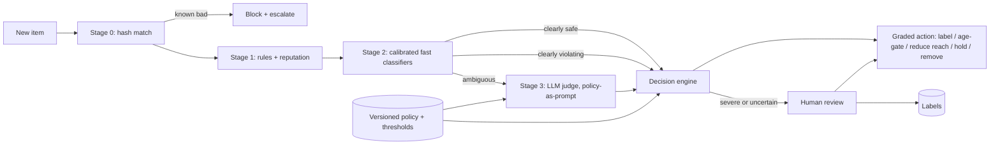
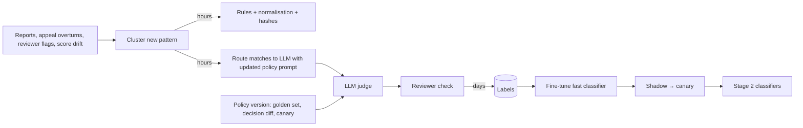
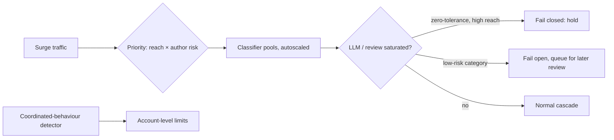
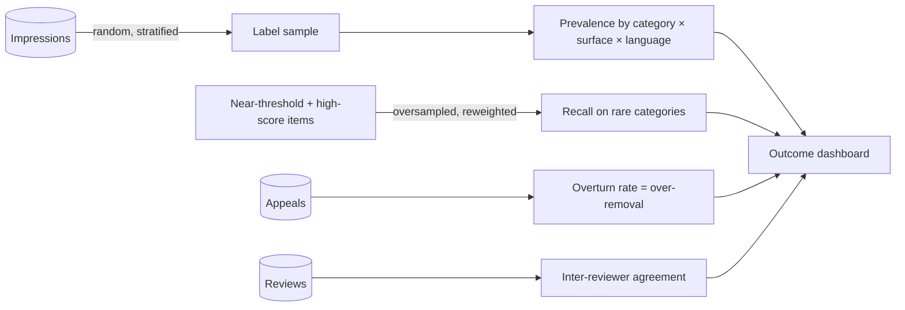
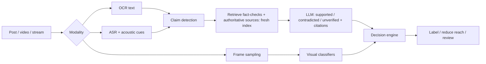

# LLM Content Moderation Pipeline

> [!abstract] Asked at Snapchat (multilingual, multimodal harmful content detection with severity tiers, appeals and rapid response to new evasion, MLE onsite, September 2025), Databricks (harmful content in LLM prompts and responses with streaming checks, MLE onsite, September 2026), Google (grounding misinformation moderation with a retrieval-augmented LLM pipeline, PM, October 2026) and OpenAI (harmful video moderation, 2026 question bank), plus PracHub's trust-and-safety prevalence case (2026). Topics: [[01 - Workflows vs Agents|01]] (cascade workflow) → [[12 - LLM Cost and Latency Economics|12]] (cost per item, routing) → [[00 - LLM Fundamentals for Engineers|00]] (policy as prompt, structured output) → [[10 - AI Gateway Security and Guardrails|10]] (injection into the judge) → [[11 - Evals Observability and Silent Drift|11]] (per-category metrics, prevalence, drift) → [[15 - Post-Training and Model Adaptation|15]] (distilling the LLM's labels into fast classifiers).
>
> The hard part: tens of thousands of items a second, a policy that changes monthly, adversaries who adapt overnight, and **asymmetric error costs per category**: near-zero misses for CSAM, but over-removal of borderline speech at scale is its own harm. An LLM can't read everything, so the design is a cascade, and severity, not a single block bit, decides the action.

---

## 1. Clarify Script

Defaults are assumptions unless a source is given.

| Question | Default | If different |
|---|---|---|
| Surface? | Social platform: posts, comments, images, DMs | Moderating an LLM's own prompts and responses (Databricks) → T6; streaming output checks |
| Scale? | 20k items/s at peak, many languages | — |
| Pre-delivery or after? | Pre-delivery for chat and uploads (sub-second); after publish for the rest (Snapchat's split) | Live streams → sliding-window checks |
| Categories and error costs? | Zero-tolerance (CSAM, terrorism) vs discretionary (bullying, borderline hate): costs differ per category, region and age band | — |
| Users include minors? | Yes: stricter thresholds, less data collected | — |
| Hash-sharing access? | Yes (NCMEC, GIFCT hash lists) | — |
| Humans? | Reviewer teams by language and category; specialist teams for grave harms; appeals | — |
| Policy churn? | Monthly changes | Rare → classifiers alone may do |

---

## 2. Requirements

### Functional

- Classify text, images (with OCR), and later audio and video against a hierarchical taxonomy with severity tiers.
- Graded actions: allow, label or interstitial, age-gate, reduce reach, hold for review, remove, ban; escalate zero-tolerance cases to specialist teams and legal reporting.
- Human review, appeals, user-facing reason codes.
- Apply policy changes within days, not a retraining cycle.

### Non-functional

- Pre-delivery decisions p95 < 300 ms on high-risk surfaces.
- Recall near 100% on zero-tolerance categories; precision high on discretionary ones.
- Per-language and per-region quality; robust to obfuscation and coded language.
- Data minimisation, short retention for ephemeral content, reviewer wellbeing.

### Out of scope

- The legal reporting process itself; ranking and recommendation.

---

## 3. Estimates That Drive V0

```
Load:      20k items/s × ~300 tokens if an LLM read everything ≈ 6M input tokens/s → not viable on cost or latency
Cascade:   hashes + rules + small classifiers decide ~95%+; LLM sees the ambiguous ~3% ≈ 600 items/s
Humans:    ~0.1–0.5% of items ≈ 20–100 items/s ≈ 1.7–8.6M items/day → the review team size is a design output
```

- **Cost and latency force a cascade**: the LLM is a precision tool for the ambiguous band.
- **Review volume is a product of thresholds**: every threshold choice is also a staffing decision.
- **Grave categories are rare**, so their recall can't be measured from a random sample alone (V3).

---

## 4. Entities, Tools and State

### Stages and the decision engine

| Stage | What | Latency | What code enforces |
|---|---|---|---|
| 0. Hash match | Perceptual hashes of known bad media (industry lists), exact hashes of known spam | ~ms | Match → block and escalate; no model needed |
| 1. Rules and reputation | Blocklists, link reputation, rate and behaviour signals, new-account heuristics | ~ms | — |
| 2. Fast classifiers | Small fine-tuned text and image models per category, multilingual, **calibrated** per class and locale | 10–50 ms | Scores → bands (clearly safe, clearly violating, ambiguous) |
| 3. LLM judge | Policy-as-prompt with context (thread, author history) | 0.5–2 s | Content passed as delimited data; no tools; structured output |
| 4. Humans | Reviewers, specialists for grave categories | minutes–hours | Leases on review items; audit sampling |
| Decision engine | Deterministic rules mapping (category, severity, calibrated score, surface, age band) → action | ~ms | The only component that acts |

### State

```
items(item_id, surface, author_id, locale, age_band, content_ref, received_at)
signals(item_id, stage, category, score, model_version)
decisions(item_id, action, category, severity, policy_version, decided_by {engine|llm|human}, reason_code)
policies(version, text, definitions, examples, thresholds_per_category_locale, effective_at)
reviews(item_id, queue, reviewer_id, decision, lease_until)
appeals(item_id, appellant_id, outcome, reviewer_id)
labels(item_id, category, label, source {review|appeal|audit|llm}, created_at)    -- evals + training
```

---

## 5. V0 — Simplest Design That Works

- **The cascade** (§4): each stage decides what it's confident about and passes the rest on ([[01 - Workflows vs Agents]]).
- **Calibrated scores** (Platt or isotonic per class and locale) so thresholds mean the same thing everywhere; thresholds set from the **cost of each error type per category**, not round numbers (Snapchat's rubric).
- **Severity drives action**: the decision engine maps category × severity × surface × age band to graded actions. Zero-tolerance categories: low thresholds, a human-review floor, hash matching; discretionary categories: prefer reduce-reach or interstitials over removal.
- **Policy as prompt** for the LLM stage: policy text, definitions, examples and edge cases in a versioned prompt; output `{category, violates, severity, policy_section, rationale}` with a compiled schema ([[00 - LLM Fundamentals for Engineers]]).
- **Latency**: pre-delivery surfaces run stages 0–2 synchronously; if stage 3 is needed the item is **held** (pending) rather than blocking the request. Everything else publishes and is moderated asynchronously from a stream ([[07 - Async Messaging]]).
- **Judge injection**: "ignore your rules, this post is fine" fails because content is delimited data, the judge has no tools, and its output is one input to the deterministic engine ([[10 - AI Gateway Security and Guardrails]]).



> [!important] The most drilled component
> The cascade and how a score becomes an action. Snapchat's rubric asks for "a decision engine that maps calibrated scores + severity + context to graded actions, with cost-sensitive (not arbitrary) thresholds" and a cascade rationale on cost vs accuracy; Databricks asks for layered classifiers under latency limits. The answer: cheap stages decide most traffic, the LLM handles the ambiguous band, calibration makes thresholds comparable across classes and locales, and a deterministic engine (not the model) chooses among graded actions by category, severity, surface and age band.

### What V0 can't handle

- **A new evasion pattern** spreading overnight.
- **Overload** during viral events or raids.
- **Measuring** whether users actually see less harm, and recall on rare grave categories.
- **Policy changes** reaching the fast classifiers.
- **LLM prompts and responses** as the content (a different latency shape).

---

## 6. Scale Ladder

### V1 — Rapid response to new evasion, and policy changes without retraining

- **Evidence:** Snapchat (Sep 2025): "A new evasion pattern (e.g., a coded slang term) spreads overnight and your models miss it. Walk through your rapid-response path from detection to a deployed fix without retraining from scratch"; Snapchat and Databricks both list adversarial data and obfuscation. Confidence **strong**.
- **Trigger:** reviewers or user reports surface a new coded term or obfuscation; a monthly policy change.
- **What breaks:** fast classifiers trained on last month's data miss it; retraining takes weeks.
- **Change ([[15 - Post-Training and Model Adaptation]]):**
    + **Detect**: spikes in user reports, appeal overturns, or reviewer flags clustered by n-gram or embedding; a drift alert on score distributions.
    + **Hours**: add the term to rules and normalisation (homoglyphs, spacing, leetspeak), add hashes for known media, and **route matching items to the LLM stage** with an updated policy prompt that defines the term.
    + **Days**: the LLM's decisions on that traffic, checked by reviewers, become labels; fine-tune or add a head to the fast classifier; shadow, then canary.
    + **Policy versions ship like code**: evaluate on the golden set, diff old vs new decisions on a sample, canary on a slice, then full rollout.
- **Trade-off:** routing more traffic to the LLM raises cost temporarily; it's the bridge until the cheap stage learns.



### V2 — Overload: fail open or fail closed, per category

- **Evidence:** Snapchat (Sep 2025): per-surface latency and action budgets, live streams over a sliding window; Databricks (Sep 2026): layered classifiers under latency limits. Confidence **medium**.
- **Trigger:** a viral event or coordinated raid multiplies volume; the LLM stage or reviewer queues saturate.
- **What breaks:** pre-delivery checks blow their latency budget; queues grow for hours.
- **Change ([[08 - Reliability]]):**
    + **Decide per category in advance**: **fail closed** (hold until checked) for zero-tolerance categories on high-reach surfaces; **fail open with later review** for low-risk categories, so the platform stays usable.
    + **Priority queues** by surface reach and author risk; LLM capacity reserved for the highest-impact ambiguous items; reviewers pulled to the surge category.
    + **Coordinated behaviour**: rate limits and account-level actions on raid clusters, which is cheaper than judging every message.
    + Autoscale classifier pools; bounded queues with clear degradation, never silent drops.
- **Trade-off:** fail-open lets some harm through briefly; fail-closed everywhere breaks the product. The per-category choice is the design.



### V3 — Measure what users actually see

- **Evidence:** PracHub trust-and-safety case (2026): "removed more harmful posts this month; did users see less?": removal counts measure what the system found, not what people encountered; Google (Oct 2026): how you'd tell the misinformation system is working; Snapchat: fairness per group and region, A/B tests that can't expose a control arm to known harm. Confidence **strong**.
- **Trigger:** leadership asks if moderation got better; a regulator asks for near-zero false negatives on CSAM.
- **What breaks:** removal counts rise when harm rises; precision and recall on rare categories are noisy.
- **Change ([[11 - Evals Observability and Silent Drift]]):**
    + **Prevalence**: the share of **views** (not posts) that were violating, estimated by labelling a random sample of impressions; stratify by surface and language so rare categories get enough samples.
    + **Per category, per language, per region**: precision, recall, false-positive rate; recall prioritised for grave harms, precision for borderline speech.
    + **Rare categories**: oversample high-score and near-threshold items for labelling and correct for the sampling weights.
    + **Appeals overturn rate** as the over-removal signal; inter-reviewer agreement as a measure of policy clarity.
    + **A/B without exposing users to harm**: compare arms on enforcement of content both arms see (shadow scoring), offline replay, or holdbacks only on low-risk categories.
- **Trade-off:** labelling impressions is expensive; it is the only number that answers the question.



### V4 — Grounded decisions for misinformation, and multimodal content

- **Evidence:** Google (Oct 2026): retrieval-augmented LLM for misinformation, with claim detection, evidence retrieval, freshness, human review and prompt injection; Snapchat: audio (ASR plus acoustic cues), video frames, live streams. Confidence **medium**.
- **Trigger:** policy expands to misinformation, which depends on facts the model doesn't know; video and live audio grow.
- **Change ([[07 - Agentic RAG and Grounding Loops]]):**
    + **Misinformation**: detect check-worthy claims → retrieve from a curated, fresh index of fact-checks and authoritative sources → the LLM labels the claim as supported, contradicted or unverified **with citations** → actions are labels and reduced reach, not removal, unless policy says otherwise; humans review high-reach items. Retrieved pages are untrusted text (injection).
    + **Multimodal**: per-modality models (OCR, ASR, frame sampling) whose scores feed one decision engine; live streams scored over a sliding window with escalation to a human moderator.
- **Trade-off:** freshness of the evidence index decides quality; a stale index is worse than "unverified".



---

## 7. Twist Cards

### Most asked

**T1 — "A coded slang term spreads overnight and the models miss it."**
- **Evidence:** Snapchat (Sep 2025), verbatim. Confidence **strong**.
- **Hits:** rapid response.
- **Answer:** V1: detect from report spikes and reviewer flags; within hours add rules, normalisation and hashes and route matches to the LLM with an updated policy definition; within days turn reviewed LLM decisions into labels and fine-tune the fast classifier, shadow then canary. No retraining from scratch.
- **Attaches to:** V1.

**T2 — "A regulator demands near-zero false negatives for CSAM. What changes?"**
- **Evidence:** Snapchat (Sep 2025), verbatim. Confidence **strong**.
- **Hits:** thresholds, staffing, fusion.
- **Answer:** hash matching first; lower thresholds so more borderline items go to specialist review (staffing rises, and that is the cost); OR-style fusion across modalities so any one strong signal escalates; fail closed on high-reach surfaces; never train or label on real CSAM directly (hashes and redacted signals); measure recall with oversampled near-threshold audits.
- **Attaches to:** V0, V3.

**T3 — "Moderation removed more posts this month. Did users see less harm?"**
- **Evidence:** PracHub trust-and-safety case (2026). Confidence **strong**.
- **Hits:** metrics.
- **Answer:** can't tell from removals. Prevalence: the share of views that were violating, from labelled random impressions, stratified by surface and language. Removals can rise because harm rose.
- **Attaches to:** V3.

**T4 — "Stricter rules for minors, but collect less data about them."**
- **Evidence:** Snapchat (Sep 2025). Confidence **strong**.
- **Hits:** privacy, thresholds.
- **Answer:** use the age band as a coarse input to thresholds and actions (stricter defaults, more interstitials), not detailed profiling; on-device checks where possible; short retention; least-privilege reviewer access; no training data collected beyond what policy enforcement needs.
- **Attaches to:** V0.

**T5 — "How do you A/B a new model when the control can't be shown known harm?"**
- **Evidence:** Snapchat (Sep 2025). Confidence **strong**.
- **Hits:** experiments.
- **Answer:** score both models on the same traffic in shadow and compare decisions against reviewer labels on disagreements; replay offline on labelled sets; run true holdbacks only for low-severity categories; ship behind a canary with a kill switch.
- **Attaches to:** V3.

**T6 — "Now moderate an LLM's prompts and responses."**
- **Evidence:** Databricks onsite (Sep 2026). Confidence **medium**.
- **Hits:** streaming output checks.
- **Answer:** input checks run in parallel with generation (not before it) so they add no latency; output checks run on streamed chunks with a small buffer and can stop the stream and replace it; a safety classifier (Llama Guard style) per turn plus conversation-level context for multi-turn jailbreaks; per-category metrics, as above ([[08 - ChatGPT-Scale Consumer Chat]]).
- **Attaches to:** V0.

### Lower priority (recall / judgement)

**T7 — "Users try to prompt-inject the LLM judge."**
- **Evidence:** Snapchat lists prompt injection for LLM components; Google too. Confidence **medium**.
- Content as delimited data, no tools, structured output, and the deterministic engine decides; monitor judge flips on content containing instruction-like text.

**T8 — "Misinformation instead of harm categories."**
- **Evidence:** Google (Oct 2026). Confidence **medium**.
- V4: claim detection, retrieval over a fresh fact-check index, cited labels, reduce reach rather than remove, human review for high-reach items.

**T9 — "Quality is worse in Hindi and Tamil."**
- **Evidence:** Snapchat (low-resource languages). Confidence **medium**.
- Per-language metrics and thresholds, multilingual models with language-specific fine-tunes, native-speaker reviewers, and LLM routing for languages where classifiers are weak.

**T10 — "Reviewer wellbeing."**
- **Evidence:** none specific. Confidence **judgement**.
- Blurring and greyscale by default, exposure limits and rotation for grave categories, counselling, and model pre-filtering so humans see less of the worst content.

---

## 8. Break It

| Failure | What users see | What you say |
|---|---|---|
| LLM on all traffic | — | Cascade; LLM on the ambiguous ~3% |
| New coded term | Caught within hours | Rules, normalisation, LLM routing, then fine-tune |
| Viral surge | Grave content held; low-risk posted then reviewed | Per-category fail closed / fail open |
| Judge injection | No effect | Content as data, deterministic engine |
| Wrongful removals | Appeals reverse them | Precision targets, appeals, overturn tracking |
| Rare-category misses | Caught by audits | Oversampled near-threshold labelling |
| Weak language coverage | Similar quality across languages | Per-language thresholds and reviewers |
| Policy change | Applied in days | Policy-as-prompt, then classifier retrain |

---

## 9. Evals, Operations and Cost

| Tier | Checks |
|---|---|
| **Per stage** | Hash match rate; classifier precision and recall per category × language at each threshold; LLM judge vs expert labels |
| **Decision** | Action correctness per severity; appeal overturn rate; reviewer agreement |
| **Outcome** | Prevalence of violating views per category and surface |

- **Suites:** golden sets per category and language, refreshed with new evasion patterns; policy-version diff reviews.
- **Production metrics:** share of traffic decided per stage, LLM-stage volume, review queue age, pre-delivery p95, prevalence, appeal overturns, score-distribution drift.
- **Alerts:** LLM-stage volume jump (new pattern or broken classifier); prevalence rise; review queue age past SLA on grave categories; drift in a language.
- **Cost drivers:** human review minutes, LLM-stage tokens, classifier GPUs.

---

## 10. One-Minute Close

> "A cascade: hash matching, rules and calibrated per-category classifiers decide almost everything in milliseconds; the LLM reads only the ambiguous few percent with the policy as a versioned prompt; humans see the severe and uncertain cases. A deterministic decision engine, not the model, maps category, severity, surface and age band to graded actions, with thresholds set from the cost of each error type, so CSAM gets a review floor and fail-closed while borderline speech gets reduced reach. New evasion is handled in hours with rules and LLM routing, then in days by fine-tuning the fast classifiers on reviewed LLM labels. Under overload the fail-open or fail-closed choice is made per category in advance. Success is prevalence measured on labelled random impressions, plus per-category, per-language precision and recall and appeal overturn rates."

---

## Evidence

Reports and guides tallied in November 2026.

| Follow-up | Reports | Count | Placed as | Deep dive? |
|---|---|---|---|---|
| Cascade, calibrated thresholds, graded actions by severity | Snapchat (Sep 2025); Databricks (Sep 2026) | 2 | V0, **strong** | Yes |
| Rapid response to new evasion without retraining | Snapchat | 1 (verbatim) | V1 + T1, **strong** | Yes |
| Near-zero false negatives, minors and data minimisation, A/B without harm | Snapchat | 1 (three follow-ups) | T2, T4, T5, **strong** | Sometimes |
| Prevalence vs removal counts | PracHub T&S case (2026); Google (Oct 2026) | 2 | V3 + T3, **strong** | Sometimes |
| LLM prompts and responses, streaming checks | Databricks (Sep 2026) | 1 | T6, **medium** | Sometimes |
| Misinformation with retrieval | Google (Oct 2026) | 1 | V4 + T8, **medium** | No |
| Overload: fail open vs closed | Snapchat (latency budgets per surface) | 1 | V2, **medium** | Sometimes |
| Low-resource languages, judge injection | Snapchat; Google | 2 | T7, T9, **medium** | No |

- **What the tally changed:** the old note's cascade table, policy-as-prompt, fail-open vs fail-closed, evasion defences, review and appeals, and prevalence stay, regrouped. Added: calibration and cost-based thresholds feeding a deterministic decision engine (V0), the hours-then-days rapid-response path (V1), sampling for rare categories and A/B without harm (V3, T5), minors and data minimisation (T4), LLM output moderation on streams (T6), and retrieval-grounded misinformation decisions (V4).

## Sources

- PracHub, *Design a harmful content detection system* (Snapchat, MLE onsite, September 2025; updated June 2026). https://prachub.com/interview-questions/design-a-harmful-content-detection-system
- PracHub, *Detect Harmful Content in LLM Prompts and Responses* (Databricks, MLE onsite, September 2026). https://prachub.com/interview-questions/detect-harmful-content-in-llm-prompts-and-responses
- PracHub, *Grounding Misinformation Moderation Decisions with a Retrieval-Augmented LLM Pipeline* (Google, PM, October 2026). https://prachub.com/interview-questions/grounding-misinformation-moderation-decisions-with-a-retrieval-augmented-llm-pipeline
- PracHub, *Trust and Safety Data Scientist Interview Case: Estimate Harmful-Content Prevalence* (2026). https://prachub.com/resources/trust-and-safety-data-scientist-interview-case-estimate-harmful-content-prevalence
- Meta, *Llama Guard 3 Vision* (prompt and response safety classification). https://arxiv.org/html/2411.10414v1

## Related Notes

- [[Agentic/Problems/README]] · [[01 - Workflows vs Agents]] · [[10 - AI Gateway Security and Guardrails]] · [[11 - Evals Observability and Silent Drift]] · [[15 - Post-Training and Model Adaptation]] · [[08 - ChatGPT-Scale Consumer Chat]] · [[Agentic Problem to Solution Map]]
