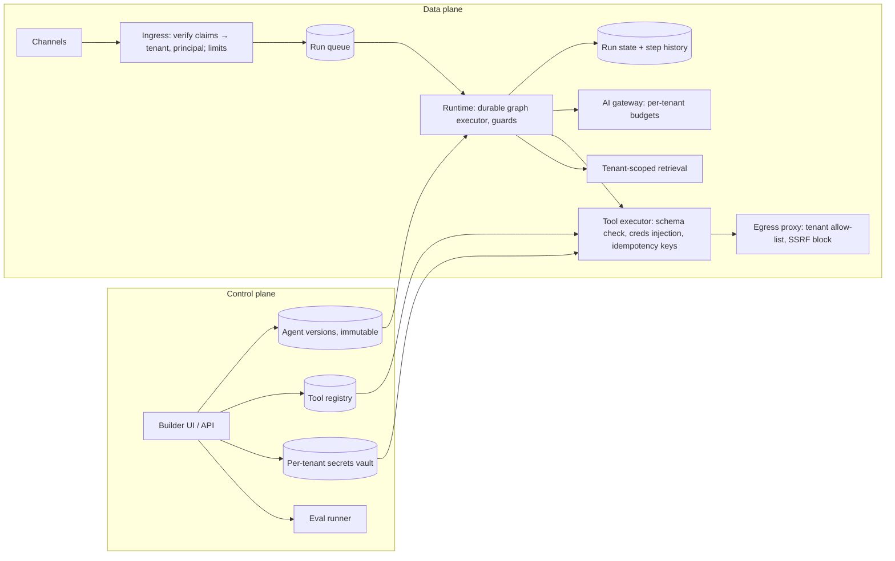
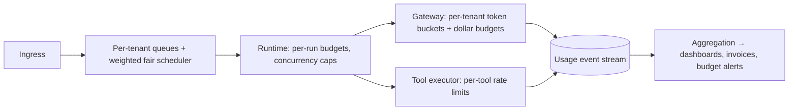
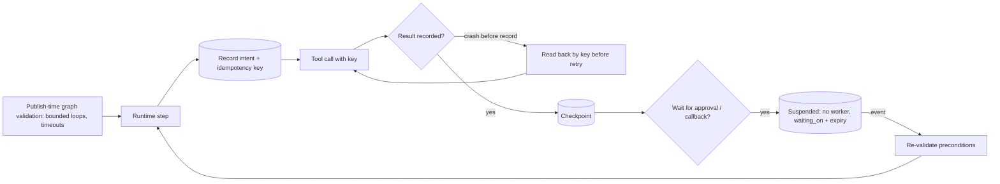
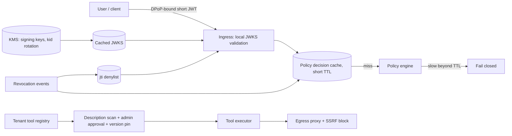
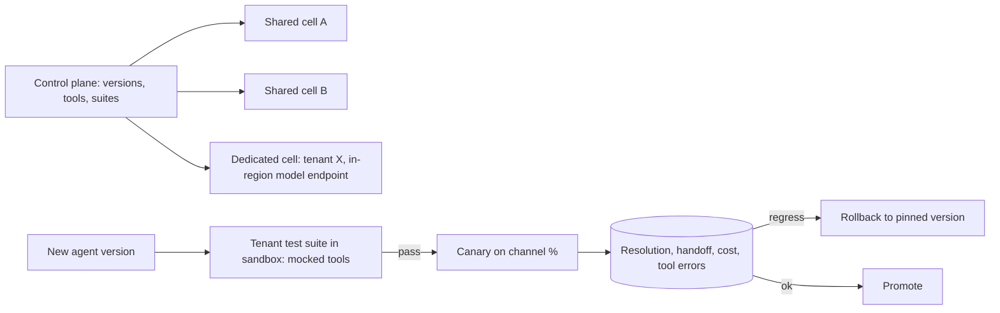

# Multi-Tenant Agent Platform

> [!abstract] Asked at Microsoft (secure multi-tenant Copilot API: threat model, token lifecycle, cross-tenant leakage, onsite, April 2026; multi-tenant voice and chat receptionist platform, September 2026), Capital One (enterprise agent platform with guardrails, workflow-vs-agent choices and latency control, senior lead AI engineer onsite, September 2026) and Qualified Health (recover durable DAG workflows with external effects and multi-day approvals; LLM workflow quotas and recovery costs; validating editable DAGs and bounding repetition; streaming LLM output while committing reliable results, onsite, September 2026), plus OpenAI's agent harness and evaluation system (April 2026). Topics: [[10 - AI Gateway Security and Guardrails|10]] (tenant identity, tokens, egress) → [[09 - Durable Execution HITL and Realtime UX|09]] (durable runs, long waits) → [[03 - Tool Engineering and Action Spaces|03]] (tool connectivity, delegated auth) → [[02 - Execution Loops and Control Topologies|02]] (bounded graphs) → [[12 - LLM Cost and Latency Economics|12]] (budgets, metering) → [[11 - Evals Observability and Silent Drift|11]] (evals as a product feature).
>
> The hard part: thousands of customers run their own agents, with their own tools and secrets, on shared infrastructure. **Tenant identity must come only from trusted token claims and be re-checked at every hop**; credentials must never be visible to the model; runs must survive crashes and multi-day waits without repeating side effects; and one tenant's spike or malicious tool can't touch anyone else.

---

## 1. Clarify Script

Defaults are assumptions unless a source is given.

| Question | Default | If different |
|---|---|---|
| Who builds agents? | Business customers (tenants) through a builder UI and API | Internal teams only → simpler isolation, same runtime |
| Tools? | Tenants register their own: OpenAPI specs, MCP servers, built-in connectors | First-party only → smaller SSRF and sandbox surface (Microsoft's clarifier) |
| Channels? | Web widget, Slack, email, phone | — |
| Identity? | Tenants bring their own IdPs (OIDC or SAML SSO); agents may act for the tenant or for an end user | — |
| Runs? | Mostly seconds; some wait hours or days for approvals or callbacks | — |
| Scale? | 5,000 tenants, ~50k concurrent runs at peak, ~5M runs/day | — |
| Compliance? | Audit logs, retention, training opt-out; some tenants require dedicated infrastructure in-region | All shared → simpler, cheaper |
| Agent or workflow? | Both: tenants define graphs with fixed steps and agentic nodes | — |

---

## 2. Requirements

### Functional

- Builder: instructions, model, tools, knowledge, guardrails, approval steps; versioned agents with rollback.
- Deploy to channels; runs with multi-step tool use, human handoff, long waits.
- Tenant-facing traces, costs, outcomes; eval suites run before publishing.
- Usage-based billing with budgets.

### Non-functional

- **Hard isolation** of data, secrets, prompts, runs and caches between tenants; fail closed on auth or policy failure.
- Noisy-neighbour protection across queues, model traffic and tool egress.
- Runs survive crashes; side effects never duplicated.
- Interactive turns stay fast: per-request auth and policy checks must be cheap.

### Out of scope

- The tenants' own systems behind their tools; model training.

---

## 3. Estimates That Drive V0

```
Runs:      5M/day ≈ 60/s average, ~300/s peak
Calls:     ~5–10 model and tool calls per run → ~3k model calls/s at peak through the gateway
Waits:     a few % of runs wait hours or days → hundreds of thousands of suspended runs at any time
Traces:    every step recorded for observability and billing → billions of append-only events per month
```

- **Suspended runs must hold no worker**: waiting is state in a durable store, resumed by an event.
- **Policy checks on every hop** at 3k calls/s must be local or cached, with a revocation story.
- **Trace and usage volume** is a data pipeline of its own, with per-tenant retention.

---

## 4. Entities, Tools and State

### Isolation by layer

| Layer | What code enforces |
|---|---|
| **Identity** | Tenant and principal come from **verified token claims** at ingress (OIDC SSO for users, workload identity or mTLS between services, never static keys); propagated in the run context and **re-verified at every downstream hop** (retrieval, tools, storage). No component accepts a tenant id from the model or a request field |
| **Data** | `tenant_id` on every row with row-level security; tenant-scoped vector partitions with filtered search ([[02 - Multi-Tenant Document RAG]]); per-tenant encryption keys for sensitive stores ([[18 - Security]]) |
| **Secrets** | Per-tenant vault namespaces; the tool executor injects credentials at call time, outside the model's context |
| **Compute** | Shared stateless runtime workers; code tools in per-run microVMs; dedicated pools for enterprise tenants |
| **Network** | Tool calls leave through an egress proxy that enforces each tenant's allow-listed domains and blocks internal addresses (SSRF) |
| **Model traffic** | Gateway tags every call with tenant; per-tenant rate limits, budgets, residency routing |

### State

```
agents(tenant_id, agent_id, version, graph_def, model, tools[], guardrails, created_at)     -- immutable versions
deployments(tenant_id, channel, agent_id, version, traffic_split)
tools(tenant_id, tool_id, kind {openapi|mcp|builtin}, schema, endpoint, auth_mode {tenant|delegated},
      requires_approval, idempotent, timeout, rate_limit, pinned_version, description_review_status)
runs(tenant_id, run_id, agent_version, status {running|waiting|done|failed}, waiting_on, budget, spent)
steps(run_id, seq, node, kind, input_ref, output_ref, idempotency_key, status)                -- event history
usage(tenant_id, run_id, ts, model, input_tokens, cached_tokens, output_tokens, tool_calls, cost)
```

---

## 5. V0 — Simplest Design That Works

- **Control plane vs data plane**: the control plane stores what agents *are* (immutable versions, tool registry, secrets, eval suites); the data plane runs them. A deployment points a channel at a version ([[19 - Deployment and Infrastructure]]).
- **Ingress**: authenticate, resolve tenant and principal from claims, apply per-tenant limits, enqueue the run.
- **Runtime**: each run is a **durable workflow** executing the agent graph step by step, checkpointing after each node; waiting states (approval, callback, human handoff) **release the worker** and resume on an event ([[09 - Durable Execution HITL and Realtime UX]]).
- **Workflow vs agent per node** (Capital One asks for this choice): fixed nodes for deterministic steps (lookups, validations, notifications), agentic nodes only where the path can't be predicted, each with its own step and token cap ([[01 - Workflows vs Agents]]).
- **Tool executor**: validates arguments against the schema, injects credentials, attaches a runtime-generated idempotency key to side-effecting calls, enforces per-tool timeouts, retries only idempotent tools, routes through the egress proxy.
- **Guards on every run**, enforced by the runtime: step caps, token and dollar budgets, repeated-action detection, wall-clock limits ([[02 - Execution Loops and Control Topologies]]).
- **Agent version pinned for the life of a run**; checkpoints carry a schema version.



> [!important] The most drilled component
> Tenant identity through every hop. Microsoft's hint calls it "the spine": tenant identity flows from trusted token claims, never from a user-controlled field, and is re-checked at retrieval, tools and storage rather than trusted once at the gateway. Its follow-up tests it: a retrieved document tells the model to call a deployment tool and exfiltrate another tenant's data. The platform stops that, not the model: retrieval is tenant-scoped, the tool executor checks the run's principal and the tool's permission, credentials are scoped to this tenant, and egress only reaches this tenant's allow-listed hosts.

### What V0 can't handle

- **Noisy neighbours**: one tenant launches 100k runs.
- **Side effects across crashes and multi-day waits**, and the exactly-once limits of external systems.
- **Token theft and fast revocation** at hot-path latency.
- **Bad agent versions** reaching a tenant's customers.
- **Dedicated, in-region** customers.

---

## 6. Scale Ladder

### V1 — Noisy neighbours and cost control

- **Evidence:** Qualified Health (Sep 2026): controlling LLM workflow quotas and recovery costs; Microsoft (Apr 2026): excessive usage and cost blow-ups, distributed tenant-aware rate limiting; Capital One (Sep 2026): end-to-end latency control. Confidence **strong**.
- **Trigger:** one tenant's campaign launches 100k runs; another's agent loops; model provider limits are shared.
- **What breaks:** everyone's runs queue behind one tenant; a runaway agent burns a tenant's month of budget in an hour.
- **Change ([[08 - Reliability]], [[12 - LLM Cost and Latency Economics]]):**
    + **Run queue partitioned by tenant** with weighted fair scheduling; per-tenant concurrency caps by plan.
    + **Gateway budgets**: per-tenant token buckets and dollar budgets enforced in real time (soft alert, hard stop), plus per-run budgets in the runtime.
    + **Per-tool rate limits** that protect the tenant's own APIs from their agent.
    + **Metering**: every model and tool call emits a usage event to a stream; aggregated for dashboards and invoices; real-time enforcement stays at the gateway ([[20 - Data Processing and Analytics]]).
    + **Recovery cost**: retries and replays are budgeted too, so an incident doesn't double a tenant's bill.
- **Trade-off:** fair scheduling can delay a large tenant's legitimate burst; enterprise plans buy reserved capacity.



### V2 — Side effects across crashes and multi-day waits

- **Evidence:** Qualified Health (Sep 2026): recovering DAG workflows "through crashes, duplicate attempts, external side effects, and multi-day approvals using durable state and explicit exactly-once limits"; streaming LLM output while committing reliable results; bounding runtime repetition in editable DAGs. Confidence **strong**.
- **Trigger:** worker crashes after a tool call returns but before the checkpoint; an approval arrives after three days and after the agent definition has a new version.
- **What breaks:** a retried step calls the tenant's API twice; a resumed run follows a graph that changed; a loop in a user-edited graph runs forever.
- **Change ([[09 - Durable Execution HITL and Realtime UX]], [[MD-06 - Distributed Saga and Compensating State Machine|MD-06]]):**
    + **Be explicit about exactly-once limits**: the runtime can guarantee each step's result is recorded once; it can't make an external API exactly-once. So side-effecting tools get a runtime-generated idempotency key (`run_id:step_seq`) passed to the tenant API; for APIs without idempotency, record intent before the call and **read back** before any retry; non-idempotent, non-readable tools require approval.
    + **Long waits**: a suspended run stores `waiting_on` (approval id, callback token with expiry); the resume event re-validates preconditions (the order may have changed in three days) before continuing.
    + **Version pinning**: the run finishes on the version it started with; migrating in-flight runs is an explicit, tested operation.
    + **Graph validation at publish**: reject graphs without bounded loops (max iterations per cycle), unreachable nodes, or missing timeouts.
    + **Streaming vs committing**: stream tokens to the user as they arrive, but commit the step's result only when complete; a retried step tells the client to rewind its stream.
- **Trade-off:** approvals for non-idempotent tools add friction; the alternative is double charges in tenants' systems.



### V3 — Tokens, revocation and hostile tools at scale

- **Evidence:** Microsoft (Apr 2026): full token lifecycle (asymmetric signing in KMS, `kid` and JWKS, local validation, rotation, revocation), stolen-token replay, policy-engine latency spikes without serving a stale allow, tenant-registered tools widening the SSRF surface. Confidence **strong**.
- **Trigger:** 3k calls/s each needing auth and policy checks; a stolen token; a tenant registers an MCP server whose tool descriptions contain instructions.
- **Change ([[10 - AI Gateway Security and Guardrails]]):**
    + **Short-lived JWTs** signed with KMS-held keys, validated locally against a cached JWKS (`kid` for rotation with overlapping keys); refresh tokens revocable centrally; a small `jti` denylist for urgent revocation; proof-of-possession (DPoP) for high-risk clients so a stolen token can't be replayed from another device.
    + **Policy decisions cached** with short TTLs and **invalidated by revocation events**; if the policy engine is slow, serve cached decisions only within their TTL and fail closed beyond it, never extend an allow.
    + **Tenant tools are untrusted**: MCP servers pinned by version, tool descriptions reviewed (automated scan plus tenant admin approval) for injected instructions, OAuth scopes minimal, all calls through the egress proxy with SSRF protection.
    + **Delegated identity** when the agent acts for an end user: the user's own scoped token, not the tenant's service credential ([[03 - Tool Engineering and Action Spaces]]).
- **Trade-off:** short TTLs mean more refresh traffic; local validation keeps the hot path fast.



### V4 — Evals, versioning and dedicated tenants as product features

- **Evidence:** OpenAI (Apr 2026): harness and eval platform with isolated execution, versioned task sets, graders, repeated trials and regression gates; Microsoft (Apr 2026): a customer whose data must never share infrastructure or leave its region. Confidence **strong**.
- **Trigger:** a tenant's new agent version breaks their support flow; an enterprise demands a dedicated, in-region deployment.
- **Change ([[11 - Evals Observability and Silent Drift]]):**
    + **Tenant test suites**: example conversations with expected outcomes, tool calls that must or must not happen, rubric checks; run in a sandbox with mocked or staging tools; regressions block publishing.
    + **Canary deploys** per channel with outcome metrics (resolution, handoff, cost, tool error rate) and instant rollback to the pinned previous version.
    + **Cell-based deployment**: the data plane runs in cells; shared cells for most tenants, **dedicated cells in the customer's region** for those who need it, managed by the same control plane, with model endpoints in-region.
- **Trade-off:** dedicated cells cost more to run and upgrade; price them into the plan.



---

## 7. Twist Cards

### Most asked

**T1 — "A retrieved document tells the model to call a deployment tool and exfiltrate another tenant's data. What stops it?"**
- **Evidence:** Microsoft (Apr 2026), verbatim. Confidence **strong**.
- **Hits:** platform vs model responsibility.
- **Answer:** the platform, layer by layer: retrieval is scoped to this tenant, so the other tenant's data can't be read; the tool executor checks that this run's principal may call the deployment tool (and it needs approval); credentials are this tenant's only; egress reaches only this tenant's allow-listed hosts. The model's part is to treat retrieved text as data, which reduces attempts but is never relied on.
- **Attaches to:** V0, V3.

**T2 — "A token is stolen and replayed from a new IP within its TTL."**
- **Evidence:** Microsoft (Apr 2026), verbatim. Confidence **strong**.
- **Hits:** token lifecycle.
- **Answer:** detect: DPoP proof fails (bound to the original key), or anomaly on IP, device and usage pattern. Contain: short TTL (minutes) bounds the window; revoke the refresh token and add the `jti` to the denylist; invalidate cached policy decisions for that session. Exposure: at most the TTL for unbound tokens, near zero for DPoP-bound ones. Audit what it called.
- **Attaches to:** V3.

**T3 — "The policy engine has a latency spike at peak."**
- **Evidence:** Microsoft (Apr 2026). Confidence **strong**.
- **Hits:** availability vs authorization.
- **Answer:** serve cached decisions within their short TTL, refreshed asynchronously; revocation events invalidate entries immediately; beyond the TTL fail closed for writes and tool calls, keep read-only chat working if policy allows. Never extend an allow because the engine is slow.
- **Attaches to:** V3.

**T4 — "The worker crashes after the tool call succeeded but before the checkpoint."**
- **Evidence:** Qualified Health (Sep 2026); Cursor guide pattern ([[03 - Coding Agent]]). Confidence **strong**.
- **Hits:** exactly-once limits.
- **Answer:** V2: the step's intent and idempotency key were recorded before the call; on resume, the runtime retries with the same key (the tenant API dedupes) or reads back by key; tools that support neither require approval. State the limit honestly: the platform records results exactly once; the external effect is at-least-once unless the API is idempotent.
- **Attaches to:** V2.

**T5 — "When do you use a predefined workflow instead of an agent?"**
- **Evidence:** Capital One (Sep 2026). Confidence **strong**.
- **Hits:** graph design.
- **Answer:** workflow when the steps are known and order matters (lookups, validations, approvals, notifications); agent node only where the path depends on content you can't enumerate, bounded by steps and budget. Latency and reliability are better with fixed steps, and guardrails are easier to place ([[01 - Workflows vs Agents]]).
- **Attaches to:** V0.

**T6 — "A customer wants dedicated infrastructure in their region."**
- **Evidence:** Microsoft (Apr 2026). Confidence **strong**.
- **Hits:** cells.
- **Answer:** V4: a dedicated data-plane cell in their region with in-region model endpoints and keys, managed by the shared control plane (which stores only metadata, or is itself regional for strict cases). Cost: separate capacity, upgrades per cell, on-call.
- **Attaches to:** V4.

### Lower priority (recall / judgement)

**T7 — "A tenant registers a malicious MCP server."**
- **Evidence:** Microsoft (tenant-registered tools widen the attack surface). Confidence **medium**.
- Version pinning, description scanning and admin approval, minimal OAuth scopes, calls only through the egress proxy, tool results treated as untrusted data.

**T8 — "A user-edited graph loops forever."**
- **Evidence:** Qualified Health (validate editable DAGs and bound repetition). Confidence **medium**.
- Publish-time validation (bounded cycles, timeouts on every node), plus runtime step caps and repeated-action detection.

**T9 — "How do tenants know their agent works?"**
- **Evidence:** OpenAI harness (Apr 2026). Confidence **medium**.
- V4: test suites with mocked tools, repeated trials, regression gates on publish, canaries with outcome metrics.

**T10 — "How do you bill fairly?"**
- **Evidence:** none specific. Confidence **judgement**.
- Usage events per call with cached vs uncached tokens and tool calls; budgets enforced at the gateway; retries during platform incidents not billed.

---

## 8. Break It

| Failure | What the tenant sees | What you say |
|---|---|---|
| Cross-tenant read attempt | Nothing returned | Tenant from claims, re-checked per hop; RLS; scoped retrieval |
| Injected instruction to exfiltrate | Tool call denied | Executor permission check, scoped creds, egress allow-list |
| Stolen token | Short window, then revoked | DPoP, short TTL, `jti` denylist |
| One tenant's 100k runs | Others unaffected | Per-tenant queues, fair scheduling, caps |
| Runaway agent | Run stopped at budget | Per-run and per-tenant budgets |
| Crash after tool call | No duplicate effect | Intent + idempotency key, read-back |
| Approval after 3 days | Run resumes correctly | Suspended state, re-validate on resume, pinned version |
| Bad agent version | Rolled back | Eval-gated publish, canary |
| Policy engine slow | Cached decisions, then fail closed | Short-TTL cache with revocation invalidation |

---

## 9. Evals, Operations and Cost

| Tier | Checks |
|---|---|
| **Platform security** | Cross-tenant test suite at every hop; injected-instruction fixtures; SSRF tests on the egress proxy; token replay tests |
| **Runtime** | Chaos tests: kill workers between tool call and checkpoint; assert no duplicate side effects; resume after long waits |
| **Tenant agents** | Tenant test suites with mocked tools; repeated trials; canary outcome metrics |

- **Production metrics:** runs per tenant, queue wait per tenant, suspended runs, step failure and retry rates, tokens and dollars per run, budget stops, policy-cache hit rate, egress denials.
- **Alerts:** any cross-tenant test failure; a tenant's queue wait above SLO; budget stop spikes; egress denial spikes for one tenant (misconfigured or malicious tool); policy engine p99.
- **Cost drivers:** model tokens (passed through with margin), runtime and sandbox compute, trace storage.

---

## 10. One-Minute Close

> "A control plane of immutable agent versions, a tool registry and per-tenant secrets, and a data plane that runs each run as a durable graph workflow. Tenant identity comes only from verified token claims and is re-checked at retrieval, tools and storage; credentials are injected by the tool executor outside the model; egress goes through a per-tenant allow-list proxy. Fixed workflow nodes handle known steps and bounded agent nodes the rest. Side-effecting tool calls get runtime idempotency keys with read-back, and waits of hours or days hold no worker and re-validate on resume. Per-tenant queues with fair scheduling, gateway token and dollar budgets and per-tool rate limits stop noisy neighbours. Tokens are short-lived and locally validated with a revocation denylist, policy decisions are cached briefly and fail closed. Tenants get test suites, canaries and rollback, and regulated customers get dedicated in-region cells."

---

## Evidence

Reports tallied in November 2026.

| Follow-up | Reports | Count | Placed as | Deep dive? |
|---|---|---|---|---|
| Tenant identity from claims, re-checked per hop; cross-tenant leakage | Microsoft (Apr 2026); Microsoft receptionist (Sep 2026); Qualified Health isolation (Sep 2026) | 3 | V0 + T1, **strong** | Yes |
| Token lifecycle, theft and replay, policy latency | Microsoft (Apr 2026) | 1 (three follow-ups) | V3 + T2, T3, **strong** | Yes |
| Durable workflows, external effects, multi-day approvals, exactly-once limits | Qualified Health (Sep 2026, four related questions) | 4 | V2 + T4, T8, **strong** | Yes |
| Workflow vs agent, guardrails, latency | Capital One (Sep 2026) | 1 | V0 + T5, **strong** | Sometimes |
| Quotas, cost blow-ups, recovery costs | Qualified Health; Microsoft | 2 | V1, **strong** | Sometimes |
| Dedicated, in-region customers | Microsoft | 1 | V4 + T6, **strong** | Sometimes |
| Eval harness, regression gates | OpenAI (Apr 2026) | 1 | V4 + T9, **medium** | Sometimes |
| Malicious tenant tools, billing | Microsoft (scope) / none | 1 / 0 | T7, T10, **medium** / **judgement** | No |

- **What the tally changed:** the old note's control vs data plane, isolation table, tool connectivity, durable runtime, per-tenant guardrails, evals and metering stay, regrouped. Added: re-checking tenant identity at every hop (V0), explicit exactly-once limits with intent records and read-back (V2), version pinning and re-validation across multi-day waits (V2), graph validation for editable DAGs (V2, T8), the token lifecycle and policy-cache failure mode (V3), and cell-based dedicated deployments (V4).

## Sources

- PracHub, *Design a Secure Copilot API* (Microsoft, onsite, April 2026). https://prachub.com/interview-questions/design-a-secure-copilot-api
- PracHub, *Design an Enterprise Agent Platform with Guardrails and Latency Control* (Capital One, onsite, September 2026). https://prachub.com/interview-questions/design-an-enterprise-agent-platform-with-guardrails-and-latency-control
- PracHub, *Recover Durable Workflows with External Effects and Long Waits* (Qualified Health, onsite, September 2026), with related questions on quotas and recovery costs, editable DAGs and streaming while committing results. https://prachub.com/interview-questions/recover-durable-workflows-with-external-effects-and-long-waits
- PracHub, *Design an Agent Harness and Evaluation System* (OpenAI, onsite, April 2026). https://prachub.com/interview-questions/design-an-agent-harness-and-evaluation-system
- PracHub, *Design a Voice and Chat AI Receptionist Platform* (Microsoft, onsite, September 2026). https://prachub.com/interview-questions/design-a-voice-and-chat-ai-receptionist-platform

## Related Notes

- [[Agentic/Problems/README]] · [[09 - Durable Execution HITL and Realtime UX]] · [[10 - AI Gateway Security and Guardrails]] · [[03 - Tool Engineering and Action Spaces]] · [[02 - Multi-Tenant Document RAG]] · [[03 - Coding Agent]] · [[MD-06 - Distributed Saga and Compensating State Machine|MD-06]] · [[Agentic Problem to Solution Map]]
