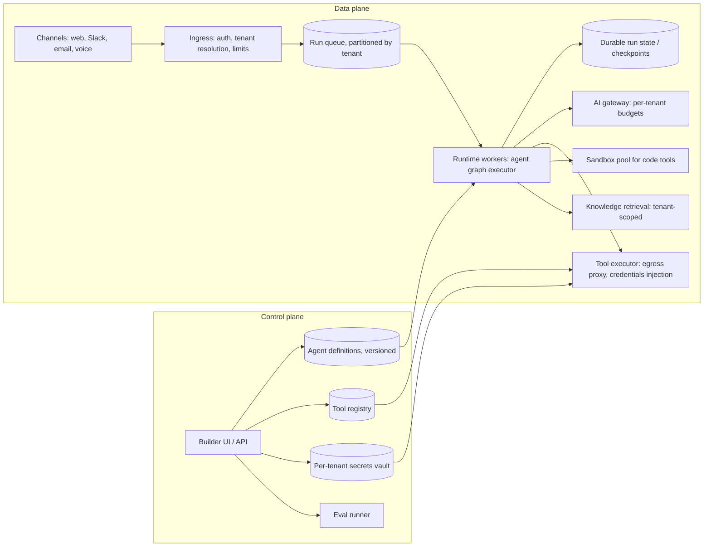

# Multi-Tenant Agent Platform

> [!abstract] The prompt
> "Design a platform where business customers build and deploy their own AI agents: they write instructions, connect tools (their APIs, SaaS apps, MCP servers), add knowledge, and deploy to chat, email or voice channels. Thousands of tenants." The hard parts: **tenant isolation of data, credentials and compute**, **safe tool connectivity**, **a durable multi-tenant runtime**, **per-tenant guardrails and budgets**, and **evals and versioning as product features**.

---

## 1. Requirements

**Functional**
- Agent builder: instructions, model choice, tools (OpenAPI import, MCP servers, built-in connectors), knowledge sources, guardrail settings, approval steps.
- Deploy to channels (web widget, Slack, email, phone); versioned agents with rollback.
- Runs: multi-step tool use, human handoff, long waits (approvals, callbacks).
- Observability per tenant: traces, costs, outcomes; evaluation suites tenants can run before publishing.
- Billing by usage.

**Non-functional**
- **Hard isolation**: one tenant's data, secrets, prompts and runs are invisible to others.
- Noisy-neighbour protection: one tenant's spike can't degrade others.
- Runs survive crashes; side effects never duplicated.
- Scale: 5,000 tenants, ~50k concurrent runs at peak, millions of runs per day.

---

## 2. Estimation

- 5M runs/day ≈ 60 runs/s average, peaks 5×; each run ~5–10 model calls and tool calls → ~3k model calls/s at peak through the gateway ([[10 - AI Gateway Security and Guardrails]]).
- Most runs are short (seconds), some wait for hours (approvals), so runs **must not hold workers while waiting** ([[09 - Durable Execution HITL and Realtime UX]]).
- Trace volume: every step stored for observability and billing → high-volume append-only telemetry with per-tenant retention ([[11 - Evals Observability and Silent Drift]]).

---

## 3. Architecture

- **Control plane** stores what agents *are*; **data plane** runs them. Agent definitions are immutable versions; a deployment points a channel at a version.

---

## 4. Deep Dive: Tenant Isolation

| Layer | Isolation |
|---|---|
| **Data** | `tenant_id` on every row, row-level security in Postgres; tenant-scoped vector partitions with filter-aware search ([[02 - Multi-Tenant Document RAG]]); per-tenant encryption keys for sensitive stores ([[18 - Security]]) |
| **Secrets** | Per-tenant vault namespaces; credentials injected by the tool executor at call time, never placed in prompts or model-visible state |
| **Compute** | Shared stateless workers for normal runs; code tools in per-run microVM sandboxes ([[10 - AI Gateway Security and Guardrails]]); dedicated worker pools for enterprise tenants |
| **Network** | Tool calls leave through an egress proxy that enforces each tenant's allow-listed domains |
| **Model traffic** | Gateway tags every call with tenant; per-tenant rate limits, budgets and data-residency routing |

- The **tenant id comes from authentication at ingress** and travels in the run context; no component accepts it from the model or from end-user input ([[03 - Tool Engineering and Action Spaces]]).

---

## 5. Deep Dive: Tool Connectivity

- **OpenAPI import**: tenants upload a spec; the platform turns selected operations into tool schemas, but encourages **intent-level** tools (tenants pick and describe a few operations instead of exposing 200 endpoints) ([[03 - Tool Engineering and Action Spaces]]).
- **MCP servers**: tenants register remote MCP servers; the platform acts as the MCP client, pins server versions, reviews tool descriptions for injected instructions, and scopes OAuth tokens.
- **Auth models**: tenant-level service credentials, or **end-user delegated OAuth** when the agent acts on behalf of the tenant's customer or employee.
- **Execution policy per tool**: timeout, retries for idempotent tools only, idempotency keys from the runtime for side-effecting tools, per-tool rate limits (protect the tenant's own API), and "requires approval" flags.

---

## 6. Deep Dive: The Runtime

- Each run is a **durable workflow**: agent graph executed step by step, state checkpointed after each node, waiting states (approval, callback, human handoff) **release the worker** and resume from an event ([[09 - Durable Execution HITL and Realtime UX]]).
- **Run queue partitioned by tenant** with fair scheduling (weighted fair queueing), so a tenant launching 100k runs can't starve others; per-tenant concurrency caps by plan ([[08 - Reliability]]).
- Guards on every run: step caps, token and dollar budgets, repeated-action detection, wall-clock limits, all enforced by the runtime ([[02 - Execution Loops and Control Topologies]]).
- Agent version is pinned for the lifetime of a run, so a mid-run deploy doesn't change behaviour; checkpoints carry a schema version.

---

## 7. Deep Dive: Guardrails and Policy per Tenant

- Platform-wide non-negotiables: no cross-tenant access, sandboxed code, egress control, PII redaction options, abuse detection.
- Tenant-configurable: topic restrictions, required approvals for action types, refund/transaction limits, tone and disclosure rules, output filters for their channels.
- Indirect injection: tenant knowledge and tool results are untrusted data; agents that read external content (emails, web) get approval gates before sensitive actions ([[10 - AI Gateway Security and Guardrails]]).

---

## 8. Deep Dive: Evals and Versioning as Product Features

- Tenants define **test suites**: example conversations with expected outcomes, tool calls that must or must not happen, rubric-based checks.
- **Publishing gate**: a new agent version runs the suite in a sandbox with mocked or staging tools; regressions block publishing.
- **Canary deploys**: route a percentage of a channel's traffic to the new version, compare outcome metrics, then promote or roll back ([[19 - Deployment and Infrastructure]]).
- Production analytics per version: resolution rate, handoff rate, cost per run, tool error rate ([[11 - Evals Observability and Silent Drift]]).

---

## 9. Deep Dive: Metering and Billing

- Every model call and tool call emits a usage event (tenant, agent version, run, tokens by type, cost) to a stream; aggregated into per-tenant usage for billing, budgets and dashboards ([[20 - Data Processing and Analytics]]).
- Budgets are enforced in real time at the gateway (soft alerts, hard stops), while invoices come from the aggregated stream ([[12 - LLM Cost and Latency Economics]]).

---

## 10. Failure Modes

| Failure | Mitigation |
|---|---|
| Cross-tenant data or secret exposure | Tenant id only from auth; RLS; vault namespaces; credentials injected outside the model |
| Noisy neighbour floods the runtime | Tenant-partitioned queues, fair scheduling, concurrency caps, per-tenant gateway limits |
| Runs hold workers while waiting | Durable waits that release workers; resume on events |
| Duplicate side effects after crashes | Runtime idempotency keys; checkpointed state |
| Malicious tenant tool or MCP server | Egress proxy, sandboxing, description review, scoped tokens |
| Bad agent version breaks a tenant's support | Eval-gated publishing, canaries, instant rollback to pinned versions |
| Runaway cost | Run budgets plus tenant budgets enforced at the gateway |

---

## Interview Lines

> [!tip] Say it like this
> - "Control plane stores immutable agent versions, tools and secrets; the data plane runs them as durable, checkpointed workflows."
> - "The tenant id comes only from authentication, and credentials are injected by the tool executor, never shown to the model."
> - "Run queues are partitioned per tenant with fair scheduling and concurrency caps, so one tenant can't starve the rest."
> - "Waiting states release workers and resume on events, which is how millions of runs coexist with hours-long approvals."
> - "Evals and canaries are product features: a new agent version can't publish if it regresses the tenant's test suite."

## Related Notes

- [[Agentic/Problems/README]] · [[09 - Durable Execution HITL and Realtime UX]] · [[10 - AI Gateway Security and Guardrails]] · [[03 - Tool Engineering and Action Spaces]]
