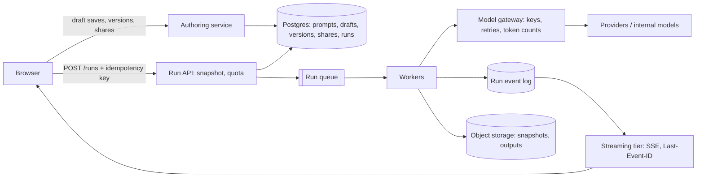
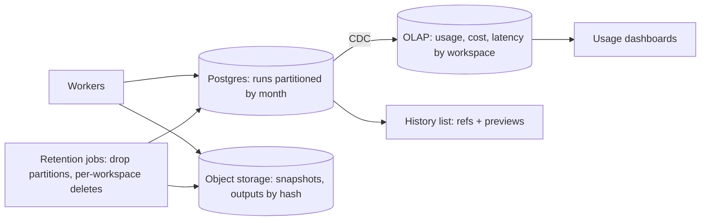
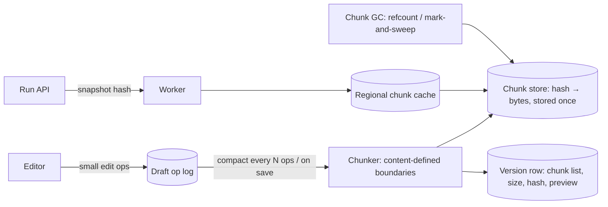
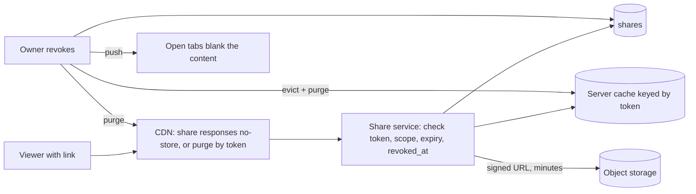
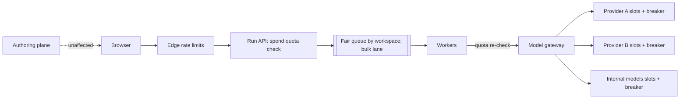

# Prompt Playground

> [!abstract] The most reported Anthropic system design question of 2026, in at least six wordings on PracHub: *Design a prompt playground* (onsite, ~4,400 solves; 100k MAU, 1M runs a day), *Collaborative Prompt Playground* (onsite, Oct 2026), *AI Playground for Very Large Prompts* (onsite, Apr 2026), *Schema, Large Prompts, Sharing and Tiny Edits* (senior onsite, Jul 2026), *Two-Tab Save Conflicts, Revocable Share Links* (onsite, Nov 2026), and a *prompt-sharing product* variant. OpenAI asks the same shape as *Design the OpenAI Playground* (SWE full-stack loop, May 2025; listed in Exponent's 2026 OpenAI guide), with conversation threads in scope. Topics: [[00 - LLM Fundamentals for Engineers|00]] (sampling, why replay isn't identical) → [[09 - Durable Execution HITL and Realtime UX|09]] (streaming decoupled from the run, cancellation) → [[10 - AI Gateway Security and Guardrails|10]] (model gateway, keys, quotas) → [[11 - Evals Observability and Silent Drift|11]] (comparing outputs, run provenance) → [[12 - LLM Cost and Latency Economics|12]] (cost per run, stored at run time).
>
> The hard part: it looks like CRUD plus a model call, and interviewers spend the hour on the details CRUD hides. A playground is **two systems under one UI**: a small, consistency-first **authoring plane** (drafts, immutable versions, sharing) and a bursty, expensive **execution plane** (runs that stream, retry, cancel and cost money). Candidates fail on the "low-level details": which exact prompt a run claims to have executed, what the second tab's save does, and whether a revoked link is still readable from a cache (Jul and Oct 2026 reports).

---

## 1. Clarify Script

Defaults are assumptions unless a source is given.

| Question | Default | If different |
|---|---|---|
| Scale? | 100k MAU, 1M runs a day (PracHub prompt) | 100× → partition runs, more gateway capacity (T8) |
| Chat threads or independent runs? | Independent runs, each an experiment with an explicit input snapshot (Anthropic variant) | OpenAI variant: threads and messages are part of a version (T9) |
| What is in a version? | System prompt, messages template, variables schema, model, parameters, tools | Include tool definitions → tools are versioned too |
| Collaboration? | Workspace members edit a shared draft with save-based concurrency; comments separate | Live co-editing → CRDT on the draft only (T6) |
| Prompt size? | Up to ~1M tokens (~4 MB of text) | Smaller cap → keep bodies inline |
| Models? | External and internal models behind one model gateway | Single provider → same gateway, fewer adapters |
| Sharing? | Read-only links that can expire and be revoked; "copy to my workspace" | Shared runs → runs carry their own share records |
| Data sensitivity? | Prompts and outputs may contain customer data and secrets | Public prompts → lighter retention rules |

---

## 2. Requirements

### Functional

- Author a prompt as a **draft**; save **immutable versions**; browse, diff and restore history.
- **Run** a version (or the current draft, frozen first) with variable values; stream output; cancel.
- **Compare** runs side by side across versions, models and parameters.
- **Share** a version by link; revoke; comment on versions.
- See **cost, latency, tokens and safety flags** per run; usage per workspace.

### Non-functional

- Time to first token adds < 100 ms over the provider's (*assumed*).
- A run survives a dropped browser; a reconnecting client resumes the stream.
- No save ever silently loses work; no run is double-charged by a client retry.
- Tenant isolation on every query; provider keys never leave the gateway; prompt content kept out of logs.
- Revocation takes effect on the next request everywhere the system controls.

### Out of scope

- Training and fine-tuning, billing and payments, the model serving stack itself ([[07 - LLM Inference Platform]]).

---

## 3. Estimates That Drive V0

```
Runs:          1M/day ≈ 12/s average; peak 5× ≈ 60/s (*assumed* burst factor)
Streams:       60 runs/s × ~20 s per streamed run (*assumed*) ≈ 1,200 concurrent streams at peak
Run records:   1M/day × ~1 KB metadata  ≈ 1 GB/day of rows  → ~365 GB/year, one table, growing forever
Run bodies:    output ~2 KB + resolved input (often 10s of KB, up to MBs) → mostly object storage
Spend:         1M runs × (2,000 in + 500 out tokens) at $3 / $15 per M tokens (*assumed* prices)
               = $6,000 + $7,500 ≈ $13,500 a day of provider cost passing through the system
Large prompt:  4 MB body, edited a few characters at a time, saved often
```

- **The run table is the big one**, not prompts: it needs time partitioning and bodies outside the primary (V1).
- **Every click spends money**, so idempotency, quotas, and cancellation that actually stops the provider are part of correctness, not polish (V0, T3).
- **Concurrent streams are modest** (~1,200), so the streaming tier is simple; its job is to decouple from the run, not to scale.
- **Large prompts edited by tiny amounts** make "store every version as a full copy" expensive; content-addressed chunks fix it (V2).

---

## 4. Entities, Tools and State

### APIs

| API | What code enforces |
|---|---|
| `PUT /prompts/{id}/draft` `{content, base_revision}` | Compare-and-swap on `base_revision`; 409 with the current revision if stale (T1) |
| `POST /prompts/{id}/versions` `{from_revision, message}` | Freezes the draft revision into an immutable version; returns `version_id` |
| `POST /runs` `{version_id \| draft_revision, variables, model, params, idempotency_key}` | Freezes inputs into a **run snapshot**; checks quota; one run per idempotency key |
| `GET /runs/{id}/events` (SSE, `Last-Event-ID`) | Streams the run's event log; reconnect resumes from the last event id |
| `POST /runs/{id}/cancel` | Sets cancel intent; the worker aborts the upstream call |
| `POST /versions/{id}/shares` · `DELETE /shares/{token}` | Share record with scope and expiry; revocation checked on every read |

### State

```
workspaces(id, name, retention_days, kms_key_id)
members(workspace_id, user_id, role {viewer|editor|admin})
prompts(id, workspace_id, name, created_by)
drafts(prompt_id, revision, content_ref, updated_by, updated_at)            -- one mutable row per prompt
versions(id, prompt_id, number, content_ref, config_json, created_by, created_at)   -- immutable
runs(id, workspace_id, version_id NULL, snapshot_ref, model, params_json, status, idempotency_key,
     input_tokens, output_tokens, cost_usd, price_table_version, ttft_ms, duration_ms,
     safety_flags, created_by, created_at)                                   -- partitioned by created_at
run_events(run_id, seq, type {token|tool|error|done}, payload)               -- short-lived, for resume
shares(token_hash, version_id, scope {view|copy}, expires_at, revoked_at, created_by)
comments(id, version_id, author, body, created_at)                           -- never mutates a version
```

- **`content_ref`** points at a content-addressed body (inline for small prompts, object storage for large, V2).
- **Run snapshot** = resolved prompt text + variables + model + parameters + tool definitions, stored once by hash. A run never points at the draft.
- **`cost_usd` is computed at run time** from provider-reported tokens and the price table in force, and stored with the price table version. Recomputing from today's price constant would rewrite history (PracHub hint).

---

## 5. V0 — Simplest Design That Works

- **Authoring plane:** an authoring service over Postgres. Drafts save with compare-and-swap; "save version" copies the draft into an immutable version row.
- **Execution plane:** `POST /runs` writes the snapshot and a `queued` run row, then enqueues it. A worker claims it, calls the **model gateway** (provider keys, timeouts, retries on 429 and 5xx, token counting, error normalisation), and appends each token batch to the run's **event log** (Redis Streams, *assumed*).
- **Streaming tier:** SSE endpoints read the event log, not the worker. A dropped browser reconnects with `Last-Event-ID` and continues; the run keeps going without a browser ([[09 - Durable Execution HITL and Realtime UX#Streaming]]).
- **Completion:** the worker writes the output body to object storage, then marks the run `succeeded` with tokens, cost and latency in one update.
- **Cancel:** sets `cancel_requested` on the run; the worker checks it between token batches and **aborts the upstream request**, which is what stops billing. Whichever of cancel and completion commits its status update first wins; the other is a no-op.



> [!important] The most drilled component
> **Freeze before running.** Two collaborators edit the draft while a run is in flight; which prompt did the output come from? (Collaborative variant, Oct 2026.) The run resolves the draft or version into an immutable **snapshot** (prompt text, variables, model, parameters, tools) before it is queued, stores it by hash, and points only at the snapshot. Edits after that create new revisions and never touch it. The same idea answers "re-run an old version and get the same output": you can promise the **same inputs** exactly; you can't promise the same output, because sampling at temperature > 0 is random and even temperature 0 varies with batching and floating-point order on the provider side, and provider model aliases move ([[00 - LLM Fundamentals for Engineers#Sampling parameters]]). Pin the dated model id in the snapshot and show "same inputs, new sample".

### What V0 can't handle

- **Run history** growing ~365 GB a year in one table, with usage dashboards scanning it.
- **Very large prompts** saved often with tiny edits: full copies per version.
- **Share revocation** with caches in the path.
- **A slow provider** filling every worker; one workspace's bulk compare starving others.

---

## 6. Scale Ladder

### V1 — Run history at 1M a day: partition, move bodies out, aggregate elsewhere

- **Evidence:** PracHub *Design a prompt playground* (onsite): history at scale "driven by the 1M/day number", partitioning, retention, bodies in object storage, aggregations off the primary. Confidence **strong**.
- **Trigger:** runs table past a few hundred million rows; usage dashboards slow the primary.
- **What breaks:** index bloat and vacuum on one huge table; dashboard queries competing with run writes.
- **Change ([[05 - Databases/07 - Data Modelling]], [[20 - Data Processing and Analytics]]):**
    + **Partition `runs` by month**; index `(workspace_id, created_at)` and `(version_id, created_at)` per partition; retention drops whole partitions, plus per-workspace deletion jobs for shorter retention.
    + **Bodies out of the primary:** snapshots and outputs in object storage by hash; rows keep refs and a short preview for list views.
    + **Usage and cost dashboards** from a change stream into an OLAP store (ClickHouse or BigQuery, *assumed*), never from the primary.
- **Trade-off:** two stores and a lag of seconds on dashboards; acceptable because billing-grade cost is already on the run row.



### V2 — Very large prompts and tiny edits

- **Evidence:** *AI Playground for Very Large Prompts* (onsite, Apr 2026): when to move content out of the primary, dedupe repeated prefixes, what if object storage latency dominates run submission. Senior onsite (Jul 2026): the user adds one or two characters at a time to a large prompt; deltas, and where to store them. Confidence **strong**.
- **Trigger:** prompts of megabytes; autosave every few seconds; 50 versions of a 4 MB prompt = 200 MB for one prompt.
- **What breaks:** storage per version, write amplification, and editor load time.
- **Change:**
    + **Inline below a threshold** (~16 KB, *assumed*), object storage above it. The row keeps size, hash and a preview.
    + **Content-defined chunking** (a rolling hash cuts boundaries where the content says, ~64 KB average): a body is a list of chunk hashes, chunks are stored once. A two-character edit changes one chunk, so a new version costs one chunk plus a list, and repeated prefixes across prompts dedupe for free.
    + **Why not a delta chain:** deltas against the previous version make reading version 50 replay 49 diffs and make deleting a middle version hard; chunk lists keep every version directly readable. Mention deltas as the alternative and choose chunks.
    + **Autosave** writes small edit operations to the draft's short op log; a compaction step folds them into a chunked snapshot every N ops or on "save version".
    + **Latency:** the editor loads from a cache of recent drafts; run submission passes the snapshot hash to the worker, which assembles chunks from a regional cache, so object-storage latency is off the submit path. Stable prefixes also benefit from provider prompt caching ([[12 - LLM Cost and Latency Economics#Prompt caching in practice]]).
- **Trade-off:** a chunk store with reference counting or mark-and-sweep garbage collection for deleted versions.



### V3 — Sharing that can actually be revoked

- **Evidence:** *Two-Tab Save Conflicts, Revocable Share Links* (onsite, Nov 2026): "after a share link is revoked, can other people still see the prompt's content from a cache?"; senior onsite (Jul 2026) and the 2026 community compilation (prompt-sharing product). Confidence **strong**.
- **Trigger:** sharing launches; a user revokes a link that leaked.
- **What breaks:** revoked content still served from a CDN, a server cache, the viewer's browser or an open tab.
- **Change:** list every copy between the database and the viewer's screen, and who controls it.

| Copy | Who controls it | Rule |
|---|---|---|
| Server cache of rendered shares | Us | Keyed by share token; evicted on revoke; authorization checked before cache read |
| CDN | Us | Share pages and their API responses marked `Cache-Control: private, no-store`; or cached with a short TTL and purged by token on revoke |
| Object-storage URLs for bodies | Us | Never handed out long-lived; short-lived signed URLs minted per request after the share check |
| Viewer's browser cache | Viewer | `no-store` stops new copies; already-loaded copies can't be recalled |
| Open tab | Viewer | Page polls or subscribes to share status and blanks the content on revoke |
| Link previews (chat unfurls), screenshots, copies | Third parties | Can't be recalled; say so |

- **Share record checked on every request:** `token_hash`, scope, expiry, `revoked_at`. Tokens are random, stored hashed, and scoped to one version.
- **Honest limit:** revocation stops future reads; it can't take back what was already delivered or copied.
- **Trade-off:** no CDN caching for share pages costs origin load; fine at playground scale.



### V4 — Execution under load: slow providers, quotas and fair use

- **Evidence:** PracHub *Design a prompt playground* follow-ups: a provider becomes slow and starts timing out, degrade gracefully; 100× scale; Nov 2026 variant: stop one user's runs exhausting model capacity. Confidence **strong**.
- **Trigger:** a provider's latency triples; one workspace launches a 500-run comparison.
- **What breaks:** workers all blocked on the slow provider; other workspaces queue behind one bulk job.
- **Change ([[10 - AI Gateway Security and Guardrails#Token-Aware Rate Limiting]], [[08 - Reliability]]):**
    + **Bulkheads in the gateway:** concurrency limits per provider and model, so a slow provider fills only its own slots; circuit breaker opens on timeouts; optional fallback model only when the user opted in, recorded on the run (a fallback changes what the run measured).
    + **Two different controls:** rate limits (requests and tokens per second, protect the system) at the edge, and **spend quotas** (cost per day per workspace, protect the budget) checked at `POST /runs` and again by the worker before calling the provider, so a burst that slipped past the edge still can't overspend.
    + **Fair queueing** by workspace in the run queue; bulk comparisons go to a lower-priority lane.
    + **Degrade by plane:** when execution is down or slow, authoring, history, compare views and sharing keep working; the UI shows queued runs and the provider status.
- **Trade-off:** per-workspace queues and two quota checks add moving parts; without them one customer's experiment becomes everyone's outage.



---

## 7. Twist Cards

### Most asked

**T1 — "The same prompt is open in two tabs. Tab A saves. Then tab B, loaded before A's save, clicks save."**
- **Evidence:** Anthropic onsite (Nov 2026). Confidence **strong**.
- **Hits:** concurrency.
- **Answer:** the save carries `base_revision`. The server does `UPDATE drafts SET content_ref=?, revision=revision+1 WHERE prompt_id=? AND revision=?`; zero rows updated means stale, return 409 with the current revision. Tab B keeps its unsaved text (in local storage too) and shows "this prompt changed since you opened it" with a diff and three choices: reload theirs, overwrite with mine (a new save based on the current revision), or save mine as a new version or copy. Never silently last-writer-wins, never discard B's edits. Same logic across devices; a client retry of the same save carries the same base revision and an idempotency key, so it doesn't conflict with itself.
- **Attaches to:** V0.

**T2 — "Which exact prompt did this output come from?" / "Re-run an old version and expect the same output."**
- **Evidence:** collaborative variant (Oct 2026); PracHub follow-up. Confidence **strong**.
- **Hits:** provenance.
- **Answer:** the run snapshot (see the callout in §5). Same inputs are guaranteed; the same output is not. Offer "re-run with same inputs" and, for comparison, run several samples per configuration.
- **Attaches to:** V0.

**T3 — "The client retries `POST /runs` after a timeout. Do you pay twice?"**
- **Evidence:** PracHub hint. Confidence **strong**.
- **Hits:** idempotency.
- **Answer:** the client generates an idempotency key per click; the run API inserts with a unique constraint on `(workspace_id, idempotency_key)` and returns the existing run on conflict. Retry only timeouts, 429 and 5xx at the gateway; surface 4xx and content refusals, because retrying them is deterministic waste ([[LLD/Foundations/11 - Idempotency and Retries]]).
- **Attaches to:** V0.

**T4 — "The user closes the tab. Does the run keep billing?"**
- **Evidence:** PracHub hint ("cancellation is the subtle one"). Confidence **strong**.
- **Hits:** cancellation.
- **Answer:** closing a tab only drops the SSE connection; the run continues by design so a reconnect can resume. An explicit cancel sets intent on the run row; the worker checks between token batches and aborts the upstream HTTP stream, which stops generation and billing for most providers. Optional policy: auto-cancel a run nobody is watching after N seconds, for interactive runs only.
- **Attaches to:** V0.

**T5 — "A user loses project access while their run is active."**
- **Evidence:** collaborative variant follow-up (Oct 2026). Confidence **medium**.
- **Hits:** authorization.
- **Answer:** the run was authorized at creation, so it may finish (it's already paid for), but its output is a workspace resource: reading it checks membership on every request, so the removed user can't see it; the streaming tier re-checks on reconnect and every few minutes on long streams. For sensitive workspaces, removal cancels the user's in-flight runs.
- **Attaches to:** V3.

**T6 — "Two teammates edit the same prompt all day. When do you move to live co-editing?"**
- **Evidence:** Nov 2026 and Oct 2026 variants. Confidence **medium**.
- **Hits:** collaboration.
- **Answer:** when conflict rates on saves are high and the product is about pairing on prompts. Then put a CRDT (Yjs or Automerge) on the **draft only**, with presence as transient state; versions and runs stay immutable snapshots, so nothing in the execution plane changes. Cost: a sync server, document state in memory, and harder access control per document.
- **Attaches to:** V2.

### Lower priority (recall / judgement)

**T7 — "A shared prompt contains an API key pasted by mistake."**
- **Evidence:** Nov 2026 variant follow-up. Confidence **medium**.
- Revoke the link, then: secret scanning on save and on share (provider key patterns), block or warn before sharing, redact in the stored version (a new version with the secret removed and the old body purged, an admin-only operation that breaks immutability on purpose), notify the owner to rotate the key, and report the key to the provider's leaked-key programme if it has one. Keep secrets out of logs and traces in the first place.

**T8 — "100× scale: 100M runs a day."**
- **Evidence:** PracHub follow-up. Confidence **medium**.
- Provider rate limits break first, then the run table and event log. Shard runs by workspace, move the event log to a partitioned stream (Kafka), add regional execution planes near providers, and negotiate provider capacity. The authoring plane barely changes.

**T9 — "OpenAI's version: simulate full conversations and threads."**
- **Evidence:** OpenAI SWE full-stack loop (Exponent, May 2025). Confidence **medium**.
- A version holds an ordered message list (system, user, assistant, tool calls and results) the user can edit and replay from any point; a run appends the model's turn. Storage per message, version = list of message refs (same chunking idea), and branching forks the list.

**T10 — "A run calls a tool that sends an email, then a transient error triggers a retry."**
- **Evidence:** PracHub follow-up. Confidence **medium**.
- Tool calls in the playground are sandboxed or mocked by default; real side effects carry an idempotency key per tool call, recorded in the run's event log, and a retried step replays recorded tool results instead of calling again ([[09 - Durable Execution HITL and Realtime UX]]).

---

## 8. Break It

| Failure | What the user sees | What you say |
|---|---|---|
| Stale save from a second tab | Conflict dialog with a diff; nothing lost | CAS on `base_revision`, 409, local copy kept |
| Browser drops mid-stream | Stream resumes on reconnect | Run decoupled from the connection; `Last-Event-ID` |
| Client retries a run | One run, one charge | Idempotency key with a unique constraint |
| Cancel and completion race | One final status | First status update wins; the other is a no-op |
| Draft edited during a run | Output labelled with the exact snapshot | Freeze before running |
| Provider slow or down | Runs queue for that model; editing works | Bulkheads, breaker, opt-in fallback, degrade by plane |
| Revoked link | 404 on the next request | Auth on every read, no-store, purge, signed URLs |
| Price change | Old runs keep their cost | Cost stored at run time with the price table version |
| One workspace's bulk compare | Others unaffected | Fair queue, bulk lane, spend quota |

---

## 9. Evals, Operations and Cost

| Tier | Checks |
|---|---|
| **Correctness** | Property tests on save concurrency (two writers, retries) and on the run state machine (cancel vs complete races) |
| **Comparison quality** | Compare view shows config diffs next to output diffs, several samples per config, and an optional judge or exact-match score; never compare runs whose snapshots differ in more than one dimension without saying so ([[11 - Evals Observability and Silent Drift]]) |
| **Resilience** | Game days: provider timeouts, Redis loss (streams fall back to the stored output), CDN purge failure |

- **Production metrics:** queue wait, time to first token and tokens per second by model, run outcomes (succeeded, failed, refused, cancelled, timed out), save conflict rate, stream reconnect rate, cost per workspace per day, quota rejections.
- **Alerts:** queue wait rising for one provider (early sign of provider trouble); cancel-to-stop latency (billing continuing after cancel); any cross-workspace read denied by row-level checks (a bug, not an attack, until proven otherwise).
- **Cost drivers:** provider tokens (passed through), run bodies in object storage, OLAP for usage, the streaming tier.

---

## 10. One-Minute Close

> "A playground is two systems under one UI. The authoring plane is small and consistency-first: drafts saved with compare-and-swap on a revision so a stale tab gets a conflict instead of overwriting, immutable versions, comments kept separate, large bodies chunked by content so a two-character edit stores one chunk. The execution plane is bursty and spends real money: every run freezes an immutable snapshot of prompt, variables, model and parameters before it's queued, carries an idempotency key, streams through an event log so it survives a dropped browser, and cancels by aborting the upstream call. Cost is computed from provider-reported tokens and stored on the run. A model gateway holds keys, retries only retryable errors and isolates slow providers; spend quotas sit apart from rate limits. Shares are checked on every request with no-store caching and purges, and I'm honest that delivered content can't be recalled."

---

## Evidence

Reports tallied in November 2026.

| Follow-up | Reports | Count | Placed as | Deep dive? |
|---|---|---|---|---|
| Core design: two planes, schema, streaming, versions | PracHub prompt variants (Apr–Nov 2026); community compilation (Jul 2026); OpenAI Playground (Exponent) | 6+ | V0, **strong** | Yes |
| Large prompts, object storage, tiny edits | Very Large Prompts (Apr 2026); senior onsite (Jul 2026) | 2 | V2, **strong** | Yes |
| Sharing and revocation through caches | Nov 2026 variant; Jul 2026 senior onsite; prompt-sharing product | 3 | V3, **strong** | Yes |
| Two-tab save conflict | Nov 2026 variant | 1 | T1, **strong** | Yes |
| Freeze before run, provenance, replay | Collaborative variant (Oct 2026); PracHub follow-up | 2 | §5 callout + T2, **strong** | Yes |
| Idempotent runs, retries, cancellation | PracHub prompt hints | 1 (official prompt) | T3, T4, **strong** | Sometimes |
| Run history at 1M a day | PracHub prompt | 1 | V1, **strong** | Sometimes |
| Slow provider, quotas, fair use | PracHub prompt; Nov 2026 variant | 2 | V4, **strong** | Sometimes |
| Access lost mid-run; live co-editing; leaked key | Oct and Nov 2026 variants | 3 | T5–T7, **medium** | No |
| Conversation threads | OpenAI SWE full-stack (May 2025) | 1 | T9, **medium** | No |

- **What the tally changed:** the reports say candidates lose this round on "low-level details" (Jul 2026, rejected), so the note leads with the details each variant probes (freeze before run, CAS saves, revocation through every cache) rather than with scale. Scale (V1, V4) matters less here than in most problems.

## Sources

- PracHub, *Design a prompt playground* (Anthropic, SWE onsite, May 2026; ~4,400 solves): prompt, parts, hints and follow-ups. https://prachub.com/interview-questions/design-a-prompt-playground-2
- PracHub, *Design a Collaborative Prompt Playground* (Anthropic, onsite, Oct 2026). https://prachub.com/interview-questions/design-a-collaborative-prompt-playground
- PracHub, *Design An AI Playground For Very Large Prompts* (Anthropic, onsite, Apr 2026). https://prachub.com/interview-questions/design-an-ai-playground-for-very-large-prompts
- PracHub, *Design a Prompt Playground: Saved Prompts, Two-Tab Save Conflicts, Revocable Share Links* (Anthropic, onsite, Nov 2026). https://prachub.com/interview-questions/design-a-prompt-playground-saved-prompts-two-tab-save-conflicts-revocable-share-links
- PracHub, *Anthropic Senior Software Engineer Interview Experience: Pool Hire to Team Match* (Jul 2026): large prompts, sharing, tiny edits and deltas. https://prachub.com/interview-experiences/anthropic-senior-software-engineer-interview-experience-pool-hire-to-team-match-onsite-now-at-reference-check
- PracHub, *Anthropic Software Engineer Interview Experience: Rejected After a Weak System Design Round* (Jul 2026): "pay attention to low-level details". https://prachub.com/interview-experiences/anthropic-software-engineer-interview-experience-rejected-after-a-weak-system-design-round
- PracHub, *Anthropic SWE: A Community-Compiled Guide to the OA, Technical, and Values Rounds* (Jul 2026): "not a chatbot, every run is independent"; prompt-sharing product variant. https://prachub.com/interview-questions/design-a-prompt-playground-4
- Exponent, *OpenAI System Design Interview (2026 Guide)* and *Design the OpenAI Playground* (SWE full-stack, May 2025): threads and conversation simulation. https://www.tryexponent.com/blog/openai-system-design-interview

## Related Notes

- [[Agentic/Problems/README]] · [[09 - Durable Execution HITL and Realtime UX]] · [[10 - AI Gateway Security and Guardrails]] · [[11 - Evals Observability and Silent Drift]] · [[12 - LLM Cost and Latency Economics]] · [[08 - ChatGPT-Scale Consumer Chat]] · [[Agentic Problem to Solution Map]]
