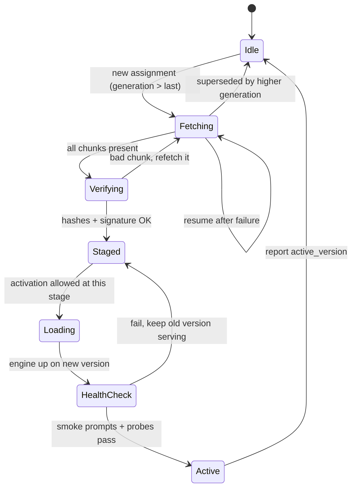
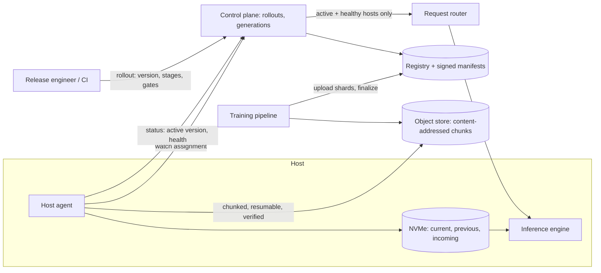
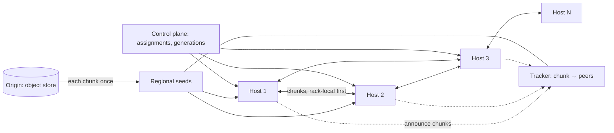
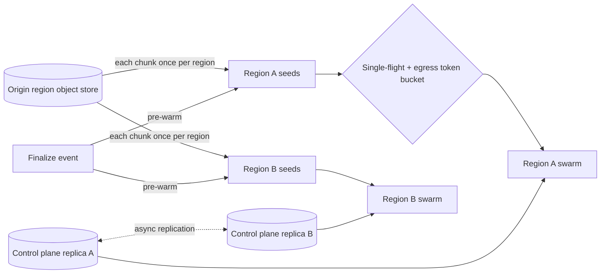
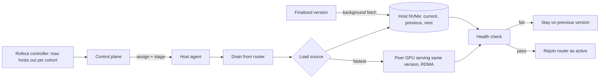
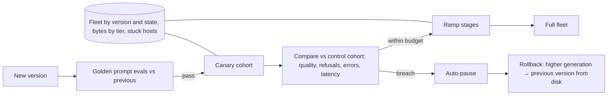

# Model Weight Distribution to a GPU Fleet

> [!abstract] Asked at Anthropic in five wordings (2026): *Design Model Weight Distribution* (onsite, thousands of workers across regions, staged rollout and rollback), *Deploy a Large Model to GPU Workers* (MLE onsite, ~1,480 solves on Codemia), *Design Peer-to-Peer Model Distribution Under a Shared Link Cap* (technical screen, Jul 2026: upload and download share 10 Gbps), plus a "500 GB to 1,000 workers: what's the lower bound" variant and a resumable-downloader variant; Exponent lists the same shape ("one huge file over a constrained link to thousands of machines"). Topics: [[13 - GPU Serving and Disaggregated KV Cache|13]] (fleet rollouts, cold starts) → [[14 - Quantization Decoding and VRAM Math|14]] (sizes, bandwidth arithmetic) → [[11 - Evals Observability and Silent Drift|11]] (canary and quality gates) → [[10 - AI Gateway Security and Guardrails|10]] (weights as secrets).
>
> The hard part: a release moves **model size × fleet size** bytes, about a petabyte here, several times a day, and no central store can serve that. The answer has two halves that must stay separate: a **data plane** that moves bytes as fast as physics allows (a swarm whose time is set by a lower bound you can prove), and a **control plane** that decides which version each worker should run, so a half-downloaded or overlapping rollout can never activate the wrong model.

---

## 1. Clarify Script

Defaults are assumptions unless a source is given.

| Question | Default | If different |
|---|---|---|
| Model size? | 500 GB per version (a large MoE in FP8), 64 shards of ~8 GB | 140 GB dense → same design, smaller numbers |
| Fleet? | 2,000 nodes × 8 GPUs, 3 regions, two hardware generations | 10,000 nodes → deeper tree, same swarm |
| Release rate? | Several versions a day; artifacts immutable after finalize (PracHub prompt) | Weekly → simpler caching, same safety |
| Network per node? | Frontend NIC 100 Gbps full duplex; backend RDMA fabric between GPUs (*assumed*) | Shared 10 Gbps up+down cap (the screen) → T1's bound changes by 2× |
| Origin? | Regional object store, ~200 Gbps egress budget per region (*assumed*) | Single region origin → cross-region seeding first |
| Targets? | Full fleet in ≤ 30 minutes; rollback to the previous version in ≤ 2 minutes | Hard SLA → reserve bandwidth, pre-stage |
| Activation? | Restart the engine on the new version; node keeps old version on disk | In-process hot swap → needs 2× GPU memory or a drained replica |
| Push or pull? | Workers pull; an agent on every host reconciles to a desired state | Push from control plane → same state machine, different trigger |
| Sensitivity? | Weights are the company's most valuable asset | Public open weights → lighter auth, same integrity checks |

---

## 2. Requirements

### Functional

- **Publish** a version: upload shards, finalize into an immutable, signed manifest.
- **Assign** versions to cohorts (service × region × hardware) with staged rollout: canary → ramp → full; pause, resume, roll back.
- **Fetch** on every worker: chunked, resumable, verified, deduplicated.
- **Activate** safely: stage, verify, load, health-check, swap; keep the last known-good versions warm.
- Workers that restart or join late **converge** to their assigned version.

### Non-functional

- Full fleet ≤ 30 min per release; rollback ≤ 2 min.
- Origin egress bounded per region (no thundering herd).
- No worker ever serves a partial, corrupt or unassigned version.
- Discovery keeps working during a regional storage incident; serving never stops during a rollout.
- Every download and activation auditable; weights encrypted at rest and in transit.

### Out of scope

- Training and checkpoint production; the inference engine's internals; request routing ([[07 - LLM Inference Platform]]).

---

## 3. Estimates That Drive V0

```
Bytes per release:  500 GB × 2,000 nodes = 1 PB  (≈ 333 TB per region)
Central origin:     333 TB ÷ 25 GB/s (200 Gbps) ≈ 13,300 s ≈ 3.7 hours per region   → too slow
Swarm lower bound:  F ÷ node link = 500 GB ÷ 12.5 GB/s (100 Gbps) = 40 s
                    + the seed must emit every byte once: 500 GB ÷ 25 GB/s = 20 s
Disk:               NVMe write ~5–10 GB/s per node (*assumed*) → 50–100 s for 500 GB
GPU load:           62.5 GB per GPU; local NVMe → GPU ≈ 1 minute (ModelExpress measured 1m 10s from fast local storage);
                    from a serving peer's GPU over RDMA ≈ 11 s (NVIDIA ModelExpress, DeepSeek-V4-Pro, 8×B200)
Disk per node:      current + previous + incoming = 1.5 TB of NVMe
```

- **The origin is the bottleneck by two orders of magnitude**, so every worker must also be a server (V1).
- **Network is no longer the bottleneck once you swarm**: disk writes and GPU loading are, which is why V3 loads from peers' GPUs and why keeping the previous version warm makes rollback fast.
- **Bytes per release** is the number to say first; interviewers in the screen variant wanted the bound, not a tour of intermediate designs (candidate report, Jul 2026).

---

## 4. Entities, Tools and State

### APIs

| API | Caller | What code enforces |
|---|---|---|
| `POST /models/{m}/versions` → upload shards → `POST .../finalize` | Training pipeline (publisher identity) | Shards written to a staging prefix; finalize computes and signs the **manifest**; after finalize the version is immutable |
| `PUT /rollouts/{cohort}` `{version, stages, gates}` | Release engineer or CI | Bumps the cohort's **generation**; one active rollout per cohort; a rollback is a new rollout with a higher generation |
| `GET /assignments?host=…` (long poll or watch) | Host agent | Returns `{version, generation, manifest_url}` for the host's cohort and its current stage |
| `GET /chunks/{hash}` | Host agent, from peers or the cache | Content-addressed; short-lived signed token bound to host identity; range requests for resume |
| `POST /hosts/{h}/status` | Host agent | Reports per-version state and progress; drives fleet counts and the router's view |

### State

```
versions(model, version, manifest_hash, signature, state {staging|final|revoked}, hw_constraints, parent_version, created_at)
manifest: { version, shards: [{name, size, sha256, chunks: [chunk_hash ...]}], tp_layout, dtype }
chunks(hash, size, locations[])                 -- content-addressed, ~64 MB each (*assumed*)
cohorts(id, service, region, hw_gen)
rollouts(cohort_id, generation, version, stage {canary|ramp_N|full|paused}, gates, started_at)
hosts(id, cohort_id, desired {version, generation}, versions_on_disk[], active_version, state, last_heartbeat)
```

- **Generation** is a number that only grows per cohort. A host acts only on an assignment whose generation is higher than the one it last acted on, so a stale or reordered instruction can never win.
- **The router's source of truth** is `hosts.active_version` reported after the health check, not the assignment. Traffic for version v goes only to hosts that report v as active and healthy (the probe in the Aug 2026 screen).

### Host agent state machine



---

## 5. V0 — Simplest Design That Works

- **Two planes.** A small, strongly consistent **control plane** (registry, rollouts, assignments; a replicated database such as etcd or Postgres with replicas per region) and a **data plane** that moves bytes (object store first).
- **Publish:** shards go to the object store under a content-addressed key; finalize writes a signed manifest. Nothing reads a version that isn't final.
- **Fetch:** the agent on every host watches its assignment, downloads chunks in parallel with range requests, writes to NVMe, verifies each chunk hash, then the manifest signature. A crash resumes from the chunks already verified.
- **Activate:** stage → verify → load on the engine → health check (load succeeded, smoke prompts return the expected shape, latency normal) → swap → report. The previous version stays on disk.
- **Rollout:** canary cohort first, then ramps; the control plane advances a stage only when the previous stage's hosts report active and healthy.
- **Rollback:** a new assignment with a higher generation pointing at the previous version, which is already on disk, so it costs only an engine restart.



> [!important] The most drilled component
> **Which version should this worker run, and how does it know?** PracHub's hint for the onsite walks through the wrong answer: a restarted worker that "looks at storage and picks the newest thing it finds" activates a half-published version, or undoes an emergency rollback. The answer: the decision lives only in the control plane, as a per-cohort assignment with a generation number that only grows; workers converge to it; storage holds only immutable, finalized artifacts; and the router sends traffic only to hosts that report the version **active and healthy**.

### What V0 can't handle

- **Origin egress:** 333 TB per region through 200 Gbps is about 3.7 hours per release (§3).
- **Thundering herd:** 2,000 hosts start fetching the same chunks in the same second.
- **Activation time:** even with bytes local, loading 500 GB from NVMe to GPUs takes about a minute per host and drains capacity during the swap.
- **Quality regressions** that pass checksums and health checks.
- **Overlapping rollouts** and late joiners during a ramp.

---

## 6. Scale Ladder

### V1 — Every worker is also a server: a swarm

- **Evidence:** Anthropic technical screen (Jul 2026, P2P downloader under a shared 10 Gbps cap); the onsite prompt's hint to compare `model_size × workers` with what one origin can serve; *Deploy a Large Model to GPU Workers* (Codemia). Confidence **strong**.
- **Trigger:** time-to-fleet set by origin egress (3.7 hours) when the target is 30 minutes.
- **What breaks:** the origin, and its egress bill.
- **Change:**
    + **Chunk the shards** (~64 MB, content-addressed). Each host downloads chunks from any peer that has them and serves its own chunks to others while it downloads.
    + **A tracker per region** tells each host which peers hold which chunks; hosts prefer peers in the same rack, then the same zone, so traffic stays off the spine.
    + **Rarest-first** chunk selection so no chunk exists only on the seed; random start offsets so peers don't all want chunk 0.
    + **Seeds:** a few cache hosts per region pull from the origin once and serve the first copies.
    + Real systems to name: Uber **Kraken** (BitTorrent-style, tracker-coordinated, in production since 2018 for Docker images) and CNCF **Dragonfly**, both used for model files.
- **The lower bound to say out loud** (Kumar and Ross, 2006, for peer-assisted distribution): time ≥ max(F ÷ seed upload, F ÷ slowest download, N·F ÷ total upload). With 2,000 hosts at 100 Gbps, the third term is about F ÷ host link = **40 s**, so the network stops mattering and disk and GPU loading take over (V3).
- **Trade-off:** a tracker and peer protocol to run; hosts spend NIC and disk bandwidth serving others while they also serve traffic, so cap upload rate on serving hosts.



### V2 — Regions, cold caches and a bounded origin

- **Evidence:** onsite follow-up (PracHub): a region's cache fleet goes cold just as a 150 GB release ramps there; how does the origin survive, and how do you bound its egress? Also "discovery must stay available during a regional storage incident." Confidence **strong**.
- **Trigger:** a region's seeds were evicted or lost; 700 hosts there ask the origin for the same chunks at once.
- **What breaks:** origin overload, cross-region egress cost, and a ramp that stalls in one region.
- **Change ([[08 - Reliability]], [[04 - Load Balancing CDN and Gateway]]):**
    + **Cross-region seeding once:** the origin region pushes each chunk to every other region's seeds once; hosts never cross regions for bytes.
    + **Request coalescing at the seeds:** concurrent misses for one chunk become one upstream fetch (single-flight); everyone else waits on it.
    + **Origin egress budget:** a token bucket per region at the seed tier; above it, seeds queue and the swarm fills in from peers, so a cold region is slower but the origin stays up.
    + **Pre-warm before the ramp:** when a version is finalized, seeds in every region fetch it before any host is assigned it.
    + **Control plane survives storage incidents:** assignments and manifests are replicated per region (small data, strongly consistent within a region, async across), so hosts keep converging even if one region's object store is down.
- **Trade-off:** pre-warming spends egress on versions that may never ship; seeds cost disk.



### V3 — Activation is the bottleneck: stage early, keep old versions warm, load from peers' GPUs

- **Evidence:** onsite prompt: "minimal serving downtime", "last few known-good versions kept warm"; the Aug 2026 screen's probe on routing only to fully loaded instances; NVIDIA ModelExpress (2026) loads DeepSeek-V4-Pro weights from a serving replica's GPUs in 11 s against ~1 minute from fast local storage (vendor-reported). Confidence **strong**.
- **Trigger:** bytes arrive in a minute, but every host spends another minute or more loading, and the fleet loses capacity during each swap.
- **What breaks:** rollouts drain capacity; rollback takes as long as a fresh load.
- **Change ([[13 - GPU Serving and Disaggregated KV Cache#Running a Model Fleet: Registry, Rollouts and Cold Starts]]):**
    + **Separate download from activation.** Fetch the next version as soon as it's finalized (low-priority bandwidth), long before the host is assigned it; activation then needs no network at all.
    + **Drain, then swap, in small batches:** remove the host from routing, let streams finish, load, health-check, rejoin. The rollout controller caps how many hosts per cohort are out at once so capacity stays above the SLO.
    + **Keep N−1 hot:** previous version on NVMe (and in pinned host RAM where memory allows), so rollback is a restart from local memory, inside the 2-minute target.
    + **GPU-to-GPU loading:** a new or restarted host pulls weights from a peer serving the same version, HBM to HBM over RDMA, without touching disk (ModelExpress, llm-d). This also cuts cold starts for autoscaling ([[07 - LLM Inference Platform]] V3).
    + **Artifacts per hardware cohort:** pre-shard per tensor-parallel layout and dtype at publish time, so hosts never reshard at load.
- **Trade-off:** 1.5 TB of NVMe per host for three versions; GPU-to-GPU loading needs the RDMA fabric and puts load on serving peers, so cap concurrent pulls per source.



### V4 — Safe rollouts: quality gates, overlapping rollouts, auto-pause

- **Evidence:** onsite follow-ups (PracHub): a v5 canary ramping when an emergency rollback to v3 is triggered; a version that passes checksums but degrades output quality while infra metrics stay green. Aug 2026 screen: observability when a deployment gets stuck. Confidence **strong**.
- **Trigger:** first release that hurt users without any infra alarm.
- **What breaks:** checksums prove the bytes are right, not that the model is.
- **Change ([[11 - Evals Observability and Silent Drift#Shipping Prompt and Model Changes]]):**
    + **Quality gates per stage**: before the canary takes traffic, run a golden prompt set and compare against the previous version (exact-match tasks, judge scores, refusal rate); during the canary, compare live metrics against the control cohort: output length distribution, refusal and error rates, user signals, per-task eval scores on sampled traffic.
    + **Auto-pause** when any gate breaches its error budget; a human resumes or rolls back.
    + **Overlapping rollouts resolve by generation**: the rollback to v3 gets a higher generation than the v5 canary; a host mid-download of v5 sees the higher generation, stops, and activates v3 from disk. v5 chunks stay cached for a later retry.
    + **Stuck-rollout observability**: per-version fleet counts by state (fetching, staged, loading, active, failed), time in state per host, bytes by tier (peer, seed, origin), and a "hosts that haven't progressed in 10 minutes" alert with the reason they last reported.
- **Trade-off:** quality gates add minutes to each stage; that delay is the price of catching a silent regression on 2% of traffic instead of 100%.



---

## 7. Twist Cards

### Most asked

**T1 — "500 GB to 1,000 workers, and upload and download share one 10 Gbps link per node. What's the fastest possible time?"**
- **Evidence:** Anthropic technical screen (Jul 2026); the candidate passed after switching from a tour of designs to the bound. Confidence **strong**.
- **Hits:** lower bound, swarm.
- **Answer:** link c = 10 Gbps = 1.25 GB/s per node, shared. Every one of the N workers must download F = 500 GB, and in total the fleet must upload N·F, of which the seed supplies at most c·T. So N·c·T ≥ N·F (downloads) + N·F − c·T (uploads), which gives **T ≥ 2NF ÷ ((N+1)·c) ≈ 2F ÷ c = 800 s ≈ 13 minutes**. A swarm with small chunks and pipelining gets close to it, because every node uploads about as much as it downloads. With a full-duplex link the bound halves to F ÷ c = 400 s. Then say what stops you reaching it: chunk size (start-up delay), stragglers, and disk write speed.
- **Attaches to:** V1.

**T2 — "Only route requests to instances that have fully loaded the correct version."**
- **Evidence:** Anthropic technical screen (Aug 2026). Confidence **strong**.
- **Hits:** control plane, router.
- **Answer:** the router reads `active_version` and health from host reports, never the assignment. A host reports active only after load and health check; while loading it's drained. Requests carry the model version they were resolved to (from the alias at the gateway), and the router sends them only to hosts active on that exact version.
- **Attaches to:** V0, V3.

**T3 — "A v5 canary is ramping when someone triggers an emergency rollback to v3. A worker is halfway through downloading v5."**
- **Evidence:** onsite follow-up (PracHub). Confidence **strong**.
- **Hits:** consistency.
- **Answer:** the rollback is a new assignment with a higher generation. The agent compares generations, abandons the v5 activation (keeps the chunks), and activates v3 from disk. A worker that restarts mid-way asks the control plane, gets generation N+1 → v3, and never looks at storage to decide.
- **Attaches to:** V4.

**T4 — "Checksums pass, infra is green, but outputs are subtly worse."**
- **Evidence:** onsite follow-up (PracHub). Confidence **strong**.
- **Hits:** quality gates.
- **Answer:** quality is a rollout gate, not an afterthought: golden prompt evals before the canary, then canary vs control on quality signals (eval scores on sampled traffic, refusal rate, output length, user feedback), auto-pause on breach. Common causes worth naming: wrong tokenizer or chat template packaged with the weights, wrong quantization scales, a shard for the wrong tensor-parallel layout.
- **Attaches to:** V4.

**T5 — "A region's caches go cold just as a 150 GB release ramps there."**
- **Evidence:** onsite follow-up (PracHub). Confidence **strong**.
- **Hits:** origin protection.
- **Answer:** seeds coalesce misses into one fetch per chunk; an egress token bucket caps origin traffic; the swarm spreads each chunk once it lands; the rollout controller slows that region's ramp instead of letting hosts hammer the origin. Pre-warming at finalize prevents it next time.
- **Attaches to:** V2.

### Lower priority (recall / judgement)

**T6 — "Write the resumable downloader."**
- **Evidence:** *Design a Parallel and Resumable Model Downloader* (PracHub). Confidence **medium**.
- Parallel range requests per chunk; each chunk written to a temp file, hashed, fsynced, then renamed; a local progress file lists verified chunks; on restart, skip verified chunks and refetch the rest; retries with backoff and jitter; a final manifest-signature check before the version is marked staged.

**T7 — "Two versions share most of their bytes, or v6 is a LoRA on v5's base."**
- **Evidence:** onsite follow-up (PracHub). Confidence **medium**.
- Content-addressed chunks dedupe automatically: hosts fetch only chunks they don't have. For adapters, ship the adapter as its own small artifact that names its base version; the engine loads it onto the resident base ([[15 - Post-Training and Model Adaptation#Serving Many Adapters: Multi-LoRA]]).

**T8 — "Weights are the most valuable thing we own. How do you protect them?"**
- **Evidence:** onsite prompt (access control, encryption). Confidence **medium**.
- Publisher and host identities from workload identity, not shared keys ([[03 - Tool Engineering and Action Spaces#Permissions and Identity]]); short-lived chunk tokens bound to a host; encryption in transit and at rest, keys released only to attested hosts; signed manifests checked before load; peers serve chunks only to authenticated peers in the same cohort; every download and activation in an audit log.

**T9 — "One slow node holds up the whole cohort."**
- **Evidence:** none specific. Confidence **judgement**.
- Don't gate stage progress on 100%: advance at a threshold (say 98% active), mark stragglers, and replace or investigate them. In the swarm, slow peers are de-prioritised as sources.

---

## 8. Break It

| Failure | What users see | What you say |
|---|---|---|
| Half-published version | Nothing | Hosts only fetch finalized, signed manifests |
| Corrupt chunk from a peer | Nothing | Per-chunk hash; refetch from another source; flag the peer |
| Host crashes mid-download | Nothing | Resume from verified chunks |
| Stale or reordered assignment | Nothing | Generation check; control plane is the only authority |
| Cold regional cache | Slower ramp in one region | Single-flight seeds, egress budget, pre-warm |
| Bad model passes checksums | Canary users only, briefly | Golden evals, canary vs control, auto-pause, rollback from disk |
| Rollout drains capacity | Stable latency | Max hosts out per cohort; drain before swap |
| Object store region down | Nothing during serving | Control plane replicated per region; peers and seeds hold the bytes |
| Rollout stuck | Release delayed | Fleet-by-state dashboard, stuck-host alert with last reported reason |

---

## 9. Evals, Operations and Cost

| Tier | Checks |
|---|---|
| **Artifact** | Manifest signature, per-chunk hashes, tensor-layout and tokenizer checks at publish time |
| **Model** | Golden prompt set vs the previous version before any canary |
| **Rollout** | Canary vs control cohort on quality, refusals, errors, latency; auto-pause rules |
| **Distribution** | Game days: kill a region's seeds mid-ramp; overlap a rollback with a canary; restart 10% of hosts mid-download |

- **Production metrics:** hosts per version per state, time-to-fleet per release, time in each state, bytes by source tier (peer / seed / origin), origin egress, chunk hash failures by peer, activation failures, rollback time.
- **Alerts:** a stage not advancing within its window; origin egress at budget; hash failures from one peer (bad disk or tampering); any host serving a version that isn't assigned to its cohort.
- **Cost drivers:** NVMe per host (three versions), cross-region egress (once per chunk per region with seeding), seed hosts, quality-gate eval compute per release.

---

## 10. One-Minute Close

> "A release moves model size times fleet size, about a petabyte, so no origin can serve it: the lower bound is set by node links, F over link speed for full duplex or twice that when upload and download share the link, and a chunked, rack-aware swarm with regional seeds gets close to it. I keep bytes and decisions apart. Immutable, content-addressed, signed artifacts in the data plane; a small control plane holds per-cohort assignments with a generation that only grows, so a restarted host or an overlapping rollback can never activate the wrong version, and the router only sends traffic to hosts that report the version active and healthy. Hosts fetch early, activate later in small drained batches, keep the previous version warm for a two-minute rollback, and load from peers' GPUs over RDMA when they can. Every stage has quality gates against a control cohort with auto-pause, because checksums prove the bytes, not the model."

---

## Evidence

Reports tallied in November 2026.

| Follow-up | Reports | Count | Placed as | Deep dive? |
|---|---|---|---|---|
| Lower bound and P2P swarm under a link cap | Anthropic screen (Jul 2026); P2P question (Codemia); 500 GB variant (1point3acres) | 3 | V1 + T1, **strong** | Yes |
| Separate data plane and control plane; consistency of assignments | PracHub onsite prompt and hint (Apr–Jun 2026) | 1 (official prompt) | V0, **strong** | Yes |
| Route only to fully loaded, correct-version instances | Anthropic screen (Aug 2026) | 1 | T2, **strong** | Yes |
| Observability when a rollout is stuck | Anthropic screen (Aug 2026) | 1 | V4, **strong** | Sometimes |
| Cold cache, thundering herd, origin egress | PracHub onsite follow-up | 1 | V2 + T5, **strong** | Sometimes |
| Overlapping rollout and rollback | PracHub onsite follow-up | 1 | V4 + T3, **strong** | Sometimes |
| Quality regression with green infra | PracHub onsite follow-up | 1 | V4 + T4, **strong** | Sometimes |
| Shared shards, LoRA deltas | PracHub onsite follow-up | 1 | T7, **medium** | No |
| Resumable downloader | PracHub question | 1 | T6, **medium** | No |

- **What the tally changed:** the bound comes first (T1), because the one detailed screen report says interviewers wanted it before any design tour. Activation safety and routing to fully loaded hosts get their own step (V3, T2) because two reports probe them.

## Sources

- PracHub, *Design Model Weight Distribution* (Anthropic, SWE onsite; updated June 2026), prompt, hints, strong-answer list and follow-ups. https://prachub.com/interview-questions/design-model-weight-distribution
- PracHub, *Anthropic Software Engineer Interview Experience: Technical Screen on Designing a P2P Model Downloader* (July 2026). https://prachub.com/interview-experiences/anthropic-software-engineer-interview-experience-technical-screen-on-designing-a-p2p-model-downloader
- PracHub, *Anthropic Software Engineer Interview Experience: Call Stack Sampling and GPU Weight Distribution System Design* (August 2026). https://prachub.com/interview-experiences/anthropic-software-engineer-interview-experience-call-stack-sampling-and-gpu-weight-distribution-system-design
- PracHub, *Design a Parallel and Resumable Model Downloader*. https://prachub.com/interview-questions/design-a-parallel-and-resumable-model-downloader
- Codemia, *Design Peer-to-Peer Model Distribution Under a Shared Link Cap* and *Deploy a Large Model to GPU Workers* (Anthropic, 2026). https://codemia.io/practice/design-peer-to-peer-model-distribution-under-a-shared-link-cap · https://codemia.io/practice/deploy-a-large-model-to-gpu-workers
- 1point3acres, *Distributed Model Deployment System Design* (Anthropic; 500 GB to every GPU worker). https://www.1point3acres.com/interview/post/7100001
- R. Kumar and K. Ross, *Peer-Assisted File Distribution: The Minimum Distribution Time* (IEEE HotWeb, 2006): the lower bound used in V1 and T1.
- NVIDIA, *ModelExpress: Distributing Model Artifacts at the Speed of Light* (2026) and the ModelExpress README: 11 s GPU-to-GPU load of DeepSeek-V4-Pro from a serving replica (vendor-reported). https://developer.nvidia.com/blog/modelexpress-distributing-model-artifacts-at-the-speed-of-light/ · https://github.com/ai-dynamo/modelexpress
- Uber, *Introducing Kraken, an Open Source Peer-to-Peer Docker Registry*; Kraken README. https://www.uber.com/blog/introducing-kraken/ · https://github.com/uber/kraken
- CNCF Dragonfly, P2P file and image distribution. https://d7y.io/

## Related Notes

- [[Agentic/Problems/README]] · [[07 - LLM Inference Platform]] · [[13 - GPU Serving and Disaggregated KV Cache]] · [[14 - Quantization Decoding and VRAM Math]] · [[11 - Evals Observability and Silent Drift]] · [[10 - Distributed Building Blocks]] · [[Agentic Problem to Solution Map]]
