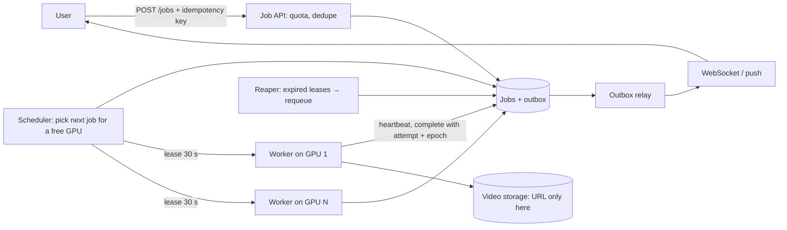
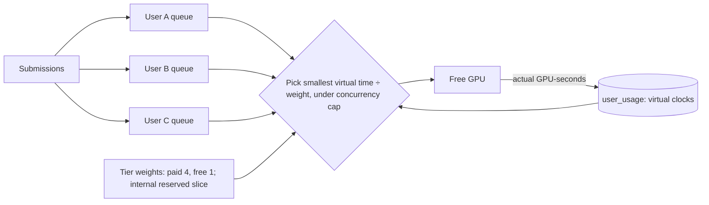
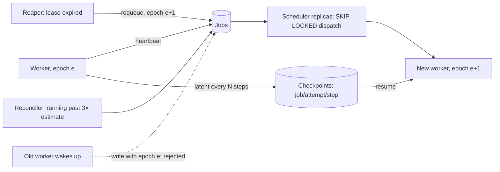
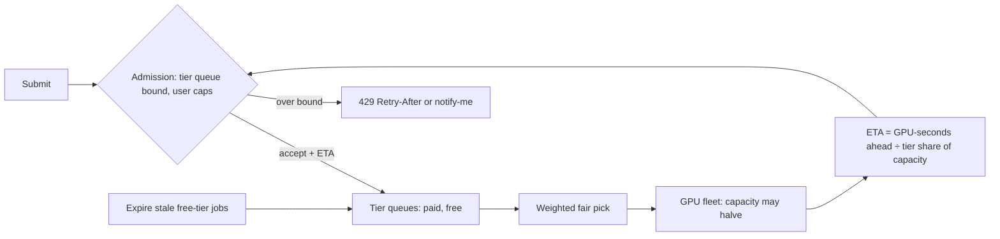
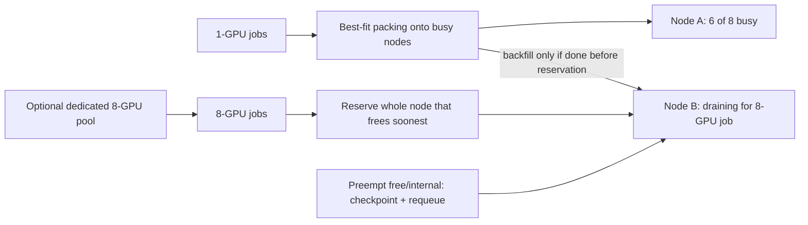

# GPU Job Scheduler for Video Generation

> [!abstract] Asked at OpenAI in at least four wordings (2026): *Design Video Generation Orchestration* (technical screen, Jun 2026), *Text-to-Video Generation Service: GPU Scheduling, Failures, Traffic Bursts* (onsite, Sep 2026), *Text-to-Video GPU Job Scheduler with One GPU per Task and Fair Queueing* (onsite, Sep 2026), and *Sora-Style Video Generation Service with Fair Queueing and Cancellation* (virtual onsite report, Sep 2026). Related: OpenAI *GPU credit allocator* (screen) and Anthropic *Route and Batch Inference with Eight GPUs*. Topics: [[09 - Durable Execution HITL and Realtime UX|09]] (async jobs, leases, notifications) → [[10 - AI Gateway Security and Guardrails|10]] (quotas) → [[12 - LLM Cost and Latency Economics|12]] (GPU-seconds as cost) → [[13 - GPU Serving and Disaggregated KV Cache|13]] (fleet, placement).
>
> The hard part: demand is far larger than GPU capacity and each job holds a GPU for minutes, so the design is about **who gets the next free GPU and what happens when a job dies halfway**. Fairness must be measured in **GPU time, not job count**; every job state change must be a conditional update so a redelivered message or a dead worker can't advance a job twice; and the system needs an honest answer for a burst ten times its capacity.

---

## 1. Clarify Script

| Question | Default (assumed unless sourced) | If different |
|---|---|---|
| Scale? | ~1M users, peak ~1,000 submissions/s (PracHub prompt) | Lower → same design, smaller queue |
| Job length? | p50 ~30 s, p99 several minutes, depends on duration and resolution (PracHub prompt) | Hours → checkpointing becomes mandatory (V2) |
| GPUs per job? | One GPU per task (OpenAI onsite, Sep 2026) | 1 or 8 GPUs on one node → gang scheduling (V4) |
| Backend sync or async? | Worker drives the model in-process on its GPU | Async backend with webhooks → reconciler (T2) |
| Tiers? | Free, paid, internal, with weights | One tier → plain fair share |
| Cancellation? | Yes, and the model can stop between denoising steps | Can't abort → cancel only queued jobs |
| Notifications? | In-app (WebSocket or SSE) and push; at-least-once, duplicates hidden (prompt) | Email too → same outbox |
| Storage? | Out of scope; store the result URL (prompt) | |

---

## 2. Requirements

### Functional

- Submit a prompt with options; get a `job_id` immediately.
- See the status of all my jobs today; get notified on success or failure.
- Cancel a queued or running job.
- Admins: set tier weights, quotas, and fleet capacity.

### Non-functional

- Submit and status calls < 200 ms p99 regardless of queue depth (*assumed*).
- A job is never run twice in parallel and never charged twice; it always reaches a terminal state.
- Fair share of GPU time across users within a tier; paid tiers keep their share during overload.
- Survive worker, GPU, scheduler and region-zone failures without manual cleanup.

### Out of scope

- The video model itself, video storage and CDN, encoding.

---

## 3. Estimates That Drive V0

```
Fleet:       5,000 GPUs (*assumed*), one job each
Mean job:    ~60 s of GPU time (*assumed* from p50 30 s with a long tail)
Throughput:  5,000 ÷ 60 s ≈ 83 jobs/s at full utilisation
Peak demand: 1,000 submissions/s (prompt) → the queue grows by ~900 jobs every second at peak
             one minute of peak = ~54,000 queued jobs ≈ 11 minutes of fleet time
Status reads: users poll in-flight jobs; reads ≫ writes → push updates, cache per-user lists
GPU cost:    at ~$2 per GPU-hour (*assumed*), a 60 s job ≈ 3.3 cents of GPU time; a 5-minute 1080p job ≈ 17 cents
```

- **Demand exceeds capacity by an order of magnitude at peak**, so admission control and queue limits are part of V0, not an afterthought (V3).
- **Jobs differ by 10× in GPU time**, so counting jobs is not fairness; charge GPU-seconds (V1).
- **A minute-long job on one GPU** makes leases and heartbeats cheap relative to the work, and checkpointing worthwhile for long jobs (V2).

---

## 4. Entities, Tools and State

### APIs

| API | What code enforces |
|---|---|
| `POST /jobs` `{prompt, options, idempotency_key}` | User and tier from the session; quota check; unique `(user_id, idempotency_key)` returns the existing job on retry; returns `job_id`, position and ETA |
| `GET /jobs?since=…` · `GET /jobs/{id}` | Reads the user's job list (cached); never touches the scheduler |
| `POST /jobs/{id}/cancel` | Queued → cancelled at once; running → `cancel_requested`, worker stops at the next step |
| Worker: `claim()` · `heartbeat(job, attempt, epoch)` · `complete(job, attempt, epoch, result_url)` | Every call carries the attempt id and fencing epoch; stale ones are rejected |

### State

```
jobs(id, user_id, tier, prompt_ref, options, est_gpu_seconds, status, attempt, lease_owner, lease_until,
     epoch, checkpoint_ref, result_url, gpu_seconds_used, cancel_requested, error, created_at, updated_at)
status: queued → leased → running → {succeeded | failed | cancelled};  running → queued (lease expired, retry)
user_usage(user_id, window, gpu_seconds)          -- fairness and quota accounting
outbox(id, job_id, event, created_at, sent_at)    -- notifications written in the same transaction as the status change
```

- **Every transition is a conditional update:** `UPDATE jobs SET status='running', … WHERE id=? AND status='leased' AND attempt=? AND epoch=?`. Zero rows means someone else already moved it; the caller stops. This is the answer to "two workers or a redelivered message advance the same job" (PracHub hint).
- **The outbox** makes "job finished" and "send notification" one atomic write; a relay delivers outbox rows at least once, and clients dedupe by `(job_id, event)` ([[07 - Async Messaging]]).

---

## 5. V0 — Simplest Design That Works

- **Submit:** API writes the job row (`queued`) and its outbox row, returns `job_id`. Never blocks on generation.
- **Scheduler:** a loop that, whenever a GPU is free, picks the next job (V1 decides which), leases it to that GPU's worker with `lease_until = now + 30 s`, and bumps `attempt`.
- **Worker:** one per GPU. Claims, sets `running`, generates, heartbeats every ~10 s to extend the lease, uploads the video, then `complete` writes `succeeded`, `result_url`, `gpu_seconds_used` and the outbox row in one transaction.
- **Status:** the client gets updates pushed from the outbox relay over WebSocket or SSE; the list view reads a per-user cache refreshed by the same events; polling is the fallback.
- **Reaper:** finds `running` or `leased` jobs whose lease expired and requeues them (same job, next attempt).



> [!important] The most drilled component
> **Two failure points, two detectors** (PracHub hint). (1) The worker finished the video but died before recording it: the upload is keyed by `job_id/attempt`, so the reaper's retry first checks storage and completes the job instead of regenerating. (2) The worker never finishes: heartbeats stop, the lease expires, the reaper requeues with `attempt + 1` and a new epoch, and any late write from the old attempt is rejected by the conditional update. The user is charged only for the attempt that succeeded, and notified once because the client dedupes outbox events.

### What V0 can't handle

- **Fairness:** FIFO lets one user with 500 long jobs take the whole fleet.
- **Long jobs dying at 95%:** retries restart from zero.
- **Bursts:** the queue grows by ~900 jobs a second at peak with no limit.
- **Multi-GPU jobs** and fragmentation.

---

## 6. Scale Ladder

### V1 — Fair queueing by GPU time

- **Evidence:** OpenAI onsite (Sep 2026): "fairness by GPU time rather than task count"; the Sora report spent most of the round on fair-queueing approaches and their trade-offs. Confidence **strong**.
- **Trigger:** one user's batch of long, high-resolution jobs delays everyone else by tens of minutes.
- **What breaks:** FIFO and round-robin by job both reward users who submit long jobs.
- **Change:**
    + **Per-user queues** and a **virtual clock per user** that advances by GPU-seconds used ÷ weight. The scheduler gives the next free GPU to the user with the smallest virtual time who has queued work (weighted fair queueing; deficit round robin is the cheaper approximation).
    + **Charge estimates at dispatch, correct at completion:** advance the user's clock by `est_gpu_seconds` when the job starts (from resolution × duration × model), then by `actual − estimate` when it ends, so mis-estimates don't accumulate.
    + **Tiers as weights between groups**, fair share within a tier: paid users get weight 4, free 1 (*assumed*); internal jobs use a reserved slice.
    + **Per-user concurrency cap** (say 3 running jobs) so even a heavy user can't hold hundreds of GPUs while others wait.
    + **Idle users don't bank credit:** a user returning after an hour starts at the current minimum virtual time, not far behind it.
- **Trade-off:** fairness by GPU time needs an estimate before the job runs; a bad estimate is corrected only after the fact. Name the alternative: reserve-by-request (fair on what was asked) vs charge-by-use (fair on what happened); this design does both.



### V2 — Failures: leases, fencing, checkpoints and stuck jobs

- **Evidence:** OpenAI onsite (Sep 2026): "recover long-running jobs when workers fail", leases and retries across workers, GPUs and the scheduler; orchestration screen follow-ups: lost or duplicated webhooks, jobs stuck in RUNNING far past p99. Confidence **strong**.
- **Trigger:** GPU Xid errors and node losses at fleet scale every hour; 5-minute jobs restarting from zero.
- **What breaks:** wasted GPU time, duplicate work after a network partition, jobs that never terminate.
- **Change ([[08 - Reliability]], [[10 - Distributed Building Blocks]]):**
    + **Fencing epochs:** the job's epoch increments on every lease; workers and the storage writer reject commands and writes from older epochs, so a partitioned worker that wakes up can't overwrite the new attempt.
    + **Checkpoints for long jobs:** diffusion runs a fixed number of denoising steps; save the latent state every N steps (or every chunk of frames) to object storage keyed by `job/attempt/step`. A retry resumes from the last checkpoint on any GPU of the same type.
    + **Retry budget:** at most 3 attempts; a job that kills its GPU twice is marked poison and fails with a clear error, so it can't take down the fleet one GPU at a time.
    + **Stuck-job reconciler:** jobs in `running` past a per-size deadline (estimate × 3) are checked against the worker; dead or unresponsive → requeue with a new epoch; alive but slow → leave and alert.
    + **Scheduler failover:** the scheduler is stateless over the jobs table; two replicas with a lease-held leader, or both using `SELECT … FOR UPDATE SKIP LOCKED` on dispatch, so a scheduler crash loses nothing.
- **Trade-off:** checkpoints cost storage and a few seconds per save; worth it only above a job length threshold (say 2 minutes, *assumed*).



### V3 — Bursts ten times capacity, and capacity suddenly halved

- **Evidence:** OpenAI onsite (Sep 2026): "absorb traffic bursts far beyond capacity"; orchestration screen follow-up: GPU capacity halved, paid users still served, queue must not grow unbounded. Confidence **strong**.
- **Trigger:** a launch or a viral prompt; a zone loses half its GPUs.
- **What breaks:** an unbounded queue where every job waits hours, and paid users stuck behind free ones.
- **Change:**
    + **Bounded queues per tier** with an honest ETA at submit: `queue_gpu_seconds_ahead ÷ (GPUs × utilisation)` for that tier's share. Above the bound, reject with `Retry-After` (free tier first) or offer "notify me when capacity frees up".
    + **Per-user queued-job caps** (say 10 queued) in addition to running caps.
    + **Weights protect paid tiers** automatically when capacity drops: their share of the remaining GPUs is unchanged in proportion.
    + **Degrade before refusing:** offer lower resolution or shorter clips during overload (cheaper GPU-seconds), only with the user's consent.
    + **Expire stale queued work:** free-tier jobs queued over N hours are cancelled with a notification rather than run for a user who left.
- **Trade-off:** rejecting work loses users; queuing it for hours loses them more slowly and costs more. State which the product prefers.



### V4 — Jobs that need 1 or 8 GPUs: gang scheduling and fragmentation

- **Evidence:** Anthropic *Route and Batch Inference with Eight GPUs* (hard) and the 1-GPU vs 8-GPU job variant; PracHub multi-resource scheduling guide (Oct 2026) on gang reservations and starvation. Confidence **medium**.
- **Trigger:** a new long-video model needs all 8 GPUs of one node; small jobs keep every node partly busy.
- **What breaks:** an 8-GPU job never finds an empty node (fragmentation), or partial launches hold GPUs idle while waiting for the rest.
- **Change:**
    + **All-or-nothing reservation:** an 8-GPU job reserves a whole node atomically or doesn't start; never launch 5 of 8 and wait.
    + **Pack small jobs** onto already-busy nodes (best fit) so whole nodes stay free for large jobs.
    + **Reservations with backfill:** when a large job is at the head, reserve the node that frees soonest; let small jobs backfill only if they'll finish before the reservation starts (needs runtime estimates).
    + **Separate pools** if the mix is stable: some nodes for 8-GPU jobs only.
    + **Preemption:** internal or free-tier jobs can be preempted (checkpoint, then requeue) when a paid large job has waited past its target.
    + **Fairness in multi-resource terms:** charge GPU-seconds × GPUs, and use dominant shares if CPU memory or disk also limits placement (DRF, Ghodsi et al., NSDI 2011).
- **Trade-off:** reservations leave GPUs idle while they wait; backfill reduces that but depends on estimates.



---

## 7. Twist Cards

### Most asked

**T1 — "How do you cancel a running job?"**
- **Evidence:** OpenAI Sora onsite (Sep 2026): several approaches compared; the interviewer preferred a direct RPC because each task holds at most one GPU and cancels are rare. Confidence **strong**.
- **Hits:** cancellation.
- **Answer:** two options. (a) **Direct RPC** to the worker holding the lease: simple, immediate, fine at low cancel volume; fails if the worker is unreachable. (b) **Cancel flag** on the job row that the worker checks between denoising steps (or receives through a per-worker control channel): works through partitions and scales to multi-GPU jobs. Use (a) as the fast path and (b) as the source of truth, so a missed RPC still cancels within one step. Release the GPU, mark `cancelled`, charge GPU-seconds used, notify. A cancel that races completion: whichever conditional update commits first wins.
- **Attaches to:** V0.

**T2 — "The backend calls a webhook on completion, but webhooks get lost or duplicated."**
- **Evidence:** OpenAI orchestration screen follow-up (Jun 2026). Confidence **strong**.
- **Hits:** reliability.
- **Answer:** the webhook is a hint, not the source of truth. Handle it idempotently (conditional update on `job_id + backend_job_id`); duplicates become no-ops. A reconciler polls the backend for every job in `running` past its expected time, so a lost webhook only delays completion. Terminal state is guaranteed by the reconciler, not the webhook.
- **Attaches to:** V2.

**T3 — "A user double-clicks submit three times on a flaky network."**
- **Evidence:** OpenAI orchestration screen follow-up. Confidence **strong**.
- **Hits:** idempotency.
- **Answer:** the client creates one idempotency key per click of the form (not per HTTP attempt); the API inserts with a unique constraint on `(user_id, idempotency_key)` and returns the existing job on conflict. Checked at the API before quota is charged. Three identical prompts with three different keys are three intentional jobs; optionally warn on exact duplicates within seconds.
- **Attaches to:** V0.

**T4 — "Many jobs are stuck in RUNNING far past p99."**
- **Evidence:** OpenAI orchestration screen follow-up. Confidence **strong**.
- **Hits:** operations.
- **Answer:** detect with a per-size deadline and a dashboard of time-in-state by worker, node, GPU type and model version; attribute by grouping (one bad node, one model version, one driver). Recover with a new epoch and resume from checkpoint; the old attempt is fenced, so no double completion; charge only the successful attempt's GPU-seconds and dedupe notifications by `(job_id, event)`.
- **Attaches to:** V2.

### Lower priority (recall / judgement)

**T5 — "Why not a priority queue sorted by tier?"**
- **Evidence:** fair-queueing discussion in the Sep 2026 report. Confidence **medium**.
- Strict priority starves the free tier completely under load. Weights give paid users more share without starving anyone; strict priority only for internal emergencies.

**T6 — "GPU credits: track and deduct GPU usage in real time across many nodes."**
- **Evidence:** OpenAI *Design GPU credit allocator* (screen). Confidence **medium**.
- Reserve credits at dispatch (estimate) with an idempotent ledger entry keyed by `job/attempt`, settle actual at completion, release on failure; balances are a sum over an append-only ledger, cached per account; hierarchical budgets (org → team → user) checked at admission.

**T7 — "Heterogeneous GPUs: H100 and A100."**
- **Evidence:** none specific. Confidence **judgement**.
- Each job type lists compatible GPU types; charge normalised GPU-seconds (measured throughput ratio) so users on slower GPUs aren't penalised twice; checkpoints resume only on compatible types.

---

## 8. Break It

| Failure | What the user sees | What you say |
|---|---|---|
| Worker dies mid-job | Job resumes, a little later | Lease expiry, new epoch, checkpoint resume |
| Worker finished but didn't record it | Job completes on the retry's first check | Upload keyed by job/attempt; reaper checks storage first |
| Partitioned old worker writes late | Nothing | Fencing epoch rejects it |
| One user submits 500 long jobs | Others still get GPUs | GPU-time fair queueing, concurrency caps |
| Burst 10× capacity | Accurate ETA or a clear 429 | Bounded tier queues, admission control |
| Capacity halves | Paid users keep their share | Weights, shed free tier first |
| Lost webhook | Job completes after the reconciler polls | Reconciler is the source of truth |
| Double submit | One job | Idempotency key at the API |
| Poison job | Fails after 3 attempts with an error | Retry budget, poison marking |

---

## 9. Evals, Operations and Cost

| Tier | Checks |
|---|---|
| **Scheduler simulation** | Replay recorded arrivals and job sizes: per-user GPU share vs entitlement, queue wait by tier, utilisation, starvation of large jobs |
| **Fault injection** | Kill workers mid-job, partition a node, duplicate webhooks, scheduler failover during dispatch |
| **Output quality** | Sampled outputs per model version (owned by the model team; the scheduler records the version per job) |

- **Production metrics:** queue depth and wait by tier, GPU utilisation, goodput (GPU-seconds of successful jobs ÷ total), retry and preemption rates, checkpoint restore time, time in state, ETA accuracy, notification lag.
- **Alerts:** wait for paid tier above target; goodput dropping (failures wasting GPU time); one node with repeated job failures (drain it); reconciler backlog.
- **Cost drivers:** GPU-hours (goodput is the number to improve), checkpoint storage, idle GPUs held by reservations.

---

## 10. One-Minute Close

> "Submit writes a job row and returns an id; nothing blocks on generation. Each GPU's worker leases one job, heartbeats, checkpoints long jobs every few denoising steps, and completes with a conditional update carrying its attempt and fencing epoch, so a redelivered message or a partitioned worker can never advance a job twice. A reaper and a reconciler guarantee every job reaches a terminal state, and an outbox delivers notifications at least once with client dedupe. Fairness is weighted fair queueing on GPU-seconds, charged by estimate at dispatch and corrected at completion, with per-user caps; tiers are weights, not strict priority. Bursts hit bounded tier queues with honest ETAs and 429s for the free tier first. Multi-GPU jobs reserve whole nodes atomically, small jobs pack and backfill around them, and low-priority work can be preempted from a checkpoint."

---

## Evidence

Reports tallied in November 2026.

| Follow-up | Reports | Count | Placed as | Deep dive? |
|---|---|---|---|---|
| Async job orchestration, state machine, notifications | Orchestration screen (Jun 2026); text-to-video service (Sep 2026) | 2 | V0, **strong** | Yes |
| Fair queueing by GPU time | Fair-queueing scheduler (Sep 2026); Sora onsite (Sep 2026) | 2 | V1, **strong** | Yes |
| Cancellation approaches | Sora onsite (Sep 2026) | 1 | T1, **strong** | Yes |
| Worker failure, leases, retries, stuck jobs | All three OpenAI prompts | 3 | V2 + T4, **strong** | Yes |
| Bursts far beyond capacity; capacity halved | Text-to-video service; orchestration follow-up | 2 | V3, **strong** | Sometimes |
| Lost or duplicated webhooks; double submit | Orchestration follow-ups | 1 | T2, T3, **strong** | Sometimes |
| Multi-GPU jobs, gang scheduling | Anthropic eight-GPU question; PracHub scheduling guide | 2 | V4, **medium** | No |
| GPU credits | OpenAI credit allocator screen | 1 | T6, **medium** | No |

## Sources

- PracHub, *Design Video Generation Orchestration* (OpenAI, technical screen, Jun 2026): prompt, scale, hints and follow-ups. https://prachub.com/interview-questions/design-video-generation-orchestration
- PracHub, *Design a Text-to-Video Generation Service: GPU Scheduling, Failures, Traffic Bursts* (OpenAI, onsite, Sep 2026). https://prachub.com/interview-questions/design-a-text-to-video-generation-service-gpu-scheduling-failures-traffic-bursts
- PracHub, *Design a text-to-video GPU job scheduler with one GPU per task and fair queueing* (OpenAI, onsite, Sep 2026). https://prachub.com/interview-questions/design-a-text-to-video-gpu-job-scheduler-with-one-gpu-per-task-and-fair-queueing
- PracHub, *OpenAI Software Engineer Interview Experience: Virtual Onsite Design Round, Sora With One GPU per Task* (Sep 2026). https://prachub.com/interview-experiences/openai-software-engineer-interview-experience-virtual-onsite-design-round-sora-with-one-gpu-per-task
- PracHub, *Design GPU credit allocator* (OpenAI, screen). https://prachub.com/interview-questions/design-gpu-credit-allocator
- PracHub, *Multi-Resource Scheduling Interview Questions: Dominant Shares, Fairness, and Tenant Quotas* (Oct 2026). https://prachub.com/resources/multi-resource-scheduling-interview-questions-dominant-shares-fairness-and-tenant-quotas
- A. Ghodsi et al., *Dominant Resource Fairness: Fair Allocation of Multiple Resource Types* (NSDI 2011). https://www.usenix.org/legacy/events/nsdi11/tech/full_papers/Ghodsi.pdf
- A. Demers, S. Keshav, S. Shenker, *Analysis and Simulation of a Fair Queueing Algorithm* (SIGCOMM 1989); M. Shreedhar and G. Varghese, *Efficient Fair Queuing Using Deficit Round Robin* (SIGCOMM 1995).

## Related Notes

- [[Agentic/Problems/README]] · [[07 - LLM Inference Platform]] · [[14 - Model Weight Distribution to a GPU Fleet]] · [[09 - Durable Execution HITL and Realtime UX]] · [[12 - LLM Cost and Latency Economics]] · [[08 - Reliability]] · [[Agentic Problem to Solution Map]]
