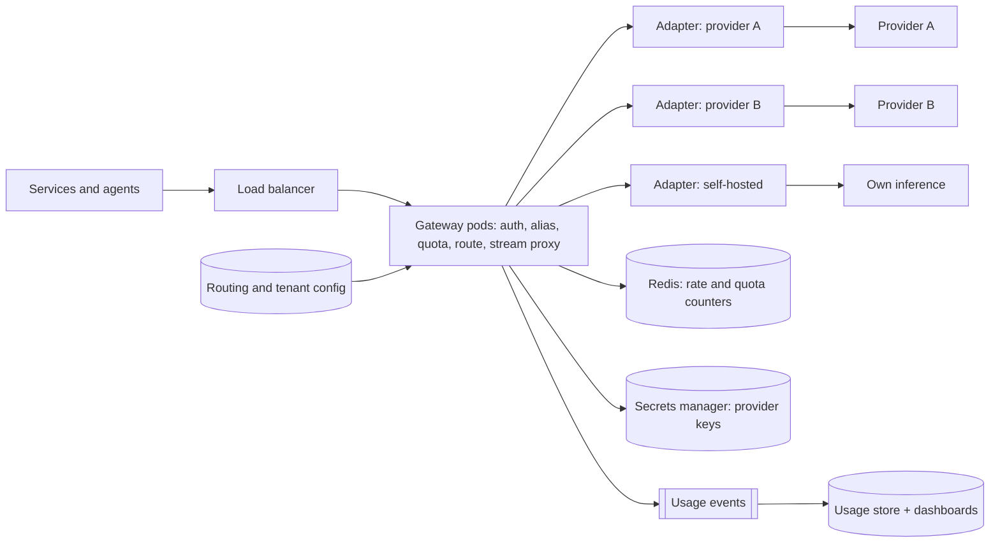
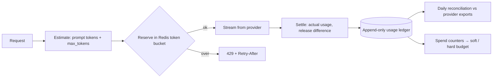
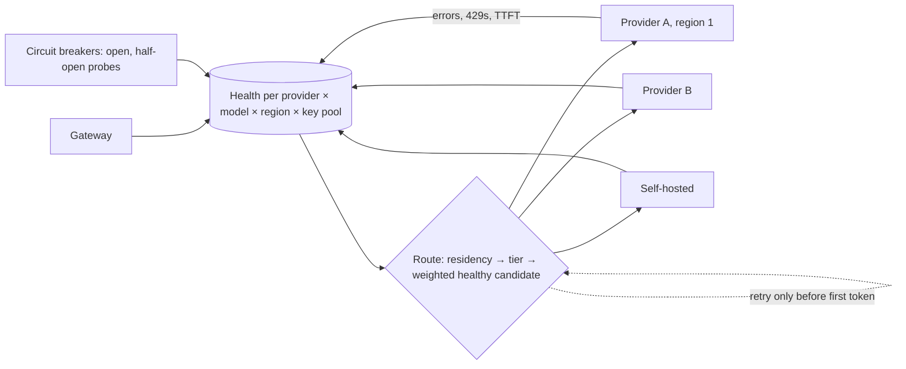
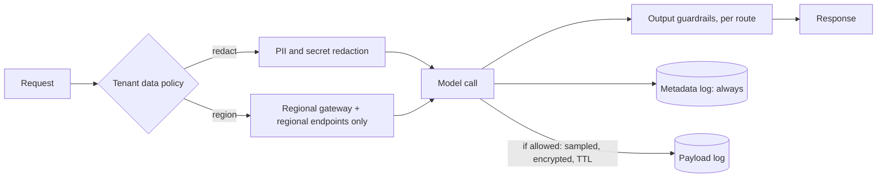
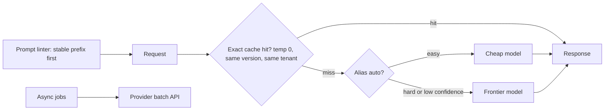

# AI Gateway

> [!abstract] Asked at Decagon twice in 2026: *Design an AI gateway* (onsite, Jan 2026: multiple external LLM providers, routing and fallback, observability, privacy-preserving logging, retries, circuit breakers, quotas) and *Design an AI Gateway* (technical screen, Feb 2026, ~880 views: multi-tenant, unified API and authentication, routing and retries, rate limits and quotas, observability, failure handling, model selection, cost control). "Multi-model gateway" also appears in 2026 GenAI design lists. Related: Decagon *Security Architecture for an LLM Chatbot*; Uber's MCP gateway (Uber engineering, Oct 2026). Topics: [[10 - AI Gateway Security and Guardrails|10]] (gateway, token limits, guardrails) → [[12 - LLM Cost and Latency Economics|12]] (routing, caching, budgets) → [[11 - Evals Observability and Silent Drift|11]] (tracing, fallback evals) → [[08 - Reliability]] (breakers, retries).
>
> The hard part: it looks like an API gateway, but the unit of cost is the **token, known only after the response**, responses **stream** for seconds, providers fail **partially** (429s on one key, slow tokens on one region), and the logs contain the most sensitive data the company has. Every feature has to work mid-stream, without adding visible latency, and without leaking prompts.

---

## 1. Clarify Script

| Question | Default (assumed unless sourced) | If different |
|---|---|---|
| Who calls it? | Internal services and agents of many teams and enterprise tenants | Public developers → stronger abuse controls |
| Providers? | 3–4 external providers plus self-hosted models (Decagon prompt: multiple providers) | One provider → fallback across regions and keys only |
| Traffic? | ~5,000 requests/s peak, 2,000 input + 400 output tokens average, 70% streamed (*assumed*) | |
| Latency budget? | Gateway adds < 10 ms p99 before the provider call (*assumed*) | |
| Quotas? | Per tenant and per team: tokens per minute, requests per minute, monthly spend | |
| Data rules? | Some tenants require no prompt logging, redaction, regional processing | |
| Model selection? | Callers ask for a capability ("fast", "smart") or an exact model; aliases map to versions | |

---

## 2. Requirements

### Functional

- One API (OpenAI-compatible chat, embeddings, tool calling, streaming) in front of every provider.
- Authenticate callers, attribute every token to tenant, team, feature and run.
- Route by model alias, capability tier, region and health; fall back on failure.
- Enforce rate limits, token quotas and spend budgets; return clear errors.
- Log and trace every call with configurable redaction and retention; usage dashboards and alerts.

### Non-functional

- < 10 ms p99 added latency; no buffering of streams.
- 99.99% availability for the gateway itself, independent of any one provider.
- No provider key ever leaves the gateway; no tenant sees another's data or usage.
- Usage and cost accurate enough to bill (reconciled against provider invoices).

### Out of scope

- The models themselves ([[07 - LLM Inference Platform]]); agent orchestration ([[12 - Multi-Tenant Agent Platform]]).

---

## 3. Estimates That Drive V0

```
Requests:     5,000/s peak; 70% streaming, average stream ~8 s (*assumed*) → ~28,000 open streams
Tokens:       5,000 × 2,400 ≈ 12M tokens/s through the gateway at peak
Spend:        at a blended $2 per M tokens (*assumed*) ≈ $24 per second ≈ $2M per day at sustained peak
Quota checks: 5,000/s reads + post-response updates; a Redis cluster handles this, a SQL row per tenant doesn't
Logs:         5,000/s × ~10 KB prompt + response ≈ 50 MB/s ≈ 4 TB/day if every payload is kept
```

- **28,000 concurrent streams** means the gateway is a streaming proxy first: async I/O, no buffering, connection limits per pod.
- **$2M a day** of spend through one component: quota and budget errors are money, so accounting has to be exact and reconciled (V1).
- **4 TB a day of payload logs** is a privacy and cost problem, so full payload logging is opt-in and sampled (V3).

---

## 4. Entities, Tools and State

| Surface | What code enforces |
|---|---|
| `POST /v1/chat/completions` (stream or not) | Caller identity from a gateway key or workload identity; alias → model version; quota reservation; idempotency key for non-streamed retries |
| Routing config | Alias → ordered candidates `(provider, model, region, key pool)`, weights, capability tier, data-residency constraints |
| Admin API | Tenants, teams, keys, quotas, budgets, redaction and retention policy, allowed models |

```
tenants(id, plan, monthly_budget_usd, data_policy {log_payloads, redact, region})
api_keys(hash, tenant_id, team_id, scopes, expires_at)
quotas(tenant_id, team_id, tpm, rpm, concurrent_streams)
routes(alias, candidates[{provider, model, region, weight, tier}], fallback_policy)
usage_events(request_id, tenant, team, feature, run_id, provider, model, input_tokens, cached_tokens,
             output_tokens, cost_usd, latency_ms, ttft_ms, status, started_at)     -- append-only
provider_keys: in a secrets manager, referenced by pool id; never in config or logs
```

---

## 5. V0 — Simplest Design That Works

- **Stateless gateway pods** behind a load balancer: authenticate, resolve the alias, check quota, pick a provider, proxy the request, stream the response through unchanged, and emit a usage event at the end ([[10 - AI Gateway Security and Guardrails#The AI Gateway]]).
- **Provider adapters** translate the unified API to each provider's format (tool-call schema, streaming event shape, error codes) and normalise errors back.
- **Keys** live in a secrets manager; pods load them at start and on rotation.
- **Usage events** go to a queue, then to the usage store and dashboards; tokens come from the provider's usage field, never estimated in the hot path.



> [!important] The most drilled component
> **Quota on a cost you only know afterwards.** A request's tokens are known when the response ends, and a stream can run for 30 seconds. Admit with a **reservation**: estimate input tokens (count the prompt) plus `max_tokens`, reserve that against the tenant's token bucket atomically, stream, then **settle** to the provider-reported usage and release the difference. If a stream would push a tenant past a hard budget, the gateway can stop it mid-stream with a clear finish reason ([[10 - AI Gateway Security and Guardrails#Token-Aware Rate Limiting]]).

### What V0 can't handle

- A provider that is slow or rate-limited on one key but not down.
- Budgets that must be exact across many pods and regions.
- Tenants who forbid payload logging, or need regional processing.
- Cost: every call goes to the requested model at full price.

---

## 6. Scale Ladder

### V1 — Exact quotas and budgets across pods

- **Evidence:** Decagon screen (Feb 2026): rate limiting and quotas, cost control. Confidence **strong**.
- **Trigger:** a tenant overspends because 40 pods each allowed "a little more"; monthly invoices don't match the dashboard.
- **Change:**
    + **Token buckets in Redis** per tenant and team (TPM, RPM, concurrent streams), updated with an atomic script that reserves and later settles; local per-pod allowances refilled from Redis for very hot tenants to cut round trips.
    + **Budgets in dollars** as a separate, slower control: daily and monthly spend checked at admission against a counter updated on settle; soft limit alerts, hard limit rejects.
    + **Ledger:** usage events are append-only and idempotent by request id; daily reconciliation against provider usage exports.
- **Trade-off:** reservation over-holds capacity for long `max_tokens`; settle quickly and cap `max_tokens` per tier.



### V2 — Partial failures: health-aware routing and fallback

- **Evidence:** Decagon onsite (Jan 2026): routing and fallback strategies, retries, circuit breakers. Confidence **strong**.
- **Trigger:** one provider returns 429 on a key pool and doubles time-to-first-token in one region, while still "up".
- **Change ([[08 - Reliability]]):**
    + **Health per (provider, model, region, key pool):** error rate, 429 rate, TTFT and tokens per second from live traffic; a circuit breaker opens on errors or latency, half-opens with probes.
    + **Routing:** weighted choice among healthy candidates in the same **capability tier**, with data-residency constraints applied first; fall back to another tier only if the caller allowed it.
    + **Retries only before the first token.** After a stream has started, a retry would duplicate output; fail with a clear error, or resume only if the caller asked for non-streaming semantics.
    + **Provider rate limits as a shared resource:** pool keys per provider and track each key's remaining quota from response headers; route away from keys near their limit.
    + **Optional hedging** for short, non-streamed calls on the critical path: send a second request after the p95 delay, cancel the loser ([[12 - LLM Cost and Latency Economics]]).
- **Trade-off:** fallback models behave differently (tool-calling quirks, formats), so every fallback pair must pass the caller's evals ([[10 - AI Gateway Security and Guardrails#Fallbacks need care]]).



### V3 — Privacy-preserving logging, guardrails and data residency

- **Evidence:** Decagon onsite (Jan 2026): privacy-preserving logging; Decagon security architecture question (Sep 2026). Confidence **strong**.
- **Trigger:** an enterprise tenant forbids storing prompts; another requires EU-only processing.
- **Change ([[10 - AI Gateway Security and Guardrails#PII and Data Governance]]):**
    + **Metadata always, payloads by policy:** every call logs ids, tokens, cost, latency, model, status; payloads are stored only when the tenant allows it, redacted, sampled, encrypted with the tenant's key and deleted on schedule.
    + **Redaction in the gateway** (PII detectors, secret scanners) before payloads leave for providers that aren't approved for raw data; placeholders re-inserted in responses where needed.
    + **Regional gateways** pinned to regional provider endpoints; the routing config refuses candidates outside the tenant's allowed regions.
    + **Guardrail hooks** (input and output classifiers) as optional, per-route steps, run in parallel with the model call where possible so they don't add latency.
- **Trade-off:** no payload logs makes debugging harder; offer tenant-controlled "debug capture" windows with explicit consent.



### V4 — Cut cost and latency: caching and routing

- **Evidence:** Decagon screen (Feb 2026): model selection and cost control. Confidence **medium**.
- **Trigger:** spend grows faster than traffic; the same long system prompts are re-sent millions of times.
- **Change ([[12 - LLM Cost and Latency Economics#The Levers]]):**
    + **Provider prompt caching** passthrough and prompt-shape linting (stable prefix first), with cached-token savings shown per team.
    + **Exact response cache** for deterministic calls (temperature 0, same model version, same tenant), short TTL; **semantic caching** only per tenant and only where wrong answers are cheap ([[11 - Evals Observability and Silent Drift#Semantic Caching Risks]]).
    + **Router** for "auto" aliases: a small classifier sends easy requests to a cheap model and escalates on low confidence, evaluated per route.
    + **Batch API** for asynchronous jobs at about half price.
- **Trade-off:** routing and caching change behaviour silently; every change goes through the same shadow-and-canary path as a model change.



---

## 7. Twist Cards

### Most asked

**T1 — "A stream fails halfway. Do you retry?"**
- **Evidence:** Decagon prompts (retries, failure handling). Confidence **strong**.
- **Answer:** not transparently. Retrying after tokens were sent duplicates output and double-bills. Retry only failures before the first token (connection errors, 429, 5xx with `Retry-After`), with backoff and jitter. Mid-stream, emit an error event with a finish reason and let the caller decide; settle usage for the tokens delivered.

**T2 — "How do you add a new provider without every team changing code?"**
- **Evidence:** Decagon onsite (multiple providers, unified API). Confidence **strong**.
- **Answer:** an adapter that maps the unified schema (messages, tools, streaming events, errors, usage) to the provider's, a conformance test suite every adapter must pass, then a route change behind an alias with shadow traffic and evals before any team is moved.

**T3 — "The gateway is a single point of failure."**
- **Evidence:** Decagon screen (failure handling). Confidence **medium**.
- **Answer:** stateless pods in several zones and regions; config cached locally so a config-store outage doesn't stop traffic; if Redis is down, fail open with local per-pod limits for a short window (protect availability) or fail closed for hard budgets (protect money), chosen per tenant; health-checked by synthetic calls through every route.

### Lower priority (recall / judgement)

**T4 — "Agents call tools through MCP. Does the gateway cover that?"**
- **Evidence:** Uber MCP gateway (Oct 2026). Confidence **medium**.
- The same pattern for tool traffic: an MCP gateway with a registry of approved servers, per-agent permissions, identity propagation, response projection to cut tokens, and the same logging policy ([[03 - Tool Engineering and Action Spaces#Model Context Protocol (MCP)]]).

**T5 — "Rotate a leaked provider key."**
- **Evidence:** none specific. Confidence **judgement**.
- Keys live in a key pool; add the new key, shift traffic, revoke the old one; pods reload from the secrets manager without restart; alert on any use of a revoked key.

---

## 8. Break It

| Failure | What callers see | What you say |
|---|---|---|
| Provider rate-limits one key pool | Slightly higher latency | Per-key health, route away, pool keys |
| Provider slow in one region | Same model from another region or tier | Health on TTFT and tokens/s, breakers |
| Stream breaks mid-way | Error event with finish reason | No silent retry after first token |
| Tenant exceeds budget | 429 or a clean stop mid-stream | Reserve-then-settle; hard and soft budgets |
| Redis down | Requests continue under local limits | Per-tenant fail-open or fail-closed choice |
| Tenant forbids logging | Metadata only | Policy-driven payload logging |
| Fallback behaves differently | Eval-gated fallback pairs only | Same-tier fallback, evaluated |

---

## 9. Evals, Operations and Cost

| Tier | Checks |
|---|---|
| **Adapter conformance** | Tool calls, streaming events, errors and usage fields identical through every adapter |
| **Fallback pairs** | Each route's fallback passes the caller's eval suite |
| **Load and chaos** | 28k concurrent streams; kill a provider, a region, Redis; verify limits and budgets hold |

- **Production metrics:** added latency p99, TTFT and tokens/s per route, error and 429 rate per provider and key pool, breaker state, fallback rate, cache hit rates (provider prompt cache, exact cache), spend per tenant and team, reconciliation drift.
- **Alerts:** fallback rate above normal (a provider is degrading), reconciliation drift above 1%, a tenant at 90% of budget, any request to a non-allowed region.
- **Cost drivers:** provider tokens (the gateway's job is to cut them), gateway compute for 28k streams, payload log storage.

---

## 10. One-Minute Close

> "A stateless streaming proxy with a unified API, provider adapters that pass a conformance suite, and keys only in the secrets manager. Quotas are tokens, not requests: reserve prompt tokens plus max_tokens in a Redis token bucket, stream, then settle to provider-reported usage, with dollar budgets and a ledger reconciled against provider exports. Routing is health-aware per provider, model, region and key pool, with circuit breakers and fallbacks only within an evaluated capability tier, and retries only before the first token. Metadata is always logged, payloads only by tenant policy, redacted, encrypted and expiring, and regional tenants are pinned to regional endpoints. Cost comes down through provider prompt caching, a deterministic exact cache, an evaluated cheap-first router and the batch API."

---

## Evidence

Reports tallied in November 2026.

| Follow-up | Reports | Count | Placed as | Deep dive? |
|---|---|---|---|---|
| Unified API across providers, auth | Decagon onsite (Jan 2026), screen (Feb 2026) | 2 | V0 + T2, **strong** | Yes |
| Rate limits, quotas, cost control | Decagon screen | 1 | V1 + callout, **strong** | Yes |
| Routing, fallback, retries, breakers | Decagon onsite and screen | 2 | V2 + T1, **strong** | Yes |
| Privacy-preserving logging, security | Decagon onsite; Decagon chatbot security question | 2 | V3, **strong** | Sometimes |
| Model selection, cost | Decagon screen | 1 | V4, **medium** | No |
| Tool traffic through a gateway | Uber MCP gateway | 1 | T4, **medium** | No |

## Sources

- PracHub, *Design an AI gateway* (Decagon, onsite, Jan 2026) and *Design an AI Gateway* (Decagon, technical screen, Feb 2026). https://prachub.com/interview-questions/design-an-ai-gateway · https://prachub.com/interview-questions/design-an-ai-gateway-2
- PracHub, Decagon company bank (2026): security architecture for an LLM chatbot, rule management for agents. https://prachub.com/companies/decagon
- Uber, *Designing MCP Gateway: Uber's MCP Management Platform* (Oct 2026). https://www.uber.com/us/en/blog/designing-mcp-gateway/

## Related Notes

- [[Agentic/Problems/README]] · [[10 - AI Gateway Security and Guardrails]] · [[12 - LLM Cost and Latency Economics]] · [[12 - Multi-Tenant Agent Platform]] · [[07 - LLM Inference Platform]] · [[Agentic Problem to Solution Map]]
