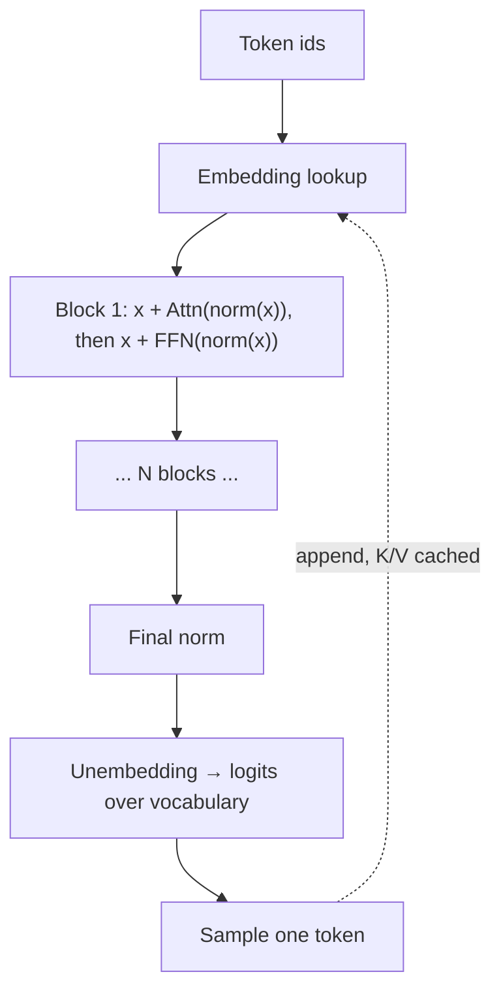

# LLM Fundamentals for Engineers

> [!abstract] What this is
> What an engineer needs to know about a single LLM call before building anything on top of it: tokens and context windows, how generation and sampling work, why the chat API is stateless, how tool calling and structured outputs really work, prompting basics, and where latency comes from. Every later topic assumes this.

---

## Why It Exists

- Most agent and RAG bugs are really misunderstandings of the single call underneath: a context that silently overflowed, a "deterministic" temperature-0 call that wasn't, a tool call the model never actually executed, JSON that parsed once and broke in production, a latency spike from output length rather than the model.
- Interviewers start here to check you reason from mechanics, not from framework docs.

---

## Tokens

- Models read and write **tokens**, not characters or words. A tokenizer (usually **byte-pair encoding**, BPE) splits text into frequent sub-word pieces from a fixed vocabulary (~100k–200k entries).
- Rules of thumb (heuristics, model-dependent):
    + English prose: **~4 characters ≈ 1 token**, **~0.75 words per token**.
    + Code, JSON and non-English scripts (Hindi, Tamil, Chinese) use **more** tokens per character, so they cost more and fill context faster.
    + Numbers split unpredictably (`"12345"` may be several tokens), one reason models are shaky at arithmetic and digit-level tasks.
- Everything is priced and limited in tokens: **input tokens** (prompt, history, tool results, documents) and **output tokens** (the generated reply). Output tokens are typically **several times more expensive** than input tokens and are generated one at a time, so they dominate latency ([[13 - GPU Serving and Disaggregated KV Cache]] explains why).

```python
import tiktoken                                   # OpenAI's tokenizer; other providers expose count APIs
enc = tiktoken.get_encoding("o200k_base")
print(len(enc.encode("Refund order ORD-1234 for ₹499")))   # count before you send
```

- **Count tokens in code** for budgets and truncation; don't estimate from characters on the hot path.

### The token tax on Indian languages

- Tokenizers are trained mostly on English, so the **same content** in an Indian language splits into more tokens. That makes it **costlier, slower and shorter-lived in the context window**, at the same per-token price.
- Measured ratios (same content, vs English):
    + GPT-4o's tokenizer (`o200k_base`): from about **1.6× for Hindi** to about **5× for Odia**, and 13.7× for Santali in Ol Chiki script (2026 study across Indian languages).
    + The older GPT-4 tokenizer (`cl100k_base`): an average of about **8×** across Indian languages, up to 13× for Malayalam, which leaves an Indian-language user as little as **12%** of the effective context window an English user gets.
- What it means in a design:
    + Budget cost and context **per language**, from token counts on real traffic, not English averages.
    + Newer tokenizers (larger vocabularies) cut the tax a lot; compare models on **tokens for your own traffic**, not just per-token price.
    + Romanised Hindi ("Hinglish") tokenizes differently again; measure what your users actually type or say.
    + Voice agents pay it twice: in the LLM call and in the context carried across turns.

---

## The Context Window

- The **context window** is the maximum number of tokens the model can attend to in one call: **input + output together**. Typical windows today run from ~128k to 1M+ tokens.
- A bigger window isn't free:
    + **Cost** grows linearly with input tokens on every call.
    + **Latency**: the time to process the prompt (prefill) grows with its length, and attention cost grows faster than linearly.
    + **Quality**: models use information at the **start and end** of long contexts better than the middle ("**lost in the middle**"), and irrelevant content dilutes attention ("**context rot**"). More context can make answers *worse*.
- So context is a **budget you engineer**, not a bucket you fill ([[04 - State Memory and Context Engineering]]).
- **Max output tokens** is a separate cap you set per call. Hitting it truncates the answer mid-sentence (or mid-JSON); the API reports this as a finish reason like `length`, which you must check.

### Long context vs RAG: "the window is 10× bigger, why retrieve?"

- **Advertised length is not usable length.** Models score near-perfectly on the basic **needle-in-a-haystack** test (one planted fact, found by an exact phrase), but the harder **RULER** benchmark (multi-hop tracing, aggregation, multiple needles) found that almost all models claiming 32k+ tokens dropped sharply as context grew, and only about half held up at 32k.
- **Context rot.** Later tests across 18 models found accuracy falls faster when **distractors look like the answer**, which is exactly what a real corpus of similar documents looks like.
- **Cost and latency.** Every call pays for every token, and prefill time grows with length. A 500k-token context on every question is slow and expensive; 5 retrieved chunks are not. Prompt caching helps only if the context is identical each time.
- **Scale and permissions.** A corpus of millions of documents doesn't fit in any window, changes daily, and differs per user's access rights. Retrieval handles freshness and ACL filtering; a window doesn't.
- **Where long context wins.** Studies comparing the two find long context often does as well or better on question answering **when the whole relevant source fits**, e.g. one contract, one codebase module, one long report. Chunk-based retrieval can lose cross-chunk reasoning.

| Situation | Pick |
|---|---|
| The relevant material is one document or a small set that fits comfortably | Long context (with prompt caching if reused) |
| Large or changing corpus, per-user permissions, or citations required | RAG |
| A few large documents plus a big corpus | **Hybrid**: retrieve the right documents, then pass them whole |

- **When you extend a model's context window**, test with a needle-in-a-haystack probe at many depths and lengths, not just perplexity: context-extension tricks (RoPE scaling, YaRN) and KV-cache quantization can degrade long-range retrieval while perplexity looks fine.

---

## How Generation Works

- An LLM is an **autoregressive next-token predictor**. For each step it outputs a score (**logit**) for every token in the vocabulary; softmax turns those into probabilities; one token is **sampled**; it's appended; repeat until a stop token or the output limit.
- That loop is why output is **sequential** (each token depends on the previous ones) and why output length drives latency.

### Inside the transformer (engineer depth)

- A decoder-only LLM is a stack of identical **blocks** (e.g. 32–80 layers). Each token flows through every block as a vector of size `d_model` (e.g. 4096). Each block has two parts:
    1. **Self-attention**: each token gathers information from earlier tokens.
    2. **Feed-forward network (FFN)**: transforms each token's vector on its own.
- **Self-attention.** Each token's vector is projected into a **query** (what am I looking for), a **key** (what do I contain) and a **value** (what I pass on):
    + `Attention(Q, K, V) = softmax(Q Kᵀ / √d_k) V`
    + `Q Kᵀ` scores every token against every earlier token; softmax turns scores into weights; the output is the weighted sum of values.
    + **Why divide by √d_k:** dot products of `d_k`-dimensional vectors grow with `d_k`, which pushes softmax towards one-hot and makes its gradients vanish. Scaling keeps the scores in a trainable range.
    + **Causal mask:** scores for **future** positions are set to −∞ before softmax, so each token sees only itself and earlier tokens. That is what lets the model train on every position of a sequence at once and still generate left to right.
- **Why attention is O(n²):** the score matrix is `n × n` for `n` tokens, per head per layer. Doubling the prompt roughly quadruples attention work in prefill. **FlashAttention** computes the same exact result in tiles held in fast on-chip memory, never writing the full `n × n` matrix to GPU memory; it's faster because the bottleneck was memory traffic, not arithmetic.
- **Multi-head attention:** instead of one attention over `d_model`, split it into `h` heads (e.g. 32 heads of 128), each with its own projections, then concatenate. Same compute, but each head can specialise (syntax, coreference, position). One big softmax would blur everything into one average.
- **Grouped-query attention (GQA):** many query heads share a few key/value heads (e.g. 32 query heads, 8 KV heads). The KV cache shrinks by that factor (4× here) with little quality loss, which is why most open models use it: at long context and high batch the **KV cache, not compute, is the memory limit** ([[13 - GPU Serving and Disaggregated KV Cache]]). Multi-query attention (one KV head) is the extreme.
- **Position:** attention by itself ignores order (shuffle the tokens and the scores don't change), so position must be injected. **RoPE** (rotary position embedding) rotates queries and keys by an angle that depends on position, so their dot product depends only on the **distance** between tokens. It extrapolates better than learned position tables and supports context extension (position interpolation, NTK scaling, YaRN) with light fine-tuning.
- **The rest of the block:**
    + **Residual connections** add each sublayer's output back to its input (`x + sublayer(norm(x))`), so signal and gradients pass cleanly through dozens of layers.
    + **Normalisation** (LayerNorm or the cheaper RMSNorm) is applied **before** each sublayer ("pre-norm"), which keeps deep models stable to train. It normalises per token across features, so it doesn't depend on batch composition the way BatchNorm would.
    + The **FFN** expands each vector about 4× and back (modern models use a gated variant, SwiGLU). Most of the parameters and FLOPs live here, not in attention.
- **Mixture of experts (MoE):** the FFN is replaced by many expert FFNs and a router that sends each token to a few of them (e.g. 2 of 8). Compute per token is small, but **all experts must sit in memory**, and uneven routing creates hot GPUs; that's a serving problem, not a free lunch.



- **One decode step, end to end:** embed the new token → in every block, compute its Q, K, V; attend over the **cached** K and V of all earlier tokens plus its own; run the FFN → final hidden state × unembedding matrix = logits → apply temperature and top-p, sample → append its K and V to the cache → repeat. **Prefill** does the same for the whole prompt in one parallel pass, which is why the first token is slow and the rest stream ([[13 - GPU Serving and Disaggregated KV Cache]]).
- Interviews for LLM-serving roles sometimes ask you to **implement attention and a KV cache from scratch**; see Drill 8 in [[AI Engineer Round Drills]].

### Sampling parameters

| Parameter           | What it does                                                                                                      | Typical use                                                                 |
| ------------------- | ----------------------------------------------------------------------------------------------------------------- | --------------------------------------------------------------------------- |
| **Temperature**     | Scales logits before softmax: low = sharper (likely tokens dominate), high = flatter (more variety). `0` ≈ greedy | 0–0.3 for extraction, classification, tool calls; 0.7–1.0 for creative text |
| **Top-p (nucleus)** | Sample only from the smallest set of tokens whose probability sums to p                                           | Usually tune temperature *or* top-p, not both                               |
| **Top-k**           | Sample only from the k most likely tokens                                                                         | Less common in hosted APIs                                                  |
| **Stop sequences**  | End generation when a string appears                                                                              | Cut off after a delimiter                                                   |
| **Seed**            | Request reproducible sampling where supported                                                                     | Best-effort only                                                            |

> [!warning] Temperature 0 is not deterministic
> Even greedy decoding can vary between runs: requests are **batched** with other users' requests on the GPU, floating-point operations aren't associative, and kernels differ by batch shape, so tiny numeric differences can flip a near-tie between two tokens. Design for variation: validate outputs, use evals with multiple samples, and never assume a byte-identical replay.

- **Logprobs**: many APIs can return token probabilities. Useful for confidence scores, classification thresholds, and detecting uncertain answers.

### Reasoning models

- Some models first generate hidden or summarised **reasoning tokens** ("thinking") before the visible answer. They're much better at multi-step problems (planning, math, code) but you **pay for and wait on** the reasoning tokens, often many times the answer's length. Many APIs expose an effort or thinking-budget setting.
- Rule: route hard, rare decisions (planning, complex tool selection) to a reasoning model; keep simple, high-volume steps on a fast non-reasoning model ([[12 - LLM Cost and Latency Economics]]).
- **Thinking tokens are ordinary output tokens.** The model is trained to write a scratchpad first, usually between markers such as `<think>` … `</think>`, and it generates that scratchpad the same way as any text: **one token at a time**, each new token appended to the context and the whole sequence fed back for the next one. It "knows" it is thinking because the context shows an open `<think>` block; when it predicts the closing marker, it switches to writing the visible answer. So the "talking to itself" is just autoregression over its own scratchpad, not a separate loop.
- **Why the UI shows thinking in chunks:** the GPU still produces one token at a time, but the API streams tokens in batched network events (Server-Sent Events) and the UI renders each batch at once. Many providers also show a *summary* of the thinking, written in blocks, rather than the raw tokens. Both make a thought look like it arrived whole.
- **Why thinking pauses and then resumes:** that's agentic orchestration, outside the model. When the model emits a tool call (search, run code), generation **stops**; the orchestration layer runs the tool, appends the result to the context, and starts a **new inference call**. The model reads the updated context and continues thinking or answers. Each "pause, act, think again" cycle is one more model call, which is where agent cost and latency multiply ([[02 - Execution Loops and Control Topologies]]).

### Reasoning models inside a tool loop

- **Interleaved thinking:** the model can think again **between** tool calls, reasoning about each tool result before the next action, instead of thinking only once at the start of the turn. On Anthropic's adaptive thinking it's automatic (Claude docs, 2026).
- **Pass the reasoning back, unchanged.** A tool-use loop is one assistant turn. When you return a tool result, the assistant message you send back must include its thinking blocks complete and unmodified; they carry a **signature** bound to the conversation, and dropping them loses the reasoning even when the API doesn't error (Claude docs). OpenAI's Responses API does the same with **reasoning items**: chain with `previous_response_id`, or, when nothing is stored (`store=false`, zero data retention), request `reasoning.encrypted_content` and send those items back yourself (OpenAI cookbook, 2025).
- **Don't change the thinking configuration mid-turn:** switch effort or budget only between user turns. Forced tool choice may be rejected or may skip thinking, depending on model (Claude docs).
- **Harness consequences** ([[04 - State Memory and Context Engineering]]):
    + A framework or proxy that rebuilds messages from plain text silently strips reasoning; this is a common bug in routers and gateways (several open-source fixes in 2025–26).
    + **Compaction and caching:** reasoning from earlier turns is usually dropped or summarised by the provider on later turns; keep the stable prefix stable so prompt caching still hits ([[12 - LLM Cost and Latency Economics#Prompt caching in practice]]).
    + **Switching providers mid-run** loses reasoning: signed or encrypted reasoning from one provider is rejected by another.
    + **Budget per step:** set effort per call type (high for planning, low for routine tool steps); thinking tokens are billed as output.

| Situation | Do |
|---|---|
| Multi-step agent on a reasoning model | Keep thinking blocks or reasoning items in the turn's messages until the turn ends |
| Stateless or zero-retention deployment | Encrypted reasoning items (OpenAI) or echo the signed thinking blocks (Anthropic) yourself |
| Cheap, high-volume tool steps | Low effort, or a non-reasoning model for that step |
| Gateway in front of several providers | Pass provider-specific reasoning through untouched; never translate it |

---

## The Chat API Is Stateless

- A chat completion call sends a list of **messages** with roles and gets the next assistant message back. The model **remembers nothing** between calls: "conversation memory" is your application re-sending the history every time.

| Role | Purpose |
|---|---|
| **system** (or developer) | Instructions, persona, rules, output format. Highest priority, set by you |
| **user** | The end user's input (untrusted) |
| **assistant** | The model's previous replies, including its tool calls |
| **tool** | The result of a tool call you executed, linked by the call's id |

- Consequences:
    + Every turn re-sends (and re-pays for) the whole history, so long conversations get slower and costlier per turn unless you compact them or use **prompt caching** ([[12 - LLM Cost and Latency Economics]]).
    + You fully control what the model "remembers", which is both the power and the job of context engineering.
    + Some providers offer server-side conversation state; it's a convenience over the same mechanism, not real memory.

---

## Tool Calling: What Actually Happens

- The model **never executes anything**. "Tool calling" means:
    1. You send tool **definitions** (name, description, JSON Schema of arguments) with the request.
    2. The model may reply with a **tool call**: a structured message naming a tool and giving arguments as JSON, instead of (or alongside) text.
    3. **Your code** validates the arguments, executes the tool, and appends the result as a `tool` message referencing the call id.
    4. You call the model again with the extended history. It reads the result and either calls another tool or answers.
- That loop *is* an agent at its simplest ([[02 - Execution Loops and Control Topologies]]). The model only chooses; your runtime is responsible for safety, permissions, idempotency and errors ([[03 - Tool Engineering and Action Spaces]]).

```python
import json
from openai import OpenAI

client = OpenAI()

TOOLS = [{
    "type": "function",
    "function": {
        "name": "get_order_status",
        "description": "Look up the current status of a customer's order by order id.",
        "parameters": {
            "type": "object",
            "properties": {"order_id": {"type": "string", "description": "e.g. ORD-1234"}},
            "required": ["order_id"],
            "additionalProperties": False,
        },
    },
}]

def get_order_status(order_id: str) -> dict:
    return {"order_id": order_id, "status": "SHIPPED", "eta": "2026-10-14"}

REGISTRY = {"get_order_status": get_order_status}

def run(user_msg: str, max_steps: int = 5) -> str:
    messages = [
        {"role": "system", "content": "You are a support assistant. Use tools for facts."},
        {"role": "user", "content": user_msg},
    ]
    for _ in range(max_steps):                          # always bound the loop
        resp = client.chat.completions.create(model="gpt-4.1-mini", messages=messages,
                                              tools=TOOLS, temperature=0)
        msg = resp.choices[0].message
        messages.append(msg)                            # keep the assistant turn (with its tool calls)
        if not msg.tool_calls:
            return msg.content                          # model answered: done
        for call in msg.tool_calls:
            try:
                args = json.loads(call.function.arguments)
                result = REGISTRY[call.function.name](**args)
            except Exception as e:                       # errors go back as observations
                result = {"error": f"{type(e).__name__}: {e}"}
            messages.append({"role": "tool", "tool_call_id": call.id,
                             "content": json.dumps(result)})
    return "Sorry, I couldn't complete that."
```

- Details that matter in production:
    + Models can request **several tool calls in one turn** (parallel tool calls); execute independent ones concurrently.
    + **Arguments can be invalid** (wrong types, missing fields, hallucinated ids): validate before executing and return the validation error as the tool result so the model can fix it.
    + **Tool descriptions are prompts**: the model picks tools by reading names and descriptions. Vague descriptions cause wrong picks.
    + Tool definitions consume input tokens on **every** call.

---

## Structured Outputs

- Code consuming model output needs a reliable shape. Three levels, from weakest to strongest:

| Approach | How | Guarantee | Pick when |
|---|---|---|---|
| **Prompted JSON** | "Respond only with JSON like {...}" | None: may add prose, miss fields, break syntax | Prototypes |
| **JSON mode** | API flag forcing syntactically valid JSON | Valid JSON, **not** your schema | Loose shapes |
| **Schema-constrained output** (structured outputs / strict tool schemas) | You supply a JSON Schema; the server masks tokens so output must match it ([[14 - Quantization Decoding and VRAM Math]]) | Matches the schema | Default for anything code consumes |

- Even with schema enforcement, **validate semantics** yourself (an `amount` can be schema-valid and still absurd). The standard Python pattern: define a **Pydantic** model, validate, and on failure feed the error back once for a repair attempt.

```python
from pydantic import BaseModel, Field, ValidationError

class RefundDecision(BaseModel):
    approve: bool
    amount_inr: int = Field(ge=0, le=50_000)
    reason: str

def decide(ticket: str, retries: int = 1) -> RefundDecision:
    messages = [{"role": "system", "content": "Return a refund decision as JSON matching the schema."},
                {"role": "user", "content": ticket}]
    for attempt in range(retries + 1):
        raw = call_llm_json(messages, schema=RefundDecision.model_json_schema())
        try:
            return RefundDecision.model_validate_json(raw)
        except ValidationError as e:                  # feed the error back for one repair
            messages += [{"role": "assistant", "content": raw},
                         {"role": "user", "content": f"Invalid: {e}. Return corrected JSON only."}]
    raise ValueError("model failed to produce a valid decision")
```

- Large or very nested schemas cost tokens and can slow the first token (the server compiles the schema into a grammar); keep schemas small and reuse them.

---

## Prompting Basics That Matter

- **Be explicit about the task, the audience and the output format.** Models follow instructions literally; ambiguity becomes variance.
- **Separate instructions from data** with clear delimiters (XML-style tags or fenced blocks), especially for untrusted content like user text or retrieved documents. This helps quality and is a first line (not a full defence) against prompt injection ([[10 - AI Gateway Security and Guardrails]]).
- **Few-shot examples** steer format and edge cases better than paragraphs of rules; pick diverse examples, including a tricky one.
- **Ask for reasoning before the answer** (or use a reasoning model) for multi-step problems; ask for the answer only when you need speed and the task is easy.
    + **Chain-of-thought (CoT):** asking the model to work step by step before answering. In a structured output, put the `reasoning` field **before** the `label` field: the model generates fields in order, so the label is then conditioned on the reasoning instead of being justified after the fact.
    + **Self-consistency:** sample several reasoning paths at a moderate temperature and take the majority answer. Costs N× generation; worth it for a hard, checkable step (a classification that gates a refund), not for chat ([[15 - Post-Training and Model Adaptation]] → test-time compute).
    + **Let the model abstain:** make optional fields nullable (`owner: str | None`) and say "null if not stated". A required field the document doesn't contain is an invitation to invent one.
- **Put stable content first** (system prompt, tool definitions, reference docs) and variable content last, so provider prompt caching can reuse the prefix ([[12 - LLM Cost and Latency Economics]]).
- Treat prompts as **code**: version them, review changes, and test them with evals ([[11 - Evals Observability and Silent Drift]]).

---

## Embeddings in One Section

- An **embedding model** maps text (or images) to a fixed-length vector (e.g. 768–3072 floats) such that semantically similar inputs land close together. Similarity is usually **cosine similarity** (or dot product on normalised vectors).
- Embeddings power retrieval, clustering, deduplication and semantic caching. They're a different, much cheaper model than the chat model. How they're chosen, stored and searched: [[06 - RAG Ingestion and Indexing Pipeline]], [[08 - Vector DB Internals and Hybrid Search]].

---

## Latency Anatomy

- For one call:

```
total latency ≈ network + queueing + TTFT + (output_tokens × time_per_output_token)
```

| Term | What drives it |
|---|---|
| **TTFT** (time to first token) | Prompt length (prefill), queueing at the provider, schema compilation, reasoning tokens before visible output |
| **Time per output token** (inverse of tokens/sec) | Model size, server load, batching; output is generated one token at a time |
| **Output tokens** | How much you let or ask the model to write |

- Implications:
    + **Shorter outputs** are the biggest single latency win (ask for terse answers, structured fields, no restating).
    + **Streaming** doesn't make generation faster but makes **perceived** latency close to TTFT ([[09 - Durable Execution HITL and Realtime UX]]).
    + **Smaller models** have lower per-token time; long prompts hurt TTFT; agents multiply all of this by the number of steps.

---

## Failure Modes

| Failure | What happens | Mitigation |
|---|---|---|
| **Silent truncation** | Output hits the max-token cap; JSON or answer cut off | Check the finish reason; raise the cap or ask for shorter output |
| **Context overflow** | Request rejected, or history silently trimmed by a framework | Count tokens; compact history deliberately |
| **Assuming determinism** | Tests flake; replays differ | Validate outputs; evaluate over multiple samples |
| **Schema-valid nonsense** | JSON parses but values are wrong | Semantic validation in code; repair loop; evals |
| **Unbounded tool loop** | Model keeps calling tools; cost and latency explode | Step and token budgets ([[02 - Execution Loops and Control Topologies]]) |
| **Instructions mixed with data** | Retrieved text or user input overrides the system prompt | Delimit untrusted content; enforce rules outside the model |
| **Cost blindness** | Long histories and tool schemas re-sent every turn | Token accounting per request; prompt caching; compaction |

---

## Interview Lines

> [!tip] Say it like this
> - "The model never executes tools; it emits a structured call, my runtime validates and runs it, and I feed the result back as a tool message."
> - "The API is stateless, so memory is whatever I choose to re-send; that's why context engineering matters."
> - "Temperature zero isn't deterministic because of batching and floating-point effects, so I validate and evaluate over samples."
> - "Latency is roughly time-to-first-token plus output tokens times per-token time, so shorter outputs and streaming are my first levers."
> - "For anything code consumes I use schema-constrained output plus Pydantic validation with one repair attempt."
> - "Attention is softmax(QKᵀ/√d_k)V with a causal mask; it's quadratic in sequence length, GQA shrinks the KV cache, and RoPE encodes relative position."
> - "A bigger window doesn't replace retrieval: usable length is shorter than advertised, similar distractors hurt, every token is paid for, and a window can't enforce per-user permissions. If the whole source fits, long context can win."
> - "Indian languages pay a token tax, about 1.6× for Hindi on GPT-4o's tokenizer and far more for some languages, so I budget cost and context per language from real traffic."

## Sources

- *Measuring Tokenizer Disparity and Its Cost for the Languages of India* (arXiv 2611.13058, 2026). https://arxiv.org/abs/2611.13058
- *The Tokenizer Tax: Quantifying and Explaining the Cross-Lingual Cost of Subword Tokenization for Indian Languages* (arXiv 2607.24276, 2026). https://arxiv.org/abs/2607.24276
- Hsieh et al., *RULER: What's the Real Context Size of Your Long-Context Language Models?* https://arxiv.org/abs/2404.06654
- *Context Rot in LLMs: RAG vs Long Context in 2026* (summary of Chroma's 18-model study). https://glasp.co/articles/context-rot-rag-long-context-hybrid
- *Long Context vs. RAG for LLMs: An Evaluation and Revisits* (arXiv 2501.01880). https://arxiv.org/abs/2501.01880
- Anthropic, *Thinking in tool and multi-turn workflows* (Claude docs, 2026): interleaved thinking, passing thinking blocks back unmodified. https://platform.claude.com/docs/en/build-with-claude/thinking-tool-workflows
- OpenAI, *Handling Function Calls with Reasoning Models* (cookbook) and *Migrate to the Responses API*: reasoning items and `encrypted_content`. https://developers.openai.com/cookbook/examples/reasoning_function_calls
- Transformer-internals question set: landedjobs, *awesome-ai-engineer-interview*, fundamentals (2026). https://github.com/landedjobs/awesome-ai-engineer-interview/blob/main/questions/fundamentals.md

## Related Notes

- [[01 - Workflows vs Agents]] · [[02 - Execution Loops and Control Topologies]] · [[12 - LLM Cost and Latency Economics]]
- [[Agentic/README]]
