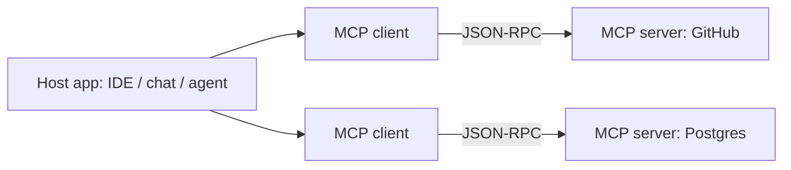

# Tool Engineering and Action Spaces

> [!abstract] What this is
> Designing the **actions** an agent can take: tool schemas the model fills reliably, the right **granularity** of tools, returning errors as observations, making side-effecting tools **idempotent**, scoping **permissions**, and exposing tools through **MCP** (and agents to each other through A2A). The decision this helps with: what the model is allowed to do, and how to make each action safe, cheap and selectable.

---

## Why It Exists

- The model only ever picks from the tools you give it ([[00 - LLM Fundamentals for Engineers]]). Its accuracy, cost and safety are bounded by that **action space**: too many tools and it picks wrong; vague schemas and it fills arguments wrong; unsafe tools and one bad pick refunds the wrong customer twice.
- Tools are where an AI system touches real state, so this is where classic backend engineering (validation, idempotency, authorisation, timeouts) matters most.

---

## Schema Engineering

- A tool definition is a **prompt plus a contract**: the name and description tell the model *when* to use it, the JSON Schema tells it *how*.

| Practice | Why |
|---|---|
| **Verb-noun names** (`get_order_status`, `issue_refund`) | Selection is driven by names and descriptions |
| **Description says when to use it and when not to** | Disambiguates overlapping tools ("Use for delivered orders only; for cancellations use `cancel_order`") |
| **Enums instead of free strings** (`"reason": {"enum": ["damaged", "late", "wrong_item"]}`) | The model can't invent values |
| **Few, required, typed parameters**; `additionalProperties: false` | Fewer ways to be wrong |
| **Describe formats with examples** (`"order_id": "e.g. ORD-1234"`) | Fewer malformed ids |
| **Don't ask the model for things the runtime knows** (user id, tenant, timestamps) | Security and accuracy; inject them in code (see Permissions) |

### Constrained decoding

- With **strict / structured** tool schemas, the serving engine compiles the JSON Schema into a grammar and **masks invalid tokens** at each decoding step, so arguments always parse and match the schema ([[14 - Quantization Decoding and VRAM Math]]). It guarantees **shape**, not **truth**: a schema-valid `order_id` can still be hallucinated. Always validate in code.

```python
from pydantic import BaseModel, Field
from typing import Literal

class IssueRefund(BaseModel):
    """Refund a delivered order. Only for orders delivered within the last 7 days."""
    order_id: str = Field(pattern=r"^ORD-\d{4,}$", description="e.g. ORD-1234")
    reason: Literal["damaged", "late", "wrong_item"]
    amount_inr: int = Field(gt=0, le=50_000)

tool_schema = {"type": "function",
               "function": {"name": "issue_refund",
                            "description": IssueRefund.__doc__,
                            "parameters": IssueRefund.model_json_schema(),
                            "strict": True}}
```

- Generating schemas from Pydantic keeps the model-facing contract and the code-side validation **identical**.

---

## Tool Granularity: Atomic vs Coarse Intent

| Granularity | Example | Gains | Costs | Pick when |
|---|---|---|---|---|
| **Atomic / raw** | `get_customer`, `get_orders`, `get_payments`, `create_refund_record`, `update_ledger`, `send_email` | Flexible, composable | More steps, more chances to err, more context, model must know the business procedure | Exploratory agents over a well-understood API, internal power tools |
| **Coarse / intent-level** | `refund_order(order_id, reason)` that does all of the above in code | One reliable call; business rules enforced in code; fewer tokens | Less flexible; more tools to write | Anything with a known procedure, especially side effects |

- Rules of thumb:
    + **Encode procedures in code, not prompts.** If the refund process is always "check eligibility → create record → update ledger → notify", that's one tool, not four the model must sequence.
    + **Don't expose raw microservice endpoints 1:1.** A common heuristic is that selection accuracy drops noticeably once an agent sees more than ~10–20 tools (model- and description-dependent). Fifty raw endpoints is far past it.
    + **Return what the model needs**, not the raw payload: a 15 KB JSON response becomes three relevant fields plus an id ([[04 - State Memory and Context Engineering]]).

### When there are many tools anyway

| Technique | How |
|---|---|
| **Routing first** | Classify the request, then expose only that domain's tools ([[01 - Workflows vs Agents]]) |
| **Tool retrieval** | Embed tool descriptions; give the model only the top-k relevant tools per request |
| **Namespacing / toolkits** | Group tools (`billing.*`, `shipping.*`); a sub-agent per group ([[05 - Multi-Agent Topologies and Concurrency]]) |
| **Progressive disclosure** | A `search_tools` / `list_capabilities` tool that reveals detailed schemas only when needed |

---

## Errors as Observations

- When a tool fails, **return the error to the model as the tool result** instead of raising an exception that kills the run. The model can then correct itself: fix an argument, try another tool, or ask the user.

```python
def execute(call) -> str:
    try:
        args = REGISTRY[call.name].schema.model_validate_json(call.arguments)   # validate first
    except KeyError:
        return json.dumps({"error": "unknown_tool", "available": list(REGISTRY)})
    except ValidationError as e:
        return json.dumps({"error": "invalid_arguments", "details": e.errors(include_url=False)})
    try:
        return json.dumps(REGISTRY[call.name].fn(args))
    except OrderNotFound:
        return json.dumps({"error": "order_not_found", "hint": "Ask the user to confirm the order id."})
    except UpstreamTimeout:
        return json.dumps({"error": "temporarily_unavailable", "retryable": True})
```

- Make errors **actionable and short**: a machine-readable code, what was wrong, and a hint. Raw 300-line stack traces waste context; for validation errors, the concise field-level messages are exactly what the model needs.
- Distinguish **retryable** (timeout, 503) from **permanent** (not found, forbidden) errors, and let the **runtime** handle retries for transient failures rather than spending model steps on them ([[08 - Reliability]]).
- Still **raise** for things the model must never work around: authorisation failures on sensitive actions, budget exhaustion, policy violations.

---

## Idempotency and Side Effects

- Classic failure: the agent calls `issue_refund`, the call **times out** after the refund actually happened, the run is retried (by the runtime, a durable-execution replay, or the model itself), and the customer is refunded **twice**.
- Rules:
    + Classify tools as **read-only** vs **side-effecting**. Read-only tools can be retried freely.
    + Every side-effecting call carries an **idempotency key generated by the orchestration layer, not the model**: derived from the run id and step (`f"{run_id}:{step}:{tool}"`), stored with the result, and sent to the downstream API so repeats return the original result ([[LLD/Foundations/11 - Idempotency and Retries]], [[08 - Reliability]]).
    + Never let the model invent the key: it may produce a new one on retry, defeating the purpose.
    + Prefer **state-checked** operations downstream (`refund only if not already refunded`).
    + Require **human confirmation** for high-impact or irreversible actions ([[09 - Durable Execution HITL and Realtime UX]]).

```python
def call_side_effecting(run_id: str, step: int, tool: Tool, args: BaseModel) -> dict:
    key = f"{run_id}:{step}:{tool.name}"                    # deterministic, outside the model
    if (cached := idempotency_store.get(key)) is not None:
        return cached                                      # replay / retry: same result, no new effect
    result = tool.fn(args, idempotency_key=key)            # downstream also dedupes on the key
    idempotency_store.put(key, result)
    return result
```

- Also plan for **compensation**: if a later step fails, can this action be undone (refund reversal, cancel booking)? Multi-step side effects are a saga ([[10 - Distributed Building Blocks]]).

---

## Permissions and Identity

- The model is **not** a security boundary. Anything it can be tricked into calling, an attacker can call ([[10 - AI Gateway Security and Guardrails]]).
    + **Least privilege per agent**: the support agent gets `get_order` and `refund_order` for the current customer, not admin APIs.
    + **Identity comes from the session, not the arguments.** The runtime injects `user_id`, `tenant_id` and auth tokens into tool execution; they never appear in the schema, so the model can't change whose data it touches.
    + **Authorise every call in the tool or service layer**, exactly as for a normal API request.
    + **Tiered actions**: read freely; write with limits (refund ≤ ₹5,000 automatically); above limits, require approval.

```python
def refund_order(args: RefundArgs, ctx: RequestContext) -> dict:   # ctx from the session, not the model
    order = orders.get(args.order_id)
    if order.customer_id != ctx.user_id:
        raise Forbidden("order does not belong to this user")     # never trust the model's choice
    if args.amount_inr > 5_000:
        return {"status": "pending_approval", "approval_id": request_approval(ctx, args)}
    return payments.refund(order, args.amount_inr, idempotency_key=ctx.idempotency_key)
```

---

## Model Context Protocol (MCP)

- **MCP** is an open protocol for connecting AI applications to tools and data in a standard way, so a tool integration is written once and works in any MCP-capable client (IDEs, chat apps, agent frameworks). Think "a common plug for tools", the same role LSP plays for editor language support.



| Concept | Meaning |
|---|---|
| **Host** | The application the user interacts with; runs the model and decides what to expose |
| **Client** | A connector inside the host, one per server connection |
| **Server** | Exposes capabilities from a system (GitHub, a DB, your internal API) |
| **Transport** | JSON-RPC 2.0 over **stdio** (local processes) or **Streamable HTTP** (remote servers) |
| **Server primitives** | **Tools** (model-invoked actions), **Resources** (readable data/context), **Prompts** (reusable templates) |
| **Client primitives** | e.g. **sampling** (server asks the host's model to generate), **roots** (allowed filesystem scope), **elicitation** (server asks the user for input) |

- Lifecycle: the client connects, both sides negotiate capabilities, the client lists tools/resources, and the host passes selected tool definitions to the model; when the model calls one, the client sends `tools/call` to the server.
- Remote servers use **OAuth-based authorisation**; local stdio servers run with the user's local permissions.
- **Risks to name:** a malicious or compromised server can return instructions inside tool descriptions or results (tool poisoning, a form of prompt injection); a server can be over-privileged; tool names can collide across servers. Mitigations: allow-list servers, pin versions, review tool descriptions, scope tokens narrowly, and keep authorisation in your own services.
- When to use it: exposing internal systems to many AI clients, or consuming third-party integrations without writing glue code. For a single in-process agent with a handful of tools, plain function tools are simpler.

### Agent-to-Agent (A2A)

- MCP connects an agent to **tools**; **A2A** (an open protocol started by Google, now under the Linux Foundation) connects **agents to other agents**, possibly built by different teams or vendors.
    + Agents publish an **Agent Card** (capabilities, endpoint, auth requirements).
    + Work is exchanged as **tasks** with a lifecycle (submitted, working, input-required, completed), with streaming updates and artifacts.
- Mental model: MCP is "call a function", A2A is "delegate a job to a colleague who may take a while and ask questions". Within one codebase, sub-agents are just function calls ([[05 - Multi-Agent Topologies and Concurrency]]).

---

## Failure Modes

| Failure | What happens | Mitigation |
|---|---|---|
| **Too many raw tools** | Wrong tool picked; long schemas waste tokens | Coarse intent tools; routing; tool retrieval |
| **Vague descriptions / free-text params** | Wrong tool or invented argument values | Clear when/when-not descriptions; enums; Pydantic-generated schemas |
| **Exceptions kill the run** | One bad argument ends the task | Errors as short, actionable observations |
| **Duplicate side effects on retry** | Double refund after a timeout | Runtime-generated idempotency keys; state-checked downstream ops |
| **Model-controlled identity** | Prompt manipulation changes whose data is accessed | Identity injected from the session; authorise in the service |
| **Huge tool outputs** | Context bloat, cost, distraction | Return trimmed fields; store full output out of band |
| **Malicious MCP server** | Injected instructions or data exfiltration | Allow-list, pin, review, least-privilege tokens |

---

## Interview Lines

> [!tip] Say it like this
> - "Tool descriptions are prompts and schemas are contracts; I generate both from Pydantic so validation matches what the model sees."
> - "I expose intent-level tools like `refund_order` instead of raw endpoints, so the business procedure lives in code."
> - "Errors go back to the model as short, actionable observations; transient retries are the runtime's job."
> - "Side-effecting tools get idempotency keys from the orchestrator, never from the model, so a replay can't double-refund."
> - "User and tenant identity are injected from the session and authorised in the service; the model can't choose whose data it touches."
> - "MCP standardises tools and resources over JSON-RPC; A2A standardises delegating tasks between agents."

## Related Notes

- [[00 - LLM Fundamentals for Engineers]] · [[02 - Execution Loops and Control Topologies]] · [[10 - AI Gateway Security and Guardrails]] · [[LLD/Foundations/11 - Idempotency and Retries]]
- [[Agentic/README]]
