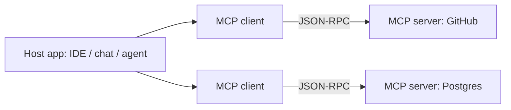

# Tool Engineering and Action Spaces

> [!abstract] What this is
> Designing the **actions** an agent can take: tool schemas the model fills reliably, the right **granularity** of tools, returning errors as observations, making side-effecting tools **idempotent**, scoping **permissions** and **delegated identity**, keeping large tool catalogues out of the context (**code mode**, **skills**), and exposing tools through **MCP** (current to the 2026-07-28 spec, including its OAuth flow) and agents to each other through A2A. The decision this helps with: what the model is allowed to do, and how to make each action safe, cheap and selectable.

---

## Why It Exists

- The model only ever picks from the tools you give it ([[00 - LLM Fundamentals for Engineers]]). Its accuracy, cost and safety are bounded by that **action space**: too many tools and it picks wrong; vague schemas and it fills arguments wrong; unsafe tools and one bad pick refunds the wrong customer twice.
- Tools are where an AI system touches real state, so this is where classic backend engineering (validation, idempotency, authorisation, timeouts) matters most.

---

## Schema Engineering

- A tool definition is a **prompt plus a contract**: the name and description tell the model *when* to use it, the JSON Schema tells it *how*.

| Practice | Why |
|---|---|
| **Verb-noun names** (`get_order_status`, `issue_refund`) | Selection is driven by names and descriptions |
| **Description says when to use it and when not to** | Disambiguates overlapping tools ("Use for delivered orders only; for cancellations use `cancel_order`") |
| **Enums instead of free strings** (`"reason": {"enum": ["damaged", "late", "wrong_item"]}`) | The model can't invent values |
| **Few, required, typed parameters**; `additionalProperties: false` | Fewer ways to be wrong |
| **Describe formats with examples** (`"order_id": "e.g. ORD-1234"`) | Fewer malformed ids |
| **Don't ask the model for things the runtime knows** (user id, tenant, timestamps) | Security and accuracy; inject them in code (see Permissions) |

### Constrained decoding

- With **strict / structured** tool schemas, the serving engine compiles the JSON Schema into a grammar and **masks invalid tokens** at each decoding step, so arguments always parse and match the schema ([[14 - Quantization Decoding and VRAM Math]]). It guarantees **shape**, not **truth**: a schema-valid `order_id` can still be hallucinated. Always validate in code.

```python
from pydantic import BaseModel, Field
from typing import Literal

class IssueRefund(BaseModel):
    """Refund a delivered order. Only for orders delivered within the last 7 days."""
    order_id: str = Field(pattern=r"^ORD-\d{4,}$", description="e.g. ORD-1234")
    reason: Literal["damaged", "late", "wrong_item"]
    amount_inr: int = Field(gt=0, le=50_000)

tool_schema = {"type": "function",
               "function": {"name": "issue_refund",
                            "description": IssueRefund.__doc__,
                            "parameters": IssueRefund.model_json_schema(),
                            "strict": True}}
```

- Generating schemas from Pydantic keeps the model-facing contract and the code-side validation **identical**.

---

## Tool Granularity: Atomic vs Coarse Intent

| Granularity | Example | Gains | Costs | Pick when |
|---|---|---|---|---|
| **Atomic / raw** | `get_customer`, `get_orders`, `get_payments`, `create_refund_record`, `update_ledger`, `send_email` | Flexible, composable | More steps, more chances to err, more context, model must know the business procedure | Exploratory agents over a well-understood API, internal power tools |
| **Coarse / intent-level** | `refund_order(order_id, reason)` that does all of the above in code | One reliable call; business rules enforced in code; fewer tokens | Less flexible; more tools to write | Anything with a known procedure, especially side effects |

- Rules of thumb:
    + **Encode procedures in code, not prompts.** If the refund process is always "check eligibility → create record → update ledger → notify", that's one tool, not four the model must sequence.
    + **Don't expose raw microservice endpoints 1:1.** A common heuristic is that selection accuracy drops noticeably once an agent sees more than ~10–20 tools (model- and description-dependent). Fifty raw endpoints is far past it.
    + **Return what the model needs**, not the raw payload: a 15 KB JSON response becomes three relevant fields plus an id ([[04 - State Memory and Context Engineering]]).

### When there are many tools anyway

| Technique | How |
|---|---|
| **Routing first** | Classify the request, then expose only that domain's tools ([[01 - Workflows vs Agents]]) |
| **Tool retrieval** | Embed tool descriptions; give the model only the top-k relevant tools per request |
| **Namespacing / toolkits** | Group tools (`billing.*`, `shipping.*`); a sub-agent per group ([[05 - Multi-Agent Topologies and Concurrency]]) |
| **Progressive disclosure** | A `search_tools` / `list_capabilities` tool that reveals detailed schemas only when needed |
| **Code execution ("code mode")** | Present tools as a code API and let the model write a script that calls them (next section) |
| **Skills** | Package instructions and scripts as folders the model loads only when the task needs them (next section) |

---

## Context-Efficient Tool Use: Code Mode and Skills

- Direct tool calling has two costs that grow with the catalogue:
    + **Definitions in context.** Most clients load every tool schema up front. With hundreds or thousands of tools across many MCP servers, that is a large share of the context before the user's request is even read.
    + **Intermediate results through the model.** To copy a meeting transcript from Drive into a CRM record, the transcript passes through the model twice: once as the result of the read, and again as the argument of the write.

### Code execution with MCP

- Present each MCP server as a **code API on a filesystem** (`./servers/google-drive/getDocument.ts`, `./servers/salesforce/updateRecord.ts`). The model lists the directory, reads only the tool files it needs, and writes one script that calls them in a sandbox.
- What it buys:
    + **Only the needed definitions load.** Anthropic reports one example dropping from about 150,000 tokens to about 2,000 (98.7%) by loading tool definitions on demand.
    + **Data stays in the sandbox.** A 10,000-row sheet is filtered in code; the model sees the five rows it logs, not all 10,000.
    + **Control flow in code.** Loops, conditionals, retries and polling run in the script instead of as many model round-trips, which also cuts latency.
    + **Privacy.** The harness can tokenise PII in results (`[EMAIL_1]`) and untokenise it only when it's passed to the next tool, so the real values never enter the model's context.
    + **State and reuse.** The script can write intermediate files, and a working script can be saved as a reusable function.
- Costs: you now run **model-written code**, which needs a real sandbox with resource limits, network egress rules and monitoring ([[10 - AI Gateway Security and Guardrails]]). For a handful of tools, direct tool calls are simpler. Cloudflare published the same idea under the name "Code Mode".

```python
# What the model writes in code mode: the transcript never enters its context
transcript = gdrive.get_document(document_id="abc123")["content"]
salesforce.update_record(object_type="SalesMeeting", record_id="00Q5f000001abcXYZ",
                         data={"notes": transcript})
print("updated")                                  # only this line goes back to the model
```

### Agent Skills (progressive disclosure as files)

- A **skill** is a folder with a `SKILL.md` (a short name and description up front, detailed instructions in the body) plus optional scripts and reference files. Only the **name and description** sit in context by default; the body loads when the model decides the skill is relevant, and scripts or reference files load only if the body points to them.
- Skills complement MCP: MCP gives **access** (what the agent can call), a skill gives **procedure** (how to do a task well with what it can call).
- Measure before adopting. A March 2026 benchmark of coding skills (SWE-Skills-Bench) found that 39 of 49 tested skills gave no pass-rate improvement, and token overhead ranged from savings to a 451% increase. A skill is a prompt like any other and needs an eval ([[11 - Evals Observability and Silent Drift]]).

| Approach | Loads into context | Pick when |
|---|---|---|
| **All tool schemas up front** | Every definition | Under ~10–20 tools (heuristic) |
| **Tool retrieval / `search_tools`** | Top-k matching definitions | Large catalogue, independent tools |
| **Code mode** | Only the files the model reads; results filtered in code | Many tools, large payloads, multi-step data plumbing; you can run a sandbox |
| **Skills** | Name and description; body on demand | Repeatable procedures that need more instructions than a tool description holds |

---

## Errors as Observations

- When a tool fails, **return the error to the model as the tool result** instead of raising an exception that kills the run. The model can then correct itself: fix an argument, try another tool, or ask the user.

```python
def execute(call) -> str:
    try:
        args = REGISTRY[call.name].schema.model_validate_json(call.arguments)   # validate first
    except KeyError:
        return json.dumps({"error": "unknown_tool", "available": list(REGISTRY)})
    except ValidationError as e:
        return json.dumps({"error": "invalid_arguments", "details": e.errors(include_url=False)})
    try:
        return json.dumps(REGISTRY[call.name].fn(args))
    except OrderNotFound:
        return json.dumps({"error": "order_not_found", "hint": "Ask the user to confirm the order id."})
    except UpstreamTimeout:
        return json.dumps({"error": "temporarily_unavailable", "retryable": True})
```

- Make errors **actionable and short**: a machine-readable code, what was wrong, and a hint. Raw 300-line stack traces waste context; for validation errors, the concise field-level messages are exactly what the model needs.
- Distinguish **retryable** (timeout, 503) from **permanent** (not found, forbidden) errors, and let the **runtime** handle retries for transient failures rather than spending model steps on them ([[08 - Reliability]]).
- Still **raise** for things the model must never work around: authorisation failures on sensitive actions, budget exhaustion, policy violations.

---

## Idempotency and Side Effects

- Classic failure: the agent calls `issue_refund`, the call **times out** after the refund actually happened, the run is retried (by the runtime, a durable-execution replay, or the model itself), and the customer is refunded **twice**.
- Rules:
    + Classify tools as **read-only** vs **side-effecting**. Read-only tools can be retried freely.
    + Every side-effecting call carries an **idempotency key generated by the orchestration layer, not the model**: derived from the run id and step (`f"{run_id}:{step}:{tool}"`), stored with the result, and sent to the downstream API so repeats return the original result ([[LLD/Foundations/11 - Idempotency and Retries]], [[08 - Reliability]]).
    + Never let the model invent the key: it may produce a new one on retry, defeating the purpose.
    + Prefer **state-checked** operations downstream (`refund only if not already refunded`).
    + Require **human confirmation** for high-impact or irreversible actions ([[09 - Durable Execution HITL and Realtime UX]]).

```python
def call_side_effecting(run_id: str, step: int, tool: Tool, args: BaseModel) -> dict:
    key = f"{run_id}:{step}:{tool.name}"                    # deterministic, outside the model
    if (cached := idempotency_store.get(key)) is not None:
        return cached                                      # replay / retry: same result, no new effect
    result = tool.fn(args, idempotency_key=key)            # downstream also dedupes on the key
    idempotency_store.put(key, result)
    return result
```

- Also plan for **compensation**: if a later step fails, can this action be undone (refund reversal, cancel booking)? Multi-step side effects are a saga ([[10 - Distributed Building Blocks]]).

---

## Permissions and Identity

- The model is **not** a security boundary. Anything it can be tricked into calling, an attacker can call ([[10 - AI Gateway Security and Guardrails]]).
    + **Least privilege per agent**: the support agent gets `get_order` and `refund_order` for the current customer, not admin APIs.
    + **Identity comes from the session, not the arguments.** The runtime injects `user_id`, `tenant_id` and auth tokens into tool execution; they never appear in the schema, so the model can't change whose data it touches.
    + **Authorise every call in the tool or service layer**, exactly as for a normal API request.
    + **Tiered actions**: read freely; write with limits (refund ≤ ₹5,000 automatically); above limits, require approval.

```python
def refund_order(args: RefundArgs, ctx: RequestContext) -> dict:   # ctx from the session, not the model
    order = orders.get(args.order_id)
    if order.customer_id != ctx.user_id:
        raise Forbidden("order does not belong to this user")     # never trust the model's choice
    if args.amount_inr > 5_000:
        return {"status": "pending_approval", "approval_id": request_approval(ctx, args)}
    return payments.refund(order, args.amount_inr, idempotency_key=ctx.idempotency_key)
```

### Delegated identity: whose authority is the agent using?

- An agent acts **on behalf of** someone. Every tool call should carry two identities: the **user** it acts for and the **agent** doing the acting. Without both, audit logs can't answer "who did this", and permissions collapse to whatever the agent's own credential allows.
- **Treat agents as non-human identities (NHIs).** Each agent (or agent deployment) gets its own identity, an owner and an expiry, like a service account, not a shared API key.
- **Short-lived, task-scoped tokens.** Mint a token per run or task with only the scopes that task needs (`orders:read`, `refunds:write` up to a limit), audience-bound to the one downstream service, expiring in minutes. A stolen token is then worth one task, not the whole account.
- **Delegation, not impersonation.** Prefer flows where the downstream service sees "agent X acting for user Y" (OAuth token exchange, RFC 8693, carries an `act` claim for the actor) over handing the agent the user's own long-lived token.
- **The confused deputy.** A low-privilege agent asks a high-privilege agent or tool to do something on its behalf, and the high-privilege side acts on its *own* authority without re-checking the original caller. Fix: every hop authorises against the **originating user's** permissions, not the caller's. This is OWASP's ASI03 (Identity and Privilege Abuse) ([[10 - AI Gateway Security and Guardrails]]).
- **Never pass tokens through.** A tool or MCP server must not forward the token it received to another service; it gets its own token for that service. The MCP spec forbids servers from accepting or forwarding tokens not issued for them (next section).
- **Step-up for risky actions.** When an action needs more than the current scopes (a refund above the auto-approve limit), the service returns "insufficient scope"; the agent pauses and the user approves or re-authorises ([[09 - Durable Execution HITL and Realtime UX]]).

| Pattern | What the downstream sees | Pick when |
|---|---|---|
| **Agent's own service credential** | Agent only | Back-office jobs with no end user |
| **User's token passed to the agent** | User only (agent invisible) | Avoid: no audit of the actor, over-broad scope |
| **Token exchange: agent acting for user** | Both, with narrowed scopes | Any agent acting for a signed-in user |
| **Per-task capability token** | A short-lived grant for one task | High-risk tools; multi-agent hand-offs |

---

## Model Context Protocol (MCP)

- **MCP** is an open protocol for connecting AI applications to tools and data in a standard way, so a tool integration is written once and works in any MCP-capable client (IDEs, chat apps, agent frameworks). Think "a common plug for tools", the same role LSP plays for editor language support.



| Concept | Meaning |
|---|---|
| **Host** | The application the user interacts with; runs the model and decides what to expose |
| **Client** | A connector inside the host, one per server connection |
| **Server** | Exposes capabilities from a system (GitHub, a DB, your internal API) |
| **Transport** | JSON-RPC 2.0 over **stdio** (local processes) or **Streamable HTTP** (remote servers) |
| **Server primitives** | **Tools** (model-invoked actions), **Resources** (readable data/context), **Prompts** (reusable templates) |
| **Asking the client for more input** | **Elicitation** (ask the user for input) via the multi round-trip pattern below. **Sampling** (server asks the host's model to generate) and **roots** (allowed filesystem scope) are **deprecated** since the 2026-07-28 spec |

### What changed in the 2026-07-28 spec

- **MCP is stateless at the protocol layer.** There is no `initialize` handshake and no `Mcp-Session-Id` header any more. Every request carries its protocol version and client capabilities in `_meta`, and a server that needs cross-call state passes an explicit handle as an ordinary tool argument. This is what lets a remote MCP server sit behind a plain load balancer with no sticky sessions.
- **`server/discover`** replaces the handshake: servers must implement it to advertise versions, capabilities and identity, and clients may call it first.
- **Multi round-trip requests (MRTR).** A server that needs more input (user confirmation, a choice) returns a result with `resultType: "input_required"`; the client gets the answer and **retries the original request** with the responses attached. This replaces servers sending their own requests to the client.
- **Deprecated, still working for at least 12 months:** Roots (pass paths as tool parameters or configuration instead), Sampling (call the LLM provider directly instead), Logging (use stderr or OpenTelemetry), the old HTTP+SSE transport, and OAuth Dynamic Client Registration (use Client ID Metadata Documents).
- **Tasks** (long-running, pollable operations) moved out of the core into an official extension, polled with `tasks/get`.
- **Smaller changes worth knowing:** `tools/list` should return tools in a **deterministic order** so clients and LLM prompt caches hit; list results carry `ttlMs` caching hints; OpenTelemetry trace context travels in `_meta`.
- Lifecycle now: the client optionally calls `server/discover`, lists tools and resources, and the host passes selected tool definitions to the model; when the model calls one, the client sends `tools/call` with its version and capabilities in `_meta`.

### MCP authorisation (remote servers)

- Authorisation is optional in MCP, but a remote server that has it follows OAuth 2.1. Local stdio servers take credentials from their environment instead.
- Roles: the **MCP server is an OAuth resource server**, the **MCP client is the OAuth client**, and a separate **authorisation server** talks to the user and issues tokens.
- The flow:
    1. The client calls the server without a token and gets **401** with a `WWW-Authenticate` header pointing to the server's **Protected Resource Metadata** (RFC 9728) and the scopes it needs.
    2. The client reads that metadata to discover the authorisation server, then reads the authorisation server's own metadata.
    3. The client identifies itself, preferably with a **Client ID Metadata Document** (a URL it controls describing the client).
    4. Authorisation code flow with **PKCE**, sending a **`resource`** parameter (RFC 8707) naming the exact MCP server the token is for.
    5. The client sends `Authorization: Bearer …` on every request. The server must check the token was issued **for it** (audience) and must never accept or forward a token meant for someone else.
    6. If a later call needs more scopes, the server returns **403 `insufficient_scope`** with the scopes required, and the client runs a **step-up** authorisation for the union of old and new scopes.
- Two 2026 additions close a real attack. Clients must check the **`iss`** (issuer) in the authorisation response against the issuer they recorded before redeeming the code, and must key stored credentials by issuer. Both official MCP SDKs shipped high-severity fixes in October 2026 for a flaw where a malicious MCP server could make the client send its OAuth credentials to an authorisation server the attacker controlled.
- In practice most servers are behind: one 2026 scan found 53% of MCP servers relied on static API keys or personal access tokens, and only 8.5% used OAuth. Treat "it's an MCP server" as saying nothing about its security.

- **Risks to name:** a malicious or compromised server can return instructions inside tool descriptions or results (tool poisoning, a form of prompt injection); a server can be over-privileged; tool names can collide across servers. Mitigations: allow-list servers, pin versions, review tool descriptions, scope tokens narrowly, and keep authorisation in your own services.
- When to use it: exposing internal systems to many AI clients, or consuming third-party integrations without writing glue code. For a single in-process agent with a handful of tools, plain function tools are simpler.

### Agent-to-Agent (A2A)

- MCP connects an agent to **tools**; **A2A** (an open protocol started by Google, now under the Linux Foundation) connects **agents to other agents**, possibly built by different teams or vendors.
    + Agents publish an **Agent Card** (capabilities, endpoint, auth requirements).
    + Work is exchanged as **tasks** with a lifecycle (submitted, working, input-required, completed), with streaming updates and artifacts.
- Mental model: MCP is "call a function", A2A is "delegate a job to a colleague who may take a while and ask questions". Within one codebase, sub-agents are just function calls ([[05 - Multi-Agent Topologies and Concurrency]]).

---

## Failure Modes

| Failure | What happens | Mitigation |
|---|---|---|
| **Too many raw tools** | Wrong tool picked; long schemas waste tokens | Coarse intent tools; routing; tool retrieval |
| **Vague descriptions / free-text params** | Wrong tool or invented argument values | Clear when/when-not descriptions; enums; Pydantic-generated schemas |
| **Exceptions kill the run** | One bad argument ends the task | Errors as short, actionable observations |
| **Duplicate side effects on retry** | Double refund after a timeout | Runtime-generated idempotency keys; state-checked downstream ops |
| **Model-controlled identity** | Prompt manipulation changes whose data is accessed | Identity injected from the session; authorise in the service |
| **Huge tool outputs** | Context bloat, cost, distraction | Return trimmed fields; store full output out of band |
| **Malicious MCP server** | Injected instructions or data exfiltration | Allow-list, pin, review, least-privilege tokens |
| **Token passthrough / wrong audience** | A token issued for one service is replayed against another | Audience-bound tokens (RFC 8707 `resource`); servers reject tokens not issued for them; never forward tokens |
| **OAuth mix-up via a malicious server** | Client sends its credentials to an attacker's authorisation server | Validate `iss`; key credentials by issuer; patched SDKs |
| **Confused deputy between agents** | A privileged agent acts on a low-privilege caller's request | Authorise every hop against the originating user |
| **Context full of tool schemas** | Slow, expensive, worse selection | Tool search, code mode, skills |
| **Unsandboxed code mode** | Model-written script reaches the host or network | Sandbox with resource limits and egress rules |

---

## Interview Lines

> [!tip] Say it like this
> - "Tool descriptions are prompts and schemas are contracts; I generate both from Pydantic so validation matches what the model sees."
> - "I expose intent-level tools like `refund_order` instead of raw endpoints, so the business procedure lives in code."
> - "Errors go back to the model as short, actionable observations; transient retries are the runtime's job."
> - "Side-effecting tools get idempotency keys from the orchestrator, never from the model, so a replay can't double-refund."
> - "User and tenant identity are injected from the session and authorised in the service; the model can't choose whose data it touches."
> - "MCP standardises tools and resources over JSON-RPC; A2A standardises delegating tasks between agents."
> - "Since the July 2026 spec MCP is stateless: no handshake, no session id, so a remote server scales behind a normal load balancer."
> - "A remote MCP server is an OAuth resource server: 401 with protected-resource metadata, PKCE, an audience-bound token, and step-up on insufficient scope."
> - "Agents get their own short-lived, task-scoped identity and act *for* the user via token exchange; every hop re-authorises against the original user."
> - "With hundreds of tools I'd use code mode: the model reads only the tool files it needs and filters big results in a sandbox, so they never hit the context."

## Sources

- MCP specification 2026-07-28, *Key Changes* and *Authorization* (read November 2026). https://modelcontextprotocol.io/specification/2026-07-28/changelog · https://modelcontextprotocol.io/specification/2026-07-28/basic/authorization
- SEP-2577, *Deprecate Roots, Sampling, and Logging*. https://modelcontextprotocol.io/seps/2577-deprecate-roots-sampling-and-logging
- Anthropic, *Code execution with MCP: Building more efficient agents* (November 2025). https://www.anthropic.com/research/code-execution-with-mcp
- MCP SDK OAuth advisories, October 2026 (dev.to write-up). https://dev.to/fabwaseem/mcp-security-in-2026-the-oauth-sdk-cves-tested-and-how-to-lock-down-your-server-3lln
- MCP server authentication survey, 2026 (DevToolLab; also cited by Microsoft Tech Community). https://devtoollab.com/blog/mcp-server-authentication-oauth-guide-2026
- SWE-Skills-Bench figures via CloudsPress (2026). https://www.cloudspress.com/agent-skills-vs-mcp-what-context-costs-actually-look-like/
- OWASP Top 10 for Agentic Applications (December 2025), ASI03. https://genai.owasp.org/resource/owasp-top-10-for-agentic-applications-for-2026/

## Related Notes

- [[00 - LLM Fundamentals for Engineers]] · [[02 - Execution Loops and Control Topologies]] · [[10 - AI Gateway Security and Guardrails]] · [[LLD/Foundations/11 - Idempotency and Retries]]
- [[Agentic/README]]
