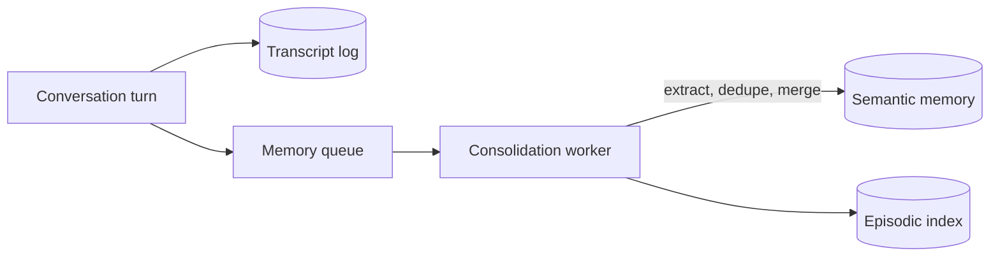

# State, Memory and Context Engineering

> [!abstract] What this is
> Deciding **what the model sees on each call** and **what the system remembers across calls**: short-term state (transcripts vs structured state), keeping context small (compaction, observation masking, offloading), long-term memory tiers (episodic, semantic, procedural), and the write path for memory, including concurrent updates. The decision this helps with: what goes into the next prompt, what gets stored, and how.

---

## Why It Exists

- The API is stateless ([[00 - LLM Fundamentals for Engineers]]), so every call's context is something you assemble. Left alone, an agent's context **only grows**: every tool result and turn is appended, making each step slower, costlier and less accurate.
- "Context engineering" is the discipline of putting the **smallest set of high-signal tokens** in front of the model for the current step. "Memory" is the storage and retrieval behind it.

---

## Short-Term State

| Model | What it is | Gains | Costs | Pick when |
|---|---|---|---|---|
| **Append-only transcript** | The full message list: user turns, assistant turns, tool calls and results | Simple; complete audit trail; what chat APIs expect | Grows without bound; old noise stays forever | Short conversations; as the durable log underneath |
| **Structured state** | Typed fields the workflow reads and writes (`order_id`, `plan`, `verified_identity`, `steps_done`) | Compact; precise; easy to validate and checkpoint | Must design the schema; less flexible | Agents with known sub-goals; graph runtimes ([[02 - Execution Loops and Control Topologies]]) |

- Production systems usually keep **both**: the transcript as the durable, auditable log, and a structured state object from which each prompt is **rendered**. The prompt is a view of state, not the state itself.

```python
from pydantic import BaseModel

class SupportState(BaseModel):
    goal: str
    customer_id: str                       # injected by the runtime, never by the model
    order_id: str | None = None
    order_summary: str | None = None       # 2-line summary, not the raw 15 KB payload
    plan: list[str] = []
    facts: list[str] = []                  # durable findings the agent must not forget
    recent_turns: list[dict] = []          # last few messages verbatim

def render_prompt(state: SupportState) -> list[dict]:
    return [
        {"role": "system", "content": SYSTEM_PROMPT},           # stable prefix (cache-friendly)
        {"role": "user", "content":
            f"<goal>{state.goal}</goal>\n<facts>{state.facts}</facts>\n"
            f"<order>{state.order_summary}</order>\n<plan>{state.plan}</plan>"},
        *state.recent_turns,
    ]
```

---

## Keeping Context Small

### Why big context hurts

- **Cost and latency** scale with input tokens on every step.
- **Context rot / lost in the middle**: one early 15 KB JSON blob stays in history for the rest of the run, diluting attention and pushing important instructions away from the edges of the window where models attend best.
- **Distraction and contamination**: stale tool results and failed attempts mislead later steps.

### Techniques

| Technique | How it works | Costs you | Pick when |
|---|---|---|---|
| **Trim tool outputs at the source** | Tools return only needed fields ([[03 - Tool Engineering and Action Spaces]]) | Tool design work | Always, first |
| **Observation masking** | After a result is used (e.g. 2 steps later), replace the raw output in history with a short summary or a placeholder | Details lost unless stored | Long tool-heavy runs |
| **Offloading / handles** | Store large outputs (files, query results) outside the context; give the model an id and a `read(id, range)` tool | An extra tool | Big documents, logs, datasets |
| **Sliding window** | Keep the last N turns verbatim | Older turns forgotten entirely | Casual chat |
| **Summarisation / compaction** | When near a token threshold, an LLM call condenses older history into a summary of decisions, facts and open tasks | An extra call; summary can drop details | Long conversations and agent runs |
| **Structured scratchpad** | The agent writes durable facts and its plan to explicit state fields (or a notes file) | Schema design | Long-horizon tasks |
| **Sub-agent isolation** | Delegate a messy sub-task to a sub-agent and keep only its result ([[05 - Multi-Agent Topologies and Concurrency]]) | Extra calls | Research, search-heavy steps |

```python
def mask_old_observations(messages: list[dict], keep_last: int = 2) -> list[dict]:
    tool_idx = [i for i, m in enumerate(messages) if m["role"] == "tool"]
    for i in tool_idx[:-keep_last]:                          # older tool results only
        m = messages[i]
        if len(m["content"]) > 500:
            m["content"] = json.dumps({"masked": True,
                                       "summary": summarise_short(m["content"]),
                                       "ref": store_blob(m["content"])})   # recoverable via a read tool
    return messages
```

- **Compaction must preserve**: the goal, user constraints, decisions already made (and why), identifiers, unresolved errors and the remaining plan. Test compaction with evals: a bad summary silently changes behaviour.
- **Cache awareness**: rewriting early messages invalidates provider prompt caches, so compact in **chunks** at thresholds rather than every turn, and keep the system prompt and tool definitions stable at the top ([[12 - LLM Cost and Latency Economics]]).

---

## Long-Term Memory

- Long-term memory is information that persists **across sessions**, stored outside the model and retrieved into context when relevant. It's a retrieval problem plus a write-policy problem.

| Tier | What it holds | Example | Store / retrieval |
|---|---|---|---|
| **Episodic** | Specific past events and interactions | "On 3 Oct the user's refund for ORD-1201 was denied as out of window" | Event log + embeddings; retrieve by similarity, recency, entity |
| **Semantic** | Facts and preferences distilled from many events | "Prefers Hindi; is a premium member; has a nut allergy" | User profile / key-value or document store, or a knowledge graph |
| **Procedural** | How to do things: learned instructions, rules, successful strategies | "For this merchant, always check the warehouse API before promising a date" | Versioned prompt fragments, skills, rules files; few-shot examples |

- Retrieval at query time typically combines **relevance** (embedding similarity), **recency** and **importance**, filtered by **user/tenant** first ([[08 - Vector DB Internals and Hybrid Search]]).
- Memory hygiene:
    + **Scope** strictly by user and tenant; cross-user leakage is a privacy incident.
    + **TTL and deletion**: users must be able to forget things; deletion must reach every copy (embeddings included) ([[18 - Security]]).
    + **Memory poisoning**: untrusted content (a malicious document, a prompt-injected message) can get written to memory and influence every future session. Write only distilled, validated facts from trusted sources; keep provenance.
    + **Contradictions**: newer facts must supersede older ones explicitly, not just accumulate.

---

## The Memory Write Path

### Hot path vs background

| Option | How | Costs you | Pick when |
|---|---|---|---|
| **Write in the hot path** | The agent calls a `remember(fact)` tool during the conversation | Adds latency and a model decision to every turn | The fact must be available immediately in this session |
| **Background consolidation** | After a turn or session, an async job extracts, deduplicates and merges facts into memory | Memory lags by seconds to minutes | Default: keeps responses fast; better extraction quality |



- The consolidation worker is a normal async consumer: idempotent on the turn id, retried on failure, and ordered per user ([[07 - Async Messaging]]).

### Concurrent updates and conflicts

- Two sessions (or two parallel sub-agents) update the same user profile at once: one sets `preferred_language = "hi"`, another appends an allergy. A naive read-modify-write of the whole profile **loses one update** ([[03 - Concurrency Control]]).

| Fix | How | Pick when |
|---|---|---|
| **Per-user single writer** | Partition the memory queue by user id so one worker applies a user's updates in order | Default for background consolidation |
| **Optimistic versioning** | `UPDATE ... WHERE version = n`; on conflict re-read, re-merge, retry | Direct writes from several places |
| **Field-level updates / merge operations** | Update one field or append to a set instead of rewriting the document | Profiles with independent fields |
| **Append-only facts + resolution at read** | Store every fact with timestamp and source; resolve "latest wins" or by confidence when reading | Facts that conflict over time; audit needed |

```python
def apply_memory_update(user_id: str, update: MemoryUpdate) -> None:
    for _ in range(3):
        profile, version = store.get_profile(user_id)
        merged = merge(profile, update)                     # field-level, newest-wins with provenance
        if store.compare_and_set(user_id, merged, expected_version=version):
            return
    raise ConflictError(user_id)                            # goes back on the queue
```

---

## Failure Modes

| Failure | What happens | Mitigation |
|---|---|---|
| **Context rot** | An early large payload lingers, raising cost and diluting attention | Trim at source; observation masking after N steps; offload with handles |
| **Lossy compaction** | Summary drops a constraint; agent repeats work or breaks a rule | Structured summaries (goal, decisions, open items); evals on compaction |
| **Cache-busting compaction** | Rewriting history every turn invalidates prompt caching | Compact at thresholds; keep stable prefix |
| **Lost memory update** | Concurrent writes overwrite each other | Per-user ordered queue; compare-and-set; field-level merges |
| **Memory poisoning** | Injected content persists and affects future sessions | Write only validated facts with provenance; human review for procedural memory |
| **Cross-user leakage** | One user's memory retrieved for another | Hard user/tenant filters before similarity search |
| **Stale facts** | Old preferences override new ones | Timestamps and explicit supersession |

---

## Interview Lines

> [!tip] Say it like this
> - "I keep the transcript as the durable log but render each prompt from structured state, so context stays small and precise."
> - "Raw tool outputs get masked into short summaries a couple of steps after use, with the full payload stored behind a handle."
> - "Long-term memory has three tiers: episodic events, semantic facts and procedural know-how, each with its own store and retrieval."
> - "Memory is written by a background consolidation worker, ordered per user, so concurrent sessions don't lose updates."
> - "Memory is an attack surface: I only persist validated facts with provenance, scoped by user and tenant."

## Related Notes

- [[02 - Execution Loops and Control Topologies]] · [[03 - Tool Engineering and Action Spaces]] · [[05 - Multi-Agent Topologies and Concurrency]] · [[12 - LLM Cost and Latency Economics]]
- [[Agentic/README]]
