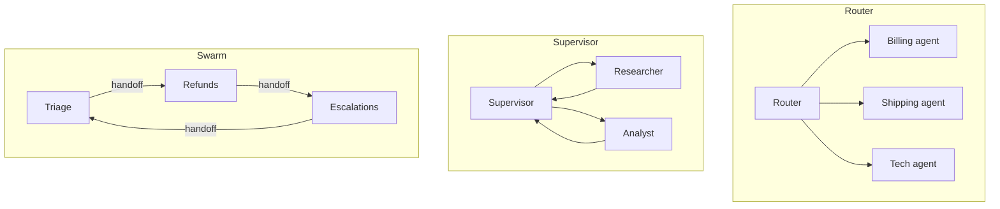

# Multi-Agent Topologies and Concurrency

> [!abstract] What this is
> When and how to split work across several agents: single vs multi-agent trade-offs, the main topologies (**router**, **hierarchical supervisor**, **decentralised swarm / handoffs**), scoping state and context per agent, typed handoff payloads, and running agents concurrently with fan-out, map-reduce and **state reducers**. The decision this helps with: whether more agents help at all, and how to wire them so errors and context don't compound.

---

## Why It Exists

- A single agent with every tool and every instruction gets confused: too many tools, a bloated context, conflicting personas ([[03 - Tool Engineering and Action Spaces]], [[04 - State Memory and Context Engineering]]). Splitting work can fix that, and lets independent work run in parallel.
- But each extra agent adds calls, latency, cost and a new place to fail. Multi-agent is a trade-off to justify, not an upgrade.

---

## Single vs Multi-Agent

| | Single agent | Multi-agent |
|---|---|---|
| Context | One growing context | Each agent has a focused, smaller context |
| Tools | All tools in one place | Each agent gets a small, relevant tool set |
| Parallelism | Sequential steps | Independent sub-tasks in parallel |
| Cost | Lower | Higher: more calls, repeated context, coordination overhead (often several times the tokens) |
| Reliability | One loop to get right | Errors compound across hand-offs |
| Debugging | One trajectory | Several interleaved trajectories |

- Multi-agent **helps** when work is **broad and parallelisable** (research across many sources, reviewing many files independently), or when distinct domains need **separate tool sets and instructions** (billing vs shipping vs technical support).
- It **hurts** when sub-tasks are **tightly coupled** and need shared, evolving context (e.g. one coherent code change across files): agents make conflicting assumptions and the merge is the hard part.

### The compounding problem

- If 5 sequential sub-agents each succeed 90% of the time, the chain succeeds ~59% of the time (0.9⁵ ≈ 0.59). Parallel fan-out doesn't multiply failures the same way if the reducer tolerates some missing results, which is one reason **parallel breadth** works better than **long sequential hand-off chains**.

---

## Topologies



| Topology | How it works | Gains | Costs | Pick when |
|---|---|---|---|---|
| **Centralised router** | One classifier sends each request to exactly one specialist; no back-and-forth | Simple, cheap, predictable | Can't combine specialists for one request | Requests fall into clear domains |
| **Hierarchical supervisor** | A supervisor plans, delegates sub-tasks to workers (who return results), and decides what next; can be nested (supervisors of supervisors) | Central control, global view, easy to add policy checks | Supervisor is a bottleneck and a single point of confusion; extra calls | Complex tasks needing decomposition and synthesis (orchestrator-workers as agents, [[01 - Workflows vs Agents]]) |
| **Decentralised swarm / handoffs** | Agents transfer control to each other directly ("hand off to refunds"); the active agent talks to the user | Natural for conversational specialists; no central bottleneck | Harder to trace; loops between agents; no global plan | Customer-facing flows where one specialist at a time owns the conversation |

- Implementation note: in most frameworks a **handoff is just a tool call** (`transfer_to_refunds_agent`) that changes which agent's instructions and tools are active, and a **sub-agent is just a function** the supervisor calls. Nothing magical.

---

## State Scoping and Context Isolation

- Each agent should see **only what its job needs**.

| Anti-pattern | What goes wrong | Fix |
|---|---|---|
| Passing the parent's full transcript to every sub-agent | Context contamination: the sub-agent follows the parent's persona or stale instructions, costs balloon | Pass a **scoped task brief** |
| Sharing one mutable global state dict | Agents overwrite each other's fields | Per-agent private state; shared state only through reducers |
| Returning a sub-agent's whole trajectory to the parent | Parent context fills with the child's exploration noise | Return a **structured result** only |

### Typed handoff payloads

```python
from pydantic import BaseModel, Field
from typing import Literal

class ResearchTask(BaseModel):                 # parent -> child: everything the child needs, nothing more
    question: str
    sources: list[Literal["web", "kb", "tickets"]]
    max_tool_calls: int = Field(default=8, le=20)
    output_format: str = "3-5 bullet findings with citations"

class ResearchResult(BaseModel):               # child -> parent: compact, validated
    findings: list[str]
    citations: list[str]
    confidence: Literal["low", "medium", "high"]
    gaps: list[str] = []

async def research_agent(task: ResearchTask) -> ResearchResult:
    raw = await run_agent(instructions=RESEARCH_PROMPT, tools=tools_for(task.sources),
                          input=task.model_dump_json(), budget=task.max_tool_calls)
    return ResearchResult.model_validate_json(raw)          # validate at the boundary
```

- Validating at every boundary turns "the sub-agent rambled" into a clear, retryable error instead of silent garbage flowing upward.

---

## Concurrency: Fan-Out, Map-Reduce and Reducers

### Fan-out with asyncio

- Independent sub-tasks run concurrently; latency becomes roughly the **slowest** branch instead of the **sum**.

```python
import asyncio

SEM = asyncio.Semaphore(5)                      # cap concurrent model calls (rate limits, cost)

async def bounded(coro, timeout_s: float = 60):
    async with SEM:
        return await asyncio.wait_for(coro, timeout_s)

async def research(question: str) -> str:
    tasks = plan_subquestions(question)          # list[ResearchTask]
    results = await asyncio.gather(*[bounded(research_agent(t)) for t in tasks],
                                   return_exceptions=True)
    ok = [r for r in results if isinstance(r, ResearchResult)]
    failed = len(results) - len(ok)
    if len(ok) < max(1, len(tasks) // 2):        # tolerate partial failure, but not too much
        raise RuntimeError(f"{failed}/{len(tasks)} sub-agents failed")
    return await synthesise(question, ok, note_missing=failed)
```

- Concurrency rules (same as any fan-out, [[02 - Fundamentals]], [[08 - Reliability]]):
    + **Bound concurrency** with a semaphore: provider rate limits are per minute in tokens and requests ([[10 - AI Gateway Security and Guardrails]]).
    + **Timeout every branch**; decide up front whether partial results are acceptable.
    + **Budget per branch**, so one runaway sub-agent can't spend the whole task budget.
    + **Tail latency**: with many branches, the slowest dominates; hedging or dropping stragglers helps.

### Map-reduce

- **Map**: apply the same agent or prompt to many chunks (documents, files, tickets) in parallel. **Reduce**: combine the outputs, possibly in stages (pairwise or hierarchical) when they don't fit in one context.
- Classic uses: summarising a large corpus, extracting fields from thousands of documents, reviewing every file in a PR.

### State reducers

- When parallel branches write to shared state, the **merge rule** must be explicit and deterministic, or results depend on which branch finished first.

| Reducer | Behaviour | Use for |
|---|---|---|
| **Overwrite** (default) | Last write wins | Single-writer fields only |
| **Append / concatenate** | Combine lists | Findings, messages, citations |
| **Union with dedupe** | Combine sets by key | Entities, URLs |
| **Keyed merge** | Each branch writes its own key | Per-sub-task results |
| **Custom deterministic merge** | Sort, then merge by rule (e.g. highest confidence wins) | Conflicting answers |

```python
from typing import Annotated, TypedDict
import operator

def merge_by_key(a: dict, b: dict) -> dict:
    return {**a, **b}                                  # each branch owns distinct keys

class ResearchState(TypedDict):
    question: str                                      # overwrite: only the entry node writes it
    findings: Annotated[list[str], operator.add]       # append reducer: safe for parallel branches
    per_source: Annotated[dict, merge_by_key]          # keyed merge
```

- This is the same principle as concurrent code in general: shared mutable state needs an explicit merge or ownership rule ([[LLD/Concurrency/13 - Designing Thread-Safe Classes]]). Sort parallel outputs by a stable key before reducing so runs are reproducible.

---

## Failure Modes

| Failure | What happens | Mitigation |
|---|---|---|
| **Multi-agent for a coupled task** | Agents conflict; merge is incoherent | Single agent with good context; multi-agent only for separable work |
| **Error compounding in sequential chains** | 5 steps at 90% ≈ 59% success | Fewer hand-offs; validation at each boundary; prefer parallel breadth |
| **Context contamination** | Sub-agent inherits the parent's whole history and persona | Scoped, typed task briefs |
| **Noisy child results** | Parent context fills with sub-agent exploration | Structured, validated results only |
| **Non-deterministic merges** | Output depends on branch timing | Explicit reducers; sort by stable key |
| **Rate-limit storms** | Fan-out exceeds provider TPM/RPM; cascading 429s | Semaphore; token-aware rate limiting at the gateway |
| **Handoff loops** | Agents keep transferring back and forth | Max hand-offs per run; loop detection; escalate to a human |
| **Cost blow-up** | Every agent repeats shared context | Per-branch budgets; shared cached prefix; smaller models for workers |

---

## Interview Lines

> [!tip] Say it like this
> - "Multi-agent pays off for broad, parallel work or clearly separate domains; for tightly coupled tasks a single agent with good context is better."
> - "Sequential hand-offs compound errors: five steps at 90% is about 59%, so I prefer parallel fan-out with validation at each boundary."
> - "Sub-agents get a scoped Pydantic task brief and return a validated result, never the parent's full transcript."
> - "Parallel branches merge through explicit reducers, and I bound fan-out with a semaphore, timeouts and per-branch budgets."
> - "Router for clear domains, supervisor when the task needs decomposition, handoffs when one specialist at a time owns the conversation."

## Related Notes

- [[01 - Workflows vs Agents]] · [[02 - Execution Loops and Control Topologies]] · [[04 - State Memory and Context Engineering]] · [[LLD/Concurrency/13 - Designing Thread-Safe Classes]]
- [[Agentic/README]]
