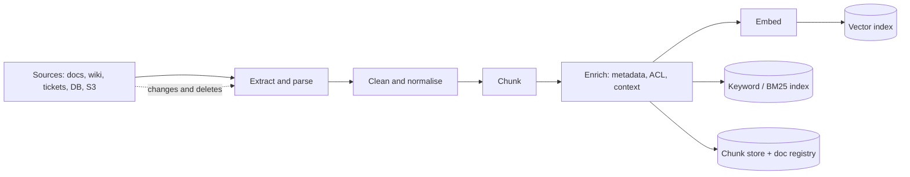

# RAG Ingestion and Indexing Pipeline

> [!abstract] What this is
> The offline half of RAG, which decides most of its quality: getting documents out of their sources, **parsing** them faithfully, **chunking** them well, attaching the right **metadata** (including access control), choosing and running an **embedding model**, writing to the indexes, and keeping everything **fresh** as sources change and get deleted. The decision this helps with: what a "retrievable unit" is, and how it stays correct over time.

---

## Why It Exists

- Most "the RAG gives wrong answers" bugs are ingestion bugs: a table parsed into word soup, an answer split across two chunks, a chunk with no context ("it increased by 12%" — what did?), a deleted policy still being retrieved, a document visible to the wrong tenant.
- No reranker or prompt can recover information that ingestion destroyed. Retrieval quality is capped by what you indexed.

---

## The Pipeline



- It's a classic data pipeline ([[20 - Data Processing and Analytics]]): batch for the initial load, incremental (ideally CDC-driven) for updates, idempotent at every stage so re-runs don't duplicate chunks.
- Keep three stores in sync: the **vector index**, a **keyword index** for hybrid search ([[08 - Vector DB Internals and Hybrid Search]]), and a **document registry** (doc id, version, content hash, chunk ids, ACL, timestamps) that makes updates and deletes possible.

---

## Parsing

| Source | Pitfall | Approach |
|---|---|---|
| **PDFs** | Multi-column layouts read across columns; headers/footers repeated on every page; tables flattened into nonsense; scanned pages have no text layer | Layout-aware parsers (e.g. Docling, Unstructured, PyMuPDF with layout), OCR for scans; for complex visual documents, a vision model to extract structure, or embedding page images directly (ColPali-style, [[09 - Durable Execution HITL and Realtime UX]]) |
| **Tables** | Rows lose their column headers when chunked | Convert to Markdown/HTML tables or to one sentence per row ("Plan Gold: price ₹999, limit 10 users"); keep header rows with every table chunk |
| **HTML / wikis** | Navigation, cookie banners, sidebars | Boilerplate removal; keep heading hierarchy |
| **Slides, spreadsheets** | Meaning lives in layout and cell positions | Per-slide / per-sheet extraction with titles |
| **Code** | Splitting mid-function | Language-aware splitting by function/class (AST) |
| **Structured DB rows** | Not documents at all | Often better served by a SQL tool than by embedding ([[07 - Agentic RAG and Grounding Loops]]) |

- Preserve **structure** as you parse: headings, section paths ("Refund Policy > International > Exceptions"), page numbers and source URLs. They become metadata, chunk boundaries and citation anchors.
- Always **inspect parsed output** on a sample; parsing quality is invisible from metrics alone.

---

## Chunking

- A **chunk** is the unit you embed and retrieve. Too large: the embedding averages several topics, retrieval gets fuzzy, and you waste context. Too small: the chunk lacks the context needed to answer. Common starting points (heuristics, tune with evals) are a few hundred tokens per chunk with ~10–20% overlap.

| Strategy | How it works | Gains | Costs | Pick when |
|---|---|---|---|---|
| **Fixed-size with overlap** | N tokens per chunk, sliding with overlap | Simple, predictable | Cuts mid-sentence and mid-section | Baseline; uniform prose |
| **Recursive / structure-aware** | Split on headings, then paragraphs, then sentences, until under the size limit | Respects document structure | Uneven sizes | Default for docs, wikis, Markdown |
| **Semantic chunking** | Split where embedding similarity between adjacent sentences drops (topic shift) | Topic-coherent chunks | Extra embedding cost; sensitive to thresholds | Long unstructured text (transcripts) |
| **Parent-child (small-to-big)** | Index small chunks for precise matching, but return their **larger parent** section to the model | Precise retrieval *and* enough context | Two levels to store | Most production RAG |
| **Sentence window** | Retrieve a sentence, return it with ±k neighbouring sentences | Precise + local context | Context may still be insufficient | FAQ-like, fact lookup |
| **Contextual chunk headers / contextual retrieval** | Prepend a short context to each chunk before embedding ("From the 2026 Refund Policy, International section: ...") — often LLM-generated per chunk | Chunks become self-describing; big retrieval gains reported | One LLM call per chunk at ingestion (cacheable) | Chunks that are ambiguous out of context |
| **Late chunking** | Embed the whole document with a long-context embedding model, then pool token embeddings per chunk | Each chunk embedding "knows" the document | Needs a long-context model that supports it | Long, interdependent documents |

```python
from dataclasses import dataclass
import hashlib

@dataclass
class Chunk:
    chunk_id: str
    doc_id: str
    doc_version: str
    text: str            # what gets embedded (with contextual header)
    parent_text: str     # what gets returned to the model
    metadata: dict

def chunk_document(doc, max_tokens=400, overlap=60) -> list[Chunk]:
    chunks = []
    for section in split_by_headings(doc.markdown):                  # structure first
        for i, piece in enumerate(split_by_tokens(section.text, max_tokens, overlap)):
            header = f"Document: {doc.title}. Section: {section.path}."
            chunks.append(Chunk(
                chunk_id=hashlib.sha256(f"{doc.id}:{section.path}:{i}".encode()).hexdigest()[:16],
                doc_id=doc.id, doc_version=doc.version,
                text=f"{header}\n{piece}",                            # contextual header
                parent_text=section.text,                             # small-to-big
                metadata={"tenant_id": doc.tenant_id, "acl": doc.acl, "source": doc.url,
                          "section": section.path, "updated_at": doc.updated_at,
                          "content_hash": hashlib.sha256(piece.encode()).hexdigest()},
            ))
    return chunks
```

- **Deterministic chunk ids** (from doc id + position) make ingestion **idempotent**: re-processing a document upserts the same ids instead of adding duplicates.

---

## Metadata and Access Control

- Metadata enables **filtering** (tenant, product, language, date), **ranking** (recency), **citations** (source, page, section) and **freshness** (version, hash).
- **Access control belongs at ingestion and query time, not in the prompt.**
    + Store `tenant_id` and an ACL (users, groups, roles) on every chunk, copied from the source system's permissions.
    + At query time, filter by the caller's identity **inside the retrieval query**, before results ever reach the model ([[08 - Vector DB Internals and Hybrid Search]], [[10 - AI Gateway Security and Guardrails]]).
    + When source permissions change, the ACL on chunks must change too, which is part of freshness.
- A model that never sees a forbidden chunk can't leak it; "please don't reveal confidential documents" in a prompt is not a control.

---

## Choosing an Embedding Model

| Factor | Why it matters |
|---|---|
| **Domain and language fit** | General models underperform on legal, medical, code or Indian-language text; test on your data |
| **Retrieval quality on *your* eval set** | Public leaderboards (e.g. MTEB) are a starting shortlist, not the answer |
| **Dimension** | Higher dims cost more RAM and compute per vector; Matryoshka models let you truncate ([[08 - Vector DB Internals and Hybrid Search]]) |
| **Max input length** | Text beyond the limit is silently truncated |
| **Query vs document modes** | Many models expect different prefixes or task types for queries and passages ("query:" / "passage:"); mixing them up hurts recall |
| **Hosted vs self-hosted** | Cost per million tokens, latency, data residency |
| **Lock-in** | Vectors from different models are **not comparable**; changing models means re-embedding everything |

- Changing the embedding model is a **full migration**: dual-write a new index, backfill, shadow-compare retrieval quality, then switch ([[11 - Evals Observability and Silent Drift]], [[12 - Schema Changes and Backups]]). Store the model name and version on every vector.

---

## Freshness: Updates and Deletes

- Sources change constantly; a stale or deleted document that's still retrievable produces confidently wrong (or non-compliant) answers.

| Mechanism | How | Pick when |
|---|---|---|
| **Full re-index** | Rebuild everything on a schedule, swap atomically (alias swap) | Small corpora; after chunking or model changes |
| **Incremental by content hash** | On change, re-parse the doc; re-embed only chunks whose hash changed; delete chunk ids that disappeared | Default for documents |
| **CDC / webhooks from the source** | Source emits change events (DB CDC, Confluence/Drive webhooks) into the ingestion queue | Near-real-time freshness ([[07 - Async Messaging]]) |
| **TTL / expiry metadata** | Chunks carry `valid_until`; filtered out at query time | Time-bound content (offers, notices) |

```python
def reingest(doc) -> None:
    old = registry.chunk_hashes(doc.id)                          # {chunk_id: content_hash}
    new_chunks = chunk_document(doc)
    new = {c.chunk_id: c.metadata["content_hash"] for c in new_chunks}

    changed = [c for c in new_chunks if old.get(c.chunk_id) != new[c.chunk_id]]
    removed = [cid for cid in old if cid not in new]

    vectors.upsert(changed, embeddings=embed([c.text for c in changed]))   # only what changed
    keyword_index.upsert(changed)
    vectors.delete(removed); keyword_index.delete(removed)                 # deletes are not optional
    registry.save(doc.id, doc.version, new)
```

- **Deletes**: when a source document is deleted or access is revoked, its chunks must be removed from **every** index and any caches; for compliance ("right to be forgotten"), deletion has to be provable ([[18 - Security]]).
- **Versioning**: keep `doc_version` on chunks so answers can cite the version used, and so stale chunks from a previous version can be found and purged.
- **Deduplication**: the same content in several places (copied wiki pages, email threads) wastes retrieval slots; dedupe by content hash or near-duplicate detection (MinHash, embedding similarity).

---

## Measuring Ingestion Quality

- Evaluate retrieval separately from generation ([[11 - Evals Observability and Silent Drift]]):
    + Build a set of real questions with the chunks or documents that answer them.
    + Measure **recall@k** (is a correct chunk in the top k?), **MRR** (how high is the first correct one?), and **context precision** (how much of what's retrieved is relevant).
    + Change one thing at a time (chunk size, strategy, embedding model, contextual headers) and re-run.

---

## Failure Modes

| Failure | What happens | Mitigation |
|---|---|---|
| **Broken parsing** | Tables and multi-column text become garbage; answers are wrong or missing | Layout-aware parsers; table-to-text; inspect samples |
| **Context-free chunks** | "It rose 12%" retrieved with no subject | Contextual headers; parent-child retrieval |
| **Answer split across chunks** | Neither half retrieves well | Structure-aware splitting; overlap; parent sections |
| **Duplicate chunks on re-run** | Same content retrieved several times | Deterministic chunk ids; upserts |
| **Stale or deleted content retrieved** | Outdated policy cited | Content-hash incremental updates; CDC; propagate deletes everywhere |
| **ACL not enforced in retrieval** | Users see other tenants' or restricted documents | ACL metadata on chunks; filter inside the query |
| **Query/document prefix mismatch** | Recall quietly drops | Follow the model's query/passage conventions |
| **Mixed embedding models in one index** | Similarity scores meaningless | Model version on every vector; migrate by dual-write and backfill |

---

## Interview Lines

> [!tip] Say it like this
> - "Most RAG quality is decided at ingestion: parsing, chunking and metadata cap what retrieval can ever find."
> - "I chunk by document structure, index small chunks but return the parent section, and prepend a contextual header so each chunk makes sense alone."
> - "Every chunk carries tenant and ACL metadata, and permissions are enforced inside the retrieval query, not in the prompt."
> - "Ingestion is idempotent with deterministic chunk ids; updates re-embed only changed chunks, and deletes propagate to every index."
> - "Changing the embedding model means re-embedding everything, so I dual-write a new index and compare before switching."

## Related Notes

- [[07 - Agentic RAG and Grounding Loops]] · [[08 - Vector DB Internals and Hybrid Search]] · [[11 - Evals Observability and Silent Drift]] · [[20 - Data Processing and Analytics]]
- [[Agentic/README]]
