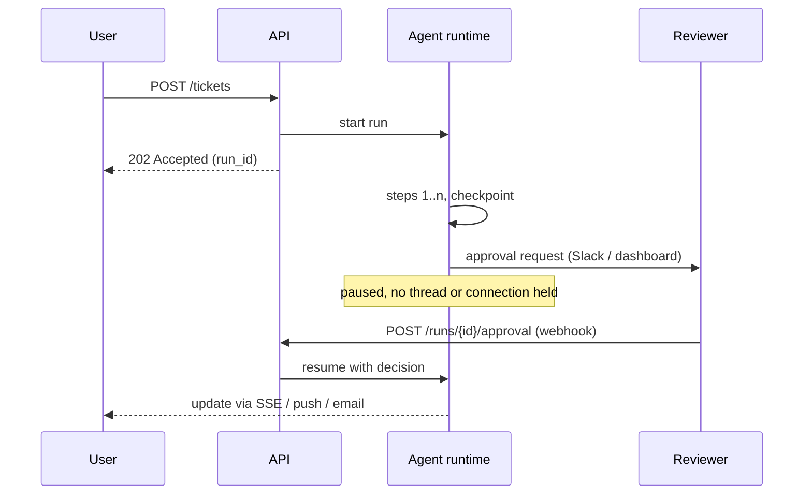

# Durable Execution, HITL and Realtime UX

> [!abstract] What this is
> Making long-running agents survive crashes and wait for people, and making them feel fast: **durable execution** (event-sourced replay, Temporal), **checkpointing** agent state per step, **human-in-the-loop** approvals without blocked connections, **streaming** tokens and progress (SSE vs WebSockets), and realtime **voice** agents (WebRTC, voice activity detection, barge-in), plus visual document retrieval (ColPali). The decision this helps with: where agent state lives between steps, and how results reach the user.

---

## Why It Exists

- Agent runs take seconds to hours and span many paid model calls and side effects. If the process crashes at step 8 of 10:
    + restarting from zero **re-pays** for every inference call, and
    + re-executes side effects (a second refund, a second email).
- Some steps need a **human** (approve a refund over ₹5,000), which can take minutes or days. Holding an HTTP connection or a thread open for that is fragile and wasteful.
- Meanwhile users judge speed by when **something appears**, not by when the run finishes.

---

## Durable Execution

- **Durable execution** means the runtime records every step's result, so after a crash the run **resumes where it stopped** instead of starting over. Two common implementations:

### 1. Event-sourced replay (Temporal model)

- Code is split into:
    + **Workflows**: orchestration logic that must be **deterministic** (no direct I/O, no random numbers, no wall-clock reads; use the SDK's versions).
    + **Activities**: anything non-deterministic or side-effecting: LLM calls, tool calls, DB writes, emails. They have timeouts and retry policies.
- The server stores an **event history** of every activity result. On recovery, a worker **replays** the workflow code; completed activities return their recorded results **instantly without re-running**, so the code reaches the crash point and continues.

```python
from datetime import timedelta
from temporalio import workflow, activity
from temporalio.common import RetryPolicy

@activity.defn
async def call_llm(messages: list[dict]) -> dict: ...          # paid call: recorded once

@activity.defn
async def issue_refund(order_id: str, amount: int, idem_key: str) -> dict: ...

@workflow.defn
class RefundAgent:
    def __init__(self):
        self.approved: bool | None = None

    @workflow.signal
    def approval(self, approved: bool) -> None:               # human decision arrives as a signal
        self.approved = approved

    @workflow.run
    async def run(self, ticket: dict) -> str:
        retry = RetryPolicy(maximum_attempts=3)
        decision = await workflow.execute_activity(
            call_llm, [{"role": "user", "content": ticket["text"]}],
            start_to_close_timeout=timedelta(seconds=60), retry_policy=retry)
        if decision["amount"] > 5000:
            await workflow.wait_condition(lambda: self.approved is not None,
                                          timeout=timedelta(days=2))   # waits durably: no thread held
            if not self.approved:
                return "rejected"
        await workflow.execute_activity(
            issue_refund, args=[ticket["order_id"], decision["amount"],
                                f"{workflow.info().workflow_id}:refund"],   # deterministic idempotency key
            start_to_close_timeout=timedelta(seconds=30), retry_policy=retry)
        return "refunded"
```

- Activities can still run **more than once** (a retry after a timeout where the work actually happened), so side-effecting activities still need **idempotency keys** ([[03 - Tool Engineering and Action Spaces]]). Durable execution gives *exactly-once workflow progress*, not exactly-once side effects.
- Other engines with the same idea: AWS Step Functions, Azure Durable Functions, Restate, DBOS, Inngest. This is the saga orchestrator from HLD with a durable state store ([[10 - Distributed Building Blocks]]).

### 2. Checkpointing (graph runtimes)

- Agent graph frameworks persist the **state after every node** to a store (Postgres, Redis, SQLite), keyed by a thread or run id. On crash or pause, load the latest checkpoint and continue from the next node ([[02 - Execution Loops and Control Topologies]]).

```python
from langgraph.checkpoint.postgres import PostgresSaver

with PostgresSaver.from_conn_string(DB_URL) as saver:
    saver.setup()
    app = graph.compile(checkpointer=saver)
    cfg = {"configurable": {"thread_id": "ticket-9812"}}
    app.invoke({"messages": [("user", text)]}, config=cfg)     # state saved after each node
    # after a crash, invoking again with the same thread_id resumes from the last checkpoint
```

| | Event-sourced replay (Temporal) | Per-node checkpoints (LangGraph-style) |
|---|---|---|
| What's stored | Every activity result in an event history | Full state snapshot after each node |
| Recovery | Replay deterministic code, skipping completed activities | Load latest snapshot, run the next node |
| Strengths | Battle-tested retries, timers, signals, long waits (days/months), visibility | Natural for agent graphs; easy inspection, time travel and forking of runs |
| Watch out | Determinism rules; versioning workflow code changes | State must be serialisable; large state means large checkpoints |
| Pick when | Business-critical, long-running, many side effects | Agent-centric apps; moderate durability needs |

- **Serialisation discipline**: checkpointed state must be plain, versioned data (Pydantic models, JSON). No open connections, file handles or framework objects in state; add a schema version so old checkpoints can still be loaded after a deploy.

---

## Human-in-the-Loop (HITL)

- Patterns:
    + **Approve / reject** an action before it runs (refunds, sending emails, deleting data, executing code).
    + **Edit** the agent's proposed action or draft.
    + **Answer a question** the agent can't resolve (missing information, ambiguity).
    + **Review after the fact** (sampled audits) for low-risk actions.
- The mechanism is always the same: **pause durably, notify, resume on an event.**



```python
from langgraph.types import interrupt, Command

def approve_refund(state):
    decision = interrupt({"type": "refund_approval",        # saves state and stops here
                          "order_id": state["order_id"], "amount": state["amount"]})
    return {"approved": decision == "approve"}

# ...later, from the approval webhook handler:
app.invoke(Command(resume="approve"), config={"configurable": {"thread_id": run_id}})
```

- Rules:
    + **Never block a synchronous HTTP request** waiting for a human. Return `202 Accepted` with a run id; deliver results by SSE, polling, push or webhook ([[03 - Networking and APIs]]).
    + **Timeouts** on every approval (auto-reject or escalate after N hours).
    + **Show reviewers the exact action and context**, not the whole transcript; record who approved what (audit log).
    + **Re-validate on resume**: the world may have changed while waiting (the order was already refunded).
    + The approval endpoint itself needs authentication and authorisation, or it becomes a bypass.

---

## Streaming

- Streaming makes **perceived latency ≈ time to first token** ([[00 - LLM Fundamentals for Engineers]]). For agents, stream **progress events** too ("Searching orders…", "Checking refund policy…"), not just final tokens.

| Transport | Direction | Fits | Watch out |
|---|---|---|---|
| **Server-Sent Events (SSE)** | Server → client over plain HTTP | Token streaming, progress updates; the default for chat UIs | One-way; proxies with buffering must be configured to flush |
| **WebSockets** | Bidirectional, persistent | Clients that also stream (voice, collaborative editing, cancel/interrupt mid-stream) | Sticky connections, LB and scaling work ([[04 - Load Balancing CDN and Gateway]]) |
| **Polling / long polling** | Client pulls | Simple job status, background runs | Latency, wasted requests |
| **Webhooks / push** | Server → another server / device | Long-running runs finishing later | Sender verification ([[03 - Networking and APIs]]) |

```python
from fastapi import FastAPI
from fastapi.responses import StreamingResponse
import json

app = FastAPI()

@app.get("/runs/{run_id}/stream")
async def stream(run_id: str):
    async def events():
        async for ev in agent_events(run_id):          # {"type": "token"|"tool"|"done", ...}
            yield f"event: {ev['type']}\ndata: {json.dumps(ev)}\n\n"
    return StreamingResponse(events(), media_type="text/event-stream",
                             headers={"Cache-Control": "no-cache", "X-Accel-Buffering": "no"})
```

- Production details:
    + **Resumable streams**: give events ids and support `Last-Event-ID`, or let the client reconnect and fetch the run's state, so a dropped mobile connection doesn't lose the answer.
    + **Decouple generation from the connection**: the run continues (and is checkpointed) if the client disconnects; the stream is just a view.
    + **Cancellation**: a "stop" button must cancel the model call and pending tools, not just close the socket.
    + **Streaming + structured output**: parse partial JSON or stream a text field while structured fields arrive at the end; validate only the final result.
    + **Moderation on streams**: output guardrails can't see the whole answer yet; check incrementally by sentence, or delay display slightly for high-risk surfaces ([[10 - AI Gateway Security and Guardrails]]).

---

## Realtime Voice Agents

### Two architectures

| Architecture | How it works | Gains | Costs |
|---|---|---|---|
| **Cascaded (STT → LLM → TTS)** | Speech-to-text streams a transcript, the LLM replies, text-to-speech speaks it | Any LLM, tools, guardrails and logging on text; easy to debug | Latency adds up across three stages; loses tone and emotion |
| **Speech-to-speech (native audio models)** | One model consumes and produces audio directly | Lowest latency; natural prosody | Fewer model choices; harder to inspect, guard and evaluate |

- Target: humans expect a reply within roughly **half a second to a second** after they stop speaking (heuristic). Every stage must stream: STT partials, LLM tokens, TTS starting on the first sentence.

### Transport

- **WebRTC** for client audio: built for realtime media over UDP, with jitter buffers, echo cancellation and packet-loss handling. **WebSockets** carry audio acceptably for server-to-server or controlled networks but suffer head-of-line blocking on lossy mobile links ([[03 - Networking and APIs]]). Telephony arrives via SIP/PSTN gateways.

### Turn-taking, VAD and barge-in

- **Voice Activity Detection** (e.g. Silero VAD) classifies short audio frames as speech or silence. It drives:
    + **End-of-turn detection**: the user stopped speaking (silence threshold, ideally plus a semantic turn-detection model so a pause mid-sentence isn't treated as the end).
    + **Barge-in**: the user starts talking while the agent is speaking.
- Barge-in failure is the classic bug: the agent keeps talking for seconds after being interrupted because audio was already generated and buffered downstream. On detected user speech the system must, immediately:
    1. **Stop playback** and **flush every audio buffer** (TTS output queue, network jitter buffer, client player).
    2. **Cancel** the in-flight LLM generation and TTS synthesis.
    3. **Truncate the transcript** to what was actually spoken, so the model's history matches what the user heard.
    4. Start listening to the new turn.

```python
async def on_vad_speech_start(session):
    if session.agent_speaking:
        session.player.clear()                 # client/output buffers
        session.tts_task.cancel()               # stop synthesising
        session.llm_task.cancel()               # stop generating
        session.history.truncate_assistant_to(session.player.spoken_text())
        session.agent_speaking = False
```

### Visual document retrieval (ColPali)

- For documents where meaning lives in layout (slides, scanned forms, charts), **ColPali**-style models embed **page images** directly with a vision-language model and use late-interaction (ColBERT-style) matching, skipping OCR and parsing. Strong for visually rich corpora; costs more storage per page than text chunks ([[06 - RAG Ingestion and Indexing Pipeline]], [[08 - Vector DB Internals and Hybrid Search]]).

---

## Failure Modes

| Failure | What happens | Mitigation |
|---|---|---|
| **Crash mid-run restarts from zero** | Paid inference re-run; side effects duplicated | Durable execution or per-node checkpoints; idempotency keys on side effects |
| **Non-deterministic workflow code** | Replay diverges and fails after deploy | Keep I/O in activities; use SDK time/random; version workflow changes |
| **Unserialisable or unversioned state** | Old checkpoints can't load after a deploy | Plain, versioned state models |
| **Blocking HTTP for human approval** | Timeouts, held threads, lost decisions | 202 + run id; durable pause; webhook/signal resume |
| **Approval with stale context** | Approved action no longer valid when resumed | Re-validate state on resume; approval timeouts |
| **Stream tied to the connection** | Dropped connection loses the answer | Decouple run from stream; resumable event ids |
| **Barge-in failure** | Voice agent keeps talking after interruption | VAD-triggered buffer flush, cancel generation and TTS, truncate history |
| **Premature end-of-turn** | Agent interrupts the user mid-thought | Tune silence thresholds; semantic turn detection |

---

## Interview Lines

> [!tip] Say it like this
> - "Durable execution records each activity's result, so after a crash the workflow replays past completed steps instead of re-paying for them; side effects still carry idempotency keys."
> - "Agent graphs checkpoint state after every node to Postgres, keyed by thread id, so runs can resume, pause for humans and be inspected."
> - "Human approval never blocks an HTTP request: I return 202 with a run id, pause durably, and resume from the approval webhook after re-validating."
> - "I stream tokens and progress over SSE, decoupled from the run, and use WebSockets or WebRTC only when the client streams too."
> - "For voice, barge-in must flush every audio buffer and cancel generation the moment VAD detects speech."

## Related Notes

- [[02 - Execution Loops and Control Topologies]] · [[03 - Tool Engineering and Action Spaces]] · [[10 - Distributed Building Blocks]] · [[03 - Networking and APIs]]
- [[Agentic/README]]
