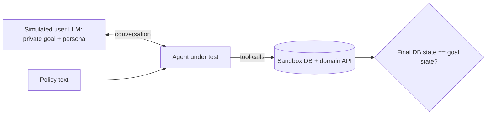
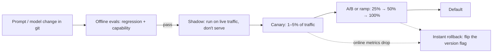

# Evals, Observability and Silent Drift

> [!abstract] What this is
> Knowing whether an AI system works and noticing when it stops: **tracing** every model, tool and retrieval step with tokens and cost (OpenTelemetry), a **three-tier evaluation** strategy (deterministic checks, trajectory analysis, outcome verification), **LLM-as-a-judge** and its biases, building **eval datasets** and running them in CI, putting **error bars** on scores (standard errors, clustering, paired tests, power), **detecting hallucinations** without a reference, catching **silent drift** in production, **quality SLOs and incident response**, the risks of **semantic caching**, and **migrating embedding models** without downtime. The decision this helps with: what to measure, how to trust the measurement, and what to alert on.

---

## Why It Exists

- AI systems fail **silently**. A broken service returns 500s; a broken agent returns 200 OK with a plausible, wrong answer, or quietly loops through retries that triple the cost.
- Outputs are non-deterministic and quality is subjective, so normal unit tests don't cover it. Without evals, every prompt change, model upgrade or index rebuild is a guess.

---

## Observability: Tracing AI Systems

- One **trace** per request or agent run; one **span** per step: each LLM call, tool call, retrieval, rerank, guardrail check and sub-agent. This is distributed tracing ([[11 - Services and Observability]]) with AI-specific attributes.

| Attribute | Why |
|---|---|
| Model name and version, provider | Attribute regressions to model changes |
| Input, output, cached and reasoning token counts | Cost and latency drivers |
| Computed cost | Per request, per feature, per tenant |
| Latency, time to first token | Where time goes |
| Prompt template id and version | Which prompt produced this |
| Tool name, arguments, result status | Debug trajectories |
| Retrieved chunk ids and scores | Debug RAG |
| Run / thread / tenant / user ids | Correlation and attribution |
| Finish reason, error types | Truncation, refusals, failures |

- OpenTelemetry has **GenAI semantic conventions** for these attributes, so traces can flow to general backends (Datadog, Grafana, Honeycomb) and LLM-specific tools (Langfuse, LangSmith, Arize Phoenix, and others).

```python
from opentelemetry import trace
tracer = trace.get_tracer("support-agent")

def traced_llm_call(messages, model, step: int):
    with tracer.start_as_current_span("chat " + model) as span:
        span.set_attribute("gen_ai.request.model", model)
        span.set_attribute("agent.step", step)
        resp = gateway.chat(model=model, messages=messages)
        span.set_attribute("gen_ai.usage.input_tokens", resp.usage.prompt_tokens)
        span.set_attribute("gen_ai.usage.output_tokens", resp.usage.completion_tokens)
        span.set_attribute("llm.cost_usd", price(model, resp.usage))
        span.set_attribute("gen_ai.response.finish_reasons", [resp.choices[0].finish_reason])
        return resp
```

- Prompts and outputs in traces are sensitive data: redact, restrict access and set retention ([[10 - AI Gateway Security and Guardrails]]).

### Production metrics to dashboard and alert on

| Metric | Catches |
|---|---|
| **Task success rate** (from outcome checks, user feedback, escalations) | Quality regressions |
| **Cost per task** and tokens per task | Retry loops, context bloat, routing mistakes |
| **Steps per task**, repeated-action rate | Looping agents ([[02 - Execution Loops and Control Topologies]]) |
| **Tool error rate** by tool | Broken upstream APIs |
| **Latency p50/p95/p99**, TTFT | Provider slowdowns, prompt growth |
| **Refusal / abstention rate** | Over-cautious changes, or retrieval failures |
| **Truncation rate** (finish reason = length) | Output caps too low |
| **Guardrail trigger rate** | Attacks, or over-blocking |
| **User signals**: thumbs, edits, retries, handoff to human | Real-world dissatisfaction |

---

## Three-Tier Evaluation

| Tier | Question | Examples | Cost | Run when |
|---|---|---|---|---|
| **1. Unit / deterministic** | Does each step behave correctly? | Output parses against the schema; router picked the right label; tool chosen and arguments correct; required fields present; regex/exact match; latency and token limits | Cheap, fast, reliable | Every commit in CI |
| **2. Trajectory** | Did the agent take a reasonable path? | Called the right tools in a sensible order; no forbidden actions; no repeated calls; within step budget; asked for approval when required | Medium; needs traces | CI on agent changes; sampled production |
| **3. Outcome** | Did the task actually succeed? | Final environment state is correct (refund recorded once, ticket closed, tests pass); answer correct against a reference; RAG answer faithful to sources | Expensive (sandbox environments, judges, humans) | Before releases; nightly; sampled production |

- Prefer **outcome checks against real state** over judging the text: "the refund row exists exactly once with amount 499" beats "the reply sounds like it refunded".
- For RAG, evaluate retrieval and generation separately:
    + **Retrieval**: recall@k, MRR, context precision ([[06 - RAG Ingestion and Indexing Pipeline]]).
    + **Generation**: **faithfulness** (claims supported by retrieved context), **answer relevance**, **correctness** vs a reference, and correct **abstention** when the answer isn't in the corpus. Libraries like RAGAS package these metrics.

```python
def eval_case(case) -> dict:
    run = agent.run(case.input, sandbox=fresh_env(case.fixtures))
    return {
        "schema_ok": run.final.validates(),                                  # tier 1
        "tools_ok": set(case.required_tools) <= set(run.tools_called()),     # tier 2
        "no_forbidden": not (set(run.tools_called()) & set(case.forbidden_tools)),
        "steps_ok": run.steps <= case.max_steps,
        "outcome_ok": case.check_state(run.env),                             # tier 3: real state
    }
```

- **Retrieval metrics in one line each** (detail in [[06 - RAG Ingestion and Indexing Pipeline]]):
    + **recall@k**: share of questions where a correct chunk is in the top k. Measures "did we fetch it at all".
    + **MRR** (mean reciprocal rank): average of `1 / rank of the first correct chunk`. Rewards putting one right answer high.
    + **nDCG@k** (normalised discounted cumulative gain): uses graded relevance and discounts by position (`relevance / log2(rank + 1)`), normalised against the ideal ordering. Use it when several chunks are relevant to different degrees, for example to judge a reranker.
    + **context precision**: share of retrieved chunks that are relevant. Low precision means noise in the prompt.

### How the RAG metrics are computed

- A RAG answer can fail in the retriever or in the generator, and they fail separately, so you need metrics for both. The names below are the ones RAGAS uses; other libraries compute them the same way.

| Metric | Measures | Needs | How it's computed |
|---|---|---|---|
| **Faithfulness** | Is every claim in the answer supported by the retrieved context? (hallucination check) | Answer + retrieved context | Split the answer into atomic claims; a judge (LLM or NLI model) marks each claim supported or not by the context; score = supported ÷ total |
| **Answer relevancy** | Does the answer address the question asked? | Question + answer | Generate a few questions the answer would fit; average their embedding similarity to the real question. Evasive or off-topic answers score low |
| **Context precision** | Are the relevant chunks ranked near the top? | Question + retrieved chunks (+ reference) | Judge each retrieved chunk relevant or not, then average precision@k over the positions of the relevant ones, so relevant chunks ranked low cost more |
| **Context recall** | Did retrieval fetch everything needed? | Reference answer + retrieved context | Split the **reference** answer into claims; score = share that can be attributed to the retrieved context |
| **Citation accuracy** | Do cited sources actually support the sentence they're attached to? | Answer with citations + cited chunks | For each citation: the id exists, any quote is verbatim, and the chunk supports the claim ([[07 - Agentic RAG and Grounding Loops]]) |
| **Abstention accuracy** | Does it say "I don't know" when the corpus has no answer? | Unanswerable questions in the eval set | Share of unanswerable cases where the system declines instead of answering |

- Reading them together tells you where to fix:

| Pattern | Diagnosis | Fix |
|---|---|---|
| Low context recall | Retrieval missed needed facts | Chunking, hybrid search, query rewriting, higher k ([[06 - RAG Ingestion and Indexing Pipeline]]) |
| Good recall, low context precision | Right chunks retrieved but buried in noise | Reranker; lower k after reranking |
| Good context metrics, low faithfulness | The model goes beyond the sources | Answer-only-from-sources instruction, abstention, citation verification |
| High faithfulness, low answer relevancy | Grounded but doesn't answer the question | Prompt and question understanding, not retrieval |

```python
CLAIMS_PROMPT = "Split this answer into short standalone factual claims. Return a JSON list of strings.\n\n{answer}"
VERDICT_PROMPT = ("Context:\n{context}\n\nClaim: {claim}\n"
                  "Is the claim fully supported by the context? Answer yes or no.")

def faithfulness(llm, answer: str, chunks: list[str]) -> float:
    claims = json.loads(llm(CLAIMS_PROMPT.format(answer=answer)))
    if not claims:
        return 1.0                                       # nothing asserted, nothing unsupported
    context = "\n\n".join(chunks)
    supported = sum(llm(VERDICT_PROMPT.format(context=context, claim=c)).strip().lower().startswith("yes")
                    for c in claims)
    return supported / len(claims)
```

- **Caveats to say out loud:**
    + These are **LLM-judged**, so they inherit judge bias and noise: calibrate the judge against 100–200 human labels before trusting the numbers (LLM-as-a-Judge below).
    + Faithfulness isn't correctness: an answer faithful to a **stale or wrong** chunk scores 1.0. Pair it with correctness against a reference.
    + Context recall needs **reference answers**, so it only runs on the labelled eval set, not on live traffic. Faithfulness and answer relevancy need no reference, so they can score sampled production traffic.
    + Starting thresholds one practitioner guide suggests: faithfulness > 0.80, answer relevancy > 0.85, context precision > 0.75, context recall > 0.80. Treat these as a first target; set real ones from your own baseline and what users tolerate.

---

## Evaluating Multi-Turn Agents: Simulated Users, State Grading and pass^k

- Single-turn evals don't cover the agents people actually deploy: a support or booking agent holds a **conversation**, asks clarifying questions, follows **business policy** and changes **real state**. The standard method for this comes from **τ-bench** (Sierra, 2024).

### The method

1. **Environment**: a sandbox database plus the agent's real tools (the domain API) and a written **policy** ("refunds only within 7 days; confirm with the user before any change").
2. **Simulated user**: another LLM plays the customer, given a private goal and persona ("you want to exchange the blue shirt for size L; you don't remember the order id"). It answers the agent's questions and pushes back like a person would.
3. **Grading on state, not transcript**: when the conversation ends, compare the **database** with an annotated **goal state**. An agent that says "I've processed your exchange" but never called the tool scores zero; fluency counts for nothing.
4. **Repeat each task k times** and report **pass^k**.



### pass^k vs pass@k

- **pass@k**: the chance that **at least one** of k attempts succeeds. Right for code generation, where you can run tests and keep the one that passes.
- **pass^k** ("pass-hat-k"): the chance that **all** k attempts succeed, averaged over tasks. Right for agents that get **one attempt per customer** and can't check their own work. It measures **reliability**, not capability.
- Example from the original τ-bench leaderboard (one 2024 model, retail domain): pass^1 69.2% falling to pass^4 46.2%. At 1,000 conversations a day, 69% success is still about 300 failed customers a day.
- **Read the distribution, not the mean.** Keep per-task outcomes across the k runs and split tasks into three groups:
    + **always pass**: solved;
    + **always fail**: usually a missing tool, an ambiguous policy or an impossible goal, not a model problem. Later analysis found annotation errors and underspecified tasks capping τ-bench scores;
    + **sometimes pass**: the only group where a better model or prompt is the fix.

```python
def pass_hat_k(results: dict[str, list[bool]], k: int) -> float:
    """results: task_id -> outcomes of n >= k independent trials. Unbiased estimator."""
    from math import comb
    total = 0.0
    for outcomes in results.values():
        n, c = len(outcomes), sum(outcomes)
        total += comb(c, k) / comb(n, k)          # P(k trials drawn from n all succeed)
    return total / len(results)
```

### Simulated users are part of the measurement

- The user simulator is an LLM too, so a score describes the **agent plus simulator pair**. Research in 2026 found agent success rates varying by up to **9 percentage points** depending on which model played the user, and simulators that were systematically too easy on hard tasks and too harsh on moderate ones.
- Simulated users also give **more positive feedback** than real people do. Use them for regression and comparison, and calibrate against a sample of real conversations.
- Make simulators adversarial on purpose: personas that withhold information, change their mind, try to talk the agent past the policy, or inject instructions.

### Versions to know

| Version | Adds |
|---|---|
| **τ-bench** (2024) | Airline and retail domains, state grading, pass^k |
| **τ²-bench** (2025) | "Dual control": the user also has tools and acts on the shared environment; a telecom domain |
| **τ³-bench** (2026) | Banking knowledge retrieval, full-duplex voice, and more than 75 task fixes |

- Other agent benchmarks worth naming: **SWE-bench** (fix real GitHub issues, graded by hidden tests), **Terminal-Bench**-style terminal tasks, **WebArena** / OSWorld-style browser and desktop tasks ([[16 - Computer Use and Browser Agents]]). Quote any public score with its version and date; they move fast and task sets get fixed.

---

## LLM-as-a-Judge

- Using a model to grade outputs scales evaluation to open-ended answers, but judges have systematic biases:

| Bias | What happens | Mitigation |
|---|---|---|
| **Position bias** | In pairwise comparison, prefers whichever answer appears first (or second) | Evaluate both orders; count only consistent wins |
| **Verbosity bias** | Prefers longer answers | Rubrics that reward concision; length-controlled comparisons |
| **Self-preference** | Rates outputs from its own model family higher | Judge with a different model family |
| **Leniency / score inflation** | Everything gets 4/5 | Binary pass/fail criteria instead of 1–10 scales |
| **Format sensitivity** | Markdown or confident tone scores higher | Rubric focused on specific checkable criteria |

- Making judges trustworthy:
    + **Binary, specific rubrics**: "Does the answer state the refund window as 7 days? yes/no" instead of "rate helpfulness 1–10". Break quality into several yes/no checks.
    + **Give the judge the reference** answer or the source context when available.
    + **Calibrate against humans**: label 100–200 cases yourself, measure judge–human agreement (accuracy, Cohen's kappa), and iterate on the rubric until agreement is high; re-check periodically.
    + Ask for a short **reason before the verdict**, and log both.

```python
JUDGE_RUBRIC = """You are grading a support answer against the policy excerpt.
Answer each with yes or no, then give one-sentence reasons.
1. Every factual claim is supported by the policy excerpt.
2. The refund window stated (if any) matches the policy.
3. The answer does not promise anything the policy doesn't allow.
Return JSON: {"supported": "...", "window_correct": "...", "no_overpromise": "...", "reasons": "..."}"""
```

---

## Eval Datasets and CI

- **Where cases come from:**
    + Real production traffic (sampled, anonymised), especially failures, escalations and thumbs-down.
    + Every **incident** becomes a regression case.
    + **Adversarial** cases: prompt injection, out-of-scope questions, unanswerable questions, edge-case inputs.
    + Coverage across intents, languages, tenants and difficulty.
- **Hygiene:**
    + Version the dataset with the code; record expected outcomes or rubrics per case.
    + Keep a **held-out** set you don't tune against, or you'll overfit prompts to the eval.
    + Run multiple samples per case for non-deterministic components and report pass rates with variance.
- **In CI:** run tier-1 checks on every change; run trajectory and outcome suites on prompt, model, tool or retrieval changes; **block merges** on regressions beyond a threshold; show per-case diffs, not just one score.
- **Online evaluation:** score a sample of production traffic continuously with the same judges and checks, so quality is a live metric.

---

## Designing Agent Evals You Can Trust

Practices from Anthropic's January 2026 guide to agent evals, drawn from its own and customers' production agents.

### Vocabulary

| Term | Meaning |
|---|---|
| **Task** | One test case: inputs and success criteria |
| **Trial** | One attempt at a task; run several because outputs vary |
| **Grader** | Logic scoring one aspect; a task can have several (code, model, human) |
| **Transcript** | The full record of a trial: messages, tool calls, results |
| **Outcome** | The final state of the environment (is the reservation in the database?) |
| **Eval harness** | Runs tasks concurrently, records transcripts, grades, aggregates |
| **Agent harness** | The scaffold that makes the model an agent; an eval measures **model + harness together** |

### Two kinds of suite

- **Capability evals** ask "what can it do?". They should **start at a low pass rate**, on tasks the agent struggles with, so there's a hill to climb.
- **Regression evals** ask "does it still do what it used to?". They should pass **nearly 100%**; any drop means something broke.
- Tasks **graduate**: once a capability task passes reliably, it moves into the regression suite and runs continuously.
- **Saturation**: a suite near 100% shows regressions but no longer shows improvement, and big capability gains look like small score changes. Add harder tasks when a capability suite saturates.

### Building the task set

- **Start small and early**: 20–50 tasks drawn from **real failures** (bug tracker, support queue, things you check by hand before a release) is enough while each change has a large effect.
- **Unambiguous tasks**: two domain experts should independently give the same pass/fail. Everything the grader checks must be stated in the task (a test that expects a file path the task never mentioned fails the agent unfairly).
- **A reference solution per task**: a known output that passes every grader, which proves the task is solvable and the graders are wired correctly.
- **A 0% pass rate across many trials usually means a broken task or grader**, not an incapable agent. Anthropic reports a frontier model scoring 42% on one benchmark until grading bugs (exact-match on `96.12` vs `96.124991…`, ambiguous specs) were fixed; it then scored 95%.
- **Balanced sets**: test both when the behaviour should happen **and when it shouldn't**. If you only test "searches when it should", you get an agent that searches for everything (over-triggering).

### Graders

| Type | Examples | Strengths | Weaknesses |
|---|---|---|---|
| **Code** | Exact/regex match, unit tests, static analysis, state checks, tool-call checks, turn and token counts | Fast, cheap, reproducible | Brittle to valid variations; little nuance |
| **Model** | Rubrics, natural-language assertions, pairwise comparison, reference-based grading | Handles open-ended output | Non-deterministic; must be calibrated against humans |
| **Human** | Expert review, spot checks, A/B tests | The gold standard; calibrates model graders | Slow, expensive |

- Prefer code graders, use model graders where you must, and humans to calibrate.
- **Grade what was produced, not the path taken.** Checking an exact tool-call sequence punishes valid solutions nobody anticipated. Assert on the outcome and on a few necessary steps (identity verified before a refund), not the whole order.
- **Partial credit** for multi-part tasks: an agent that verified the customer and found the problem but didn't issue the refund is better than one that failed at once.
- **One judge per dimension**, each with its own rubric, and give the judge a way out ("return Unknown if the transcript doesn't show it") so it doesn't guess.
- **Make graders hard to game**: passing should require solving the problem, not exploiting a loophole in the check.

### Running and maintaining

- **Isolate every trial**: a fresh environment each time. Leftover files, caches or shared git history make trials correlated, or let the agent "cheat" (Anthropic saw a model read the git history of earlier trials).
- **Read transcripts.** A failure should look fair: the agent did something wrong, not the grader. Don't take a score at face value until someone has read a sample of transcripts behind it.
- **Ownership**: a small team owns the eval infrastructure; product and domain people contribute tasks, the way they'd add unit tests.
- **Eval-driven development**: write the capability eval for a feature before the agent can do it; when a new model ships, the suite shows within days which bets paid off.

### Frameworks to name

- **Harbor** (containerised agent trials at scale; Terminal-Bench ships through it), **Braintrust** (offline evals plus production observability), **LangSmith** and the self-hostable **Langfuse** (tracing, datasets, online and offline evals), **Arize Phoenix** (open-source tracing and evals). A framework is only as good as the tasks and graders in it.

---

## Eval Statistics: Error Bars on Every Score

- An eval score is a **sample mean**: the questions are a sample from the universe of questions you care about, and the model's answers are random too. "Model B scored 82.1% vs A's 80.4%" says nothing until you know how much that number would move on a different draw of questions. Anthropic made this argument in *Adding Error Bars to Evals* (Miller, Nov 2024), and its post-training evaluation job posting asks for statistics and experiment design (datainterview course, 2026).
- The five recommendations from that paper, plus two standard tools:

| # | Do this | Why | Watch out |
|---|---|---|---|
| 1 | **Report a standard error (SE) with every score**: SE = sd / √n; 95% CI = mean ± 1.96 × SE | 500 questions at 80% accuracy gives SE ≈ 1.8 points, so the CI is about ±3.5 points | Assumes questions are independent |
| 2 | **Cluster the SE** when questions share a passage, a repo, a document or a template | Ten questions about one passage carry less information than ten unrelated questions; the naive SE is too small | Anthropic found clustered SEs on popular evals **over 3×** the naive ones; a course on this paper (datainterview, 2026) shows a naive 95% interval covering the truth only **77.3%** of the time on a templated benchmark |
| 3 | **Reduce variance within questions**: sample each question k times and average (with chain of thought), or use the probability of the correct answer token (without it) | Total variance = variance across questions + variance of the model's answers to one question; the second part shrinks with k | More samples per question help less than more questions once answer noise is small |
| 4 | **Compare models with paired differences** on the same questions | Shared question difficulty cancels; Anthropic measured question-score correlations of **0.3–0.7** between frontier models, which makes paired SEs much smaller | Needs per-question results for both models, not two summary numbers |
| 5 | **Size the eval with power analysis** before running it | Tells you whether a 3-point difference is detectable at all with the questions you have | Small evals can only detect large gaps |
| 6 | **Wilson interval** for pass rates with small n or rates near 0% or 100% | At 19/20 the normal interval's upper end is 104.5%; Wilson gives 76.4–99.1% | Use it for safety-style evals with very few failures |
| 7 | **Correct for many comparisons** (Holm for family-wise error, Benjamini-Hochberg for false discovery rate) | Run 20 evals at p < 0.05 and about one "wins" by luck | Pre-register the primary eval so only it decides the release |

- **The arithmetic that comes up**: to detect a 3-point gap at ~80% accuracy (per-question variance ≈ 0.16) with 95% confidence and 80% power, you need **about 1,400 questions** if the two models' scores correlate at 0.5 and you pair them, and **about 2,800** if you don't. Pairing halves the eval.
- **Agent evals add structure**: trials of one task are a cluster, tasks from one repo or one customer are a cluster, and the environment itself is noisy (Anthropic's 2026 note on infrastructure noise: resource limits and timeouts move agentic coding scores). Cluster on the task, repeat trials, and keep the environment configuration fixed between the two arms.
- **Bootstrap** when there is no formula (median latency, pass^k, a ratio of two metrics): resample questions (or clusters) with replacement 1,000+ times, recompute the statistic, and take the 2.5th and 97.5th percentiles.

```python
import math
from statistics import NormalDist, mean, stdev

Z = NormalDist().inv_cdf

def score_with_ci(scores, conf=0.95):
    """Mean and CI. scores: one number per question (0/1, or the mean over k samples)."""
    n, m = len(scores), mean(scores)
    se = stdev(scores) / math.sqrt(n)
    z = Z(0.5 + conf / 2)
    return m, se, (m - z * se, m + z * se)

def wilson(passes, n, conf=0.95):
    """Pass-rate interval that stays inside [0, 1]."""
    z, p = Z(0.5 + conf / 2), passes / n
    centre = (p + z * z / (2 * n)) / (1 + z * z / n)
    half = z / (1 + z * z / n) * math.sqrt(p * (1 - p) / n + z * z / (4 * n * n))
    return centre - half, centre + half

def clustered_se(scores, cluster_ids):
    """Questions sharing a passage/repo/template: sum residuals per cluster first."""
    n, m, sums = len(scores), mean(scores), {}
    for s, c in zip(scores, cluster_ids):
        sums[c] = sums.get(c, 0.0) + (s - m)
    return math.sqrt(sum(v * v for v in sums.values())) / n

def paired_diff(a, b, conf=0.95):
    """Two models on the SAME questions: CI of the per-question difference."""
    return score_with_ci([x - y for x, y in zip(a, b)], conf)

def questions_needed(effect, var_a, var_b, rho, alpha=0.05, power=0.8):
    """Questions to detect `effect` (0.03 = 3 points) with a paired test."""
    var_d = var_a + var_b - 2 * rho * math.sqrt(var_a * var_b)
    return math.ceil((Z(1 - alpha / 2) + Z(power)) ** 2 * var_d / effect ** 2)

def holm(pvalues, alpha=0.05):
    """Which comparisons survive a family-wise correction."""
    order = sorted(range(len(pvalues)), key=lambda i: pvalues[i])
    keep = [False] * len(pvalues)
    for rank, i in enumerate(order):
        if pvalues[i] > alpha / (len(pvalues) - rank):
            break
        keep[i] = True
    return keep

# Tested: 500 questions at 80% -> SE 0.0186; wilson(19, 20) -> (0.764, 0.991);
# 50 passages x 10 questions -> clustered SE 2.35x naive;
# questions_needed(0.03, 0.16, 0.16, 0.5) -> 1396, with rho=0 -> 2791;
# holm([0.001, 0.04, 0.03, 0.2, 0.012]) -> [True, False, False, False, True]
```

---

## Hallucination Detection Without a Reference

- With retrieved evidence you check **groundedness**: is each claim supported by the cited chunk ([[07 - Agentic RAG and Grounding Loops#Citation verification]], faithfulness in [[#How the RAG metrics are computed]]). The harder case is an open question with **no reference**: a chat answer, a summary of the model's own knowledge, an agent's claim about what it did.
- The signals, from cheapest to most expensive:

| Method | How it works | Needs | Cost | Pick when |
|---|---|---|---|---|
| **Token log-probabilities** | Low average or minimum probability over the answer tokens, or over the tokens of key entities and numbers, flags uncertainty | Logprobs from the API (not every provider exposes them; reasoning models often don't) | Free with the call | A cheap first filter on short factual answers |
| **Self-consistency / SelfCheckGPT** (Manakul et al., 2023) | Sample the answer N times; claims that the samples disagree on are likely made up | N extra calls (typically 5–10) | N× generation | Black-box APIs; offline audits of a sample of traffic |
| **Semantic entropy** (Farquhar et al., *Nature*, 2024) | Sample N answers, cluster them by **meaning** (two answers are in one cluster if each entails the other), compute entropy over the clusters. "Paris" and "It's Paris, France" are one cluster, so wording differences don't count as disagreement | N samples plus an entailment model | N× generation + entailment checks | The strongest unsupervised signal for factual Q&A; the *Nature* study's average AUROC is about 0.79 (as summarised by aiplusinfo, 2026) |
| **Probes on hidden states** (semantic entropy probes, Kossen et al., 2024) | A small classifier on the model's internal activations predicts semantic entropy or correctness from **one** forward pass | Open weights; labelled data to train the probe | Nearly free at serve time | Self-hosted models at volume |
| **Verify against tools** | Extract claims, then check each against search, a database or code execution | Tools and a claim extractor | Several calls per answer | High-stakes answers; agents asserting facts about state ("the PR is merged") |

- **What none of them do**: they detect **uncertainty**, not falsehood. A model that is confidently wrong (a common misconception it learned in training) has low entropy and passes. That's why grounding with retrieval, and verifying claims against systems of record, come first.
- **Where it fits in production**: run the cheap signal on all traffic, sample-based methods on a slice or on answers the cheap signal flags, and route high-uncertainty answers to abstention, a retrieval retry or a human ([[07 - Agentic RAG and Grounding Loops#Abstention]]). Calibrate thresholds on labelled data: 2026 benchmark work found that no single detector wins across models and datasets, and that combining log-prob and semantic signals does better than either alone.

---

## Shipping Prompt and Model Changes

- A prompt edit, a model upgrade or a retrieval change is a **deploy**, with the same risks as a code deploy and fewer guard rails by default. The classic incident: someone "fixes" an output by editing the prompt in a vendor console, quality drops on unrelated inputs a week later, and nobody can tell what changed.



- **Prompts live in source control**, not a console. Each has a `prompt_version`; the trace of every request records the prompt version, model id and retrieval config that served it ([[#Observability: Tracing AI Systems]]).
- **Pin model versions**; a floating alias ("latest") can change behaviour with no deploy on your side. Upgrade deliberately, through the same pipeline.
- **The pipeline:**
    1. **Offline evals in CI** gate the merge: the regression suite must hold, and the capability suite shows the gain.
    2. **Shadow**: the new version runs on a copy of live traffic without serving users; compare outputs, cost and latency, and judge-score the differences.
    3. **Canary**: a small slice of real traffic (1–5%), watched on online metrics (task success, escalations, thumbs-down, cost per task, latency).
    4. **A/B test** for changes meant to improve outcomes, run long enough to be significant; then ramp up.
    5. **Rollback is a config flip** to the previous version, not a redeploy.
- **Per-tenant overrides** (a customer's custom prompt) go through the same pipeline and are versioned the same way.
- What to watch during a rollout: success rate per intent (an average hides one broken intent), refusal rate, output length, tokens and cost per task, steps per task for agents, and guardrail trigger rate.

---

## Product Metrics and the Launch Decision

- "How would you know this feature is good enough to launch?" is the question evals exist to answer, and it's asked of engineers as well as PMs. Adoption alone is incomplete (users try anything new) and a benchmark score alone is incomplete (it doesn't say users' work got easier). A good answer is a **metric stack** where each layer answers a different question, and a decision rule written before the experiment.

| Layer | Question it answers | Examples |
|---|---|---|
| **Business outcome** | Is it worth having? | Resolved cases, conversion, hours saved, cost per resolved case |
| **User outcome** | Did the user's task get done with less effort? | Task completion, draft acceptance, **edit distance** on accepted drafts, repeat contact within 7 days, escalation rate |
| **Task quality** (offline evals) | Is the output correct? | Groundedness, correctness vs reference, tool-call correctness, rubric scores (sections above) |
| **System** | Can we afford and sustain it? | p95 latency, availability, timeout rate, **cost per successful task** (not per call) |
| **Risk** (guardrail metrics) | What harm does it cause? | Unsafe-output prevalence, privacy incidents, injection success rate, harmful tool actions, **over-refusal rate**, quality gaps across languages and segments |

- **Measure both sides of safety.** A system that refuses every hard request looks safe and fails legitimate users. Track unsafe completions **and** unnecessary refusals, weighted by severity, on the same sets ([[10 - AI Gateway Security and Guardrails]]).
- **Severity beats averages.** One wrong refund or one leaked document outweighs many small helpfulness gains. Set **hard guardrails** (must not get worse: wrong-refund rate, leakage, severe safety) separately from **goal metrics** (should get better), and never trade one for the other inside a single blended score.

### A/B testing an LLM feature

- **Unit of randomisation**: the user or the conversation, not the request, so one person doesn't see two behaviours mid-task. For B2B, randomise by tenant or use switchback (time-sliced) tests when tenants are few.
- **Primary metric chosen in advance**, with guardrail metrics and a minimum run length; LLM outcomes are noisy and vary by weekday and intent mix.
- **Novelty and learning effects**: users explore a new assistant then settle; read the trend over weeks, not day one.
- **Interference**: shared caches, shared quotas or a shared human queue can leak treatment effects into control; isolate them or accept the bias knowingly.
- **When you can't A/B** (too little traffic, or exposing control to a known harm is unacceptable): shadow mode with offline grading of both arms, interleaving for ranking-like features, or staged rollout with before/after comparisons on matched segments.

### When offline and online disagree

| Pattern | Usual cause | What to do |
|---|---|---|
| Offline score up, online flat | The eval set doesn't look like real traffic, or the gain is on cases users rarely hit | Re-sample the eval set from recent production; weight by traffic |
| Offline flat, online up | Latency, tone or format improved, which the rubric doesn't measure | Add the dimension to evals if it matters |
| Judge prefers new, users prefer old | Judge bias (length, confidence) | Calibrate the judge against human labels on the disagreements (LLM-as-a-Judge above) |
| Coverage up, read depth down | Longer outputs game the rubric | Score coverage per unit length; measure what users read |

### The decision rule

- Write it before the experiment: "Ship if task completion rises by at least X with no guardrail metric worse than its threshold, cost per successful task within budget, and no segment (language, tenant tier) worse than Y." Name the owner, the review date and what evidence would roll it back. That sentence is the answer interviewers are looking for.

---

## Silent Drift

| Source of drift | Symptom | Mitigation |
|---|---|---|
| **Provider updates a model** behind the same alias | Quality, format or refusal behaviour changes overnight | Pin dated model versions; re-run evals before switching |
| **Upstream API changes** | Tool calls start failing; agent retries quietly while returning 200 | Tool error-rate alerts; contract tests on tools; circuit breakers |
| **Data drift** | New product names, policies or user language the prompts and index don't cover | Monitor retrieval scores and abstentions; refresh eval sets from recent traffic |
| **Index staleness** | Answers cite outdated docs | Freshness monitoring on ingestion ([[06 - RAG Ingestion and Indexing Pipeline]]) |
| **Prompt edits** | A "small wording change" breaks a case | Prompts versioned and gated by evals |

- **Semantic circuit breakers**: trip on error rate, cost per task, steps per task or quality-score drops (not just HTTP errors), and switch to a fallback (simpler workflow, older prompt, human handoff) ([[08 - Reliability]]).

---

## Quality SLOs and Incident Response

- Availability and latency SLOs stay green while an AI feature gets worse: a hallucination, a truncated summary or an agent loop is an HTTP 200. Production AI needs a **quality SLO** next to the infrastructure ones, an on-call that can act on it, and a runbook for "nothing is down but the answers are wrong".

### Writing a quality SLO

1. **SLI**: the share of **sampled** responses that pass your graders, e.g. "required fields present, grounded, rubric score ≥ 4". Run deterministic checks on 100% of traffic and an LLM judge on a 5–10% sample, raising the sample rate automatically when cheap signals look bad (Tian Pan, Apr 2026).
2. **Target and window**: set it from a measured baseline, not a wish. If two weeks of traffic pass at 94%, start at 92% over 28 days; the 8-point gap is the **error budget**.
3. **Burn-rate alerts**, borrowed from the Google SRE workbook: page when the budget is being spent fast (for a 30-day window, about **14×** normal burn over 1 hour or **6×** over 6 hours), open a ticket on slow burns. A plain threshold alert either fires late or flaps.
4. **The budget has teeth**: when it's spent, prompt and model changes pause except fixes. Without that rule the SLO is a dashboard.
5. **Trust the grader first**: check judge agreement with humans before an SLO pages anyone ([[#LLM-as-a-Judge]]).

### What to page on

| Signal | Why it pages | Typical threshold |
|---|---|---|
| **Spend rate** per feature and per tenant | Runaway loops burn money before anyone reads a dashboard; one reported case went from a projected $127 for the week to **$47,000** (Tian Pan, Apr 2026, author's account) | Hourly spend over N× the trailing average; hard caps per run ([[12 - LLM Cost and Latency Economics#Budgets and Attribution]]) |
| **Steps or tool calls per task** | Loops and retries show here first ([[02 - Execution Loops and Control Topologies#Loop Termination and Runaway Detection]]) | p95 steps above the eval baseline |
| **Quality SLI burn rate** | Gradual quality loss | The burn-rate rule above |
| **Guardrail trigger rate** | An attack in progress, or over-blocking after a change | Sudden change against the same hour last week |
| **Provider errors and latency** | Outages and silent degradations; providers target roughly 99–99.5% uptime | Error rate or TTFT above SLO → fail over ([[10 - AI Gateway Security and Guardrails#Fallbacks need care]]) |
| **Output distribution drift** | Length, refusal rate, language mix or embedding distribution moved without a deploy | Ticket, not page |

### The runbook when nothing is down

1. **Mitigate before diagnosing.** The levers, fastest first: roll back the prompt or model **config** (a flag flip, [[#Shipping Prompt and Model Changes]]); switch to the fallback model; turn off one tool or feature with a kill switch; route the affected intent to human review; cap spend per run.
2. **Find what changed.** Every trace carries prompt, model, index, tool and policy versions ([[#Observability: Tracing AI Systems]]), so compare failing and passing traces by version. Then ask in order: did we ship a change; did the input mix shift (new customer, new language, a marketing campaign); did the provider change the model under the same name; did a dependency (index refresh, tool API) change.
3. **Size the blast radius** from traces: which tenants, which intents, since when, and which wrong **actions** (not just answers) were taken. Actions may need reversal and customer contact.
4. **Close the loop**: the failing cases join the regression suite, and the postmortem records which layer failed. In AI incidents blame spreads across model, prompt, retrieval, grader and infrastructure, so name the one that changed.

### Silent failures in agent runtimes

- A 2026 study of one production personal-assistant agent (about 40 scheduled jobs, 8 LLM providers, 22 postmortems over eight weeks; arXiv 2606.14589) found one pattern behind most incidents: **an error signal that never reaches a human in actionable form**. Its five classes:

| Class | Example | Fix |
|---|---|---|
| **A. Environment and platform quirks** | A scheduler or container behaves differently in production | Health checks that exercise the real path |
| **B. Design-assumption mismatches** | A job assumes a field is always present | Contracts and schema validation at boundaries |
| **C. Error swallowing and dilution** | A retry wrapper logs and continues; the warning drowns in logs | Errors as counted metrics with alerts, not log lines |
| **D. Chained hallucination** | A tool fails, and the model **turns the error into a fluent, plausible answer** for the user | Pass tool errors as structured fields the harness checks ([[03 - Tool Engineering and Action Spaces#Errors as Observations]]); never let the model be the only reporter of its own failures |
| **E. Operational omission** | No trace was kept, so nobody can say what happened | Trace every run; retain enough to replay |

- Class D is specific to LLM systems and the most dangerous, because the failure **looks like success** to the user and to any dashboard that only reads the answer.
- **Why severity matters legally**: in *Moffatt v. Air Canada* (BC Civil Resolution Tribunal, Feb 2024) the airline was held responsible after its website chatbot misstated its bereavement-fare refund policy. A wrong answer from your bot is your answer, which is why some outputs get hard guardrails and human review, not just an SLO.

---

## Semantic Caching Risks

- A **semantic cache** returns a stored answer when a new query's embedding is close enough to a cached one. It can cut cost and latency for repeated FAQ-style questions, but similarity is not equivalence:
    + "Send ₹500 to Ravi" and "Send ₹500 to Rahul" have very high cosine similarity and completely different meaning.
    + "Is the store open today?" asked on different days needs different answers.
    + Personalised answers leak across users if the cache key ignores the user.

| Rule | Why |
|---|---|
| **Never semantically cache actions or transactional intents** | A near-match executes the wrong thing |
| **Exact-match caching** (normalised text + parameters) for deterministic calls | Safe and still useful |
| **Include tenant, user scope, locale and data version in the key** | No cross-user leakage; invalidation on data change |
| **High similarity thresholds plus entity checks** (same ids, names, numbers) | Catch "Ravi vs Rahul" |
| **TTLs and invalidation on source changes** | No stale answers |
| **Measure false-hit rate** on an eval set | Know the risk you're taking |

- Provider **prompt caching** (reusing computed prefixes) is a different thing and is always safe: it changes cost and latency, not answers ([[12 - LLM Cost and Latency Economics]]).

---

## Zero-Downtime Embedding Model Migration

- Vectors from different embedding models can't be mixed, so changing models is a full data migration ([[06 - RAG Ingestion and Indexing Pipeline]]). The expand–migrate–contract pattern from schema changes applies ([[12 - Schema Changes and Backups]]):
    1. **Create a new index** for the new model; keep the old one serving.
    2. **Dual-write**: ingestion embeds new and changed chunks with both models.
    3. **Backfill** the new index with the existing corpus (batched, throttled, resumable).
    4. **Shadow read**: run queries against both; compare retrieval metrics on the eval set and on sampled traffic.
    5. **Switch reads** (alias swap or config flag), with the old index kept warm for rollback.
    6. **Stop dual-writing** and delete the old index after a safety window.

---

## Failure Modes

| Failure | What happens | Mitigation |
|---|---|---|
| **200 OK but wrong** | Silent quality failures, cost-inflating retry loops | Outcome checks, cost/steps-per-task alerts, semantic circuit breakers |
| **Untrusted judge** | Eval scores move but don't reflect quality | Binary rubrics; reference answers; human calibration; different model family |
| **Overfitting the eval** | Scores improve, production doesn't | Held-out set; fresh cases from production |
| **Model alias drift** | Behaviour changes without a deploy | Pin versions; eval before upgrading |
| **Semantic cache false hit** | Wrong recipient, stale or another user's answer | No semantic caching for actions; scoped keys; entity checks; thresholds |
| **Mixed-model index during migration** | Retrieval quality collapses | Separate indexes; dual-write, backfill, shadow, switch |
| **Unredacted traces** | Sensitive data exposure | Redaction and retention on telemetry |
| **Score without error bars** | A 1.5-point "win" ships and is noise | SE or CI on every score; paired test on the same questions; power analysis before the run |
| **Naive SE on clustered questions** | False wins on templated or passage-based evals | Cluster the SE on passage, repo or template |
| **Twenty evals, one lucky winner** | A release justified by the one eval that moved | Pre-register the primary eval; Holm or Benjamini-Hochberg across the rest |
| **Confident hallucination passes the detector** | Low entropy, still wrong | Ground with retrieval; verify claims against tools or systems of record |
| **Tool error narrated as success** | User gets a plausible answer built on a failed call | Structured error fields checked by the harness; error counts as alerts |
| **Quality SLO nobody trusts** | Alerts ignored when they fire | Validate the grader against humans first; budget with a change freeze |
| **Spend runaway found on the bill** | Thousands of dollars before anyone looks | Page on spend rate; hard per-run caps |

---

## Interview Lines

> [!tip] Say it like this
> - "AI systems fail with 200 OK, so I alert on task success, cost per task and steps per task, not just error rates."
> - "Evals run in three tiers: deterministic checks on every commit, trajectory checks on agent changes, and outcome checks against real environment state."
> - "LLM judges get binary rubrics, both answer orders, a different model family, and calibration against human labels."
> - "Every incident becomes an eval case, and prompt or model changes are gated in CI like code."
> - "I never semantically cache transactional intents; 'send to Ravi' and 'send to Rahul' are nearly identical vectors."
> - "Embedding migrations are dual-write, backfill, shadow compare, then switch."
> - "For conversational agents I use τ-bench's method: a simulated user with a private goal, real tools on a sandbox DB, and grading on the final database state, not the transcript."
> - "Faithfulness splits the answer into claims and checks each against the retrieved context; context recall checks the reference answer's claims against what was retrieved. Low recall is a retrieval fix, low faithfulness is a generation fix."
> - "I report pass^k, not pass@k: a support agent gets one attempt per customer, so reliability across repeats is the number that matters."
> - "I split tasks into always-pass, always-fail and flaky; always-fail is usually a tool or policy gap, and only the flaky group responds to a better model."
> - "The user simulator is part of the measurement; I calibrate it against real conversations."
> - "I keep two suites: capability evals that start low and give us a hill to climb, and regression evals near 100%; tasks graduate from one to the other."
> - "I grade outcomes, not exact tool sequences, give partial credit, isolate every trial, and read transcripts before trusting a score. A 0% task is usually a broken task."
> - "Prompts and model versions are deploys: versioned in git, gated by offline evals, then shadow, canary and A/B, with rollback as a config flip."
> - "I judge a launch on a metric stack: business outcome, user outcome, task quality, system cost and latency, and risk, with hard guardrails like wrong-action rate and over-refusal that can't be traded for a helpfulness gain."
> - "The ship rule is written before the test: the primary metric's minimum gain, guardrail thresholds, cost per successful task and no segment worse than a set margin."
> - "Every eval score gets a standard error. When two models run on the same questions I compare paired differences, which can halve the questions needed, and I cluster the SE when questions share a passage or a repo."
> - "To detect a 3-point gap at 80% accuracy with 80% power I need about 1,400 paired questions; with 200 questions I can only see gaps of about 8 points, so I say that up front."
> - "Without a reference I detect hallucinations by disagreement: sample several answers and measure semantic entropy over meaning clusters. It catches uncertainty, not confident errors, so grounding and tool checks come first."
> - "Next to latency and availability I run a quality SLO: the share of sampled responses that pass the graders, a 28-day budget, and burn-rate alerts. I also page on spend rate and steps per task."
> - "In an AI incident I mitigate first with a config rollback, a fallback model or a kill switch, then diff failing and passing traces by prompt, model, index and tool versions."

## Sources

- Yao et al., *τ-bench: A Benchmark for Tool-Agent-User Interaction in Real-World Domains* (2024). https://arxiv.org/abs/2406.12045 · leaderboard: https://github.com/sierra-research/tau-bench
- Future AGI, *What Tau-Bench Actually Measures* (August 2026): pass^k, state grading, versions. https://futureagi.com/blog/tau-bench-explained/
- *Lost in Simulation: LLM-Simulated Users are Unreliable Proxies for Human Users in Agentic Evaluations* (2026). https://arxiv.org/pdf/2601.17087
- *Mind the Sim2Real Gap in User Simulation for Agentic Tasks* (2026). https://arxiv.org/pdf/2603.11245
- Anthropic, *Demystifying evals for AI agents* (January 2026). https://www.anthropic.com/research/demystifying-evals-for-ai-agents
- Prompt rollout practice: landedjobs, *awesome-ai-engineer-interview* (prompt versioning question, 2026). https://github.com/landedjobs/awesome-ai-engineer-interview/blob/main/questions/fundamentals.md
- RAG metric definitions: RAGAS documentation and DataCamp, *RAG Evaluation with Ragas* (2026). https://www.datacamp.com/tutorial/rag-evaluation-with-ragas · RapidFire AI, *RAG Evaluation Metrics* (2026). https://www.rapidfire.ai/learn/rag-evaluation-metrics
- PracHub, *AI Product Manager Interview Questions: LLM Metrics, Safety, Product Sense, and Trade-Offs* (August 2026): the metric stack (business, user, task quality, system, risk), over-refusal, offline vs online. https://prachub.com/resources/ai-product-manager-interview-questions-llm-metrics-safety-product-sense-and-trade-offs
- Starting thresholds: *Evaluating RAG With Ragas: A Hands-On Guide* (dev.to, 2026). https://dev.to/ali_82f3409ed625e8ba8515b/evaluating-rag-with-ragas-a-hands-on-guide-54ac
- Miller, *Adding Error Bars to Evals: A Statistical Approach to Language Model Evaluations* (Anthropic, Nov 2024). https://arxiv.org/abs/2411.00640 · summary post: https://www.anthropic.com/research/statistical-approach-to-model-evals
- datainterview, *LLM Eval Statistics: Clustered SEs and Power* (course lesson, 2026): the 77.3% coverage simulation, Wilson intervals, Holm and Benjamini-Hochberg. https://www.datainterview.com/courses/anthropic-research-engineer/eval-statistics
- Anthropic, *Quantifying infrastructure noise in agentic coding evals* (Feb 2026). https://www.anthropic.com/engineering/infrastructure-noise
- Manakul et al., *SelfCheckGPT* (EMNLP 2023). https://arxiv.org/abs/2303.08896 · Farquhar et al., *Detecting hallucinations in large language models using semantic entropy* (*Nature*, 2024). https://www.nature.com/articles/s41586-024-07421-0 · Kossen et al., *Semantic Entropy Probes* (2024). https://arxiv.org/abs/2406.15927
- *From Tokens to Semantics: Leveraging Complementary Signals for Hallucination Detection in Black-Box LLMs* (2026): no single detector wins; combined signals do better. https://arxiv.org/abs/2609.02679
- Tian Pan, *SLOs for Non-Deterministic AI Features* and *What to Page On When Your System Thinks* (Apr 2026). https://tianpan.co/blog/2026/04/19/slos-non-deterministic-ai-features-error-budgets · https://tianpan.co/blog/2026/04/17/ai-oncall-alerting-nondeterministic-systems
- Google, *The Site Reliability Workbook*, "Alerting on SLOs" (multiwindow burn-rate alerts). https://sre.google/workbook/alerting-on-slos/
- *When Errors Become Narratives: A Longitudinal Taxonomy of Silent Failures in a Production LLM Agent Runtime* (2026). https://arxiv.org/abs/2606.14589
- *Moffatt v. Air Canada*, 2024 BCCRT 149 (Feb 2024).

## Related Notes

- [[02 - Execution Loops and Control Topologies]] · [[06 - RAG Ingestion and Indexing Pipeline]] · [[10 - AI Gateway Security and Guardrails]] · [[11 - Services and Observability]]
- [[Agentic/README]]
