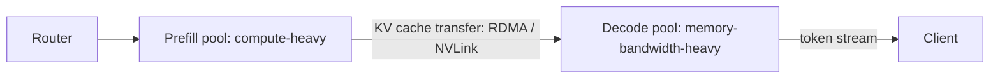

# GPU Serving and Disaggregated KV Cache

> [!abstract] What this is
> How an inference server turns GPUs into tokens: the **KV cache**, why **prefill** is compute-bound and **decode** is memory-bound, **continuous batching**, **PagedAttention** (vLLM) and **RadixAttention** (SGLang), **chunked prefill**, **disaggregated** prefill/decode serving with KV-cache transfer, tiered and distributed **KV cache networks**, model **parallelism**, and **prefix-aware routing**. Architect depth: enough to explain every design choice and its trade-off, not to write the kernels.

---

## Why It Exists

- The cost and latency of every LLM feature ([[12 - LLM Cost and Latency Economics]]) is decided here: how many requests a GPU can serve at once, how fast the first token arrives, and how fast the rest stream.
- Senior interviews increasingly ask "why is output more expensive than input?", "why does a timestamp at the top of my prompt make it slower?", "why do people split prefill and decode onto different machines?". The answers are all in this note.

---

## The KV Cache

- A transformer generates one token at a time. At each step, attention for the new token needs the **keys (K) and values (V)** of every previous token, in every layer.
- Recomputing them every step would make generation quadratic. Instead the server **stores K and V for every past token**: the **KV cache**. Each new step computes K/V only for the newest token and appends them.

### Sizing it

```
KV bytes per token = 2 (K and V) × layers × kv_heads × head_dim × bytes_per_value
```

- Example, a 70B-class model with grouped-query attention: 80 layers, 8 KV heads, head_dim 128, FP16 (2 bytes):
    + `2 × 80 × 8 × 128 × 2 ≈ 327,680 bytes ≈ 0.31 MB per token`.
    + One 128k-token context ≈ **40 GB** of KV cache, for a single sequence.
- So **KV cache, not weights, is usually what limits how many requests run concurrently** and how long contexts can be.
- Architectural reductions: **grouped-query / multi-query attention** (many query heads share few KV heads; 8 instead of 64 cuts KV 8×), sliding-window attention, and **KV-cache quantization** to FP8/INT8 ([[14 - Quantization Decoding and VRAM Math]]).

---

## Prefill vs Decode

| | Prefill | Decode |
|---|---|---|
| What happens | Process **all prompt tokens at once**, fill the KV cache, produce the first token | Generate **one token per step** per sequence, appending to the KV cache |
| Parallelism | Thousands of tokens in one big matrix multiply | One token per sequence per step |
| Bottleneck | **Compute-bound**: GPU arithmetic is saturated | **Memory-bandwidth-bound**: each step must read all weights (and the KV cache) from GPU memory to do a tiny amount of math |
| Latency metric | **TTFT** (time to first token) | **TPOT / ITL** (time per output token, inter-token latency) |
| Scales with | Prompt length | Output length × per-step time |

- **Why output tokens cost more**: in decode, the GPU reads tens of gigabytes of weights to produce **one** token per sequence. The math units mostly wait on memory. Prefill reuses each weight read across thousands of prompt tokens.
- **Why batching matters so much for decode**: reading the weights once and applying them to 64 sequences costs barely more than applying them to 1. Throughput rises almost linearly with batch size until compute or KV-cache memory runs out. Larger batches raise **throughput** but slightly increase per-token **latency**: the core serving trade-off.

---

## Batching and Scheduling

### Continuous (in-flight) batching

- **Static batching**: wait to collect a batch, run it until **every** sequence finishes. Short requests wait for the longest one; GPUs idle as sequences finish.
- **Continuous batching** (iteration-level scheduling, popularised by Orca and used by vLLM, SGLang, TensorRT-LLM, TGI): at **every decode step**, finished sequences leave the batch and waiting requests join. GPU utilisation and throughput rise dramatically; it's the baseline of every modern engine.

### Chunked prefill

- A long prompt's prefill can take hundreds of milliseconds, **stalling** the decode steps of every other request in the batch (users see stutters).
- **Chunked prefill** splits a long prefill into chunks and mixes them with ongoing decode steps, smoothing inter-token latency at a small cost to TTFT for the long prompt.

### Preemption

- If KV-cache memory runs out mid-generation, the scheduler **preempts** some sequences: swaps their KV cache to CPU memory or drops it and recomputes later. Watch preemption rates: they signal over-admission.

---

## PagedAttention and RadixAttention

### PagedAttention (vLLM)

- Naively, each sequence reserves a **contiguous** KV region sized for its maximum length, wasting most of it (internal fragmentation) and fragmenting memory between sequences.
- **PagedAttention** borrows virtual memory from operating systems: the KV cache is split into **fixed-size blocks** (e.g. 16 tokens), allocated on demand; each sequence has a **block table** mapping logical positions to physical blocks anywhere in GPU memory.
    + Near-zero waste, so far more concurrent sequences fit.
    + Blocks can be **shared** between sequences: parallel samples from one prompt, beam search, and common prefixes, with copy-on-write when they diverge.

### Prefix caching and RadixAttention (SGLang)

- Many requests share prefixes: the same system prompt, tool definitions, few-shot examples, or the earlier turns of a conversation. Recomputing their KV cache on every request wastes prefill compute.
- **Automatic prefix caching** keeps KV blocks of recent prompts and reuses them when a new prompt starts with the **same tokens** (vLLM hashes blocks of tokens to find matches).
- **RadixAttention** (SGLang) organises cached prefixes in a **radix tree** keyed by token sequences, so any request reuses the longest matching prefix automatically, with LRU eviction of unused branches. Especially effective for agents and multi-turn chat, where each call extends the previous one.
- This is the server-side mechanism behind provider **prompt caching** discounts ([[12 - LLM Cost and Latency Economics]]).

> [!warning] Prefix cache invalidation
> Caches match **exact token prefixes**. Putting high-cardinality data (a timestamp, request id, user name) at the **top** of the system prompt makes every prompt unique from the first tokens, so nothing is reused and every request pays full prefill. Keep the stable content first and the variable content last.

---

## Disaggregated Serving

- In a combined server, prefill and decode share the same GPUs and **interfere**: a burst of long prefills stalls decoding for everyone (bad inter-token latency), and tuning the batch for one phase hurts the other.
- **Disaggregated serving** runs them on **separate GPU pools**:



1. A **prefill node** processes the prompt and builds its KV cache.
2. The KV cache is **transferred** to a **decode node** over a fast interconnect (RDMA over InfiniBand/RoCE, NVLink).
3. The decode node generates tokens with its own batching policy.

| Gains | Costs |
|---|---|
| No prefill/decode interference: stable inter-token latency | KV transfer bandwidth (tens of GB for long contexts) and latency added to TTFT |
| **Independent scaling**: more prefill nodes for long-prompt workloads (RAG, agents), more decode nodes for long outputs | Needs very fast networking between pools |
| Tune each phase separately (parallelism, batch size, even different GPU types) | Much more operational complexity: routing, scheduling, failure handling |
| Optimise for **goodput**: requests that meet both TTFT and ITL SLOs | Not worth it at small scale |

- Research and systems: DistServe, Splitwise, Mooncake (Moonshot AI's KV-cache-centric architecture), and production stacks such as NVIDIA Dynamo and llm-d, plus engine-level support in vLLM and SGLang.
- **Pick when:** large-scale serving with strict latency SLOs and long prompts (agents and RAG are prefill-heavy). Below that scale, a combined server with chunked prefill and continuous batching is the pragmatic default.

---

## Distributed and Tiered KV Cache

- GPU memory (HBM) is the scarcest resource. Storing KV only there means reusable prefixes get evicted quickly. KV cache **tiering** extends it:

| Tier | Capacity | Speed | Role |
|---|---|---|---|
| GPU HBM | Tens of GB per GPU | Fastest | Active sequences |
| CPU DRAM | Hundreds of GB per node | Fast via PCIe | Recently used prefixes, swapped sequences |
| Local NVMe SSD | TBs | Slower | Long-lived shared prefixes |
| Remote / pooled cache over RDMA | Cluster-wide | Network-bound | Share prefixes across nodes; feed disaggregated decode |

- Systems like **LMCache** and **Mooncake's** store let nodes fetch a prefix's KV cache from another node or tier instead of recomputing prefill. Loading cached KV is often far cheaper than recomputing it for long prefixes, which is why "**KV cache is the new unit of caching**" in large deployments.
- Trade-off: transfer cost vs recompute cost. Short prefixes are cheaper to recompute; long ones (big system prompts, documents, long conversations) are worth fetching.

---

## Prefix-Aware ("Sticky") Routing

- Prefix caches are **per node**. Round-robin load balancing sends step 2 of an agent run to a different GPU than step 1, so the warm KV cache is useless and the whole history is prefilled again on every step.
- **Prefix-aware routing**: route each request to a node that already holds the longest matching prefix (by hashing prefix blocks or session/conversation id), while still balancing load.
    + Pure stickiness hot-spots popular prefixes; good routers score nodes by **cache hit length minus load** ([[04 - Load Balancing CDN and Gateway]] — consistent hashing with bounded load is the classic analogue).
    + With a distributed KV store, a cache miss on one node can still fetch from another, softening the trade-off.

```python
def pick_node(prompt_tokens: list[int], nodes: list[Node], block: int = 16) -> Node:
    def score(n: Node) -> float:
        hit = n.cached_prefix_len(prompt_tokens, block)       # tokens already cached on this node
        return hit / len(prompt_tokens) - 0.5 * n.load()       # balance reuse against load
    return max(nodes, key=score)
```

---

## Model Parallelism

- A large model often doesn't fit on one GPU, or one GPU is too slow. Ways to split it:

| Parallelism | What's split | Communication | Pick when |
|---|---|---|---|
| **Data parallel** (replicas) | Nothing; each GPU group runs a full copy | None between replicas | Scaling throughput once a model fits |
| **Tensor parallel** | Each layer's matrices across GPUs | Every layer (all-reduce); needs NVLink-class bandwidth | Model too big for one GPU; within a node |
| **Pipeline parallel** | Layers into stages on different GPUs | Activations between stages | Very large models across nodes |
| **Expert parallel** (MoE) | Different experts on different GPUs | Tokens routed to experts (all-to-all) | Mixture-of-experts models |
| **Context / sequence parallel** | Long sequences across GPUs | Attention across shards | Very long contexts |

- Rule of thumb: tensor parallel inside a node (fast NVLink), pipeline or expert parallel across nodes, replicas for throughput.

---

## Serving Metrics

| Metric | Meaning |
|---|---|
| **TTFT** | Time to first token: queueing + prefill |
| **TPOT / ITL** | Time per output token / inter-token latency |
| **Throughput** | Output tokens per second per GPU (or per dollar) |
| **Goodput** | Requests per second that meet **both** TTFT and ITL SLOs: the metric disaggregation optimises |
| **KV cache utilisation, preemptions** | Memory pressure and over-admission |
| **Prefix cache hit rate** | How much prefill is being saved |

- Engines to name: **vLLM** (PagedAttention, broad model support), **SGLang** (RadixAttention, strong for structured and agentic workloads), **TensorRT-LLM** (NVIDIA-optimised), **TGI**, and managed endpoints built on them.

---

## Failure Modes

| Failure | What happens | Mitigation |
|---|---|---|
| **Prefix cache invalidation** | Timestamp or ids at the top of prompts; zero cache hits; full prefill every call | Stable prefixes first, variable content last |
| **Round-robin routing for agents** | Every step prefills the whole history on a cold node | Prefix-aware / session-sticky routing with load balancing |
| **KV cache exhaustion** | Preemptions, recomputation, latency spikes | Admission control; KV quantization; GQA models; tiered KV; limit max context |
| **Long prefills stall decodes** | Token streams stutter for everyone | Chunked prefill; disaggregated serving at scale |
| **Over-batching** | Throughput up, per-token latency over SLO | Tune max batch / tokens per step for goodput, not raw throughput |
| **Disaggregation without the network** | KV transfer dominates TTFT | RDMA/NVLink-class interconnect; only disaggregate at scale |
| **Hot prefix node** | Sticky routing overloads one node | Score by cache hit minus load; replicate hot prefixes |

---

## Interview Lines

> [!tip] Say it like this
> - "The KV cache stores keys and values for every past token; at about 0.3 MB per token for a 70B model, KV memory is what limits concurrency."
> - "Prefill is compute-bound and sets TTFT; decode is memory-bandwidth-bound because every step reads all the weights for one token per sequence, which is why output costs more and batching matters."
> - "PagedAttention allocates KV in blocks like OS pages, eliminating fragmentation and letting sequences share prefixes; RadixAttention keeps prefixes in a radix tree for automatic reuse."
> - "Disaggregated serving puts prefill and decode on separate pools and ships the KV cache over RDMA, so the phases stop interfering and scale independently."
> - "Agent traffic needs prefix-aware routing; round-robin sends each step to a cold cache and re-prefills the whole history."

## Related Notes

- [[12 - LLM Cost and Latency Economics]] · [[14 - Quantization Decoding and VRAM Math]] · [[15 - Post-Training and Model Adaptation]] · [[04 - Load Balancing CDN and Gateway]]
- [[Agentic/README]]
