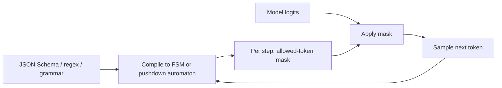

# Quantization, Decoding and VRAM Math

> [!abstract] What this is
> The numeric and decoding tricks that make models cheaper and faster to serve: precision formats (**BF16, FP8, INT8, INT4**), **weight-only vs weight-and-activation** quantization (GPTQ, AWQ), **KV-cache compression**, **constrained decoding** (FSMs, grammars, logit masking), **speculative decoding** (draft models, EAGLE), the **VRAM and cost arithmetic** to size a deployment, and the **roofline and sharding arithmetic** (FLOPs, bytes, arithmetic intensity, collective costs, tensor-parallel communication) that infra rounds ask you to do by hand. The decision this helps with: which precision and decoding setup fits a quality bar, a GPU budget and a latency target.

---

## Why It Exists

- Memory and memory bandwidth limit LLM serving ([[13 - GPU Serving and Disaggregated KV Cache]]). Halving the bytes per weight roughly halves the memory needed and speeds up memory-bound decode, but can cost quality.
- Structured output and speculative decoding change *how* tokens are chosen, affecting reliability and latency without changing the model.
- Being able to say "a 70B model in FP8 needs about 70 GB for weights, so on two 80 GB GPUs I have ~75 GB left for KV cache, roughly 240k tokens of context across all requests" is an SDE-3 signal.

---

## Precision Formats

| Format | Bits | Notes | Typical use |
|---|---|---|---|
| **FP32** | 32 | Full precision | Training master weights; rarely for inference |
| **BF16** | 16 | Same exponent range as FP32, less precision; numerically robust | Default for training and high-quality inference |
| **FP16** | 16 | More precision, smaller range (overflow risk) | Older inference setups |
| **FP8** (E4M3 / E5M2) | 8 | Native on recent accelerators (e.g. NVIDIA Hopper and later); usually small quality loss | High-throughput inference of weights and activations |
| **INT8** | 8 | Integer with scale factors | Weight or weight+activation quantization |
| **INT4** (and FP4 variants) | 4 | 4× smaller than BF16; quality loss more noticeable | Memory-constrained deployment, local models |

- Quantized values need **scales** (and sometimes zero points) per tensor, per channel, or per **group** of weights (e.g. groups of 128). Finer groups = better accuracy, slightly more memory.

---

## Weight-Only vs Weight-and-Activation Quantization

| | Weight-only (e.g. W4A16, W8A16) | Weights and activations (e.g. W8A8, FP8) |
|---|---|---|
| What's quantized | Stored weights; dequantized on the fly to BF16 for compute | Weights **and** the activations flowing through matmuls |
| Speeds up | **Memory-bound decode** (fewer bytes read per step) and fits bigger models | Also **compute-bound prefill**, using low-precision tensor cores |
| Quality risk | Lower at 8 bits; noticeable at 4 bits | Activation outliers make it harder; FP8 handles it well on supported hardware |
| Pick when | Fit a model on fewer/smaller GPUs; latency-bound single-user serving | High-throughput serving on hardware with FP8/INT8 support |

### Methods to name

- **GPTQ**: post-training quantization layer by layer, using second-order (Hessian-based) information to adjust remaining weights to compensate for rounding error. Needs a small calibration set.
- **AWQ** (activation-aware weight quantization): a small fraction of weights matter much more because they multiply large activations; AWQ scales those channels to protect them before quantizing. Robust at 4 bits.
- **SmoothQuant**: shifts quantization difficulty from activations to weights for W8A8.
- **GGUF / llama.cpp** formats for CPU and local inference.

### Quality caveat

- Quantization quality loss is **uneven**: short-answer benchmarks may look unchanged while **multi-step reasoning, long-context retrieval, code and tool use** degrade more. Aggressive INT4 on a planning or orchestrator model can produce subtly wrong plans.
- Rule: evaluate the quantized model **on your own tasks and trajectories** ([[11 - Evals Observability and Silent Drift]]), not on headline benchmarks. A common split: FP8 or BF16 for the planner/reasoner, INT4 for high-volume simple steps.

---

## KV-Cache Compression

- KV cache often uses more memory than weights at high concurrency or long contexts ([[13 - GPU Serving and Disaggregated KV Cache]]).
    + **FP8 / INT8 KV cache**: halves KV memory vs FP16 with usually small quality loss → roughly 2× more concurrent tokens.
    + **Architecture-level**: grouped-query / multi-query attention, multi-head latent attention (compressed latent KV), sliding-window layers.
    + **Eviction / sparsification** (keep only "important" tokens' KV): research-stage, riskier for retrieval-style tasks.
- Weight quantization and KV quantization are **independent** choices: W4 weights with FP16 KV, FP8 weights with FP8 KV, and so on.

---

## Constrained Decoding

- Structured outputs and strict tool schemas ([[00 - LLM Fundamentals for Engineers]], [[03 - Tool Engineering and Action Spaces]]) are enforced by **masking logits**: at each step, tokens that would make the output invalid get probability zero.



| Approach | How | Notes |
|---|---|---|
| **FSM from regex / schema** (e.g. Outlines) | Compile the schema to a finite-state machine over tokens; each state has an allowed-token set | Fast per step; compiling complex schemas is expensive |
| **Grammar engines** (XGrammar, llguidance) | Context-free grammars (pushdown automata) with precomputed token masks; handle nested JSON efficiently | Near-zero per-token overhead once compiled; used in vLLM, SGLang, TensorRT-LLM |
| **Logit masking hooks** | Custom per-step masks (allow only certain labels or ids) | Classification, enum outputs |

- **Compile cost** is the hidden latency: a new, complex schema sent per request must be compiled before the first token, inflating TTFT. Fix: **pre-compile and cache** grammars for static Pydantic schemas; keep schemas small and reused; avoid generating a new schema per request.
- Constrained decoding guarantees **syntax**, not semantics. It can also slightly hurt quality if the schema forces an unnatural order (e.g. a `final_answer` field before a `reasoning` field); put reasoning fields first when you need them.

---

## Speculative Decoding

- Decode is memory-bound: verifying several tokens in one forward pass costs about the same as generating one. Speculative decoding exploits that:
    1. A cheap **draft** proposes the next `k` tokens.
    2. The large **target** model scores all `k` positions in **one** forward pass.
    3. Accept the longest prefix the target agrees with (plus one corrected token); discard the rest.
- With proper rejection sampling, the output distribution is **identical** to the target model's: it's a lossless speed-up. The speed-up depends on the **acceptance rate** (how often the draft is right).

| Draft source | How | Notes |
|---|---|---|
| **Small draft model** | A smaller model of the same family | Needs the same tokenizer; extra memory |
| **Medusa heads** | Extra prediction heads on the target predict several future tokens | Needs fine-tuning heads |
| **EAGLE** (and successors) | A lightweight head drafts at the **feature** level using the target's hidden states | High acceptance rates; widely supported in engines |
| **N-gram / prompt lookup** | Copy likely continuations from the prompt itself | Free; great for edits, code and RAG answers that quote context |

- Best when: low-to-moderate batch sizes and latency-sensitive serving. At very high batch sizes the GPU is already busy, so the extra verification work helps less (or hurts throughput).
- Also effective for **structured outputs**: predictable JSON keys and boilerplate are easy for drafts, raising acceptance.

---

## VRAM Math

```
total VRAM ≈ weights + KV cache + activations/workspace + framework overhead
weights    = parameters × bytes per parameter
KV cache   = KV bytes per token × total tokens in flight (sum over concurrent requests)
overhead   ≈ 10–20% (CUDA graphs, buffers, fragmentation) — heuristic
```

| Model size | BF16 | FP8 / INT8 | INT4 |
|---|---|---|---|
| 8B | ~16 GB | ~8 GB | ~4–5 GB |
| 70B | ~140 GB | ~70 GB | ~35–40 GB |
| 405B | ~810 GB | ~405 GB | ~200+ GB |

### Worked example

- Serve a 70B model in **FP8** on **2 × 80 GB** GPUs (160 GB total), tensor parallel:
    + Weights ≈ 70 GB.
    + Overhead ≈ 15 GB.
    + Left for KV ≈ 75 GB.
    + KV per token at FP16 ≈ 0.31 MB ([[13 - GPU Serving and Disaggregated KV Cache]]) → **~240k tokens in flight**, e.g. ~30 concurrent requests at 8k tokens each.
    + With an **FP8 KV cache** (~0.16 MB/token) → ~480k tokens, roughly doubling concurrency.
- In BF16 the same model needs ~140 GB of weights, leaving almost nothing for KV on 160 GB: you'd need more GPUs.

### Decode speed and cost

- Single-stream decode is bandwidth-bound, so an upper bound is:

```
tokens/sec per sequence ≲ memory bandwidth ÷ bytes read per step (≈ weight bytes, per GPU shard)
```

- E.g. ~3.35 TB/s bandwidth and ~35 GB of weights per GPU (70 GB FP8 split over 2) → at most ~95 steps/s per sequence, before KV reads and overheads. Real numbers are lower.
- Batching multiplies **aggregate** throughput because the same weight reads serve many sequences.
- Cost per million output tokens (illustrative):

```
$/1M tokens ≈ (GPU $/hour × number of GPUs) ÷ (aggregate tokens/sec × 3600 ÷ 1,000,000)
```

```python
def cost_per_million(gpu_hourly: float, gpus: int, agg_tokens_per_s: float, utilisation: float) -> float:
    effective = agg_tokens_per_s * utilisation               # idle time still costs money
    return gpu_hourly * gpus / (effective * 3600 / 1e6)

print(cost_per_million(gpu_hourly=3.0, gpus=2, agg_tokens_per_s=2500, utilisation=0.6))
```

- The levers in this note show up directly: quantization raises tokens/s and frees memory for bigger batches; KV compression raises concurrency; speculative decoding raises per-sequence speed; utilisation decides whether self-hosting beats an API ([[12 - LLM Cost and Latency Economics]]).

---

## Roofline and Sharding Arithmetic

- Infra rounds at the labs ask you to performance-model a computation by hand. Anthropic's onsite has "performance-model a sharded matrix multiply: FLOPs, memory, network and roofline" (PracHub, Sep 2026), alongside FFN-size estimates and eight-GPU routing questions. The method is three counts and one comparison.

### The roofline model

1. **Count FLOPs.** A matmul `[m, k] @ [k, n]` costs `2·m·k·n` FLOPs (a multiply and an add per term). A dense transformer forward pass costs about `2 × parameters` FLOPs per token.
2. **Count bytes moved** to and from HBM: inputs read plus output written, `bytes_per_value × (m·k + k·n + m·n)`.
3. **Arithmetic intensity** = FLOPs ÷ bytes.
4. **Compare with the ridge point** = peak FLOP/s ÷ memory bandwidth. Below it, the kernel is **memory-bound** (time ≈ bytes ÷ bandwidth); above it, **compute-bound** (time ≈ FLOPs ÷ peak). Time is at least the larger of the two.

| H100 SXM (datasheet, BF16 dense) | Value |
|---|---|
| Peak compute | ~989 TFLOP/s |
| HBM3 bandwidth | 3.35 TB/s |
| **Ridge point** | **~295 FLOP/byte** |
| NVLink (within a node) | 900 GB/s total, ~450 GB/s each way |
| InfiniBand / RoCE per GPU (across nodes) | ~25–50 GB/s (typical 200–400 Gb/s NIC; *assumed*) |

- **Why decode is memory-bound**: for a weight matmul with `m` tokens in the batch and large `k, n`, intensity ≈ `m`. A decode step with 64 sequences has intensity ~63, far below 295, so the GPU waits on weight reads. You need about **300 tokens per step** before compute is the limit, which is why batching helps decode so much and why prefill (thousands of tokens at once) is compute-bound ([[13 - GPU Serving and Disaggregated KV Cache#Prefill vs Decode]]).
- **Quantization moves both sides**: FP8 weights halve the bytes, which doubles intensity for the same batch and halves memory-bound decode time. FP8 math also doubles peak FLOP/s, which doubles the ridge point, so the batch needed to become compute-bound stays about the same (~300 tokens).

### Sharding a matmul across GPUs

- Which dimension you split decides the communication (Google DeepMind, *How to Scale Your Model*, ch. 3):

| Case | Example sharding | Communication | Cost (bandwidth-bound) |
|---|---|---|---|
| Contracting dimension **not** sharded | `A[I_X, J] · B[J, K_Y]` | None | 0 |
| **One** input sharded on the contracting dimension | `A[I, J_X] · B[J, K]` | **AllGather** that input first | bytes ÷ bandwidth |
| **Both** sharded on the contracting dimension | `A[I, J_X] · B[J_X, K]` | Local partial sums, then **AllReduce** (or ReduceScatter if the output may stay sharded) | AllReduce ≈ 2 × AllGather |
| Both sharded on a non-contracting dimension along the same axis | `A[I_X, J] · B[J, K_X]` | Invalid; AllGather one input first | bytes ÷ bandwidth |

- **Collective costs** to remember: in the bandwidth-bound regime, AllGather and ReduceScatter cost about `bytes ÷ link bandwidth` regardless of the number of devices; **AllReduce costs twice that**; AllToAll (used in MoE expert routing) about a quarter of an AllGather on a ring. A ring all-reduce on GPUs sends `2(N−1)/N × bytes` per GPU. Small messages are **latency-bound** instead (microseconds per hop), which is the usual case at decode.
- **Tensor parallelism in a transformer** (Megatron style): split the MLP up-projection by columns and the down-projection by rows, so the only communication is **one all-reduce of the activations after attention and one after the MLP**, per layer, per forward pass. Activations are `tokens × d_model × 2 bytes`, small at decode and large at prefill.

### Worked example: 70B dense model on 8 × H100, tensor parallel

| Quantity | Decode step, 64 sequences | Prefill, 4,096 tokens |
|---|---|---|
| Weights streamed per GPU | 140 GB ÷ 8 = 17.5 GB | same |
| Math time (roofline) | **5.2 ms, memory-bound** (17.5 GB ÷ 3.35 TB/s) | **72 ms, compute-bound** (2 × 70B × 4,096 ÷ 8 ÷ 989 TFLOP/s) |
| All-reduces | 80 layers × 2 = 160, each 64 × 8,192 × 2 B = 1 MB | 160, each 64 MB |
| Communication | ~2.2 ms (bandwidth tiny; **~10 µs latency each** dominates, *assumed*) | ~42 ms of transfer over NVLink, which must overlap with compute |

- What the numbers tell you:
    + Decode at TP8 is ~190 steps/s per sequence before KV reads and overheads, and communication latency is already a third of the step. TP adds little past 8 GPUs at decode.
    + The same 160 all-reduces over **InfiniBand across two nodes** (TP16) take ~9.5 ms per step, more than the math. So keep tensor parallelism **inside a node** (NVLink) and use pipeline or data parallelism across nodes ([[13 - GPU Serving and Disaggregated KV Cache#Model Parallelism]]).
    + At prefill, communication is large but can overlap with the matmuls (collective matmul); without overlap it adds ~60%.

```python
PEAK_FLOPS, HBM_BW, NVLINK_UNI, BYTES = 989e12, 3.35e12, 450e9, 2   # H100 SXM, BF16

def roofline_time(flops, bytes_moved, peak=PEAK_FLOPS, bw=HBM_BW):
    t_compute, t_memory = flops / peak, bytes_moved / bw
    return max(t_compute, t_memory), ("compute" if t_compute >= t_memory else "memory")

def matmul_cost(m, k, n, b=BYTES):
    flops, moved = 2 * m * k * n, b * (m * k + k * n + m * n)
    return flops, moved, flops / moved              # intensity ~ m when m << k, n

def ring_allreduce_time(nbytes, n_gpus, bw=NVLINK_UNI, latency_s=0.0):
    return 2 * (n_gpus - 1) / n_gpus * nbytes / bw + latency_s

def decode_step(params, tp, batch, layers, d_model, ar_latency_s=10e-6):
    t_math, bound = roofline_time(2 * params * batch / tp, params * BYTES / tp)
    act = batch * d_model * BYTES
    t_comm = 2 * layers * ring_allreduce_time(act, tp, latency_s=ar_latency_s)
    return t_math, bound, t_comm

# Tested: ridge 295 FLOP/byte; matmul_cost(64, 8192, 28672) -> intensity 63.4, memory-bound;
# matmul_cost(4096, 8192, 28672) -> compute-bound; decode_step(70e9, 8, 64, 80, 8192) -> 5.22 ms memory-bound, 2.25 ms comm
```

---

## Failure Modes

| Failure | What happens | Mitigation |
|---|---|---|
| **INT4 on a planner** | Multi-step reasoning and plans degrade subtly | FP8/BF16 for reasoning steps; evaluate quantized models on your trajectories |
| **Calibration mismatch** | GPTQ/AWQ calibrated on generic text underperforms on your domain | Calibrate on representative data |
| **Per-request schema compilation** | Constrained decoding inflates TTFT | Pre-compile and cache static schemas; keep schemas small |
| **Schema forces answer-before-reasoning** | Lower answer quality | Put reasoning fields before answer fields |
| **Speculative decoding at high batch** | Little gain or lower throughput | Use for latency-sensitive, lower-batch serving; measure acceptance |
| **Forgetting KV in VRAM plans** | Model "fits" but concurrency collapses | Budget weights + KV × tokens in flight + overhead |
| **Mixing tokenizers in drafting** | Draft model unusable | Draft from the same family / tokenizer, or use EAGLE / n-gram drafts |
| **Buying FLOPs for a memory-bound workload** | A faster GPU barely speeds up decode | Check intensity against the ridge point first; for decode, buy bandwidth and batch more |
| **Tensor parallelism across nodes** | All-reduces over InfiniBand cost more than the math | TP inside the NVLink domain; pipeline or data parallel across nodes |
| **Ignoring collective latency at decode** | Adding GPUs makes each step slower | Small all-reduces are latency-bound; fewer TP ranks, fused collectives, larger batches |

---

## Interview Lines

> [!tip] Say it like this
> - "Weights are parameters times bytes: a 70B model is about 140 GB in BF16, 70 GB in FP8, 35–40 GB in INT4, and whatever's left goes to KV cache."
> - "Weight-only INT4 speeds up memory-bound decode; FP8 weights and activations also speed up prefill on hardware that supports it."
> - "I'd keep the planner in FP8 or BF16 because aggressive quantization hurts multi-step reasoning more than benchmarks show."
> - "Constrained decoding masks invalid tokens with a compiled grammar; I pre-compile static schemas so compilation doesn't inflate time to first token."
> - "Speculative decoding drafts several tokens and verifies them in one pass; it's lossless and helps most at low batch sizes."
> - "I performance-model with a roofline: count FLOPs, count bytes, divide. An H100's ridge point is about 295 FLOP per byte, and a weight matmul's intensity is roughly the batch size, so decode under ~300 tokens per step is memory-bound."
> - "Sharding rule: if the contracting dimension isn't split there's no communication; if one input is split on it I all-gather that input; if both are, I multiply locally and all-reduce, which costs twice an all-gather."
> - "Megatron tensor parallelism needs two activation all-reduces per layer. On a 70B model at TP8 a decode step is ~5 ms of weight reads and ~2 ms of mostly latency-bound collectives, so I keep TP inside the NVLink node."

## Sources

- Austin et al. (Google DeepMind), *How to Scale Your Model*, ch. 1 "Rooflines" and ch. 3 "Sharded Matrices and How to Multiply Them" (2025). https://jax-ml.github.io/scaling-book/sharding/
- NVIDIA, *H100 Tensor Core GPU datasheet*: ~989 TFLOP/s BF16 dense, 3.35 TB/s HBM3, 900 GB/s NVLink (SXM).
- Shoeybi et al., *Megatron-LM: Training Multi-Billion Parameter Language Models Using Model Parallelism* (2019): column/row split, two all-reduces per layer. https://arxiv.org/abs/1909.08053
- PracHub, Anthropic onsite question *Performance-Model a Sharded Matrix Multiply: FLOPs, Memory, Network and Roofline* (Sep 2026). https://prachub.com/interview-questions/performance-model-a-sharded-matrix-multiply-flops-memory-network-and-roofline

## Related Notes

- [[13 - GPU Serving and Disaggregated KV Cache]] · [[12 - LLM Cost and Latency Economics]] · [[15 - Post-Training and Model Adaptation]] · [[03 - Tool Engineering and Action Spaces]]
- [[Agentic/README]]
