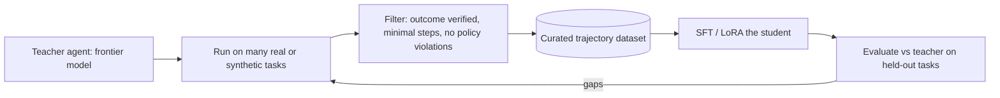
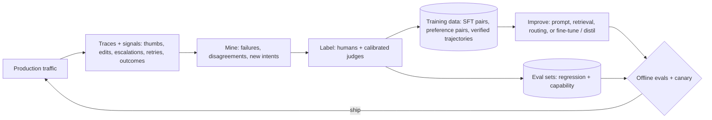

# Post-Training and Model Adaptation

> [!abstract] What this is
> How to change a model's behaviour beyond prompting: deciding between **prompting, RAG and fine-tuning**, supervised fine-tuning (**SFT**), parameter-efficient tuning (**LoRA, QLoRA**), preference tuning (**RLHF, DPO**), **reinforcement learning with verifiable rewards** (RLVR, GRPO), **distilling** agent trajectories from a large teacher into a small student, serving many adapters at once (**multi-LoRA**: S-LoRA, Punica), and **test-time compute** scaling. Architect depth: when and why, what the pipeline looks like, and what goes wrong.

---

## Why It Exists

- Prompting and RAG cover most needs, but some problems remain: a model that won't follow a format reliably, a domain style it can't imitate, a high-volume task too expensive on a frontier model, or tool use that needs to be more accurate than prompting achieves.
- Fine-tuning is often proposed for the wrong reason ("teach it our documents"). Knowing which tool fixes which problem is the core interview signal.

---

## Prompting vs RAG vs Fine-Tuning

| Need | Best tool | Why |
|---|---|---|
| Use **facts** that change, are private, or must be cited | **RAG** ([[06 - RAG Ingestion and Indexing Pipeline]]) | Fresh, citable, permission-aware; fine-tuned "knowledge" is stale, uncitable and prone to hallucination |
| Follow instructions, tone, simple formats | **Prompting** (+ few-shot) | Cheapest, fastest to iterate |
| Reliable **format, style or domain behaviour** that prompts can't hold | **Fine-tuning (SFT / LoRA)** | Behaviour baked into weights; shorter prompts |
| **Cut cost/latency** on a narrow, high-volume task | **Distil into a smaller model** | Small model matches the large one on that task |
| Better **tool-use / agent decisions** in your environment | **SFT on good trajectories**, then RL with verifiable rewards | Learns your tools and procedures |
| Better **reasoning** on checkable tasks (math, code, SQL) | **RLVR** or a reasoning model with more test-time compute | Rewards come from verifiers |

- The ladder: **prompt → RAG → fine-tune → RL**, each step justified by evals ([[11 - Evals Observability and Silent Drift]]). Fine-tuning and RAG combine well: fine-tune for behaviour (how to use retrieved context, cite, abstain), RAG for knowledge.
- Since 2025 there is a rung between hand-written prompts and fine-tuning: **automatic prompt optimisation** (next section). It needs the same eval set fine-tuning would, but no GPUs and no new model to serve.

---

## Automatic Prompt Optimisation: DSPy and GEPA

- Hand-tuning a prompt is search done by a person: edit, eyeball a few outputs, repeat. It doesn't scale across a multi-step pipeline, it breaks when the model changes, and nobody can say whether the last edit helped. **Prompt optimisers** run that search automatically against a **metric on a labelled dataset**.
- **DSPy** (Stanford NLP; version 3 released August 2025) treats a pipeline as a program:
    + A **signature** declares inputs and outputs (`question, context -> answer, citations`).
    + **Modules** compose them (retrieve, then answer, then verify).
    + An **optimiser** writes the actual instructions and picks few-shot examples by trying candidates and scoring them with your metric. Swapping the model means re-running the optimiser, not rewriting prompts.
- **Optimisers to name:**

| Optimiser | How it searches | Pick when |
|---|---|---|
| **BootstrapFewShot** | Runs the program, keeps traces that pass the metric as few-shot examples | Small data, quick win |
| **MIPROv2** | Proposes instructions and example sets, searches them with Bayesian optimisation | Tens to hundreds of labelled examples, several modules |
| **GEPA** (Genetic-Pareto, Agrawal et al. 2025, ICLR 2026 oral) | The model **reads its own failures and the metric's textual feedback**, rewrites the prompt, and keeps a Pareto set of candidates that win on different examples | Rich feedback available (judge rationales, test output, compiler errors); agents and multi-step pipelines |

- **What GEPA claims**: in the authors' experiments it beat GRPO (RL fine-tuning, below) by up to about 20% while using up to 35× fewer rollouts, and beat MIPROv2. Treat these as the paper's numbers on its tasks; the practical point is that rich textual feedback is a stronger signal than one scalar reward, so a well-built metric is the whole game.
- **When to use it, in order**: a decent hand-written prompt and an eval set first; then an optimiser if quality plateaus or you maintain the pipeline across several models; then fine-tuning when you need a smaller model, lower latency or a behaviour prompts can't hold.
- **Risks**: overfitting the dev set (hold out a test split the optimiser never sees), a metric that can be gamed (the optimiser will find the loophole, as with reward hacking below), and long, opaque prompts that are hard to review. **Optimised prompts are still deploys**: version them in git and ship them through the same eval and canary pipeline as any prompt change ([[11 - Evals Observability and Silent Drift]] → Shipping Prompt and Model Changes).

---

## Supervised Fine-Tuning (SFT)

- Train on **(input, ideal output)** pairs, usually chat-formatted, so the model imitates the target behaviour. Loss is computed on the assistant's tokens.
- **Data quality dominates**: a few thousand clean, diverse, correct examples usually beat a hundred thousand noisy ones. Include edge cases, refusals, abstentions and the exact output formats you need.
- Watch for **catastrophic forgetting** (general abilities degrade): mix in general instruction data, use parameter-efficient methods, and keep learning rates modest.
- Evaluate against the base model on your task evals **and** on general capability checks before shipping.

---

## Parameter-Efficient Fine-Tuning: LoRA and QLoRA

- Full fine-tuning updates every weight: expensive in memory (weights, gradients and optimiser states) and produces a full model copy per variant.
- **LoRA** freezes the base model and learns a **low-rank update** for selected weight matrices:

```
W' = W + ΔW,   ΔW = B · A,   A ∈ R^(r × d_in),  B ∈ R^(d_out × r),  r ≪ d   (e.g. r = 8–64)
```

- Details:
    + Only `A` and `B` train: often well under 1% of parameters, so training fits on far less hardware.
    + The **adapter** is small (megabytes to a few hundred MB) and can be merged into the base weights or kept separate and swapped at serving time.
    + Key knobs: rank `r`, scaling `alpha`, which modules get adapters (attention projections, MLP layers).
- **QLoRA**: load the frozen base model in **4-bit** and train LoRA adapters on top, letting large models be fine-tuned on a single GPU, with small quality trade-offs.

| | Full fine-tune | LoRA | QLoRA |
|---|---|---|---|
| Trainable params | All | <1% typical | <1% typical |
| Training memory | Very high | Moderate | Low |
| Artifact | Full model copy | Small adapter | Small adapter |
| Quality ceiling | Highest | Close for most tasks | Close, slightly lower |
| Pick when | Large shifts in behaviour, lots of data and compute | Default | GPU-constrained training |

```python
from peft import LoraConfig, get_peft_model
from transformers import AutoModelForCausalLM

base = AutoModelForCausalLM.from_pretrained("your-base-model")
config = LoraConfig(r=16, lora_alpha=32, lora_dropout=0.05,
                    target_modules=["q_proj", "k_proj", "v_proj", "o_proj"], task_type="CAUSAL_LM")
model = get_peft_model(base, config)
model.print_trainable_parameters()       # tiny fraction of the base model
```

---

## Preference Tuning: RLHF and DPO

- SFT teaches *what* a good answer looks like from examples. Preference tuning teaches *which of two answers is better*.
- **RLHF**: humans rank outputs → train a **reward model** on the rankings → optimise the policy with RL (classically PPO) to maximise reward, with a KL penalty keeping it close to the original model.
- **DPO** (Direct Preference Optimization): skip the separate reward model and the RL loop; train directly on (prompt, preferred, rejected) pairs with a classification-style loss. Simpler and more stable; widely used for tone, helpfulness and safety alignment.

---

## Reinforcement Learning with Verifiable Rewards (RLVR)

- For tasks with **checkable answers**, the reward comes from a **verifier**, not a human preference model:
    + Math: does the final answer match?
    + Code: do the unit tests pass?
    + SQL: does the query return the expected rows?
    + Agents: did the environment end in the correct state? Was the output schema-valid?
- The model samples solutions, gets rewarded for verified-correct ones, and learns strategies (including longer step-by-step reasoning) that lead to correct answers. This is a key ingredient behind modern reasoning models.

### GRPO (Group Relative Policy Optimization)

- For each prompt, sample a **group** of outputs (e.g. 8–64), score each with the verifier, and compute each output's **advantage relative to the group** (reward minus the group mean, normalised by the group's standard deviation). Push up the probability of better-than-average outputs, down for worse ones, with a KL constraint.
- No separate **value/critic model** (unlike PPO), which saves memory and simplifies training. Popularised by DeepSeek's reasoning-model work.

```python
def group_advantages(rewards: list[float]) -> list[float]:
    mean = sum(rewards) / len(rewards)
    std = (sum((r - mean) ** 2 for r in rewards) / len(rewards)) ** 0.5 or 1.0
    return [(r - mean) / std for r in rewards]       # better than the group -> positive advantage

# e.g. 4 sampled solutions to one coding prompt, reward = fraction of tests passed
print(group_advantages([1.0, 0.0, 0.5, 1.0]))
```

- **Reward hacking** is the main risk: the model finds ways to pass the verifier without solving the task (special-casing tests, exploiting a weak checker, overly long reasoning if length isn't penalised). Use robust verifiers, held-out tests and trajectory review.

### RL environments and rewards for agents

Asked as a design question: "training LLM agents for long-context, long-horizon tasks: environments and rewards" (Harvey, MLE, 2026) and "a real-time QA chatbot: training data, RL tasks and rewards" (Meta, MLE onsite, Sep 2026). CMU 11-768 (Fall 2026) teaches the same arc: harness → eval → training.

- **An environment** = a task distribution, a sandboxed world the agent acts in (a repo with tests, a browser with a site snapshot, a mock CRM, a document set), the tools it may call, a step and token budget, and a **grader** that scores the final state or trajectory. The same object serves evals and training; that's why teams build evals first ([[11 - Evals Observability and Silent Drift#Designing Agent Evals You Can Trust]]).
- **Reward design**, from strongest to weakest signal:

| Reward | Example | Risk |
|---|---|---|
| **Outcome, verified** | Hidden tests pass; database ends in the right state; extracted fields match labels | Sparse on long tasks; hackable if the checker is weak |
| **Rubric graded by a model** | Legal memo scored against an expert rubric item by item | Judge bias and drift; calibrate on human labels, keep the judge frozen during a run |
| **Process or milestone** | Partial credit for finding the right file, the right clause | Rewards looking busy; can teach the steps without the goal |
| **Penalties** | Tokens, steps, forbidden tool calls, policy violations | Too strong → the agent gives up early |

- **Long-horizon specifics:** rewards arrive after hundreds of steps, so use curricula (short tasks first), milestone rewards only where they can't be gamed, and group-relative advantages (GRPO) over several rollouts of the same task. Long contexts make rollouts expensive: cap context with compaction inside the harness, exactly as at inference ([[04 - State Memory and Context Engineering]]).
- **Environment engineering is most of the work:** deterministic resets, snapshotting, thousands of parallel sandboxes, network isolation, and **train and inference must use the same tool formats and harness**, or the trained behaviour doesn't transfer (Amazon's Rufus-Air post-training report, 2026, lists sandbox reliability and consistent formats as major issues).
- **Reward hacking in agents** looks like editing the tests, hard-coding expected outputs, reading the grader's files, or claiming success in text. Defences: graders the agent can't see or write, hidden test sets, checking the final state rather than the agent's report, and reading sampled trajectories every run.
- **Data for a domain** (legal, support): collect expert-written tasks with rubrics, mine production failures as new tasks, keep a held-out set never used for training ([[#The Data Flywheel: How the System Gets Better Over Time]]).

---

## Decision Models: Calibrated Scores in One Pass

Routing, guardrails, graders and "should this go to a human?" checks are decisions over a **fixed set of options**, not open-ended generation. A 2026 pattern turns an LLM into a fast, calibrated decision component: Cloudflare's open Clef models (Oct 2026), OpenAI's Decisions API (public beta), and Sarvam's Prism (Nov 2026), a LoRA of Sarvam-105B that its authors report at a 44 ms median on one B200 (vendor-reported).

- **One forward pass, no decoding:** put the context and the options in the prompt, each option tagged with one label token, and read the logits for those label tokens at one position; a softmax over them is the distribution. Latency is one prefill; cache the shared prefix (rubric, instructions).
- **Train for calibration, not just accuracy:** plain cross-entropy pushes probabilities toward 0 and 1; label smoothing plus a **Brier loss** (a proper scoring rule) rewards honest probabilities; LoRA keeps the base model intact. Measure expected calibration error and reliability curves on held-out data, per language and task ([[21 - ML Foundations Quick Reference#Metrics]]).
- **Remove option-order bias:** LLMs prefer options by position or label. Either average over permutations (several passes) or train and serve with one canonical order; test by shuffling options on an eval set and counting flipped decisions (Prism reports 0 of 2,000 flips with a fixed order vs 4.0% without, vendor-reported).
- **Use the probability:** thresholds by risk, for example auto-pass above 0.9, auto-fail below 0.1, humans for the middle; this is how a grader, a moderation cascade or a refund check turns a score into routing ([[11 - LLM Content Moderation Pipeline]], [[11 - Evals Observability and Silent Drift#LLM-as-a-Judge]]).
- **Pick when:** high-volume classification or routing where latency and calibrated confidence matter; keep generative judges for open-ended critique.

---

## Distilling Agent Trajectories

- Goal: a small, cheap model that behaves like an expensive frontier agent on **your** tasks ([[12 - LLM Cost and Latency Economics]]).



- **Filtering is the whole game.** Training on raw production logs teaches the student the teacher's **mistakes**: redundant tool calls, loops, unnecessary steps, recovered-from errors. Keep only trajectories that:
    + achieved a **verified successful outcome** ([[11 - Evals Observability and Silent Drift]]),
    + used the **fewest reasonable steps** (rejection sampling: generate several, keep the best),
    + broke no policy or permission rules,
    + cover the diversity of real inputs.
- Optionally follow SFT with RLVR on the same environment to push past the teacher's success rate.
- Licensing and terms: check that the teacher model's terms allow using its outputs to train other models.

---

## Serving Many Adapters: Multi-LoRA

- Per-tenant or per-task adapters are attractive (a support adapter, a SQL adapter, one per enterprise customer), but deploying a full model per adapter wastes GPUs.
- **Multi-LoRA serving** keeps **one base model** in GPU memory and many small adapters, and batches requests for **different** adapters together:
    + **S-LoRA**: stores adapters in a unified paged memory pool (like PagedAttention for adapters), swaps them between CPU and GPU on demand, and serves thousands of adapters on one base.
    + **Punica**: custom kernels (SGMV, segmented gather matrix-vector) that compute different LoRA updates for different requests within the same batch efficiently.
- Supported in mainstream engines (vLLM, SGLang, TensorRT-LLM, LoRAX). Trade-offs: some per-token overhead vs a merged model, adapter load latency on cold starts, and all adapters must share the base model version.

---

## Test-Time Compute Scaling

- Instead of a bigger pre-trained model, spend **more compute at inference** on hard problems:

| Technique | How | Cost |
|---|---|---|
| **Reasoning models / thinking budgets** | Model generates long internal reasoning before answering | Many extra output tokens |
| **Best-of-N with a verifier** | Sample N answers, pick the one a verifier or reward model scores highest | N× generation |
| **Self-consistency** | Sample several reasoning paths, majority-vote the answer | N× generation |
| **Search over steps** | Tree/beam search guided by a process reward model | High, complex |

- Trade-off vs **pre-training scale**: test-time compute lets a smaller model match a larger one on checkable reasoning tasks, at the cost of per-request latency and tokens. It's a dial: route only hard requests to high reasoning effort ([[12 - LLM Cost and Latency Economics]]).

---

## Operational Concerns

- **Versioning**: base model version + adapter version + training data version + eval results, all recorded together.
- **Upgrades**: when the base model updates, adapters must be **retrained**; budget for it.
- **Data governance**: training data with PII or customer content needs consent, retention rules and the ability to honour deletion (which may require retraining) ([[18 - Security]]).
- **Contamination**: keep eval sets out of training data, or scores are meaningless.
- **Serving**: fine-tuned open models need the serving stack from [[13 - GPU Serving and Disaggregated KV Cache]] and [[14 - Quantization Decoding and VRAM Math]], or a provider's fine-tuning endpoint.

---

## Dataset Engineering and Synthetic Data

Most fine-tuning results are decided by the data, not the method (Huyen, *AI Engineering*, ch. 8). Interview prompts that test it: "design quality checks for spreadsheet LLM training data" (Microsoft), "training data, reward design and deployment for an LLM chatbot" (Amazon), "training data, RL tasks and rewards" (Meta) (PracHub, 2026).

- **Three properties:** quality (correct, consistent format, following the guidelines), coverage (the tasks, languages, edge cases and refusals the model will see), quantity (enough examples per behaviour; a few thousand good examples beat a hundred thousand noisy ones for SFT of a narrow behaviour, *heuristic*).
- **Labelling:** written guidelines with worked examples; two annotators on a sample and measure **inter-annotator agreement** (Cohen's kappa); adjudicate disagreements and fix the guideline; model pre-labels reviewed by humans are cheaper but bias reviewers toward accepting.
- **Synthetic data** when real data is scarce or sensitive:

| Method | How | Watch |
|---|---|---|
| **Distil from a stronger model** | Teacher answers your prompts; keep the good ones | Licence terms; the student copies the teacher's errors |
| **Self-instruct / evolve** | Generate new instructions from seed examples, then make them harder or more varied | Collapse toward the generator's style; low diversity |
| **Rejection sampling with a verifier** | Generate many answers, keep those that pass tests, schema checks or a calibrated judge | The verifier's blind spots become the data's |
| **Back-translation and transliteration** | Translate high-resource data into low-resource languages (Indian languages) | Translationese; check with native speakers |
| **Programmatic generation** | Templates and simulators for structured tasks (forms, SQL, tool calls) | Unrealistic distributions; mix with real samples |

- **Processing:** exact and near-duplicate removal (hashing; MinHash for near-duplicates), PII scrubbing, toxicity and quality filters, format normalisation, and **decontamination**: remove anything that overlaps the eval sets, or the next score is meaningless ([[11 - Evals Observability and Silent Drift]]).
- **Data-quality checks for tabular or spreadsheet data** (the Microsoft prompt): schema and type validation, null and outlier rates per column, label leakage checks, train/test overlap, distribution comparison between synthetic and real data, and a small human-reviewed sample per batch.
- **Never train on unverified model output in a loop** (model collapse): synthetic data must pass a check grounded outside the generating model.

---

## The Data Flywheel: How the System Gets Better Over Time

- "How does your system improve after launch?" is a common senior question. The answer is one loop that connects observability, evals and training, so every week of production makes the next version better.



1. **Capture**: trace every run with its outcome ([[11 - Evals Observability and Silent Drift]]). The useful signals are **implicit** as much as explicit: a user editing the draft, rephrasing the same question, escalating to a human, or an action being reverted says more than a thumbs-down.
2. **Mine**: sample failures, low-confidence answers, judge disagreements and new intents. Cluster them so you fix a *category*, not one conversation.
3. **Label**: humans label a sample; a judge calibrated against them labels the rest.
4. **Feed two stores from the same labels**:
    + **eval sets** (every incident becomes a regression case; new hard cases become capability tasks);
    + **training data**: (input, good output) pairs for SFT, (better, worse) pairs for preference tuning, verified successful trajectories for distillation ([[#Distilling Agent Trajectories]]).
5. **Improve** with the cheapest lever that fixes the category: a prompt or tool-description change, a retrieval fix, a routing rule, and only then fine-tuning or distillation.
6. **Ship through the same gate**: offline evals, then canary ([[11 - Evals Observability and Silent Drift]] → Shipping Prompt and Model Changes).

- Guard rails on the loop:
    + **Keep eval and training data separate**, or the next score is contaminated.
    + **Consent and PII**: production data used for training needs a legal basis, redaction and deletion handling ([[18 - Security]]).
    + **Feedback is biased**: thumbs come mostly from annoyed users; implicit signals and random samples correct for it.
    + **Don't train on the model's own unverified outputs**: only outputs that passed an outcome check or human review, or quality slowly drifts.

---

## Failure Modes

| Failure | What happens | Mitigation |
|---|---|---|
| **Fine-tuning to add knowledge** | Stale, uncitable facts; more confident hallucination | RAG for knowledge; fine-tune for behaviour |
| **Training on raw logs** | Student learns loops, redundant steps and recovered errors | Outcome-verified, minimal-step, policy-clean trajectories only |
| **Catastrophic forgetting** | General abilities regress | Mixed data, LoRA, modest learning rates, general-capability evals |
| **Reward hacking in RLVR** | Passes the verifier without solving the task | Robust verifiers, held-out tests, length penalties, trajectory review |
| **Eval contamination** | Inflated scores | Strict train/eval separation |
| **Adapter sprawl** | Hundreds of unmaintained adapters on old bases | Registry, ownership, retraining plan per base upgrade |
| **Serving each adapter separately** | GPU waste | Multi-LoRA serving on a shared base |
| **Prompt optimiser overfits the dev set** | Big offline gain, none in production | Held-out test split; ship through the normal eval and canary gate |

---

## Interview Lines

> [!tip] Say it like this
> - "RAG is for knowledge, fine-tuning is for behaviour; I'd only fine-tune after prompting and RAG plateau on evals."
> - "LoRA learns a low-rank update on a frozen base, so adapters are tiny and many can be served on one base model with S-LoRA-style multi-adapter batching."
> - "RLVR replaces human preference with verifiers like unit tests; GRPO scores a group of samples per prompt and uses the group mean as the baseline, so no critic model is needed."
> - "To distil an agent, I filter teacher trajectories to verified, minimal-step, policy-clean ones; training on raw logs copies the teacher's mistakes."
> - "Test-time compute lets a smaller model reason longer on hard requests; I route only those to high reasoning effort."
> - "The system improves through a flywheel: traces and implicit feedback, mined and labelled, feed both the eval sets and the training data, and every change ships through the same eval and canary gate."
> - "Before fine-tuning I'd try a prompt optimiser like DSPy with GEPA: it rewrites the prompts against my metric using the failures' textual feedback, needs no GPUs, and re-runs when the model changes."

## Sources

- Agrawal et al., *GEPA: Reflective Prompt Evolution Can Outperform Reinforcement Learning* (2025; ICLR 2026 oral). https://arxiv.org/abs/2507.19457
- Morph, *GEPA prompt optimization* and *DSPy vs TextGrad vs GEPA vs OPRO* (2026). https://www.morphllm.com/gepa-prompt-optimization · https://www.morphllm.com/prompt-optimization
- Decagon, *Optimizing GEPA for production: a test-driven approach to prompt engineering* (2026). https://webflow2.decagon.ai/blog/optimizing-gepa-for-production
- DSPy documentation (signatures, modules, optimisers). https://dspy.ai
- PracHub, *Design a Real-Time Question-Answering Chatbot: Training Data, RL Tasks and Rewards* (Meta, MLE onsite, Sep 2026). https://prachub.com/interview-questions/design-a-real-time-question-answering-chatbot-training-data-rl-tasks-and-rewards
- CMU 11-768 *AI Agents* (Fall 2026): lectures on SFT and RL for agents; assignments harness → eval → training. https://www.cmu-agents.com/
- Cloudflare, *Introducing Clef: our open-source decision models* (Oct 2026); OpenAI, *Decisions API guide* (public beta); Sarvam, *Prism* (Nov 2026). https://blog.cloudflare.com/clef-decision-models/ · https://www.sarvam.ai/blogs/sarvam-prism
- Amazon, *Rufus-Air: An Open LLM Post-Training Recipe* (arXiv 2609.29421, 2026): agent RL environments, sandbox reliability, consistent training and inference formats. https://arxiv.org/abs/2609.29421

## Related Notes

- [[06 - RAG Ingestion and Indexing Pipeline]] · [[11 - Evals Observability and Silent Drift]] · [[12 - LLM Cost and Latency Economics]] · [[13 - GPU Serving and Disaggregated KV Cache]] · [[14 - Quantization Decoding and VRAM Math]]
- [[Agentic/README]]
