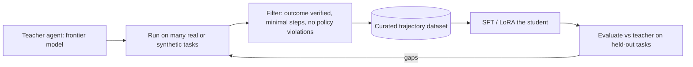

# Post-Training and Model Adaptation

> [!abstract] What this is
> How to change a model's behaviour beyond prompting: deciding between **prompting, RAG and fine-tuning**, supervised fine-tuning (**SFT**), parameter-efficient tuning (**LoRA, QLoRA**), preference tuning (**RLHF, DPO**), **reinforcement learning with verifiable rewards** (RLVR, GRPO), **distilling** agent trajectories from a large teacher into a small student, serving many adapters at once (**multi-LoRA**: S-LoRA, Punica), and **test-time compute** scaling. Architect depth: when and why, what the pipeline looks like, and what goes wrong.

---

## Why It Exists

- Prompting and RAG cover most needs, but some problems remain: a model that won't follow a format reliably, a domain style it can't imitate, a high-volume task too expensive on a frontier model, or tool use that needs to be more accurate than prompting achieves.
- Fine-tuning is often proposed for the wrong reason ("teach it our documents"). Knowing which tool fixes which problem is the core interview signal.

---

## Prompting vs RAG vs Fine-Tuning

| Need | Best tool | Why |
|---|---|---|
| Use **facts** that change, are private, or must be cited | **RAG** ([[06 - RAG Ingestion and Indexing Pipeline]]) | Fresh, citable, permission-aware; fine-tuned "knowledge" is stale, uncitable and prone to hallucination |
| Follow instructions, tone, simple formats | **Prompting** (+ few-shot) | Cheapest, fastest to iterate |
| Reliable **format, style or domain behaviour** that prompts can't hold | **Fine-tuning (SFT / LoRA)** | Behaviour baked into weights; shorter prompts |
| **Cut cost/latency** on a narrow, high-volume task | **Distil into a smaller model** | Small model matches the large one on that task |
| Better **tool-use / agent decisions** in your environment | **SFT on good trajectories**, then RL with verifiable rewards | Learns your tools and procedures |
| Better **reasoning** on checkable tasks (math, code, SQL) | **RLVR** or a reasoning model with more test-time compute | Rewards come from verifiers |

- The ladder: **prompt → RAG → fine-tune → RL**, each step justified by evals ([[11 - Evals Observability and Silent Drift]]). Fine-tuning and RAG combine well: fine-tune for behaviour (how to use retrieved context, cite, abstain), RAG for knowledge.

---

## Supervised Fine-Tuning (SFT)

- Train on **(input, ideal output)** pairs, usually chat-formatted, so the model imitates the target behaviour. Loss is computed on the assistant's tokens.
- **Data quality dominates**: a few thousand clean, diverse, correct examples usually beat a hundred thousand noisy ones. Include edge cases, refusals, abstentions and the exact output formats you need.
- Watch for **catastrophic forgetting** (general abilities degrade): mix in general instruction data, use parameter-efficient methods, and keep learning rates modest.
- Evaluate against the base model on your task evals **and** on general capability checks before shipping.

---

## Parameter-Efficient Fine-Tuning: LoRA and QLoRA

- Full fine-tuning updates every weight: expensive in memory (weights, gradients and optimiser states) and produces a full model copy per variant.
- **LoRA** freezes the base model and learns a **low-rank update** for selected weight matrices:

```
W' = W + ΔW,   ΔW = B · A,   A ∈ R^(r × d_in),  B ∈ R^(d_out × r),  r ≪ d   (e.g. r = 8–64)
```

- Details:
    + Only `A` and `B` train: often well under 1% of parameters, so training fits on far less hardware.
    + The **adapter** is small (megabytes to a few hundred MB) and can be merged into the base weights or kept separate and swapped at serving time.
    + Key knobs: rank `r`, scaling `alpha`, which modules get adapters (attention projections, MLP layers).
- **QLoRA**: load the frozen base model in **4-bit** and train LoRA adapters on top, letting large models be fine-tuned on a single GPU, with small quality trade-offs.

| | Full fine-tune | LoRA | QLoRA |
|---|---|---|---|
| Trainable params | All | <1% typical | <1% typical |
| Training memory | Very high | Moderate | Low |
| Artifact | Full model copy | Small adapter | Small adapter |
| Quality ceiling | Highest | Close for most tasks | Close, slightly lower |
| Pick when | Large shifts in behaviour, lots of data and compute | Default | GPU-constrained training |

```python
from peft import LoraConfig, get_peft_model
from transformers import AutoModelForCausalLM

base = AutoModelForCausalLM.from_pretrained("your-base-model")
config = LoraConfig(r=16, lora_alpha=32, lora_dropout=0.05,
                    target_modules=["q_proj", "k_proj", "v_proj", "o_proj"], task_type="CAUSAL_LM")
model = get_peft_model(base, config)
model.print_trainable_parameters()       # tiny fraction of the base model
```

---

## Preference Tuning: RLHF and DPO

- SFT teaches *what* a good answer looks like from examples. Preference tuning teaches *which of two answers is better*.
- **RLHF**: humans rank outputs → train a **reward model** on the rankings → optimise the policy with RL (classically PPO) to maximise reward, with a KL penalty keeping it close to the original model.
- **DPO** (Direct Preference Optimization): skip the separate reward model and the RL loop; train directly on (prompt, preferred, rejected) pairs with a classification-style loss. Simpler and more stable; widely used for tone, helpfulness and safety alignment.

---

## Reinforcement Learning with Verifiable Rewards (RLVR)

- For tasks with **checkable answers**, the reward comes from a **verifier**, not a human preference model:
    + Math: does the final answer match?
    + Code: do the unit tests pass?
    + SQL: does the query return the expected rows?
    + Agents: did the environment end in the correct state? Was the output schema-valid?
- The model samples solutions, gets rewarded for verified-correct ones, and learns strategies (including longer step-by-step reasoning) that lead to correct answers. This is a key ingredient behind modern reasoning models.

### GRPO (Group Relative Policy Optimization)

- For each prompt, sample a **group** of outputs (e.g. 8–64), score each with the verifier, and compute each output's **advantage relative to the group** (reward minus the group mean, normalised by the group's standard deviation). Push up the probability of better-than-average outputs, down for worse ones, with a KL constraint.
- No separate **value/critic model** (unlike PPO), which saves memory and simplifies training. Popularised by DeepSeek's reasoning-model work.

```python
def group_advantages(rewards: list[float]) -> list[float]:
    mean = sum(rewards) / len(rewards)
    std = (sum((r - mean) ** 2 for r in rewards) / len(rewards)) ** 0.5 or 1.0
    return [(r - mean) / std for r in rewards]       # better than the group -> positive advantage

# e.g. 4 sampled solutions to one coding prompt, reward = fraction of tests passed
print(group_advantages([1.0, 0.0, 0.5, 1.0]))
```

- **Reward hacking** is the main risk: the model finds ways to pass the verifier without solving the task (special-casing tests, exploiting a weak checker, overly long reasoning if length isn't penalised). Use robust verifiers, held-out tests and trajectory review.

---

## Distilling Agent Trajectories

- Goal: a small, cheap model that behaves like an expensive frontier agent on **your** tasks ([[12 - LLM Cost and Latency Economics]]).



- **Filtering is the whole game.** Training on raw production logs teaches the student the teacher's **mistakes**: redundant tool calls, loops, unnecessary steps, recovered-from errors. Keep only trajectories that:
    + achieved a **verified successful outcome** ([[11 - Evals Observability and Silent Drift]]),
    + used the **fewest reasonable steps** (rejection sampling: generate several, keep the best),
    + broke no policy or permission rules,
    + cover the diversity of real inputs.
- Optionally follow SFT with RLVR on the same environment to push past the teacher's success rate.
- Licensing and terms: check that the teacher model's terms allow using its outputs to train other models.

---

## Serving Many Adapters: Multi-LoRA

- Per-tenant or per-task adapters are attractive (a support adapter, a SQL adapter, one per enterprise customer), but deploying a full model per adapter wastes GPUs.
- **Multi-LoRA serving** keeps **one base model** in GPU memory and many small adapters, and batches requests for **different** adapters together:
    + **S-LoRA**: stores adapters in a unified paged memory pool (like PagedAttention for adapters), swaps them between CPU and GPU on demand, and serves thousands of adapters on one base.
    + **Punica**: custom kernels (SGMV, segmented gather matrix-vector) that compute different LoRA updates for different requests within the same batch efficiently.
- Supported in mainstream engines (vLLM, SGLang, TensorRT-LLM, LoRAX). Trade-offs: some per-token overhead vs a merged model, adapter load latency on cold starts, and all adapters must share the base model version.

---

## Test-Time Compute Scaling

- Instead of a bigger pre-trained model, spend **more compute at inference** on hard problems:

| Technique | How | Cost |
|---|---|---|
| **Reasoning models / thinking budgets** | Model generates long internal reasoning before answering | Many extra output tokens |
| **Best-of-N with a verifier** | Sample N answers, pick the one a verifier or reward model scores highest | N× generation |
| **Self-consistency** | Sample several reasoning paths, majority-vote the answer | N× generation |
| **Search over steps** | Tree/beam search guided by a process reward model | High, complex |

- Trade-off vs **pre-training scale**: test-time compute lets a smaller model match a larger one on checkable reasoning tasks, at the cost of per-request latency and tokens. It's a dial: route only hard requests to high reasoning effort ([[12 - LLM Cost and Latency Economics]]).

---

## Operational Concerns

- **Versioning**: base model version + adapter version + training data version + eval results, all recorded together.
- **Upgrades**: when the base model updates, adapters must be **retrained**; budget for it.
- **Data governance**: training data with PII or customer content needs consent, retention rules and the ability to honour deletion (which may require retraining) ([[18 - Security]]).
- **Contamination**: keep eval sets out of training data, or scores are meaningless.
- **Serving**: fine-tuned open models need the serving stack from [[13 - GPU Serving and Disaggregated KV Cache]] and [[14 - Quantization Decoding and VRAM Math]], or a provider's fine-tuning endpoint.

---

## Failure Modes

| Failure | What happens | Mitigation |
|---|---|---|
| **Fine-tuning to add knowledge** | Stale, uncitable facts; more confident hallucination | RAG for knowledge; fine-tune for behaviour |
| **Training on raw logs** | Student learns loops, redundant steps and recovered errors | Outcome-verified, minimal-step, policy-clean trajectories only |
| **Catastrophic forgetting** | General abilities regress | Mixed data, LoRA, modest learning rates, general-capability evals |
| **Reward hacking in RLVR** | Passes the verifier without solving the task | Robust verifiers, held-out tests, length penalties, trajectory review |
| **Eval contamination** | Inflated scores | Strict train/eval separation |
| **Adapter sprawl** | Hundreds of unmaintained adapters on old bases | Registry, ownership, retraining plan per base upgrade |
| **Serving each adapter separately** | GPU waste | Multi-LoRA serving on a shared base |

---

## Interview Lines

> [!tip] Say it like this
> - "RAG is for knowledge, fine-tuning is for behaviour; I'd only fine-tune after prompting and RAG plateau on evals."
> - "LoRA learns a low-rank update on a frozen base, so adapters are tiny and many can be served on one base model with S-LoRA-style multi-adapter batching."
> - "RLVR replaces human preference with verifiers like unit tests; GRPO scores a group of samples per prompt and uses the group mean as the baseline, so no critic model is needed."
> - "To distil an agent, I filter teacher trajectories to verified, minimal-step, policy-clean ones; training on raw logs copies the teacher's mistakes."
> - "Test-time compute lets a smaller model reason longer on hard requests; I route only those to high reasoning effort."

## Related Notes

- [[06 - RAG Ingestion and Indexing Pipeline]] · [[11 - Evals Observability and Silent Drift]] · [[12 - LLM Cost and Latency Economics]] · [[13 - GPU Serving and Disaggregated KV Cache]] · [[14 - Quantization Decoding and VRAM Math]]
- [[Agentic/README]]
