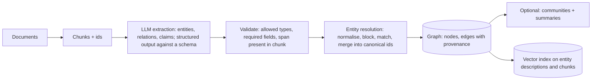

# Knowledge Graphs and GraphRAG

> [!abstract] What this is
> How to store knowledge as **entities and relationships** and use it to ground an LLM: the two graph data models, building a graph from text with an LLM (schema, extraction, **entity resolution**, provenance), the ways to query it (neighbourhood expansion, community summaries, **text-to-Cypher**, graph-seeded hybrid retrieval), the cheaper GraphRAG variants, keeping the graph fresh and permission-safe, and how to prove it beats plain vector RAG. [[07 - Agentic RAG and Grounding Loops#GraphRAG vs Vector RAG]] has the short version; this note is the depth.

---

## Why It Exists

- Vector retrieval finds chunks **similar to the question**. It struggles when the answer is a **path** ("which suppliers of part X also supply our competitor?"), a **whole-corpus theme** ("top recurring root causes this quarter"), or depends on **which facts are still true** ("who owns this service now?").
- A graph makes relationships explicit, so the system can follow them instead of hoping one chunk mentions both ends.
- It costs real money and engineering: LLM extraction over every chunk, entity resolution, upkeep on every document change. Interviewers ask "how would you control the cost of maintaining a knowledge graph used by an LLM?" (PracHub, 2026) and "when is vector RAG cheaper or better?" (PracHub GraphRAG guide, Sep 2026).

---

## Two Data Models

| | Property graph | RDF triples |
|---|---|---|
| Shape | Nodes and edges, each with a label and key-value properties | `(subject, predicate, object)` triples with global IRIs |
| Query language | **Cypher** (Neo4j, Memgraph; standardised as ISO GQL in 2024), Gremlin | **SPARQL** |
| Schema | Optional; you define labels and relationship types | Ontologies (RDFS, OWL) with formal semantics and inference |
| Strengths | Simple to model, fast traversals, properties on edges (dates, confidence, source) | Interoperable public data (Wikidata), reasoning over class hierarchies |
| Pick when | Default for an application knowledge graph behind an LLM | You must merge with public linked data or need formal ontology reasoning |

- **You often don't need a graph database.** A few hops over a few million edges fits in Postgres (an `edges(src, rel, dst, props)` table with indexes and recursive CTEs) or in memory with NetworkX for batch jobs. Reach for a graph database when traversals are deep, frequent and interactive ([[05 - Databases/07 - Data Modelling]]).

---

## Building the Graph from Text



### 1. Schema first

- Decide the **entity types and relation types** you need for the questions you must answer (`Supplier`, `Part`, `SUPPLIES`, `Incident`, `CAUSED_BY`). An open schema ("extract anything") gives a noisy graph with 40 spellings of the same relation.
- Put the schema in the extraction prompt and enforce it with structured output ([[00 - LLM Fundamentals for Engineers#Structured Outputs]]); reject or map anything outside it.

### 2. Extraction with provenance

- One LLM call per chunk (or per section) returns entities, relations and optional **claims** (dated factual statements), each with a **quoted span**.
- Every edge stores: source chunk id and document id, the span, extraction confidence, model and prompt version, `extracted_at`, and validity dates if the text gives them.
- **Validate before writing:** the span must appear in the chunk (catches invented relations); types must be in the schema; dates must parse.
- Cheaper first pass: classic NER and dependency patterns for common entity types, LLM only for relations or for chunks that contain candidate entities (this is roughly how LazyGraphRAG keeps indexing cheap; Microsoft Research, Nov 2024).

### 3. Entity resolution

The step that decides whether the graph is useful: "IBM", "I.B.M." and "International Business Machines" must be one node, and two different "John Smith"s must not.

| Stage | How |
|---|---|
| **Normalise** | Case, punctuation, legal suffixes ("Pvt Ltd", "Inc."), transliteration for Indian names |
| **Block** | Only compare candidates sharing a key (first letters, same type, same city) so you don't compare everything with everything |
| **Match** | Rules on strong identifiers (GSTIN, email, domain) first; then embedding similarity of name plus context; an LLM adjudicates the uncertain middle band |
| **Merge** | Canonical id with an alias list; keep the evidence for each merge so a wrong merge can be undone |

- **Prefer a missed merge over a wrong merge**: a split entity loses a connection; a wrong merge invents false paths that the LLM will confidently report.
- Link to an existing master list (customers, products, employees) when one exists; resolution against a catalogue is far more accurate than discovering entities from scratch.

### 4. Communities and summaries (optional)

- Microsoft's GraphRAG clusters the graph into nested communities (Leiden algorithm) and has an LLM write a summary for each, which is what makes **global** questions answerable (Edge et al., 2024).
- This is the most expensive step and the most fragile under change; skip it unless global questions matter.

### Cost arithmetic

```
1M chunks × 1 extraction call × (~1,500 input + ~300 output tokens)       (*assumed*)
= 1.5B input + 0.3B output tokens
at $0.15 / $0.60 per M on a small model (*assumed* prices) ≈ $225 + $180 ≈ $400 per full build
at $3 / $15 per M on a large model                         ≈ $4,500 + $4,500 ≈ $9,000 per full build
+ community summaries, + re-extraction on every changed chunk
```

- **Control the cost** (the reported interview question): small model for extraction with a large model only on low-confidence chunks; extract only from document types that carry relations; incremental re-extraction by chunk content hash ([[06 - RAG Ingestion and Indexing Pipeline#Freshness: Updates and Deletes]]); batch APIs at half price; skip community summaries unless global questions need them; LazyGraphRAG-style deferral of LLM work to query time.

---

## Querying the Graph

| Pattern | How it works | Pick when |
|---|---|---|
| **Local search** (entity neighbourhood) | Find the entities in the question (string match or embedding search over entity descriptions), expand 1–2 hops, gather their relations and the source chunks | Questions about known entities and their connections |
| **Global search** (community summaries) | Map over community summaries with the question, then reduce the partial answers | Corpus-wide themes; needs the summaries built |
| **DRIFT** | Starts like global search to frame the question, then runs local searches for follow-ups (Microsoft Research, Oct 2024) | Broad questions that also need specifics |
| **Text-to-Cypher** | LLM writes a graph query from the schema; the database executes it | Precise structured questions: counts, filters, exact paths |
| **Graph-seeded hybrid** | Vector or BM25 retrieval finds chunks; their entities seed a graph expansion; expanded chunks are reranked together | Default when you have both; graph adds recall for multi-hop |
| **Personalized PageRank** (HippoRAG 2) | Seed nodes from the query, run PPR over the entity–passage graph, rank passages by score (Gutiérrez et al., 2025) | Multi-hop QA without a hand-built schema |

### Text-to-Cypher safely

- Same rules as text-to-SQL ([[06 - Text-to-SQL Analytics Assistant]]): read-only credentials, an allow-listed set of labels and relationship types, a forced `LIMIT`, a query timeout, bounded path length (`*1..3`, never unbounded `*`), and permission filters applied by the database or a wrapper, never trusted to the generated query.
- **Schema filtering** (send only the relevant part of the schema) helps smaller models most (arXiv 2505.05118, 2025); fine-tuning on Text2Cypher data gives large gains for open models (Neo4j Text2Cypher dataset, 44k examples, arXiv 2412.10064).
- Validate before running: parse the query, check labels exist, `EXPLAIN` for cost; on error, feed the error back once and retry.

### Context packing

- A traversal returns many weak edges. Rank evidence by relation confidence, source authority, recency and path length; send **source passages with citations**, not just node labels; mark inferred connections separately from stated facts (PracHub GraphRAG guide, Sep 2026).

---

## GraphRAG Variants

| Variant | Idea | Indexing cost | Pick when |
|---|---|---|---|
| **Microsoft GraphRAG** | LLM extracts entities, relations, claims; Leiden communities; LLM summary per community; local, global, DRIFT search | Highest | Global questions over a stable corpus |
| **LazyGraphRAG** | NLP-based concept extraction, no up-front summaries; LLM work deferred to query time | Reported at **0.1%** of full GraphRAG, same as vector RAG (Microsoft Research, Nov 2024, vendor claim) | Want graph benefits without the indexing bill; one-off or exploratory queries |
| **LightRAG** | Graph plus vectors with dual-level retrieval (specific entities and broader themes); incremental updates without a full rebuild (Guo et al., 2024) | Medium | Changing corpus, mixed local and thematic questions |
| **HippoRAG 2** | Entity–passage graph with Personalized PageRank; keeps factual QA at vector-RAG level while improving multi-hop (Gutiérrez et al., 2025) | Medium | Multi-hop QA, continual addition of documents |
| **RAPTOR** | Not a knowledge graph: a tree of recursive cluster summaries over chunks (Sarthi et al., 2024) | Medium | Long documents needing answers at several levels of abstraction |

- Independent benchmarks disagree with vendor results: on legal documents, **hybrid** setups (LightRAG mix mode, LlamaIndex hybrid) were most accurate and **graph-only** systems underperformed (RAGE-KG 2025); an unbiased re-evaluation found many reported GraphRAG gains shrink under fair comparison (arXiv 2506.06331, 2025). Say this when asked "is GraphRAG better?".

---

## Keeping It Fresh, Deletable and Permission-Safe

- **Incremental updates:** re-extract only chunks whose content hash changed; edges whose only provenance was a removed chunk are deleted; nodes with no remaining edges are removed or marked stale.
- **Deletes are the hard case:** a deleted document's facts may live in merged entities, community summaries and cached answers. Provenance on every edge makes the graph part deletable; summaries that used the document must be regenerated (the 2026 Lightfoot paper targets exact, model-free deletion for this reason; arXiv 2611.11010).
- **Time:** facts change ("lived in Pune until 2025"). Store validity intervals on edges (a temporal or bi-temporal graph, as Zep's Graphiti does for agent memory) so queries can ask "as of" and old facts don't contradict new ones ([[04 - State Memory and Context Engineering#Long-Term Memory]]).
- **Permissions:** each edge inherits the ACL of its source documents. Filter traversals by the user's access, so a path never crosses a document they can't read. **Community summaries leak** when they mix documents with different ACLs: build them per access group, or don't use global summaries for mixed-permission corpora ([[09 - Enterprise Search over SaaS Connectors]]).

---

## Evaluating It

- **Query set labelled by type:** local lookup, multi-hop, global theme, temporal, unanswerable (PracHub GraphRAG guide).
- **Baselines:** no retrieval, vector, hybrid BM25 + vector, then the graph variant; ablate the graph, the summaries and the prompt separately so you know what produced a gain.
- **Metrics:** answer correctness, evidence coverage, faithfulness to cited passages, latency, query cost, **index build and refresh cost**, stale-answer rate ([[11 - Evals Observability and Silent Drift]]).
- **Graph quality on a labelled sample:** extraction precision and recall per relation type, entity-resolution precision (wrong merges) and recall (missed merges).

---

## Failure Modes

| Failure | What happens | Production fix |
|---|---|---|
| Hallucinated relation | False path reported as fact | Span must appear in the chunk; provenance on edges; cite passages |
| Wrong entity merge | Two companies' facts combined | Strong identifiers first; precision over recall; undoable merges with evidence |
| Missed merge | Connection never found | Aliases, catalogue linking, LLM adjudication for the uncertain band |
| Open schema | Hundreds of relation spellings | Fixed schema in the prompt and structured output |
| Unbounded traversal | Timeouts, huge contexts | Path-length limits, LIMIT, ranking by confidence |
| Stale summaries | Old facts in global answers | Incremental extraction, regenerate affected communities, track index version |
| ACL leak through summaries | User sees restricted facts | Per-access-group summaries; traversal filtered by ACL |
| Extraction bill | Budget blown on re-indexing | Small model first, content-hash incremental, LazyGraphRAG-style deferral |

---

## Interview Lines

> [!tip] Say it like this
> - "I add a graph only when the questions are about paths, whole-corpus themes or facts that change over time; otherwise hybrid vector plus BM25 with a reranker is cheaper and as good."
> - "The graph is an extraction system with an error rate: fixed schema, quoted spans checked against the chunk, provenance on every edge, and entity resolution that prefers a missed merge to a wrong one."
> - "Retrieval is hybrid: vector hits seed a bounded graph expansion, then everything is reranked and the model sees source passages with citations, not node labels."
> - "Text-to-Cypher gets the text-to-SQL treatment: read-only, allow-listed labels, LIMIT, bounded paths, timeouts, permissions enforced outside the query."
> - "Cost control: a small model for extraction, incremental re-extraction by content hash, no community summaries unless global questions need them; LazyGraphRAG reports indexing at about 0.1% of full GraphRAG."
> - "Every edge inherits its source documents' ACL, and community summaries are built per access group, or they leak."

## Sources

- D. Edge et al., *From Local to Global: A Graph RAG Approach to Query-Focused Summarization* (Microsoft Research, arXiv 2404.16130, 2024); Microsoft GraphRAG docs (indexing and query overview). https://microsoft.github.io/graphrag/
- Microsoft Research, *LazyGraphRAG: Setting a new standard for quality and cost* (Nov 2024) and *Introducing DRIFT Search* (Oct 2024). https://www.microsoft.com/en-us/research/blog/introducing-drift-search-combining-global-and-local-search-methods-to-improve-quality-and-efficiency/
- Z. Guo et al., *LightRAG: Simple and Fast Retrieval-Augmented Generation* (arXiv 2410.05779, 2024). https://arxiv.org/abs/2410.05779
- B. J. Gutiérrez et al., *From RAG to Memory: Non-Parametric Continual Learning for LLMs* (HippoRAG 2, arXiv 2502.14802, 2025). https://arxiv.org/abs/2502.14802
- P. Sarthi et al., *RAPTOR: Recursive Abstractive Processing for Tree-Organized Retrieval* (ICLR 2024).
- *Benchmarking KG-based RAG Systems: A Case Study of Legal Documents* (RAGE-KG 2025). https://2025.rage-kg.org/papers/RAGE-KG25_paper_2.pdf
- *How Significant Are the Real Performance Gains? An Unbiased Evaluation Framework for GraphRAG* (arXiv 2506.06331, 2025). https://arxiv.org/abs/2506.06331
- *Lightfoot: Graph RAG with Exact, Model-Free Document Deletion* (arXiv 2611.11010, 2026). https://arxiv.org/abs/2611.11010
- Neo4j, *Text2Cypher* dataset paper (arXiv 2412.10064, 2024); *Enhancing Text2Cypher with Schema Filtering* (arXiv 2505.05118, 2025).
- PracHub, *GraphRAG Interview Questions: Graph Construction, Retrieval, Context, and Evaluation* (Sep 2026); *Evaluate RAG System Accuracy and Cost Control Strategies* (knowledge-graph cost question, 2026). https://prachub.com/resources/graphrag-interview-questions-graph-construction-retrieval-context-and-evaluation
- ISO/IEC 39075:2024, *GQL* (graph query language standard).

## Related Notes

- [[07 - Agentic RAG and Grounding Loops]] · [[06 - RAG Ingestion and Indexing Pipeline]] · [[08 - Vector DB Internals and Hybrid Search]] · [[04 - State Memory and Context Engineering]] · [[06 - Text-to-SQL Analytics Assistant]] · [[09 - Enterprise Search over SaaS Connectors]]
- [[Agentic/README]]
