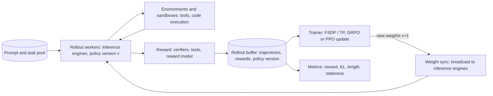

# Training and RL Systems at Architect Depth

> [!abstract] What this is
> The systems side of training that big-tech MLE and lab interviews ask about (Meta, Google, Amazon, Microsoft, 2025–26): training-memory arithmetic, the parallelism family (data, FSDP/ZeRO, tensor, pipeline, expert, context), FlashAttention and long sequences, sharding the vocabulary and combining logits, MoE pretraining, and the architecture of an **asynchronous RL post-training system**. Architect depth: explain why, do the arithmetic, choose; no kernel code. Serving-side parallelism is in [[13 - GPU Serving and Disaggregated KV Cache#Model Parallelism]]; the algorithms (SFT, DPO, GRPO) are in [[15 - Post-Training and Model Adaptation]].

---

## Why It Exists

- Reported questions: *Architect an asynchronous RL post-training system* (Meta, hard); *Explain pipeline parallelism in GRPO training* (Google); *Design a scalable MoE pretraining pipeline* (Meta, hard); *Explain parallelism and collectives in training* (Amazon); *Optimize attention for long sequences* (Amazon); *Shard an LM head and combine distributed logits* and *Shard a large input embedding table across devices* (Microsoft) (PracHub, 2025–26).
- Application roles skip this; MLE and research-engineer loops at big tech and labs expect it.

---

## Training Memory Arithmetic

```
Mixed-precision Adam, per parameter:
  BF16 weights 2 B + BF16 gradients 2 B + FP32 master weights 4 B + Adam m 4 B + Adam v 4 B = 16 B
70B parameters × 16 B ≈ 1.1 TB of model state, before activations
→ 14+ H100s (80 GB) just to hold the state; activations come on top and grow with batch × sequence × layers
```

- **Activations** usually dominate at long sequences. **Activation checkpointing** stores only some layer inputs and recomputes the rest in the backward pass: roughly a third more compute for a large memory cut.
- **Training FLOPs ≈ 6 × parameters × tokens** (2 forward, 4 backward), the standard estimate for sizing a run (Kaplan et al., 2020): 70B × 15T tokens ≈ 6.3 × 10²⁴ FLOPs; at 40% utilisation of 989 TFLOP/s per H100 (~396 TFLOP/s achieved) that is 6.3 × 10²⁴ ÷ 3.96 × 10¹⁴ ≈ 1.6 × 10¹⁰ GPU-seconds ≈ **4.4M GPU-hours** (about 2 months on 3,000 GPUs).

---

## The Parallelism Family

| Strategy | Splits | Communication | Pick when |
|---|---|---|---|
| **Data parallel (DDP)** | The batch; every GPU holds the full model state | All-reduce of gradients each step | Model state fits on one GPU |
| **FSDP / ZeRO** | Optimizer states (ZeRO-1), + gradients (ZeRO-2), + parameters (ZeRO-3 = FSDP) across data-parallel ranks | All-gather parameters per layer before use, reduce-scatter gradients | Model state doesn't fit, but each layer does; the default for most fine-tuning and mid-size pretraining |
| **Tensor parallel** | Each layer's matrices | Two all-reduces per layer (Megatron), needs NVLink | Layers too big or too slow on one GPU; inside a node |
| **Pipeline parallel** | Layers into stages | Activations between stages | Very large models across nodes |
| **Expert parallel** | MoE experts across GPUs | **All-to-all** to route tokens to experts and back | Mixture-of-experts models |
| **Context / sequence parallel** | The sequence | Ring exchange of K and V blocks (ring attention) | Very long sequences |

- Large runs combine them (**3D/4D parallelism**): TP inside a node, PP across nodes, DP or FSDP across groups, EP for MoE layers. The layout is chosen to keep the heaviest communication on the fastest links ([[19 - GPU Cluster Infrastructure and Operations#Inside a GPU Node and Between Nodes]]).
- **Pipeline bubble:** with `p` stages and `m` micro-batches, idle fraction ≈ `(p − 1) ÷ (m + p − 1)`; 8 stages and 32 micro-batches waste ~18%. More micro-batches shrink it; schedules such as 1F1B (one forward, one backward, interleaved) cap activation memory; interleaved stages shrink the bubble further.
- **Collectives to know:** all-reduce = reduce-scatter + all-gather; ring all-reduce moves about `2 × (n−1)/n × bytes` per GPU ([[14 - Quantization Decoding and VRAM Math#Sharding a matmul across GPUs]]).

---

## Long Sequences and FlashAttention

- Standard attention materialises an `n × n` score matrix per head: memory and HBM traffic grow quadratically with sequence length.
- **FlashAttention** computes exact attention in **tiles** kept in on-chip SRAM, using an **online softmax** (running max and running sum per row) so the full matrix never goes to HBM. Same result, much less memory traffic, which is why it's faster: attention is memory-bound, not FLOP-bound (Dao et al., 2022).
- **Beyond one GPU:** context parallelism / **ring attention** splits the sequence across GPUs and passes K/V blocks around a ring, overlapping transfer with compute.
- **Architecture options:** sliding-window layers (attend to the last W tokens), grouped-query attention to shrink K/V, sparse or linear-attention variants; each trades some long-range quality for cost ([[13 - GPU Serving and Disaggregated KV Cache#The KV Cache]]).

---

## Sharding the Vocabulary

- With a 128k–256k vocabulary, the **LM head** (`d_model × vocab`) and the **embedding table** are among the largest matrices. Split the vocabulary across `t` GPUs: each holds `vocab ÷ t` columns.
- **Combining distributed logits without gathering them** (the Microsoft question): each GPU computes logits for its slice, then
    1. local max → **all-reduce max** → global max `M`;
    2. local `Σ exp(logit − M)` → **all-reduce sum** → global normaliser `Z`;
    3. for the loss, the GPU that owns the target token contributes `logit_target − M − log Z`; an all-reduce sums it.
    Only a few scalars per token cross the network instead of the full vocabulary (Megatron's vocab-parallel cross-entropy).
- **For sampling:** each GPU takes its local top-k with values, gather only those `k × t` candidates, then take the global top-k and sample.
- **Embedding table:** each GPU looks up the ids in its range and returns zeros for the rest; an all-reduce sums the partial embeddings. Very large recommender tables shard by row with hashing and are looked up with all-to-all.

---

## MoE Pretraining Pipeline

- **Router** picks top-k experts per token; experts live on different GPUs (expert parallel), so each MoE layer does an all-to-all to send tokens to experts and another to bring them back.
- **Load balancing:** an auxiliary loss (or bias-based balancing) keeps experts evenly used; a **capacity factor** caps tokens per expert, and overflow tokens are dropped or routed to the next choice. Unbalanced routing makes one GPU the straggler for the whole step.
- **Pipeline around the model:** deduplicated, filtered, tokenised data in shards with a deterministic order so a restart resumes exactly; sharded asynchronous checkpoints; eval jobs on checkpoints; loss-spike detection with rollback to an earlier checkpoint and skipping the bad data batch ([[19 - GPU Cluster Infrastructure and Operations#Collective Communication and Training-Scale Failures]]).

---

## Asynchronous RL Post-Training Systems

RL for LLMs alternates two very different workloads: **generating rollouts** (inference: many long samples, tool calls, sandboxes) and **training** on them (backward passes). Running them on the same GPUs in lockstep leaves one side idle.



- **Synchronous** (generate a batch, then train on it): simple and on-policy, but trainer GPUs idle while the slowest rollout finishes; long agentic rollouts make the tail worse.
- **Asynchronous:** rollout workers keep generating with a slightly old policy while the trainer updates. Throughput is much higher; the cost is **off-policy staleness**. Bound it (accept rollouts at most `k` versions old), correct with importance weights or clipping, and log staleness as a metric.
- **Weight sync** is a large transfer every update: broadcast new weights from trainer to inference engines over NCCL or RDMA, or update in place when they share GPUs; avoid pausing all generation at once ([[14 - Model Weight Distribution to a GPU Fleet]]).
- **Pipeline parallelism in GRPO** (the Google question): GRPO needs a group of samples per prompt before computing advantages; overlap group generation for prompt *i+1* with the trainer's update for prompt *i*, and pipeline model stages across GPUs so micro-batches of trajectories flow through while others are still generating. The constraint is that advantages need the **whole group's** rewards.
- **Rewards and environments** run as their own service: sandbox fleets for code, verifiers, rate-limited reward-model calls; a slow environment is a straggler for its whole group ([[15 - Post-Training and Model Adaptation#RL environments and rewards for agents]]).
- **Watch:** reward going up while held-out evals stay flat (reward hacking), KL to the reference model, response length growth, and the fraction of groups with zero variance (all right or all wrong, no learning signal).

---

## Failure Modes

| Failure | What happens | Production fix |
|---|---|---|
| Model state doesn't fit | OOM before the first step | FSDP/ZeRO-3, activation checkpointing, smaller micro-batches |
| TP across nodes | Step time dominated by all-reduce | TP in the NVLink domain, PP or FSDP across nodes |
| Large pipeline bubble | GPUs idle a fifth of the step | More micro-batches, 1F1B or interleaved schedules |
| Unbalanced MoE routing | One expert GPU straggles | Balancing loss, capacity factor, monitor expert load |
| Quadratic attention memory | OOM on long sequences | FlashAttention, context parallelism, sliding windows |
| Gathering full logits | Huge transfers per token | Vocab-parallel softmax with all-reduced max and sum |
| Stale rollouts in async RL | Unstable training | Staleness bound, importance correction, log policy versions |
| Loss spike | Run diverges | Rollback to checkpoint, skip the data batch, lower LR |

---

## Interview Lines

> [!tip] Say it like this
> - "Mixed-precision Adam needs about 16 bytes per parameter, so a 70B model is over a terabyte of state before activations; FSDP shards it across data-parallel ranks."
> - "I keep tensor parallel inside the node, pipeline across nodes, FSDP across groups, and expert parallel for MoE layers, so the heaviest traffic is on NVLink."
> - "Pipeline bubble is (p − 1) over (m + p − 1); more micro-batches shrink it."
> - "FlashAttention is exact attention computed in tiles with an online softmax, so the n-by-n matrix never touches HBM; it's faster because attention is memory-bound."
> - "For a sharded LM head I never gather logits: all-reduce the max, all-reduce the sum of exponentials, and only the owner of the target token adds its term."
> - "Async RL keeps rollout engines busy while the trainer updates, at the price of staleness, which I bound and log; weight sync to the inference engines is part of the design."

## Sources

- S. Rajbhandari et al., *ZeRO: Memory Optimizations Toward Training Trillion Parameter Models* (SC 2020): 16 bytes per parameter for mixed-precision Adam; ZeRO stages.
- M. Shoeybi et al., *Megatron-LM* (2019) and D. Narayanan et al., *Efficient Large-Scale Language Model Training on GPU Clusters Using Megatron-LM* (SC 2021): tensor, pipeline (1F1B, interleaved) and vocab-parallel cross-entropy.
- T. Dao et al., *FlashAttention: Fast and Memory-Efficient Exact Attention with IO-Awareness* (NeurIPS 2022).
- H. Liu et al., *Ring Attention with Blockwise Transformers for Near-Infinite Context* (2023).
- J. Kaplan et al., *Scaling Laws for Neural Language Models* (2020): training FLOPs ≈ 6 × N × D.
- W. Fedus et al., *Switch Transformers* (JMLR 2022): capacity factor and load balancing in MoE.
- PracHub ML system design banks for Meta, Google, Amazon and Microsoft (2025–26): the questions listed in Why It Exists. https://prachub.com/companies/meta/categories/ml-system-design
- Austin et al., *How to Scale Your Model* (Google DeepMind, 2025). https://jax-ml.github.io/scaling-book/

## Related Notes

- [[13 - GPU Serving and Disaggregated KV Cache]] · [[14 - Quantization Decoding and VRAM Math]] · [[15 - Post-Training and Model Adaptation]] · [[19 - GPU Cluster Infrastructure and Operations]]
- [[Agentic/README]]
