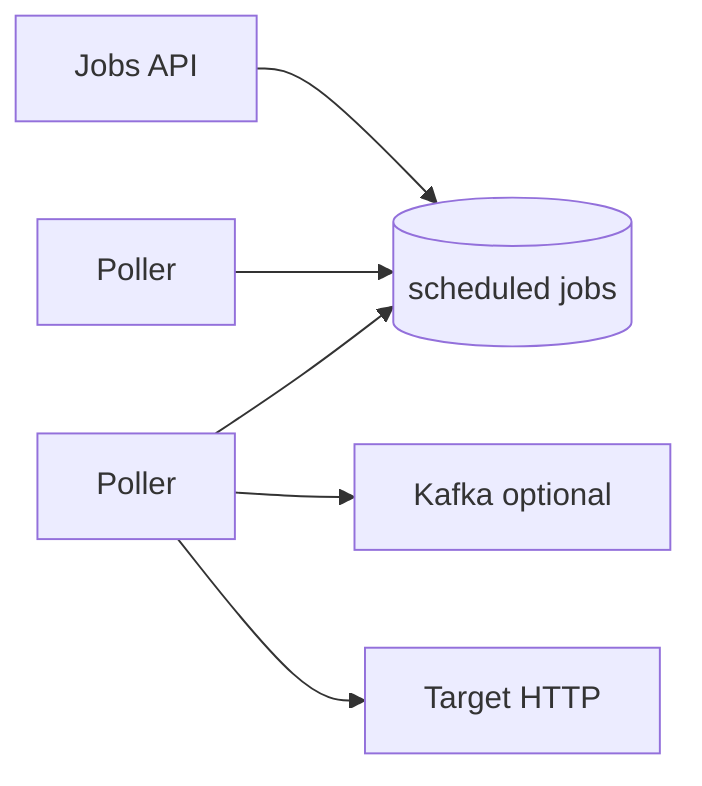
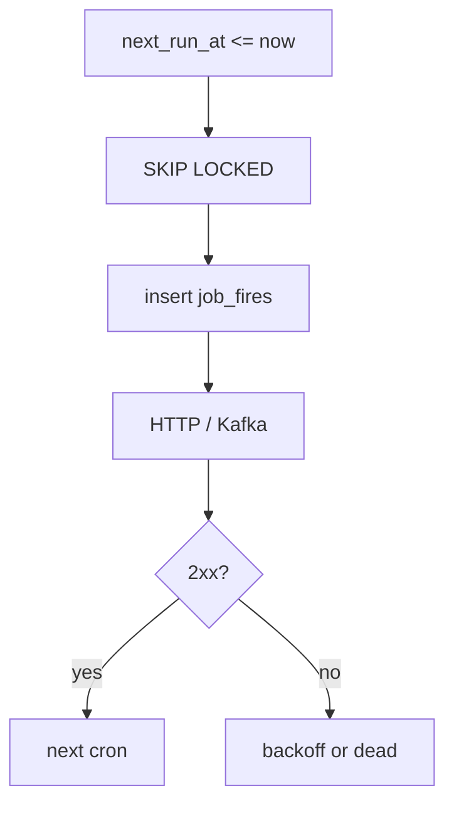
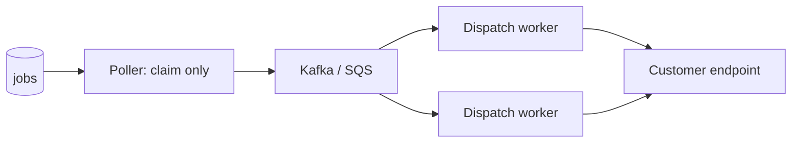

# Task Scheduler

> [!abstract] Interview walk. Cron / delayed jobs: **store the next fire, poll with `SKIP LOCKED`, dispatch once, retry with backoff.** Not “I’ll use Celery” as the design. Script: [[01 - How the Round Works]]. Locks: [[14 - Coordination and Concurrency]].

## 1. Requirements

**Clarify:** one-shot delay vs cron? HTTP callback vs queue? At-least-once is the default.

### Functional

- Create a job: cron (`0 9 * * *`) **or** `run_at`.
- Payload: URL + body **or** topic key (we pick **HTTP callback** + optional Kafka).
- Cancel. List by owner.
- On fire: invoke, record success/fail, cron computes **next**.
- Retries with backoff; then dead-letter.

### Non-functional

- Fire within **~1s** of schedule (not 1 ms). 99.9% eventually delivered.
- **At-least-once.** Idempotent consumers / `Idempotency-Key` on the target.
- Multi-instance pollers, **no double-dispatch** of the same fire.

### Out of scope

- Distributed cron across 20 regions, exactly-once end-to-end, user-facing workflow UI ([[05 - Jira]]).

## 2. Estimations

Say the arithmetic out loud. Every number below **changes one decision**.

**Average load — boring on purpose**

- **1M jobs**, most of them daily → ~1M fires/day
- `1M / 10⁵` = **~12 fires/s average**. That is nothing
- So the average tells you: **one Postgres, no queue needed for throughput**

**The clump is the real problem**

- Humans write `0 * * * *` and `0 0 * * *`. Assume **30% fire on the hour**
- 300k jobs all due at `:00` → not 12/s, a **300k backlog in one instant**
- Drain rate = `batch_size × pollers / cycle_seconds`
    + 50 × 2 pollers / 0.5 s = **200/s** → 300k takes **25 minutes**. Blows the 1s SLA badly
- Fix in this order
    1. **Jitter `next_run_at` by 0–60 s on create** — removes most of the clump for free
    2. Bigger batch (500) and more pollers
    3. **Split claim from delivery** (§7) — claim is cheap, HTTP is not

**Delivery concurrency — the number people miss**

- `concurrency = QPS × latency` ([[16 - Estimation and Decision Cheat Sheet]])
- Target endpoints are customer-owned → assume **200 ms**
- To sustain **1k fires/s**: `1000 × 0.2` = **200 in-flight HTTP calls**
- One poller doing serial HTTP: `1 / 0.2` = **5/s**. Two pollers = 10/s. **You cannot brute force this**
- Therefore: poller **enqueues**, dispatch workers do the HTTP, and they scale separately

**Storage — drives a retention decision**

- `jobs`: 1M × ~300 B = **300 MB**. Irrelevant
- `job_fires`: 1M/day × 200 B = **200 MB/day** → `~73 GB/year`, ~150 GB with indexes
- That number says: **partition `job_fires` by month, drop after 90 days.** Not "keep fires forever"

**The pick**

> Postgres for `jobs` and `job_fires`, N stateless pollers claiming with `SKIP LOCKED`, delivery split onto a queue. Redis ZSET instead **only** if they demand sub-100 ms precision or millions of fires per minute — then Redis is a second SoR and I owe them a rebuild story.

Same machine I actually operate: [[Resume/Delhivery/05 - Pause Resume]].

## 3. APIs

| Method | Path | Notes |
|---|---|---|
| `POST` | `/jobs` | `{cron \| run_at, url, payload, max_attempts}` |
| `GET` | `/jobs/{id}` | status, next_run_at, last_error |
| `DELETE` | `/jobs/{id}` | cancel |
| `GET` | `/jobs?owner=` | list |

Internal: poller is not a public API. Dispatch = HTTP POST to `url` with `{job_id, fire_id, payload}`.

## 4. Schema

```
jobs(
  id, owner_id, cron, timezone,
  next_run_at,   -- indexed, the poll cursor
  status,        -- active | paused | cancelled
  url, payload_json,
  max_attempts, attempt, backoff_sec,
  updated_at
)
job_fires(
  id, job_id, scheduled_for, started_at, finished_at,
  status,        -- pending | running | succeeded | failed | dead
  http_status, error
)
```

Index: `jobs(status, next_run_at)` **partial** `WHERE status='active'`.

`job_fires.id` is the **idempotency key** the target sees.

## 5. High-level design



- **API** — CRUD, computes first `next_run_at`.
- **Pollers** — every 200–500 ms: claim due rows, dispatch, write result.
- **Kafka** — if the target is *our* workers (`dd-scheduled-events-dispatch` style). HTTP if the client owns the endpoint.

Two pollers, one row: **`FOR UPDATE SKIP LOCKED`**. [[14 - Coordination and Concurrency]].

## 6. Core flow

**Create:** parse cron → `next_run_at`, insert `active`.

**Claim (one txn):**

```sql
SELECT id FROM jobs
WHERE status = 'active' AND next_run_at <= now()
ORDER BY next_run_at
LIMIT 50
FOR UPDATE SKIP LOCKED;
-- insert job_fires pending, set next_run_at = next cron OR + backoff
COMMIT;
```

Then **outside** the lock: HTTP/Kafka. Don’t hold the row during a 30s HTTP.

**After dispatch:** fire `succeeded` / `failed`. Cron: `next_run_at = next(cron)`. Fail: `next_run_at = now() + backoff`, `attempt++`, dead if `attempt >= max`.

Stale `running` (poller died): sweeper if `started_at` older than `timeout` → retry.



## 7. Deep dive

### 7a. Why not the other boxes

| Option | When | Why not default |
|---|---|---|
| Sleep in app | Never | Dies with the pod. |
| Redis ZSET + worker | Huge QPS, ms precision | Another SoR; crash/rebuild story. Fine if they push. |
| Delay Kafka / SQS delay | One-shot only | Cron is awkward; 15 min SQS cap folklore. |
| APScheduler in-process | Dev | Not multi-instance safe. |
| Temporal / Cadence | You already run it | Timers live in the cluster, workers long-poll. Correct answer at scale, **wrong** answer if you're inventing a platform on a whiteboard. |
| **PG + SKIP LOCKED** | This interview | ACID, crash-safe, several pollers, you already operate SQL. |

### 7b. What `SKIP LOCKED` actually does

Walk the transaction boundary — this is the part they probe.

```
BEGIN
  SELECT id … WHERE status='active' AND next_run_at <= now()
  ORDER BY next_run_at LIMIT 500
  FOR UPDATE SKIP LOCKED          -- rows locked in THIS txn only
  → insert job_fires 'running', set next_run_at = next(cron)
COMMIT                            -- lock released here
-- HTTP / enqueue happens AFTER this point
```

- `FOR UPDATE` locks the selected rows. **`SKIP LOCKED` makes a second poller skip them instead of blocking**
- The lock lives **only until COMMIT**. After that the fence is the **row state** (`running` + `next_run_at` moved), not a held lock
- That is why two pollers on the same cycle claim **disjoint** sets with zero coordination — no leader, no advisory lock, no ZooKeeper
- **Never** hold the transaction open across the dispatch. A 30 s HTTP timeout would pin 500 rows and block vacuum

> [!tip] Say it as: *"I lock only to claim, I commit, then I work. The lock is for the claim, the status is for the fence."*

### 7c. "What if dispatch takes longer than the poll interval?"

The favourite follow-up. Nothing breaks, and you should know exactly why.

- Sleep is `max(0, interval − elapsed)` → overrun means **sleep 0**, next cycle starts immediately. One loop, sequential — you never overlap yourself
- Claimed rows are already `running` with `next_run_at` moved, so the next `WHERE next_run_at <= now()` **cannot** pick them again
- Due rows beyond the batch stay claimable. The backlog **drains across cycles**
- The other replica was never blocked — `SKIP LOCKED` plus the status filter
- **The interval is a pace, not a deadline.** Overrun is not a crash, not a drop, not a double-fire

### 7d. Split claim from delivery (how you get to 1k+/s)

The single most useful upgrade, and it falls straight out of the concurrency maths in §2.



- **Poller** — claim, commit, enqueue. Bounded, fast, 1–2 replicas
- **Dispatch workers** — the slow HTTP, retries, timeouts. Scale on the 200 ms × QPS number
- Kafka key = `fire_id` → per-fire ordering and downstream dedupe
- Enqueue **per fire** with a per-record callback, then **one flush** — not a flush per message (that turns async produce into sync)
- Bonus: a hanging customer endpoint can no longer stall the claim loop

### 7e. Precision

- Poll interval **is** your worst-case lateness. 500 ms poll → ≤ 500 ms late + dispatch time. Fine for a ~1 s SLA
- Sub-100 ms → in-memory **timing wheel** per node, DB only for durability, rebuild on restart. Say it, then say you would not build it unless the product needs it
- Clock: always compare against **DB `now()`**. Three pods with three skewed clocks is a real bug

### 7f. Cron, timezones, DST

- Store `timezone` **on the job**, compute the next fire in that zone, persist `next_run_at` in **UTC**
- Never store local wall-clock as the cursor
- DST edge: `0 2 * * *` on the night the clock springs forward — **2 am does not exist**. Policy: skip that day, or fire at 3 am. Pick one and write it down
- Ambiguous hour in autumn (2 am happens twice) → fire **once**; the `job_fires` unique on `(job_id, scheduled_for)` protects you

### 7g. Catch-up after downtime

Ask them, then default.

- **Skip missed** (default) — set `next_run_at` from **now**. Right for "send a report every hour"
- **Catch up all** — fire every missed slot. Right for billing; wrong for notifications (12 duplicate pings)
- **Catch up capped** — last N. The honest compromise
- Guard: cap the batch so a 2-hour outage doesn't become a self-inflicted DDoS on customer endpoints

### 7h. When the table itself hurts

- `next_run_at` is a **hot, indexed, constantly updated** column → index bloat. Tune autovacuum, or keep a thin `due` table
- Partial index `WHERE status='active'` keeps the hot index small — `paused`/`cancelled` rows never enter it
- `job_fires` at 1M/day → **partition by month, drop after 90 days** (the §2 number)
- If pollers genuinely contend, add `shard_id = hash(job_id) % N` and give each poller its shards. `SKIP LOCKED` stays as belt-and-braces. Do this **after** measuring, not before

### 7i. Exactly-once

No. **At-least-once + `fire_id`.** The target must tolerate two POSTs; we send the `fire_id` so it can dedupe. If they push on "but I want exactly once," the answer is that the only place exactly-once can exist is the **consumer's** unique constraint.

## 8. Break it

| Failure | What you say |
|---|---|
| Two pollers | `SKIP LOCKED` — second skips the row. |
| Poller dies after claim | Sweeper re-queues `running` past timeout. May double-call target. |
| Target 500 | Backoff. Don’t spin. |
| Target 200, we crash before update | Retry → duplicate. `fire_id`. |
| Cancel vs in-flight | `cancelled`; in-flight may still hit. Accept or check status before HTTP. |
| Catch-up after 2h downtime | Cap: fire once, set next from **now**, or catch-up N missed — **ask them**. Default: skip missed, fire next. |

## 9. Rapid grill

1. Why Postgres and not Redis?
    + 12 fires/s average, 1M jobs — ACID, crash recovery, already operated
    + Redis ZSET if they demand sub-100 ms or millions/min; then it is a second SoR
2. Two pollers claim the same row?
    + `SKIP LOCKED` — second skips, does not block
3. Lock held during the HTTP call?
    + No. Claim, **COMMIT**, then dispatch. Fence is the row status
4. Dispatch slower than the interval?
    + `sleep 0`, next batch. Claimed rows can't be re-picked. Interval is a pace
5. How do you reach 1k fires/s?
    + `1000 × 0.2 s` = 200 in-flight → poller enqueues, dispatch workers do HTTP
6. Everything fires at midnight?
    + Jitter on create, bounded batch, ordered by `next_run_at`, drain across cycles
7. Poller dies after claiming?
    + Stale sweeper on `running` past timeout → retry. May double-call; `fire_id` covers it
8. Exactly once?
    + No. At-least-once + `fire_id` unique at the target
9. Timezone / DST?
    + TZ on the job, `next_run_at` in UTC, skip-or-shift policy for the missing 2 am
10. Down for 2 hours?
    + Default skip missed and fire next. Ask; billing wants catch-up
11. Cancel a job that is already dispatching?
    + Mark `cancelled`; in-flight may still land. Check status before the HTTP if it matters
12. How do you know it is healthy?
    + **Lateness** = `now − scheduled_for` p99, backlog of due rows, DLQ depth. Lateness is the SLO

## One-minute close

Jobs live in Postgres with `next_run_at`. Several pollers claim due rows with `SKIP LOCKED`, dispatch HTTP or Kafka, then write the fire and the next time. At-least-once. I don’t sleep in the request and I don’t hold a row lock across the HTTP call.

## Related Notes

- [[HLD/Problems/README]]
- [[00 - Speed Run]]
- [[16 - Estimation and Decision Cheat Sheet]]
- [[14 - Coordination and Concurrency]]
- [[07 - Async Messaging]]
- [[Resume/Delhivery/05 - Pause Resume]] — same poller idea, different product. **You built this one** — use it when they ask "have you done this?"
