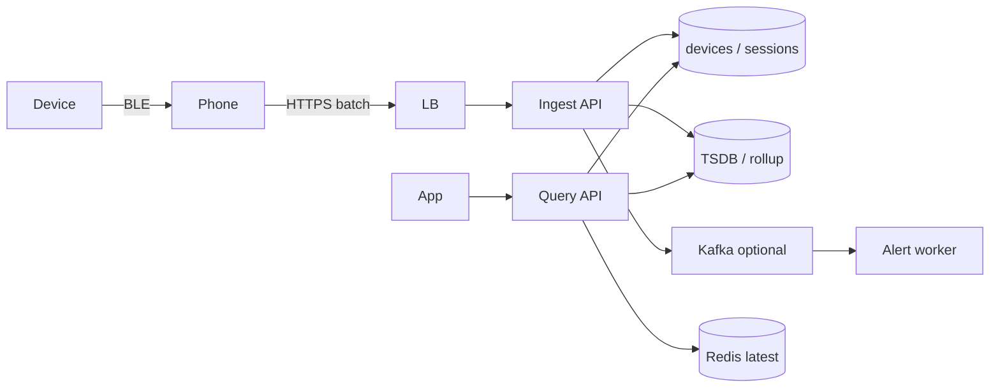
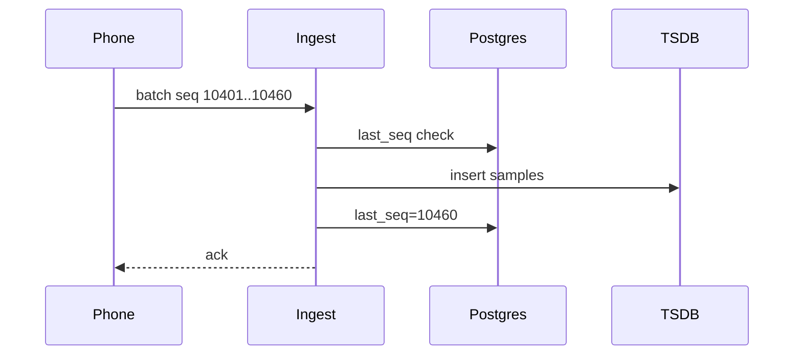

# Wearable Device

> [!abstract] Interview walk for **Temple-shaped** ingest: device → phone → API → **metadata in Postgres, samples in a time-series path**, idempotent seq, alerts after write. You do **not** design EEG. Script: [[01 - How the Round Works]].

## 1. Requirements

**Clarify:** live stream vs session upload? I’ll do **both**: batched samples while BLE is up, plus **file dump** of a workout (that file is [[04 - Multipart Upload]]).

### Functional

- Pair `user ↔ device` (one active device).
- Ingest samples: hr, temp, … with `device_ts` + `seq`.
- Start/end **session** (workout).
- App: last value, last 24h chart, session list.
- Alert if HR > threshold for N minutes (simple).

### Non-functional

- Write-heavy. **Don’t lose** a batch if the phone was in a tunnel (retry + idempotency).
- Latest HR p99 < 200 ms. Charts can be **rollups**, eventual 1–5 min.
- Strong: pairing, “this batch accepted.” Eventual: dashboard aggregates.
- PII / health — TLS, auth, don’t log raw payloads.

### Out of scope

- On-device DSP, firmware analog, BCI. Firmware **bytes** = multipart.
- Social feed of workouts.

## 2. Estimations

This is the one problem where the numbers **decide the architecture**. Do them slowly and out loud.

**Sample volume**

- **100k devices**, 1 Hz heart rate, worn **8h/day** → `8 × 3600` = **28,800 samples/device/day**
- `100k × 28,800` = **2.9 × 10⁹ samples/day**

**Request rate (phone batches, watch does not speak HTTP)**

- Phone flushes every **60 s** → 60 samples per request
- Average: `2.9e9 / 60` = 48M requests/day → `/10⁵` = **~480 req/s**
- Peak (everyone awake and moving): all 100k active → `100k / 60` = **~1.7k req/s**
- Payload `60 × 32 B` + JSON ≈ **3 KB** → `1.7k × 3 KB` ≈ **5 MB/s** ingress. **Bandwidth is a non-issue**

**Rows per second — the number that kills OLTP**

- `1.7k req/s × 60 samples` = **~100k row inserts/s at peak**
- Threshold from [[16 - Estimation and Decision Cheat Sheet]]: **> 20k writes/s sustained means the wrong engine**
- So: **samples do not live in Postgres.** Say this *because of the number*, not as a reflex

**Disk**

| Tier | Maths | Size |
|---|---|---|
| Raw @ 32 B | `2.9e9 × 32 B` | **~92 GB/day** |
| Raw, 7 days | `92 × 7` | ~650 GB |
| 1-min rollup | 480 buckets/device/day × 100k × 50 B | **~2.4 GB/day** (38× smaller) |
| 1-hour rollup | 8 buckets/device/day × 100k × 50 B | **~40 MB/day** → ~14 GB/year |

- That table **is** the retention policy: **raw 7 days → 1-min 90 days → 1-hour forever**
- Keeping raw for a year would be **33 TB**. Say that number, then drop it

**Why 1-minute buckets specifically**

- 24h of 1-min points = **1,440 points**. A phone screen is ~1,000 px wide
- 30 days of 1-hour points = **720 points**
- So the rollup granularity is chosen by **what the chart can draw**, not by taste

**Redis "now" card**

- `100k devices × ~100 B` = **10 MB**. Free. One instance, no clustering conversation

**The pick**

> Postgres for users / devices / sessions / `last_seq` — a few thousand rows per device, fully relational. Samples append to a time-series store (Timescale, Cassandra, or ClickHouse) written in **batches**. Charts read 1-minute rollups. Latest value in Redis with the column as fallback. Raw expires by dropping partitions.

## 3. APIs

| Method | Path | Notes |
|---|---|---|
| `POST` | `/devices/pair` | `{serial}` → bind to user |
| `POST` | `/sessions` | start `{device_id}` |
| `POST` | `/sessions/{id}/end` | |
| `POST` | `/ingest` | `{device_id, seq_from, samples:[{ts, hr, …}]}` **Idempotency-Key or seq** |
| `GET` | `/me/now` | latest HR |
| `GET` | `/sessions/{id}/series?from&to&step=1m` | chart |
| `POST` | `/sessions/{id}/dump/initiate` | raw file → multipart |

## 4. Schema

**OLTP (Postgres):**

```
users(id, …)
devices(id, serial UNIQUE, user_id, last_seq, last_seen_at)
sessions(id, user_id, device_id, started_at, ended_at, status)
alerts(id, user_id, session_id, kind, created_at)
```

`devices.last_seq` — **monotonic** from the phone. Ingest with `seq <= last_seq` → **200 drop** (retry).

**Samples (not OLTP long-term):**

```
samples(device_id, ts, seq, hr, extra)  -- hypertable / TSDB
rollups_1m(device_id, bucket, hr_avg, hr_max, n)
```

Latest: `devices.last_hr` + `last_hr_at` updated in ingest txn **or** Redis `device:{id}:now` with TTL.

## 5. High-level design



Phone is the **buffer** (offline queue). We never require the watch to speak HTTP.

Kafka **after** persist if alerts / fanout. Not in front of the write unless they 10× QPS.

## 6. Core ingest

```
POST /ingest
{ device_id, seq_from: 10401, samples: [ 60 points ] }
```

1. Auth: device belongs to user.
2. If `seq_from <= last_seq` → 200, no insert (idempotent).
3. If gap `seq_from > last_seq+1` → **409 gap** or **accept and mark hole** — ask them. Default: **accept**, store, `last_seq = max`. Phone may backfill.
4. Bulk insert samples; update `last_seq`, `last_hr`; bump Redis now.
5. 200 `{last_seq}`.

Session dump: same as multipart; `sessions` points at `s3_key` when `ready`.



## 7. Deep dive

### 7a. Where the beats live

| Store | Role | Why not elsewhere |
|---|---|---|
| Postgres | Pairing, sessions, `last_seq`, metadata | Relational, tiny, needs transactions |
| Redis | `now` card, 10 MB | Sub-ms read for the most-hit screen |
| TSDB / rollups | Charts, alerts | 100k rows/s and 92 GB/day (§2) |
| S3 | Workout file dump, firmware | Bytes, not rows — [[04 - Multipart Upload]] |

### 7b. Why a time-series store, in one breath

- Data is **append-only, time-ordered, never updated** — the exact workload a TSDB is built for
- Columnar + delta encoding on a monotonic timestamp compresses hard (repeated HR values around 70 bpm)
- Retention is **"drop the partition/chunk"**, not `DELETE FROM samples WHERE ts < …` scanning billions of rows
- Rollups are a **continuous aggregate**, not a nightly cron you maintain
- What you give up: joins and transactions on samples. You don't need either

> [!tip] If they won't let you add a store: **"then samples are 1-minute rollups only, written from the batch, and I tell the product we cannot show raw beats."** A named loss beats a fake `samples` table.

### 7c. Idempotency — the actual mechanism

- Phone was in a tunnel, retries the same batch. Two defences, say both
    + **`devices.last_seq`** — monotonic per device. `seq_from <= last_seq` → **200, no insert**
    + **Primary key `(device_id, ts)`** in the sample store → an upsert makes a replay a no-op even if `last_seq` is stale
- `last_seq` is the cheap gate; the PK is the correctness guarantee. Belt and braces
- `Idempotency-Key` per batch works too, but `seq` is free — the phone already has it

### 7d. Out-of-order and backfill (the follow-up that catches people)

- Real phones upload **3 days late** after a flight. So arrival order ≠ event order
- Consequences you must name
    + Rollups must be **recomputable**, not incrementally-only. Mark the touched buckets **dirty** and recompute
    + `last_seq` alone can't gate backfill of older gaps — accept out-of-range `seq` into the store, gated by the PK
    + Charts read rollups, so a late batch changes history. That is **correct**, and eventual
- **Rate-limit the backfill**: a 3-day dump is `3 × 86,400` = 260k samples from one phone. Cap batch size, 429 the rest, let it drain. One device must not be able to spike the ingest tier

### 7e. Partitioning and the shard key

- Key is **`(device_id, ts)`** — device first
- Why not `ts` first: every writer would hammer the same "now" partition → one hot node
- Why not `device_id` alone: retention needs time boundaries to drop
- Queries are always "this device, this window," so the key matches the read pattern exactly
- Avoid the cardinality trap: **do not** put per-sample tags/labels in the series key. 100k devices is fine; 100k devices × 20 tags is a cardinality explosion

### 7f. Batch size is a real tradeoff

| Batch window | Cost |
|---|---|
| 1 s | 100k req/s. Dead |
| **60 s** | 1.7k req/s, ~3 KB payload, "now" card ≤ 60 s stale, phone battery happy |
| 10 min | 280 req/s, but the live HR screen is a lie and a crash loses 10 min |

- Pick **60 s** and name what it costs: the `now` card can be up to a minute old
- If the product demands true live HR: **WebSocket while the app is foregrounded**, batches when backgrounded. Two paths, one store

### 7g. Alerts without wrecking ingest

- Requirement: HR > threshold for **3 consecutive minutes**
- Do **not** evaluate on the ingest request — ingest must stay a dumb fast write
- Minute-ticking worker reads the last 3 rollup buckets for **active** devices
    + `~33k active devices / 60 s` = **~550 reads/s**. Cheap
- **Hysteresis** — fire above 150, clear below 140. Stops flapping at the boundary
- **Cooldown** — `alerts.last_fired_at`, suppress 30 min. Otherwise one bad afternoon sends 200 pushes
- Alert delivery is at-least-once → dedupe key `(user_id, kind, window_start)`

### 7h. Two clocks, always

- Store **`device_ts`** and **`server_received_at`**. Both
- Charts plot `device_ts` — the user's timeline
- "Last seen / is it online" uses `server_received_at` — a dead watch with a fast clock must not look alive
- A watch with a wildly wrong clock: clamp or flag if `device_ts` is outside `server_received_at ± N hours`

### 7i. Live query paths

| Screen | Path | Latency |
|---|---|---|
| Now card | Redis `device:{id}:now`, fallback `devices.last_hr` | ~1 ms |
| Today's chart | 1-min rollups, ≤ 1,440 points | tens of ms |
| Month chart | 1-hour rollups, 720 points | tens of ms |
| Raw beats (debug) | TSDB raw, ≤ 7 days, capped range | seconds, rate-limited |

Never let the UI request "one year of raw" — cap the range **server-side** by tier.

## 8. Break it

| Failure | What you say |
|---|---|
| Phone retries same batch | `seq` / idempotency → no double insert. |
| Redis down | `GET /now` from `devices.last_hr`. Slower, correct. |
| TSDB down | Ingest **fails** (or spool to Kafka/local). Don’t pretend PG has 1 Hz. Lite: write rollup-only to PG and accept loss of raw. |
| Pair two users | `devices.user_id` unique active; unpair first. |
| 100 Hz sensor | Batch + rollup immediately. Never 100 Hz as PG rows. |
| Alert spam | Hysteresis + cooldown row. |
| Phone dumps 3 days of backfill | Cap batch, 429 the rest, mark rollups dirty and recompute. One device can't spike ingest. |
| "Just use Postgres for samples" | 100k rows/s and 92 GB/day. If forced: rollups only, and I say we lose raw. |

## 9. Rapid grill

1. Why not Postgres for samples?
    + **100k inserts/s, 92 GB/day** (§2). Over every threshold
2. Why a TSDB and not Kafka-only?
    + Kafka is transport, not a query store. Charts need range reads by `(device, time)`
3. What is the primary key?
    + `(device_id, ts)` — device first so "now" isn't one hot partition; time for retention drops
4. Replayed batch?
    + `seq <= last_seq` → 200 no-op, and PK upsert as the real guarantee
5. Gap in the sequence?
    + Accept and mark the hole; phone backfills. Say the alternative is 409 and why you didn't
6. Late upload from a flight?
    + Rollups recomputed from dirty buckets. Eventual, and correct
7. Why 1-minute rollups?
    + 1,440 points ≈ a screen width. 30-day view uses hourly
8. Retention?
    + Raw 7 days, 1-min 90 days, 1-hour forever. A year of raw is 33 TB
9. Redis dies?
    + `GET /now` falls back to `devices.last_hr`. Slower, correct
10. TSDB dies?
    + Ingest fails or spools (Kafka / phone keeps buffering). Don't pretend PG absorbs it
11. Alert on every sample?
    + No. Minute worker on rollups, hysteresis + cooldown
12. Sensor goes to 100 Hz?
    + 100× the numbers → on-device downsampling, or raw only inside a session window
13. Sell it to a hospital (regulated)?
    + Raw retention becomes a **compliance** input, not an engineering one. Encrypt at rest, audit reads, and re-price the 33 TB
14. Health data / PII?
    + TLS, auth per device, never log payloads, and the export path is presigned and audited

## One-minute close

The watch talks to the phone. The phone POSTs **idempotent batches**. I keep pairing and sessions in Postgres, samples in a time-series path, latest in Redis-or-column. Charts read 1-minute rollups. A workout file is multipart. I didn’t design the sensor.

## Related Notes

- [[HLD/Problems/README]]
- [[00 - Speed Run]]
- [[16 - Estimation and Decision Cheat Sheet]] — the thresholds this walk leans on
- [[04 - Multipart Upload]]
- [[09 - Storage Search and Geo]]
- [[09 - Inventory and Flash Sale]] — different; this is append-only not scarce qty
