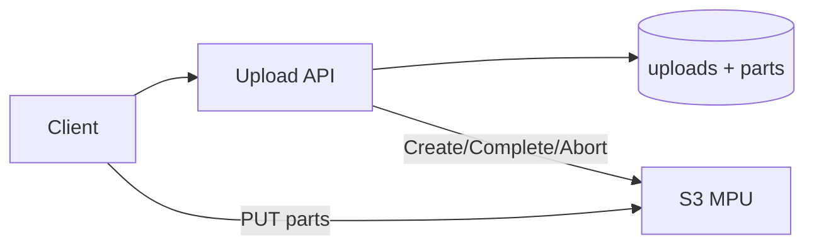
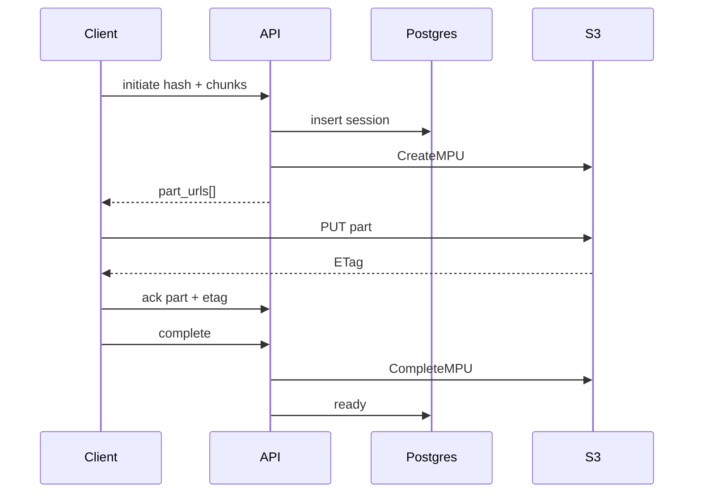

# Multipart Upload

> [!abstract] Interview walk. **Bytes never hit the API.** Initiate → presigned part URLs → S3 PUT → ack ETag per part → complete. Metadata in Postgres. Script: [[01 - How the Round Works]]. S3: [[09 - Storage Search and Geo]].

## 1. Requirements

**Clarify:** max size? resume? I’ll assume **up to ~5 GB**, resume yes, browser/mobile.

### Functional

- Client sends **file hash, size, chunk_count, chunk_size**.
- Initiate → **array of presigned PUTs** (one per part) + `upload_id`.
- Client uploads **directly to S3**, then **acks each part** with ETag.
- Complete → assemble → file ready. Abort / expire zombies.
- Download later: presigned GET (don’t deep-dive).

### Non-functional

- App p99 is **small JSON** (< 100 ms). Upload bandwidth is S3.
- Durable parts until complete or TTL (~24h–7d).
- Strong: “this part is recorded,” “file is ready.”
- Auth + quota on initiate.

### Out of scope

- Transcode, virus-scan internals (box after `ready`). Dropbox delta sync.

## 2. Estimations

The point of this problem is that **one number makes the whole design obvious**. Find it first.

**The number that decides everything**

- **100k uploads/day**, average **200 MB**
- `100k × 200 MB` = **20 TB/day** of bytes
- If those bytes went **through the app**: `20 TB / 10⁵ s` = **~230 MB/s sustained ≈ 1.9 Gbps**, and 3× at peak ≈ **5.5 Gbps**
- That is a fleet of app servers doing nothing but copying bytes, plus memory pressure and request timeouts
- **Therefore: presigned direct-to-S3.** Say it *because of 1.9 Gbps*, not because "S3 is best practice"

**What the app actually handles**

- Initiate: `100k / 10⁵` = **~1 QPS**
- Part acks: `25 parts × 100k / 10⁵` = **~25 QPS**
- Complete: ~1 QPS
- Total **< 30 QPS of small JSON**. One service, one Postgres. *"This is a bandwidth problem I refused to have, not a QPS problem."*

**Chunk size — justify 8 MB**

- S3 constraints to know: part **≥ 5 MB** (except the last), **≤ 10,000 parts**, object ≤ 5 TB
- 8 MB × 10,000 = **80 GB ceiling**. Comfortably covers a 5 GB requirement
- Tradeoff
    + Smaller parts → more requests, more ack rows, but a failed part re-uploads less
    + Bigger parts → fewer round trips, but a flaky mobile connection wastes more on each retry
- 200 MB / 8 MB = **25 parts**. Client uploads **4–6 in parallel**

**Time, which sets the presign TTL**

- 200 MB on 10 Mbps mobile = **~160 s**; on 100 Mbps = **~16 s**
- 5 GB on 10 Mbps = **over an hour**
- So presign TTL of **1 hour** covers normal cases and **will** expire on a paused overnight upload → the refresh endpoint is mandatory, not optional

**Metadata storage**

- `upload_parts`: `25 × 100k × 200 B` = **~500 MB/day** if you keep them forever
- Delete parts rows once the upload is `ready` → the table only holds **in-flight** uploads
- The 20 TB/day in S3 is a **cost** conversation (lifecycle to IA/Glacier), not a design one

**The pick**

> Small JSON API on Postgres for sessions and part receipts, S3 multipart for bytes and assembly, presigned URLs so no byte crosses my service, and two independent zombie reapers because incomplete parts are billed.

## 3. APIs

| Method | Path | Body |
|---|---|---|
| `POST` | `/uploads/initiate` | hash, size, chunk_count, chunk_size, filename |
| `POST` | `/uploads/{id}/parts/{n}/complete` | `{etag, size}` |
| `POST` | `/uploads/{id}/complete` | |
| `GET` | `/uploads/{id}` | pending parts (resume) |
| `POST` | `/uploads/{id}/abort` | |

## 4. Schema

```
uploads(
  id, user_id, filename, size_bytes, content_hash,
  chunk_count, chunk_size,
  s3_key, s3_upload_id,
  status,  -- initiated | uploading | completing | ready | failed | aborted
  expires_at
)
upload_parts(
  upload_id, part_number,  -- PK, parts 1..N
  size_bytes, etag, status,  -- pending | uploaded
  acked_at
)
```

Resume / dedup: unique-ish `(user_id, content_hash)` while not `ready`. If already `ready` → skip bytes.

## 5. High-level design



S3 **multipart**: CreateMPU → presign `UploadPart` → CompleteMPU with `{partNumber, etag}[]`.

## 6. Core flows

**Initiate:** validate (part ≥ 5 MB except last, ≤ 10k parts, size math). Insert upload + N pending parts. `CreateMultipartUpload`. Return `part_urls[]`.

**Client:** `slice` → PUT URL → save ETag → ack.

**Ack:** store etag, `uploaded`. Idempotent if same etag.

**Complete:** all parts uploaded → CAS `completing` → CompleteMPU → `ready`. Missing parts → 400.

**TTL cron:** abort stale MPU (S3 **bills** incomplete).



## 7. Deep dive

### 7a. Why ack every part

- **CompleteMPU literally requires the ETag list** — `[{PartNumber, ETag}, …]`. Without receipts you cannot finish the upload
- **Resume** — client crashes at 90%; `GET /uploads/{id}` tells it parts 23, 24 are missing instead of re-sending 180 MB
- ETag is **S3's receipt**, not our invention. It's the MD5 of that part (for unencrypted single PUTs) and it's how S3 verifies assembly

**Alternative worth naming:** skip our `upload_parts` table and call **S3 `ListParts`** at complete/resume time.

| | Our ack table | S3 `ListParts` |
|---|---|---|
| Extra writes | 25 per upload | none |
| Resume | one local query | round trip to S3 |
| Source of truth | ours, can drift | S3, always right |

Real systems do **both**: acks for fast resume, `ListParts` as the reconciliation before CompleteMPU. Say that.

### 7b. Presign: array up front vs mint per part

- **Array at initiate** — one round trip, simple client. Every URL shares one TTL
- **Mint per part** — TTL starts when the client actually needs it, but 25 extra API calls
- Pick the array (it's 25 URLs, not 10,000), and **add `GET /uploads/{id}` that re-mints URLs for pending parts**. From §2 you already know a 5 GB upload on a slow link outlives a 1-hour TTL
- A presigned URL is a **bearer capability** — whoever holds it can PUT
    + Scope it tightly: exact key, exact part number, short TTL
    + Optionally pin `Content-Length` / checksum so it can't be used to store something else
    + Never log the full URL (same rule as never logging a token)

### 7c. Hash, dedup, integrity

- `content_hash` (SHA-256) is computed **on the client**. The API never reads 2 GB to hash it
- Two uses
    + **Dedup** — hash already `ready` for this user/tenant → skip the bytes entirely, just link the object
    + **Resume key** — same hash re-initiated while `uploading` → return the **existing** session, don't start a second MPU
- Cost of client hashing: reading 5 GB takes real time on mobile. Acceptable because it can overlap the upload, or be skipped for small files
- Integrity: S3 validates each part; a whole-object checksum after complete if the domain needs it. **Do not** re-download to verify
- Trust boundary: the client's claimed `size_bytes` is a hint. Validate against S3's reported size at complete

### 7d. State machine and the complete race

```
initiated → uploading → completing → ready
                     ↘ aborted / failed / expired
```

- `completing` exists so a **double complete** can't run CompleteMPU twice
- CAS: `UPDATE uploads SET status='completing' WHERE id=? AND status='uploading'` → 0 rows means someone else is already finishing; return the same result
- If CompleteMPU succeeded but we died before writing `ready`: retry, S3 returns success or "no such upload" because the object exists → **HeadObject, then mark `ready`**. Idempotent recovery, no duplicate object
- Missing parts at complete → **400 with the list of missing part numbers**, not a generic error

### 7e. Zombies cost money — two reapers

- S3 **bills storage for incomplete multipart parts** that no one can see in the bucket listing. This is a classic real-world bill surprise
- Layer 1: our TTL cron — `expires_at < now()` and not `ready` → `AbortMultipartUpload` + mark `aborted`
- Layer 2: **S3 lifecycle rule `AbortIncompleteMultipartUpload` after N days** — catches anything our cron missed (our DB lost the row, the cron was broken for a week)
- Two independent layers because layer 1 depends on our state being correct and layer 2 does not

### 7f. Don't MPU a small file

- `size < 5 MB` → S3 won't accept it as a multi-part anyway (min part size)
- Path: single **presigned PUT**, one row, no parts table, status straight to `ready` on ack
- Say this. Running a 1-part MPU for a 200 KB avatar is the kind of over-engineering they're testing for

### 7g. After `ready` — the part everyone forgets

- Complete does **not** mean "safe to serve"
- Commit `ready` → **outbox** event → workers do virus scan, transcode, thumbnail, indexing
- Pattern: upload into a **quarantine** bucket/prefix, copy to the serving prefix only after the scan passes
- Downloads are presigned **GET** with a short TTL, gated by authz — which is [[08 - Resource Sharing ACL]], not this service

### 7h. Browser gotchas (say one, it reads as experience)

- **CORS on the bucket** must allow `PUT` and expose the `ETag` header — otherwise the browser gets the ETag and JavaScript can't read it. Classic half-day bug
- `File.slice()` gives the chunks; keep concurrency at 4–6 or mobile Safari falls over
- Retry a failed part with backoff; parts are independent so order doesn't matter — S3 assembles by part number

### 7i. Who concatenates?

**S3 does.** No worker downloads 25 parts to `cat` them. If someone suggests a stitching service, the answer is that it would re-introduce the 1.9 Gbps you just designed away.

## 8. Break it

| Failure | What you say |
|---|---|
| Expired URL | GET upload, mint new URL for that part. Same MPU. |
| Ack lost, S3 has bytes | Client PUTs again or we lack ETag → PUT again. |
| Complete twice | CAS `ready`. 200 same file_id. |
| API down mid-CompleteMPU | Retry complete; if object exists, mark ready. |
| Steal presign | Short TTL. HTTPS. Don’t log full URLs. |
| Client abandons at 60% | TTL cron aborts MPU; S3 lifecycle rule as the second net. Incomplete parts are **billed**. |
| Two devices, same file | Same `content_hash` → return the existing session, not a second MPU. |
| Claimed size is a lie | Validate against S3 at complete before `ready`. |
| Browser can't read ETag | Bucket CORS must expose the `ETag` header. |

## 9. Rapid grill

1. Why not upload through the API?
    + **20 TB/day ≈ 1.9 Gbps sustained.** App servers would be byte pumps
2. Why chunks at all?
    + Resume, parallelism, and a failed 8 MB retry instead of a failed 200 MB one
3. Why 8 MB?
    + ≥ 5 MB S3 minimum, ≤ 10k parts → 80 GB ceiling; 25 parts for a 200 MB file
4. Why ack ETags?
    + CompleteMPU requires the list; also gives resume
5. Could you skip the parts table?
    + Yes — `ListParts` from S3. Slower resume, but S3 is the real truth. Do both
6. URL expired mid-upload?
    + `GET /uploads/{id}` re-mints URLs for pending parts, same `s3_upload_id`
7. Complete twice?
    + CAS to `completing`, then `ready`. Same file id returned
8. Died after CompleteMPU, before `ready`?
    + Retry; HeadObject shows the object exists → mark `ready`
9. Someone steals a presigned URL?
    + Short TTL, scoped to key + part + length, never logged. It is a bearer capability
10. Duplicate file?
    + `content_hash` dedupe; already `ready` → skip bytes
11. Who assembles?
    + S3. Never a stitching worker
12. File is 2 MB?
    + Single presigned PUT. No MPU
13. Virus scan / transcode?
    + After `ready` via outbox; quarantine prefix until it passes
14. How do you know it's healthy?
    + Completion rate, parts retried per upload, abandoned-upload count, S3 incomplete-MPU bytes

## One-minute close

Initiate writes a session and returns presigned part URLs. The browser uploads to S3 and acks ETags. Complete asks S3 to assemble. I never put the video through the app server.

## Related Notes

- [[HLD/Problems/README]]
- [[00 - Speed Run]]
- [[16 - Estimation and Decision Cheat Sheet]]
- [[09 - Storage Search and Geo]]
- [[03 - Wearable Device]] — session dump uses this
- [[08 - Resource Sharing ACL]] — who may GET
