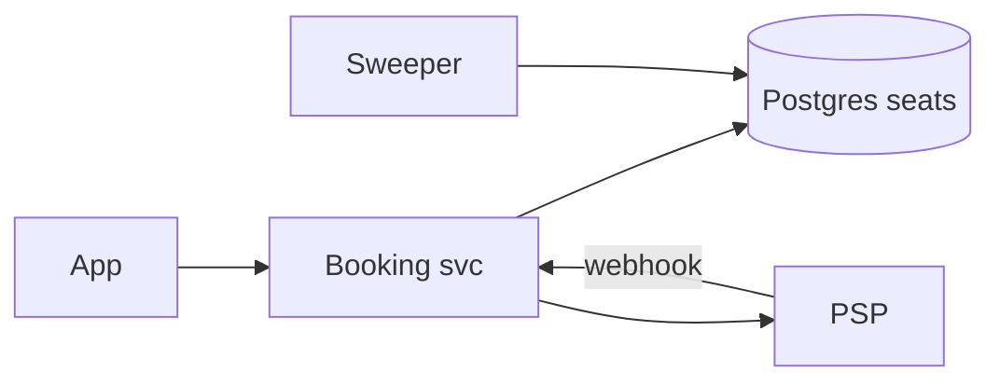
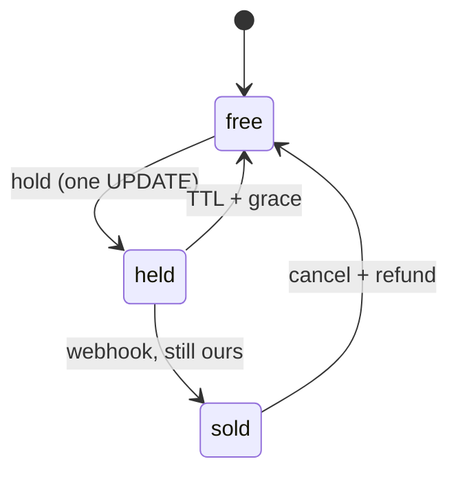

# Seat Booking

> [!abstract] Priority #9 (BookMyShow, Ticketmaster, IRCTC-style). Mini designs: [[MD-04 - High-Contention Reservation and TTL Lease Sweeper|MD-04]] (holds) → [[MD-06 - Distributed Saga and Compensating State Machine|MD-06]] (pay → confirm → ticket) → [[MD-19 - Baseline Scaling Path|MD-19]] + [[MD-11 - Multi-Tier Hot-Key Shield|MD-11]] (seat-map browse) → [[MD-02 - Traffic Shaper Rate Limiter and Waiting Room|MD-02]] (mega-event waiting room) → [[MD-20 - Partitioning Shard Keys and Resharding|MD-20]] (growth) → [[MD-21 - Multi-Region Replication and Disaster Recovery|MD-21]] (regions).
> The hard part: **one seat, two buyers**, and a mega sale where crores of people arrive in the same minute for about a lakh of seats. A hold is an atomic state change plus a clock, never a lock held across payment, and the crowd is queued outside before it reaches the hold path.

---

## 1. Clarify Script

| Question | Default assumption | If different |
|---|---|---|
| Movies (assigned seats, many small shows) or live events (stadium, sections, general admission)? | Both: movies daily, a few mega events a month | GA sections → T3 |
| Who owns the inventory? | We do | Cinema chain's own ticketing system → T5 |
| Hold duration? | 10 min to pay | UPI collect / slow banks → T2 |
| Seats per booking? | Up to 10, all-or-nothing | Adjacent seats → T4 |
| Payment? | Third-party PSP (Razorpay-like), UPI and cards | Wallet → [[07 - Wallet and Ledger]] |
| Scale? | ~1M tickets/day normally; mega sales with 1 crore+ users | Drives V1 and V3 |
| Anti-scalping requirements? | Yes, per-user caps and bot defence | T1 |
| Box office / offline sales on the same inventory? | Yes, at venues | T6 |

---

## 2. Requirements

### Functional

- Browse events and shows; view the seat map with availability.
- Hold 1–10 seats for 10 minutes, all-or-nothing.
- Pay; on success the seats are **sold** and a ticket (QR) is issued; on timeout or failure the seats are freed.
- See and cancel my bookings (refund per policy).
- For mega events: a fair queue before the seat map.

### Non-functional

- **Never double-sell.** Strong consistency on seat state.
- **Browse can be stale** by seconds. A seat that looks free but is taken returns "just taken" on hold.
- Hold API p99 under ~300 ms (excluding the PSP).
- 99.9% availability on confirm; a paid booking must never be lost.
- **Fairness and bot resistance** during mega sales.
- Payment data stays in India (RBI localisation).

### Out of scope

- Dynamic pricing models, partner CMS, recommendations, food and beverage add-ons (mention as extensions).

---

## 3. Estimates That Drive V0

```
Normal day
  Tickets      ≈ 1M/day (BookMyShow's record month was ~29M tickets) → ~12/s avg
  Bookings     ≈ 1M / ~3 tickets ≈ 330k/day → ~4/s avg, ~50/s at Friday-morning peaks
  Seat-map views ≈ 20× bookings → ~1k/s peak
  Seat rows    = 1k–10k shows/day × 200–400 seats × 90 days ≈ 20M–360M rows → one Postgres, partition by show date

Mega sale (Coldplay Mumbai, Sept 2024: ~1.3 crore people for ~1.5 lakh tickets, sold out in ~30 min)
  Arrivals     = 13M users in the first minutes
  If they all hit the seat map every 5 s: 13M / 5 ≈ 2.6M req/s  → impossible at origin
  Sales rate   = 150k tickets / 30 min ≈ 85 tickets/s ≈ 20–40 holds/s
```

- **What these pick:**
    + Normal traffic is small: one Postgres primary handles holds easily. Don't shard on day one.
    + The mega sale's problem is **arrival rate, not booking rate**: 2.6M req/s of curiosity against ~40 holds/s of actual demand the inventory can serve. That forces a waiting room at the edge (V3), not a bigger database.
    + Seat-map reads dominate, so browse needs its own read model (V1).

---

## 4. Entities, API, Schema

### API

| Method | Path | Notes |
|---|---|---|
| `GET` | `/v1/shows/{id}/seatmap` | cached read model; seconds stale |
| `POST` | `/v1/bookings` | `{show_id, seat_ids[]}` + `Idempotency-Key` → hold, returns `booking_id`, `hold_until`, payment session |
| `POST` | `/v1/psp/webhook` | signed; idempotent by PSP event ID |
| `GET` | `/v1/bookings/{id}` | status for polling after payment |
| `POST` | `/v1/bookings/{id}/cancel` | refund per policy |
| `GET` | `/v1/queue/{event_id}/status` | mega events: position and ETA |

### Schema (Postgres)

```
shows(id, event_id, venue_id, starts_at, status)
seats(
  id, show_id, section, row_label, seat_no,
  UNIQUE(show_id, section, row_label, seat_no),
  status        smallint,      -- free | held | sold | blocked
  hold_until    timestamptz,
  held_by       uuid,          -- booking_id
  price_tier    smallint
)
-- partial index for the sweeper
CREATE INDEX ON seats (hold_until) WHERE status = 'held';

bookings(
  id uuid PK, user_id, show_id, status,     -- held | payment_pending | confirmed | failed | expired | cancelled
  hold_until, amount_paise, idempotency_key UNIQUE, version
)
booking_seats(booking_id, seat_id, PRIMARY KEY(booking_id, seat_id))
payments(id, booking_id, psp_payment_id UNIQUE, status, amount_paise, updated_at)
outbox(id, aggregate_id, type, payload jsonb, created_at, sent_at)
```

- Amounts in paise (integers), never floats.
- `seats` is the **source of truth** for availability. Every cache and seat map is derived from it.

---

## 5. V0 — Simplest Design That Works

- One booking service (stateless pods), one Postgres primary with a synchronous standby, a PSP, a sweeper job.
- **Hold:** one short transaction claims all requested seats with a conditional `UPDATE … WHERE status = 'free'` over **sorted** seat IDs and checks that the row count equals the number requested; otherwise roll back and return 409 ([[MD-04 - High-Contention Reservation and TTL Lease Sweeper]]). Insert the booking as `held`. Create a PSP payment session with the booking ID as the idempotency key.
- **Confirm (webhook):** `UPDATE seats SET status='sold' WHERE held_by = :booking AND status = 'held'`. Rows = seats in booking → `confirmed`. Zero rows → the hold is gone: don't sell, refund (T2).
- **Expiry:** lazy in the hold query (`held AND hold_until < now() - grace` counts as free) plus a `SKIP LOCKED` sweeper every few seconds.





### Why not the obvious alternatives

- **`SELECT … FOR UPDATE` for 10 minutes:** a lock held across a human paying. Connections pile up, deadlocks multiply, a crashed pod holds locks until timeout. The hold is **state plus a clock** instead. `FOR UPDATE` is fine only inside a millisecond transaction that reads then branches, with IDs locked in sorted order.
- **Redis `SET NX` per seat as the source of truth:** a Redis failover can lose recent writes, and a TTL racing a late payment can double-sell. The status column is already the mutex.

### What V0 can't handle

- Seat-map reads at Friday-morning peaks hammering the primary.
- A lost or late webhook leaves bookings stuck; ticket issuing and notifications are ad hoc.
- A mega sale: millions of users at once.

---

## 6. Scale Ladder

### V1 — Separate the browse path

- **Trigger:** seat-map views run ~20× bookings; at Friday-morning release peaks that's thousands of reads/s, each scanning a show's 200–400 seats on the primary that also takes the holds.
- **What breaks:** hold latency rises because the primary is busy serving browse.
- **Change ([[MD-19 - Baseline Scaling Path]]):**
    + Event and show listings: served from a read replica and cached at the CDN (public, same for everyone).
    + **Seat-map read model** in Redis: one bitmap (or small hash) per show with a status per seat, refreshed from the database by CDC on every seat change, with a 5–15 s TTL as a safety net. The seat map is allowed to lie; the hold `UPDATE` never does.
    + Hot shows get the in-process L1 and request coalescing ([[MD-11 - Multi-Tier Hot-Key Shield]]).
    + Holds, confirms and "my bookings right after paying" stay on the primary.
- **Trade-off:** a user can click a seat that was taken a few seconds ago and get "just taken". That's UX, not a correctness problem.

### V2 — Make confirm, ticket and notify a saga

- **Trigger:** webhooks arrive late, twice, or never; tickets must be issued (QR code, sometimes in a partner's system) and notifications sent; a crash between "seat sold" and "ticket issued" loses work.
- **Change ([[MD-06 - Distributed Saga and Compensating State Machine]]):**
    + The booking is a saga: `HELD → PAYMENT_PENDING → CONFIRMED → TICKETED → NOTIFIED`, with `EXPIRED` and `REFUND_PENDING → REFUNDED` branches.
    + Every state change writes the new state and an **outbox** row in the same transaction; a relay publishes to Kafka keyed by `booking_id`. Ticketing and notification consumers are idempotent by event ID.
    + **Pivot:** payment captured. Before it, failure releases the hold. After it, only forward: retry ticketing; if impossible, refund.
    + **Reconciler:** for bookings in `PAYMENT_PENDING` past a few minutes, poll the PSP's status API with backoff and a cap per booking. Never flood it: NPCI's root cause for the April 2025 UPI outage was banks flooding a status-check API.
    + Daily reconciliation against the PSP settlement file.
- **Trade-off:** a few extra writes per booking and a Kafka dependency, in exchange for never losing a paid booking.

### V3 — Mega-event mode: waiting room and allocation

- **Trigger:** a Coldplay-style sale: ~1.3 crore people for ~1.5 lakh seats, sold out in ~30 minutes. Arrivals could hit 2.6M req/s at the origin; actual booking capacity needed is ~40 holds/s.
- **What breaks:** everything in front of the database, long before the database itself.
- **Change ([[MD-02 - Traffic Shaper Rate Limiter and Waiting Room]]):**
    + **Waiting room at the edge** for the event's sale path. Everyone who arrives before the sale opens gets a **random** queue position (as BookMyShow did for Coldplay), later arrivals queue FIFO behind them.
    + Queue tickets are signed tokens; position polling is served at the edge every 15–30 s with jitter.
    + **Admission rate = measured hold capacity** (e.g. a few thousand users per minute, tuned live by error rate and remaining inventory). Admitted users get a signed **admission token** bound to account and device, valid ~15 minutes.
    + The booking service **rejects any request without a valid admission token**, so bots can't skip the queue by calling the API directly.
    + Per-account caps (e.g. 4–6 tickets per event) and per-payment-instrument caps.
    + When inventory reaches zero, stop admitting and tell everyone still queued immediately. Expired holds can reopen admission briefly.
- **Inventory model for stadiums:**
    + Assigned-seat sections stay as seat rows. With "best available", claim with `ORDER BY seat_score LIMIT n FOR UPDATE SKIP LOCKED`, so concurrent buyers skip each other's rows instead of waiting.
    + General-admission sections are **counters**, not rows: `UPDATE sections SET available = available - :n WHERE id = :sec AND available >= :n`. If one section's counter becomes hot, split it into bucket rows or gate it with a Redis Lua counter reconciled to the DB.
- **Prep:** pre-scale every tier before the published sale time and pre-warm caches; reactive autoscaling arrives too late for a step spike.

### V4 — Shard by show, then two regions

- **Trigger:** total seat and booking volume across all cities and events grows past one primary (hundreds of millions of seat rows, sustained write load during festival weeks), or the region becomes a single point of failure for a 99.9% confirm SLA.
- **Change:**
    + **Shard key `show_id`** (or `event_id` for multi-show events), hashed into logical shards on a few physical primaries ([[MD-20 - Partitioning Shard Keys and Resharding]]). A hold touches one show, so it stays a single-shard transaction. "My bookings" becomes a separate table sharded by `user_id`, fed by CDC.
    + **Two Indian regions** ([[MD-21 - Multi-Region Replication and Disaster Recovery]]): each shard has a home region and an async replica in the other. Browse is served in both regions; holds and confirms go to the shard's home region. Failover is a fenced promotion; RPO is a few seconds of holds, which expire anyway, while confirmed bookings are reconciled from PSP records. Payment data stays in India under RBI's localisation rule.

---

## 7. Twist Cards

**T1 — "Bots and scalpers bought everything and resold at 10× (the Coldplay backlash)."**
- **Hits:** waiting room, identity, caps.
- **Answer:** randomised positions at opening, admission tokens bound to a verified account and device, per-account and per-card/UPI-ID caps, CAPTCHA or device attestation at queue entry, velocity checks (many accounts, one device or payment instrument). For the highest-demand events, named tickets with ID checks at the gate, and resale only through an official channel at face value. IRCTC's approach for Tatkal is the same idea: Aadhaar-authenticated accounts and Aadhaar OTP since July 2025, and agents barred for the first 30 minutes.
- **Attaches to:** V3.

**T2 — "The hold is 10 minutes, but UPI collect requests and bank OTPs take longer, or the payment confirms after the hold expired."**
- **Hits:** MD-04 dual TTL, MD-06 late success.
- **Answer:** dual TTL: the user sees 10 minutes; the sweeper and lazy-expiry clause use 10 + 2 minutes of grace. Stop new payment attempts in the last minute. If the PSP confirms after the hard TTL (Indian gateways can authorise late after their ~10-minute timeout), re-claim the same seats for that booking if they're still free; otherwise refund automatically and say so in the UI.
- **Attaches to:** V0 confirm, V2 saga.

**T3 — "It's a stadium with 50,000 general-admission tickets."**
- Fungible inventory: a counter per section, not seat rows. Hot counter → bucketed rows or a Redis gate with DB reconciliation ([[MD-04 - High-Contention Reservation and TTL Lease Sweeper]]).
- **Attaches to:** V3.

**T4 — "A group of 6 wants seats together."**
- The seat-map service suggests adjacent free blocks from the read model; the hold is still one all-or-nothing `UPDATE` on those exact IDs. If it fails, suggest the next block. "Best available together" is a search over the row layout, then the same atomic claim.

**T5 — "Cinema chains run their own ticketing systems; we're one of several sellers."**
- The source of truth is now the chain's system. The hold becomes a saga step that calls the chain's hold API with our booking ID as the idempotency key; confirm calls their confirm API. Their hold TTL sets ours. Cache their seat map with a short TTL and expect 409s. If their API is down, that show is unavailable for booking: circuit-break per chain rather than queueing holds.
- **Attaches to:** V2.

**T6 — "The venue box office sells from the same inventory."**
- The box office is just another client of the hold API (with its own rate limits and a priority lane), so the single conditional `UPDATE` keeps both channels correct. Never pre-split inventory between channels unless the business wants quotas.

**T7 — "Users want to cancel and get a refund."**
- `sold → cancelled` and seats back to `free`, refund as a saga step with an idempotency key, release fees per policy. Cancelled seats appear in the seat map within seconds via CDC. For mega events, released seats can go back to the queue rather than to whoever refreshes fastest.

**T8 — "Show a live countdown of seats left for a mega event."**
- An approximate counter per section from the read model, pushed to queued and admitted users over SSE every few seconds. Exactness isn't needed; the hold is the truth.

**T9 — "Dynamic pricing as demand rises."**
- Price is computed when the hold is taken and stored on the booking (`amount_paise`), so a price change mid-checkout never changes what that user pays. The pricing engine reads demand signals from the stream ([[MD-14 - Streaming Window Watermark and Top-K Pipeline]]).

**T10 — "The payment gateway is down during the sale."**
- Fail over to a second PSP for new payment sessions, extend hold TTLs for people already mid-payment by a bounded amount, and slow admission from the waiting room while payments recover so seats aren't locked in holds nobody can pay for.

**T11 — "Cut cost; the mega-sale infrastructure sits idle most of the month."**
- The waiting room and edge do the heavy lifting and scale on demand at the CDN. Pre-scale the origin only for scheduled sales and run it lean otherwise.

---

## 8. Break It

| Failure | What you say |
|---|---|
| Two users, last seat | One `UPDATE` matches; the other gets 0 rows and a 409. |
| Double click / retry | `Idempotency-Key` on `POST /bookings` returns the same booking. |
| Pay after expiry | Confirm finds 0 rows → re-claim if free, else refund; never sell. |
| Webhook and sweeper race | Confirm is guarded by `held_by` and `status='held'`; grace period between visible and hard TTL. |
| Webhook lost | Reconciler polls the PSP with backoff and a per-booking cap. |
| Redis lock held for 10 minutes | Don't: process death, TTL vs late PSP → double-sell. The DB row is the mutex. |
| Seat map says free, it isn't | Expected; hold returns 409, the map refreshes within seconds. |
| Bots call the API directly during a mega sale | No admission token → rejected. |
| Primary fails mid-sale | Synchronous standby promotes in about a minute; in-flight holds retry with their idempotency keys. |

---

## 9. Operations and Cost

- **SLIs:** hold success vs 409 rate, hold p99, confirm success, time from payment to ticket, bookings stuck in `PAYMENT_PENDING`, sweeper lag, refunds caused by expiry.
- **Mega-sale dashboards:** queue depth, admission rate, time in queue, admitted-to-hold conversion, remaining inventory per section, PSP error rate.
- **Alerts:** stuck sagas past deadline, outbox backlog, reconciliation mismatches, admission tokens rejected per minute (bot signal).
- **Cost drivers:** edge requests during mega sales (cheap), pre-scaled origin capacity around scheduled sales, and refunds/support caused by failed experiences.

---

## 10. One-Minute Close

> "Seats are Postgres rows and the status column is the mutex. A hold is one conditional `UPDATE` over sorted seat IDs, all-or-nothing, with a 10-minute clock; no lock is held across payment. The webhook confirms only if we still own the hold; late payments re-claim or refund. Expiry is lazy in the hold query plus a `SKIP LOCKED` sweeper. Confirm, ticketing and notifications are a saga with an outbox, and a reconciler polls the PSP gently. Browse is a Redis seat-map read model that may be seconds stale. For a Coldplay-sized sale, the problem is arrivals, not bookings: a waiting room at the edge with randomised positions admits users at the hold path's capacity, and the booking API rejects anyone without a signed admission token. Growth shards by `show_id`, and a second Indian region takes over with fenced promotion."

---

## Sources

- Times of India / Outlook Business / Times Now (Sept 2024): ~1.3 crore people tried for ~1.5 lakh Coldplay Mumbai tickets, sold out in ~30 minutes. https://www.outlookbusiness.com/explainers/coldplays-concert-demand-reveals-indias-growing-market-for-going-out-experiences
- CNN (Oct 2024): resale at up to ₹9.6 lakh and suspected bots. https://www.cnn.com/2024/10/01/asia/coldplay-concert-ticket-india-scalping-intl-hnk/
- Coldplay, *2025 Ahmedabad show announced*: BookMyShow virtual queue with randomised positions. https://www.coldplay.com/2025-ahmedabad-show-announced/
- BW Marketing World: BookMyShow sold ~29 million tickets in a record month. https://www.bwmarketingworld.com/article/bookmyshow-starts-fy23-strong-sells-29-million-tickets--430543
- Razorpay, *Payment Timeout vs Late Authorisation* (2026). https://razorpay.com/learn/payment-timeout/
- Moneycontrol / Economic Times (April 2025): UPI outage from flooding of the Check Transaction API; NPCI's 90-second delay rule. https://www.moneycontrol.com/technology/why-was-upi-down-for-a-few-hours-over-the-weekend-article-12995316.html
- The Hindu (June 2025): Aadhaar authentication for Tatkal, agents barred for the first 30 minutes. https://www.thehindu.com/news/national/railways-tightens-tatkal-ticket-norms-aadhaar-based-authentication-made-mandatory/article69683148.ece
- RBI payment data localisation (April 2018 circular), via The Hindu. https://www.thehindu.com/business/payments-data-must-be-saved-locally-rbi/article28159408.ece

## Related Notes

- [[HLD/Problems/README]]
- [[12 - Mini Designs]]
- [[MD-04 - High-Contention Reservation and TTL Lease Sweeper]]
- [[MD-06 - Distributed Saga and Compensating State Machine]]
- [[MD-02 - Traffic Shaper Rate Limiter and Waiting Room]]
- [[MD-11 - Multi-Tier Hot-Key Shield]]
- [[MD-19 - Baseline Scaling Path]]
- [[MD-20 - Partitioning Shard Keys and Resharding]]
- [[MD-21 - Multi-Region Replication and Disaster Recovery]]
- [[09 - Inventory and Flash Sale]] — quantity, not unique seat
- [[07 - Wallet and Ledger]]
- [[12 - E-commerce Checkout]]
- [[14 - Coordination and Concurrency]]
