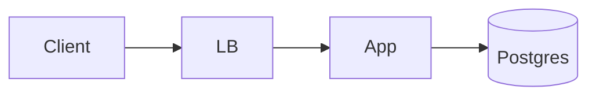
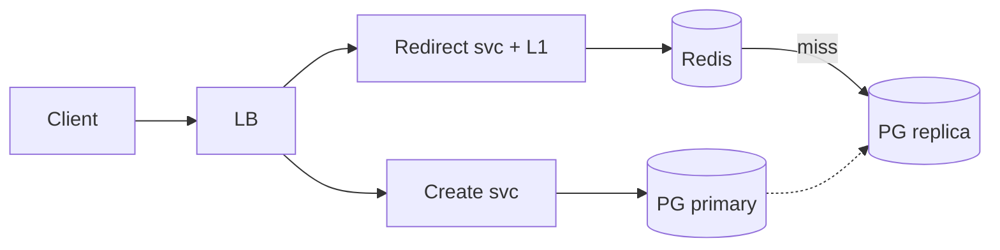

# URL Shortener

> [!abstract] Priority #1. Mini designs: [[MD-16 - Time-Sortable ID and Token Generator|MD-16]] (short codes) → [[MD-19 - Baseline Scaling Path|MD-19]] + [[MD-11 - Multi-Tier Hot-Key Shield|MD-11]] (redirect read path) → [[MD-14 - Streaming Window Watermark and Top-K Pipeline|MD-14]] (click analytics) → [[MD-20 - Partitioning Shard Keys and Resharding|MD-20]] (storage growth) → [[MD-02 - Traffic Shaper Rate Limiter and Waiting Room|MD-02]] (abuse) → [[MD-21 - Multi-Region Replication and Disaster Recovery|MD-21]] (regions).
> The hard part: a redirect path that answers in a few milliseconds for billions of clicks a day, with code generation that never collides and is not guessable, while analytics and abuse checks stay **off** that path.

---

## 1. Clarify Script

The prompt is famous, so the interviewer is listening for whether you scope it or recite it. Ask these, state the default, and note which twist card fires if the answer differs.

| Question | Default assumption | If different |
|---|---|---|
| Public service (anyone creates) or internal/B2B (brands send SMS campaigns)? | Both: free users plus business accounts | Branded domains → twist T1 |
| Custom aliases? | Yes, for logged-in users | T2 |
| Expiry? | Optional per link, default never | T3 |
| Analytics? | Click counts per link, per day, referrer, city, device; minutes of delay is fine | Billing-grade → T6 |
| Can the destination be edited after creation? | Yes for business accounts | Forces 302 and short cache TTLs → T4 |
| Same long URL twice → same code? | No, each create gets a new code | T5 |
| Scale? | 10M creates/day, 1B redirects/day, 5-year retention | Numbers drive V1–V3 |
| Regions? | India first; users abroad later | V4, T8 |

---

## 2. Requirements

### Functional

- Create a short link for a long URL; optional custom alias and expiry.
- Redirect `GET /{code}` to the long URL.
- Owners see click analytics for their links.
- Owners can disable or edit a link; the platform can take down malicious links.

### Non-functional

- **Redirect latency:** p99 under ~50 ms server-side in India (the redirect is an extra hop the user feels).
- **Availability of redirects:** 99.99%. A broken short link in a bank SMS is a support disaster; creates can be 99.9%.
- **Uniqueness:** a code maps to exactly one destination, forever (unless the owner edits it).
- **Codes not enumerable:** sequential codes let scrapers walk every link.
- **Analytics** eventually consistent (minutes), never on the redirect path.
- **Safety:** phishing and malware links are blocked quickly.

### Out of scope

- Link-in-bio pages, QR design tooling, A/B destinations (mention as extensions).

---

## 3. Estimates That Drive V0

Only the numbers that pick something.

```
Creates   = 10M/day  / 10^5  ≈ 100/s avg,  ~1k/s peak (campaign uploads)
Redirects = 1B/day   / 10^5  ≈ 10k/s avg,  ~50k/s peak (IPL ad, viral WhatsApp forward)
Read:write ≈ 100:1                         → the redirect path is the whole design
Row       ≈ 500 B (code, URL ~200 B avg, owner, timestamps, flags)
Storage   = 10M × 500 B = 5 GB/day → ~1.8 TB/year → ~9 TB over 5 years (+ indexes ×2)
Codes     = 10M/day × 365 × 5 ≈ 18B codes  → 62^7 ≈ 3.5T, so 7 Base62 chars is plenty
Clicks    = 1B/day × 300 B ≈ 300 GB/day raw → analytics cannot live in the links DB
```

- **What these pick:**
    + 50k redirects/s peak can't be served from one Postgres: the cache must absorb it (V1).
    + 9 TB over five years outgrows a comfortable single primary: sharding is on the roadmap (V3), not day one.
    + 300 GB/day of clicks needs a stream and an OLAP store (V2).
    + 7-character codes.

---

## 4. Entities, API, Schema

### API

| Method | Path | Notes |
|---|---|---|
| `POST` | `/v1/links` | body `{long_url, alias?, expires_at?, domain?}`, header `Idempotency-Key`; returns `{short_url, code}` |
| `GET` | `/{code}` | `302` with `Location`; `404` unknown; `410` expired or disabled |
| `PATCH` | `/v1/links/{code}` | edit destination, disable |
| `GET` | `/v1/links/{code}/stats?from&to&granularity` | analytics |

- The owner comes from the auth token, never from the body.
- `302` (or `307`), not `301`: a `301` is cached permanently by browsers, which breaks editing, takedowns and click counting.

### Schema (Postgres)

```
links(
  domain_id   int,              -- 0 = default short domain
  code        varchar(16),
  long_url    text,
  owner_id    bigint,
  created_at  timestamptz,
  expires_at  timestamptz NULL,
  status      smallint,         -- active | disabled | blocked
  PRIMARY KEY (domain_id, code)
)
link_owners_idx(owner_id, created_at, domain_id, code)   -- "my links", separate table once sharded
code_ranges(name PK, next_value bigint)                  -- counter-range allocation
domains(id, host UNIQUE, tenant_id, verified_at)
```

- `(domain_id, code)` is the identity from day one, so branded domains (T1) don't need a migration.

---

## 5. V0 — Simplest Design That Works

- One app tier (stateless), one Postgres primary with a standby.
- **Create:** fetch a counter value, permute it, Base62-encode to 7 chars, insert. Custom alias: insert the alias directly; the primary key rejects duplicates (409).
- **Redirect:** `SELECT long_url, status, expires_at FROM links WHERE domain_id=? AND code=?` → `302`.
- **Analytics:** none yet (or a counter column, which becomes a hot row; see V2).



### Code generation in V0

- The app takes a block of 10,000 counter values from `code_ranges` in one `UPDATE … RETURNING` and issues codes from memory ([[MD-16 - Time-Sortable ID and Token Generator]]).
- Each value goes through a bijective permutation mod 62^7 before encoding, so consecutive creates don't produce consecutive codes. No collision is possible, so there's no retry loop.

### What V0 can't handle

- 50k redirects/s at peak (Postgres would need to serve every click).
- Analytics at 300 GB/day.
- Multi-TB growth and region failure.

---

## 6. Scale Ladder

### V1 — Cache the redirect path

- **Trigger:** 10k redirects/s average, 50k/s at peak. Indexed point reads on one Postgres top out in the low tens of thousands per second, and the redirect p99 target leaves no room for queueing.
- **What breaks:** the primary's CPU and the redirect p99 at peak.
- **Change:**
    + Split the **redirect service** from the **create service** so each scales on its own and a create-path bug can't take redirects down.
    + Redis cache-aside keyed by `domain_id:code` → `{long_url, status, expires_at}`. Links never change except on edit, so the TTL can be long (24 h with jitter) and an edit simply deletes the key ([[MD-19 - Baseline Scaling Path]]).
    + **Negative caching** of unknown codes for 60 s, so scrapers trying random codes don't reach the database.
    + A 1–2 s **in-process L1** in every redirect pod for the hottest codes ([[MD-11 - Multi-Tier Hot-Key Shield]]).
- **Numbers after the change:** most clicks go to recent links. 30 days of links ≈ 300M × ~300 B ≈ 90 GB, so a Redis cluster of a few shards holds the hot set. At a 95% hit rate, 50k/s peak leaves ~2.5k/s for Postgres; one replica handles that.
- **Trade-off:** an edited link can be stale for up to the L1 TTL (1–2 s); acceptable.



### V2 — Click analytics off the hot path

- **Trigger:** 1B clicks/day ≈ 300 GB/day of raw events. A `clicks` table or a counter column in Postgres would be a write firehose and a hot row for viral links.
- **What breaks:** writes on the links database, and redirect latency if the click is recorded synchronously.
- **Change ([[MD-14 - Streaming Window Watermark and Top-K Pipeline]]):**
    + The redirect pod responds first, then appends a click event `{event_id, domain_id, code, ts, ip_prefix, ua, referrer}` to an in-memory buffer flushed to Kafka every ~100 ms, keyed by code.
    + If Kafka is unavailable, the buffer drops events after a bound instead of slowing redirects. Redirect availability beats click completeness.
    + A Flink job enriches (IP → city, user agent → device, bot filtering), aggregates per `(link, minute)` in tumbling windows on event time, and upserts into ClickHouse. Unique visitors per link per day are HyperLogLog.
    + Raw events land in object storage (Parquet) for recounts and longer history.
- **Trade-off:** dashboards are about a minute behind; a few clicks can be lost during a Kafka outage (stated as acceptable for free analytics; see T6 for paid).

### V3 — Shard the link store

- **Trigger:** ~9 TB of links (plus indexes) over five years, and creates up to ~1k/s at peak with growth. One primary still copes with the writes, but backups, vacuum and restore times degrade at this size, and growth continues.
- **Change ([[MD-20 - Partitioning Shard Keys and Resharding]]):**
    + Shard key `(domain_id, code)`, hashed into 1,024 logical shards on 4 physical Postgres primaries to begin with. Every redirect and every alias uniqueness check is a single-shard point operation.
    + "My links" moves to a separate table sharded by `owner_id`, fed by CDC from the link shards, accepting seconds of lag.
    + Counter-range allocation stays as it is: one row, one fetch per 10,000 codes, a few fetches per minute at peak.
- **Alternative to say out loud:** the access pattern is a pure key lookup, so DynamoDB or Cassandra fits naturally, with a conditional put for alias uniqueness. Postgres with logical shards is chosen here for operational familiarity; either is defensible.
- **Trade-off:** cross-shard queries ("all links containing domain X") go to the analytics store, not the link shards.

### V4 — Two regions and the edge

- **Trigger:** 99.99% redirect availability can't be met from one region, and users abroad see 150–200 ms extra per redirect from Mumbai.
- **Change ([[MD-21 - Multi-Region Replication and Disaster Recovery]]):**
    + **Redirects active-active:** each region (Mumbai, Hyderabad) has redirect pods, a local Redis and async replicas of every link shard. A redirect is a read, so both regions serve it.
    + **Creates:** each region owns a separate counter range space (region bit in the range allocator), so both regions can create without coordination. Custom aliases go to the shard's home region, because uniqueness needs one writer.
    + **Edge:** for the hottest codes, the CDN caches the `302` for 5–30 s. Click counts for those then come from CDN logs streamed into the same pipeline.
- **Trade-off:** a link created in one region may 404 in the other for a second or two (replication lag). Fix with a fallback: on a miss in region B, ask region A before returning 404.

---

## 7. Twist Cards

**T1 — "Banks and brands want to use this for SMS in India."**
- **Hits:** domain model, routing, compliance.
- **Answer:** since 1 October 2024, Indian telcos block commercial SMS containing URLs that aren't whitelisted, and generic shorteners like bit.ly are not accepted; TRAI's rule is that a short URL must clearly relate to the sender. So the product needs **per-tenant branded domains** (`hdfc.co/abc`).
    + Domain verification by DNS TXT record, automatic TLS certificates (ACME), routing by `Host` header to `domain_id`.
    + The code namespace is per domain, which the `(domain_id, code)` key already supports.
    + Tenants register their branded domain on the telcos' DLT portals; the shortener exposes the exact URL patterns so whitelisting matches.
- **Attaches to:** V0 schema (already shaped for it).

**T2 — "Custom aliases."**
- Insert the alias as the code; the primary key on `(domain_id, code)` rejects duplicates with a 409. Block reserved words (`api`, `login`, `admin`) and profanity, cap aliases per free account, and keep generated codes and aliases in different shapes (aliases ≥ 4 chars with a hyphen allowed, generated codes exactly 7 chars) so they can never collide. After V3, the check is still single-shard because the alias is the shard key.

**T3 — "Links should expire."**
- Check `expires_at` on every redirect (return 410). Cache TTL = min(normal TTL, time left). A cleanup job deletes expired rows later. **Codes are never reused**: an old SMS must never start pointing to someone else's page.

**T4 — "Owners can change where a link goes" / "Take down this phishing link now."**
- Update the row, delete the Redis key, and purge the CDN entry. L1 bounds staleness to 1–2 s. Takedowns also go to a small blocklist pushed to every redirect pod (a set refreshed every few seconds), which is checked before the cache, so a blocked link stops within seconds even if a purge lags.

**T5 — "The same long URL should return the same code."**
- Per owner, not globally (a global mapping would leak that someone else shortened the same URL). Keep `dedupe(owner_id, sha256(normalised_url)) → code` with a unique constraint; create checks it first.

**T6 — "Paid plans are billed on clicks."**
- The stream is now a preview. Daily batch recount over the raw log with deduplication by `event_id` and bot filtering produces the billable number ([[MD-14 - Streaming Window Watermark and Top-K Pipeline]]). Redirect pods stop dropping events when Kafka is down; they spill to local disk and replay.

**T7 — "Spammers use you for phishing."**
- Limit creates per account, per IP and per new domain ([[MD-02 - Traffic Shaper Rate Limiter and Waiting Room]]).
- Scan every destination asynchronously against threat feeds (for example Google Safe Browsing) and an internal reputation list. Links from new or low-reputation accounts show an interstitial warning until the scan passes.
- Re-scan popular links periodically, because destinations change after creation.
- Abuse reports feed the T4 takedown path.

**T8 — "Users in the US and Middle East complain it's slow."**
- V4: edge caching of hot redirects and redirect pods with read replicas in a region near them. Creates can stay in India.

**T9 — "One link is 40% of all traffic right now (viral forward, IPL ad)."**
- L1 in every pod, the key replicated across Redis shards, and a 5–30 s CDN cache of the 302 ([[MD-11 - Multi-Tier Hot-Key Shield]]). Postgres never sees it.

**T10 — "Redis is down."**
- Postgres can't take 50k/s. Redirect pods serve from L1 and fall back to replicas with a per-pod concurrency limit; links not in L1 may see errors for the duration. Run Redis with replicas per shard and automatic failover so this is minutes, not hours.

**T11 — "Generate codes with no coordinator at all."**
- Random 7 characters and a conditional insert. At 18B used out of 3.5T, a collision happens about 0.5% of the time, so retry. Or use 8 characters (2.2 × 10^14) to make retries negligible.

**T12 — "Cut storage cost."**
- Most links are never clicked after their first month. Move links with no clicks in 12 months to a cold store (compressed rows in object storage, fetched on a miss with a slower path), keep raw clicks 30–90 days and rollups forever.

**T13 — "Is click data personal data?"**
- IP addresses and device data are personal data under India's DPDP Act. Store only a truncated IP or the derived city, set retention for raw events, and expose deletion for an owner's analytics.

---

## 8. Break It

| Failure | What you say |
|---|---|
| Two creates get the same code | Impossible with permuted counter ranges; with random codes the primary key rejects one and it retries. |
| Client retries a create | `Idempotency-Key` returns the first result. |
| Range coordinator down | Nodes hold blocks of 10,000 codes and prefetch at 50%, so creates continue for minutes; alias creates still work. |
| Edited link served stale | Bounded by L1 TTL (1–2 s); CDN entries purged; blocklist for takedowns. |
| Kafka down | Redirects keep working; free analytics drop a bounded number of clicks; paid analytics spill to disk. |
| Scraper walks codes | Permuted codes, negative caching of misses, per-IP limits on 404s. |
| Region failure | Redirects served from the other region; creates continue with that region's range space. |
| Old SMS link after expiry | 410, and the code is never reused. |

---

## 9. Operations and Cost

- **SLIs:** redirect p50/p99 and error rate (per region and per domain), create success rate, cache hit rate per tier, analytics freshness, blocked-link count, takedown time.
- **Alerts:** cache hit rate below 90%, redirect p99 above 50 ms, replica lag above a few seconds, Kafka producer drops, spike of 404s from one IP range.
- **Cost drivers:** Redis memory for the hot set, raw click storage, and egress at the edge. The links table itself is small per row; analytics is where the money goes.

---

## 10. One-Minute Close

> "It's a 100:1 read-heavy system, so the redirect path is the design. Codes come from counter ranges handed to each node, permuted and Base62-encoded to seven characters, so they never collide and can't be walked. The key is `(domain, code)` from day one because Indian SMS rules need branded domains. Redirects are a 302, served from an in-process cache and Redis in front of Postgres, with negative caching for scrapers. Clicks go to Kafka after the response, aggregated by Flink into ClickHouse with HyperLogLog for uniques. The store shards by `(domain, code)` when it reaches terabytes, redirects run active-active in two Indian regions, hot links get cached at the edge, and abuse is handled by create limits, async URL scanning and a pushed blocklist."

---

## Sources

- TRAI press releases on URL/APK/OTT whitelisting and header/template rules, effective 1 October 2024. https://www.trai.gov.in/sites/default/files/2024-10/PR_No.60of2024.pdf · http://www.trai.gov.in/sites/default/files/2024-11/PR_No.80of2024.pdf
- WebEngage docs, *TRAI's Mandate for CTA Whitelisting* (2025): shorteners only if the short URL clearly relates to the sender. https://docs.webengage.com/docs/sms-cta-whitelisting-guidelines-trai-mandate
- Zoho community note (Sept 2024): generic shorteners such as bit.ly and tinyurl are not approved in templates. https://help.zoho.com/portal/zh/community/topic/stay-in-the-know-important-trai-mandate-on-url-whitelisting-for-indian-crm-customers
- Bitly support, *Why can't I use Bitly links in some SMS campaigns?* (custom branded domains). https://support.bitly.com/hc/en-us/articles/20441769384589-Why-can-t-I-use-Bitly-links-in-some-SMS-campaigns
- Better Engineers, *How to Design a URL Shortener at Scale* (2026): redirect targets under ~50 ms, writes under ~200 ms. https://betterengineers.substack.com/p/how-to-design-a-url-shortener-at
- Educative, *Bitly System Design Explained* (2026): analytics asynchronous, abuse prevention off the critical path. https://www.educative.io/blog/bitly-system-design
- [[Interview Question Priority]] for frequency and Indian company context.

## Related Notes

- [[HLD/Problems/README]]
- [[12 - Mini Designs]]
- [[MD-16 - Time-Sortable ID and Token Generator]]
- [[MD-19 - Baseline Scaling Path]]
- [[MD-11 - Multi-Tier Hot-Key Shield]]
- [[MD-14 - Streaming Window Watermark and Top-K Pipeline]]
- [[MD-20 - Partitioning Shard Keys and Resharding]]
- [[MD-02 - Traffic Shaper Rate Limiter and Waiting Room]]
- [[MD-21 - Multi-Region Replication and Disaster Recovery]]
- [[06 - Caching]]
