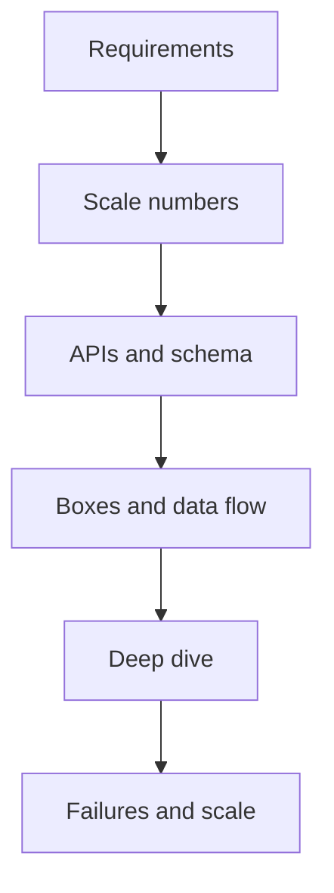

# How the Round Works

> [!abstract] What this is
> An HLD round is a **conversation with a diagram**. You drive the requirements, draw 6–8 boxes, pick a store, cache, and queue with a reason for each, and survive at least one deep dive. Perfection is not the bar. Coherence is.
>
> This note covers what each level is expected to show, the script to follow every time, and the habits that get people rejected.

---

## Why It Exists

Most candidates who fail an HLD round know enough technology. They fail because the conversation has no shape: they jump to tools, draw too many boxes, or go silent. The interviewer is scoring how you reason under ambiguity, and that is only visible if you follow a clear order and say your decisions out loud.

The round is often 40–60 minutes, and it is sometimes glued to a DSA question. If the interviewer says "how would you scale this" after a coding question, that **is** the HLD round. The same script applies with a smaller surface.

---

## What Each Level Is Expected to Show

The same question is asked at every level. What changes is how much of the conversation you are expected to own, how many layers deep you go without being prompted, and how far past "it works" you think. A wrong first guess is fine at any level if you notice it and correct it.

| Level | What they expect | What gets you marked down |
|---|---|---|
| **SDE-1** | Clear requirements, a readable diagram, a reasonable choice of SQL, cache, and queue, **one** solid deep dive, and at least one failure mode discussed. Some steering from the interviewer is normal. | No requirements, a diagram with no data flow, or no answer to "what if this box dies?" |
| **SDE-2** | You **lead** the round without being pulled along. Every box has a stated trade-off. You handle 2–3 deep dives (shard key, consistency per path, what dies and how it recovers). You **name the bottleneck before they ask**. | Waiting for the interviewer to steer, listing options without picking, or discovering the bottleneck only when told. |
| **SDE-3 / Senior** | Everything above, plus **multi-region** awareness, **cost**, **migrations**, and operability. You frame the design as a sequence of evolutions, not one final picture. | A design that only works on a whiteboard: no cost sense, no way to roll it out, no plan for a region failure. |

### What is graded, dimension by dimension

It helps to read the same expectations sideways: pick one thing the interviewer is watching, and see how the bar moves with level. None of these are hard cut-offs; a strong SDE-1 who raises cost unprompted gets credit for it.

| Dimension | SDE-1 | SDE-2 | SDE-3 / Senior |
|---|---|---|---|
| **Driving the conversation** | Follows the script; accepts hints and uses them well | Announces each phase and closes it with a decision; interviewer rarely asks "what next?" | Sets the agenda, including which parts to skip and why |
| **Deep dives** | One, usually chosen with the interviewer | 2–3, at least one proposed by you | 2–3 that go down to data layout, failure recovery, and operations |
| **Trade-offs** | Stated when asked | Stated **unprompted**, one per box | Stated unprompted, and tied to cost and team or ops burden |
| **Failure modes** | At least one, e.g. "the cache dies" | Walks what dies, what the user sees, and how it recovers | Adds blast radius, region loss, and how you'd detect it |
| **Cost** | Not expected | Nice to have | Expected: the dominant cost and one lever to cut it |
| **Migrations** | Not expected | Mentioned if the question implies an existing system | Expected: dual write, backfill, shadow read, cutover, rollback |
| **Multi-region** | Not expected | Awareness that it exists | Expected: active-passive vs active-active, which data needs cross-region consistency |

### What "driving the round" means at SDE-2

Driving means the interviewer rarely has to ask "what next?" You announce each phase ("I'll lock requirements, then do rough numbers"), you close each phase with a decision, and you propose the deep dive yourself ("the interesting part here is the fan-out on write; want me to go there?").

Stating a trade-off per box means every component on the diagram comes with one sentence of why, and one sentence of what it costs. "Postgres because orders need a transaction; the cost is that write scaling needs sharding later" is a trade-off. "Postgres because it's reliable" is not.

Naming bottlenecks first means that once the diagram is up, you point at the weakest box before the interviewer does. Typical candidates are the single primary database on the write path, a hot key in the cache, a synchronous call to a slow third party, or a fan-out that multiplies traffic.

### What Senior and SDE-3 interviewers add

At this level the interviewer assumes you can draw a correct design. They probe whether you could actually run it.

| Area | What they want to hear |
|---|---|
| **Cost** | Which component dominates the bill (storage, egress, a large cache cluster) and one lever to reduce it, such as tiered storage or a shorter retention period. |
| **Migrations** | How you get from the current system to the new one without downtime: dual writes, backfill, shadow reads, then cutover, with a rollback path. See [[19 - Deployment and Infrastructure]]. |
| **Multi-region** | Whether the system is active-passive or active-active, which data must be strongly consistent across regions, and what happens to writes during a region failover. See [[17 - Consistency Time and Consensus]]. |
| **Evolution** | A version that works for today's scale, and the specific signal (QPS, data size, latency) that would trigger the next step. |
| **Operability** | What you would alert on, how you would deploy safely, and how a new engineer would debug a failed request. See [[11 - Services and Observability]]. |

---

## The Script

Use the same order every time. What you call each phase doesn't matter; the order is the thing, because each phase produces the input for the next one.

1. **Requirements (5–7 min).** List 3–5 functional bullets, the non-functional requirements, and what is explicitly out of scope.
2. **Scale (2–4 min).** Go from DAU to QPS, with read and write computed **separately**, then to storage. Rough is fine. Skip the theatre if the system is tiny.
3. **API and schema (5 min).** Write about 4 endpoints and the key tables and indexes. Do not polish JSON.
4. **Boxes (10 min).** Draw client → gateway/LB → services → cache/DB → queue/workers. Trace **one write** and **one read** out loud.
5. **Deep dive (10–15 min).** Go into the part the question is actually about. If it's unclear which part that is, invite them to pick.
6. **Break it (5 min).** Walk through the cache going down, a duplicate message, a hot key, and replica lag.

> [!warning] Do not open with "I'll use Kafka, Redis, and microservices." That is the number one reject signal. Constraints first, technology second.

---

## Non-Functional Questions to Ask Every Time

Non-functional requirements decide the architecture far more than the feature list does, so ask them explicitly. Write them on the board rather than only saying them, so both of you can point back to them later.

| Question | What to pin down |
|---|---|
| **Scale** | Users, QPS, data size, read:write ratio. |
| **Latency** | The p99 target on the hot path. |
| **Availability** | 99.9% is about 8.8 hours down per year; 99.99% is about 52 minutes. |
| **Consistency** | Strong, read-your-writes, or eventual. Decide this **per path**, not for "the system." |
| **Durability** | Can we ever lose a write? |
| **Security** | Authentication, PII, and rate limiting as abuse control. See [[18 - Security]]. |

Then **cut scope** out loud: "I'm skipping admin, the analytics dashboard, and payments unless you want them." This keeps the design small enough to finish.

---

## How to Draw

A good diagram is readable from across the room. The interviewer should be able to follow a request without asking what a box does. A few habits get you there.

- Draw 5–8 boxes, each with one sentence of responsibility.
- Label arrows with the protocol or action (HTTP, WS, enqueue).
- Do **not** draw a load balancer in front of every service. Draw one at the edge and say the rest are horizontally scaled.
- Next to the database, write the 4–6 columns that matter and mark which column is indexed or is the shard key.

---

## Decisions They Want to Hear

A decision should be stated as a pick with a reason, not as a menu of options. Hedging such as "we could use SQL or NoSQL" without a pick reads as not knowing the answer. Name the cost of the pick in the same breath, and you have a trade-off.

> [!example] A decision said well
> "Postgres here because orders need a transaction. Redis cache-aside on the read path with a 5-minute TTL, because stale is fine. Kafka after the write so notifications don't sit on the request path."

---

## Red Flags

These are the habits that most often turn a reasonable design into a reject. Each one signals either that you skipped the product thinking or that you can't reason about scale. The last two matter more as the level goes up.

- Jumping to technology before understanding the product.
- Drawing 20 boxes with no arrows.
- Designing for 1B users when they said it's an internal tool.
- Thinking silently for minutes at a time.
- Ignoring "what about failures?"
- Caching everything.
- Sharding at 50 GB.
- Treating "exactly-once" as a magic Kafka setting with no idempotent consumer.
- (SDE-2 and above) Listing trade-offs without ever committing to one.
- (Senior) Proposing a rewrite with no migration or rollback plan.

---

## Interview Lines

> [!tip] Say it like this
> - "Before I pick any technology, let me lock the requirements and rough numbers."
> - "I'll trace one write and one read end to end, then go deep on the part that's actually hard here."
> - "The bottleneck in this design is the single write primary; here's what I'd do when we outgrow it."
> - "Consistency is per path: strong for the booking, eventual for the counts."
> - "To roll this out I'd dual-write, backfill, shadow-read, then cut over with a rollback switch."

## Related Notes

- [[02 - Fundamentals]]
- [[11 - Services and Observability]]
- [[12 - Mini Designs]]
- [[13 - Question Bank]]
- [[16 - Estimation and Decision Cheat Sheet]]
- [[17 - Consistency Time and Consensus]]
- [[18 - Security]]
- [[19 - Deployment and Infrastructure]]
