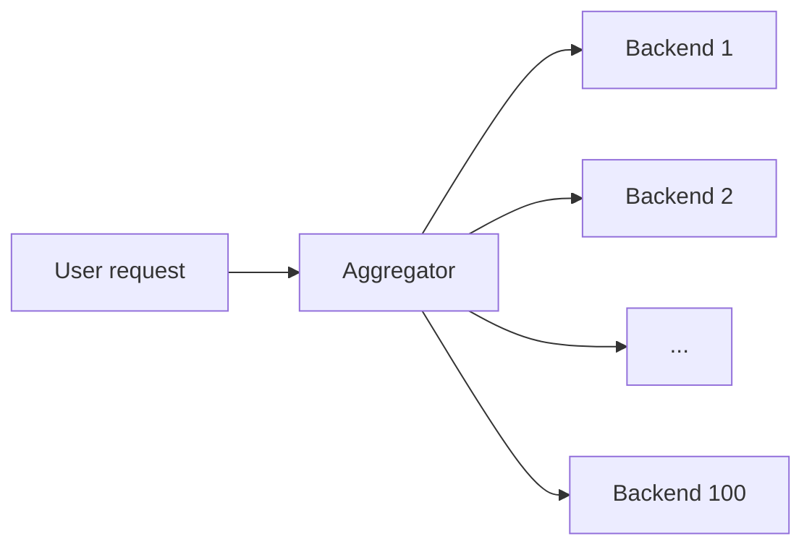

# Fundamentals

> [!abstract] What this is
> The vocabulary every follow-up question is built from: latency, throughput, availability, consistency, queueing, and the numbers that size a system. If you only remember one page, remember this: **latency is not throughput**, **availability is measured in nines**, **CAP is a choice you make during a partition**, **servers slow down sharply near full utilization**, and **the numbers decide whether you even need a queue**.

---

## Why It Exists

Every design decision in an interview is justified with these words. "Add a replica" is an availability argument. "Add a cache" is a latency argument. "Don't shard yet" is a capacity argument. If the words are fuzzy, the justification is fuzzy, and the interviewer can't tell whether you picked a component for a reason or from habit.

---

## Latency, Throughput, Bandwidth, Scalability

These four words measure different things, and mixing them up is a common source of wrong answers. A system can be good at one and bad at another.

| Term | What it measures | Watch for |
|---|---|---|
| **Latency** | Time for one request. This is what the user feels. | Look at **p50 vs p99**. The tail is what users notice. |
| **Throughput** | Requests handled per second (QPS, RPS, TPS). | Throughput can rise while latency gets worse. |
| **Bandwidth** | Bytes per second. | A 1 MB image at 1,000 QPS is about 1 GB/s. That is a different problem from "the API is slow." |
| **Scalability** | Whether adding machines gives you more of the above. | Only true if the bottleneck is actually spread across the machines. |

You can have high throughput with terrible latency, such as a huge batch job. You can have low latency with low throughput, such as one large server serving 10 users.

---

## Vertical vs Horizontal Scaling

There are two ways to get more capacity: make the machine bigger, or add more machines. The second is what "scaling" usually means in an interview, and it only works if any machine can serve any request.

| Approach | How it works | Cost | Pick when |
|---|---|---|---|
| **Vertical** | A bigger box | Hits a hardware ceiling; failover means "the box died" | Early stage, or a database primary you don't want to shard yet |
| **Horizontal** | More boxes behind a [[04 - Load Balancing CDN and Gateway\|load balancer]] | The app must be **stateless**: sessions live in Redis or the DB, not in process memory | App servers, almost always |

> [!tip] The default line is "stateless app servers behind a load balancer, with state in the DB and cache." That one sentence covers half of basic scaling.

---

## Availability and the Nines

Availability is the fraction of time the system answers correctly, usually quoted as a number of nines. Each extra nine cuts allowed downtime by 10x, and each one costs noticeably more to build.

| Nines | Downtime per year | Pick when |
|---|---|---|
| 99% | ~3.65 days | Hobby project |
| 99.9% (three nines) | ~8.8 hours | Typical product |
| 99.99% (four nines) | ~52 minutes | Payments, core checkout |
| 99.999% (five nines) | ~5 minutes | Not something you design in 45 minutes |

Availability comes from **redundancy** (replicas, multiple availability zones) and from **failing small** (timeouts instead of hanging). You cannot claim 99.99% and then draw a single Postgres with no replica.

A **SPOF** (single point of failure) is any box whose failure takes the whole site down. For every SPOF you draw, say how it is made redundant, or why you accept the risk and cache around it.

---

## Consistency Words

Consistency describes what a reader sees after someone writes. Use these precise terms instead of vague descriptions, and pick them per data path.

| Model | Guarantee | Cost | Pick when |
|---|---|---|---|
| **Strong** | After a write, every read sees it | Coordination and latency | Inventory, payments, unique bookings |
| **Read-your-writes** | *You* see your own write; others may lag | Sticky sessions, or read from the primary right after a write | Sessions, profile edits |
| **Causal** | If B happened after A, nobody sees B without A | Tracking dependencies | Comment replies; rarely needed by name in a basic round |
| **Eventual** | Replicas catch up eventually | Readers can see stale data | Feeds, counts, search indexes |

> [!warning] Do not pick one model for the whole product. Inventory and payments need strong consistency. A product description or a like count can be eventual.

For the full ladder of models (linearizability, sequential, snapshot isolation), clocks, and consensus, see [[17 - Consistency Time and Consensus]].

---

## CAP and PACELC

In a distributed store, a **network partition** will eventually happen: some nodes can't reach others. When it does, each side must either refuse requests or answer with data that might be stale. CAP names that choice.

| Choice | Behaviour during a partition | Pick when |
|---|---|---|
| **CP** | Refuse some requests rather than serve a wrong answer | Banking ledger, seat booking |
| **AP** | Keep answering, and accept that some answers are stale | Social feed, view counts |

**P is not optional** once you have more than one node, because you can't prevent the network from failing. "CA" only describes a single-node system.

**PACELC** extends CAP for when they push further: if **P**artitioned, choose **A** or **C**; **E**lse, choose **L**atency or **C**onsistency. Even on a healthy network, waiting for a quorum to confirm a write is slower than answering from one node.

The interview default is **eventual consistency unless the data is money, a stock count, or a unique booking**. Quorums, leader election, and how real systems pick a side are covered in [[17 - Consistency Time and Consensus]].

---

## ACID vs BASE

These are two families of guarantees for databases. ACID is what a relational database gives you per transaction; BASE is what many distributed NoSQL stores give up ACID for.

| Family | Meaning | Example | Pick when |
|---|---|---|---|
| **ACID** | A transaction is atomic, leaves data valid, doesn't see other transactions' uncommitted writes, and a committed write survives a crash | Postgres | Correctness per row matters: orders, money, bookings |
| **BASE** | Basically available, soft state, eventually consistent | Dynamo- or Cassandra-style stores | You need partition survival and write throughput, and can give up a single global answer to "what is this row right now" |

**Basically available** means the system always responds, even during a failure, rather than blocking or erroring out. **Soft state** means the data can change over time without a new write, simply by replicas syncing up to converge.

More on picking a store in [[05 - Databases]].

---

## Queueing: Why Latency Explodes Near Full Utilization

Every server is a queue. Requests arrive, wait if the server is busy, then get served. When the server is lightly used, a new request almost never finds anyone ahead of it. As utilization rises, the chance that it lands behind others grows, and each of those others may itself have been waiting. Waiting time therefore grows much faster than utilization does.

Think of a supermarket checkout. At half load the cashier is idle half the time, so a small burst of shoppers clears quickly. At 95% load the cashier is almost never idle, so any burst builds a line that has no spare time to drain. Arrivals are random, so bursts always happen.

The textbook model for this is the **M/M/1 queue** (random arrivals, random service times, one server). Its result is that time in system is roughly `service time / (1 - utilization)`: waiting grows like `1 / (1 − utilization)`. Real servers are not exactly M/M/1, but the shape of the curve holds. The table shows what that means for a request that takes 10 ms to serve.

| Utilization | Multiplier on service time | Time in system (10 ms service) |
|---|---|---|
| 50% | 2x | 20 ms |
| 70% | ~3.3x | ~33 ms |
| 80% | 5x | 50 ms |
| 90% | 10x | 100 ms |
| 95% | 20x | 200 ms |
| 99% | 100x | 1 s |

The curve is flat on the left and nearly vertical on the right. Going from 50% to 70% costs little. Going from 90% to 95% doubles latency. This is why capacity plans keep target utilization around **60–70%** as a rule of thumb, leaving roughly 30–40% headroom for traffic spikes, a failed node, or a slow dependency.

> [!warning] "The CPU is only at 85%, we have room" is wrong. At 85% a small traffic bump pushes the server onto the steep part of the curve, and the p99 blows up first.

### Little's Law

Little's Law connects concurrency, traffic, and latency. It holds for any stable system, with no assumptions about how requests arrive, which makes it the practical companion to the queueing curve above.

```
in-flight requests = arrival rate × time in system
L = λ × W
```

If a service receives 2,000 requests per second and each takes 50 ms, then on average `2,000 × 0.05 = 100` requests are in flight at once. That number sizes thread pools, connection pools, and worker counts. It also shows why a slow dependency is dangerous: if latency rises from 50 ms to 500 ms at the same arrival rate, in-flight requests rise from 100 to 1,000, and pools run out. The two ideas feed each other: high utilization raises W, and a higher W raises L, which pushes utilization higher still.

[[16 - Estimation and Decision Cheat Sheet]] applies Little's Law to worked sizing examples.

---

## Tail Latency Under Fan-Out

When one user request calls many backends in parallel and waits for all of them, the user's latency is the latency of the **slowest** backend. Rare slow responses stop being rare.

If each backend is slower than its own p99 only 1% of the time, then a request that fans out to N backends hits at least one slow backend with probability `1 − 0.99^N`. For N = 100 that is about **63%**. The backend's p99 has become the user's typical case.



| Fan-out | Chance at least one call is slower than backend p99 |
|---|---|
| 1 | 1% |
| 10 | ~10% |
| 100 | ~63% |

Serial hops have the same problem in a different form: a chain of five services adds up five latencies, and each one has its own tail. The mitigations attack either the number of calls or the cost of a slow one.

| Mitigation | How it helps | Pick when |
|---|---|---|
| **Fewer serial hops** | Fewer tails stacked end to end | Always look for calls that can be merged, cached, or made parallel |
| **Less fan-out** | Fewer dice rolls per request | Data can be pre-aggregated or partitioned so one request touches fewer shards |
| **Hedged requests** | Send to one replica; if no answer by about the p95, send the same call to a second and take the first reply. Cuts the tail sharply for about 5% extra load | Idempotent reads only. Details in [[08 - Reliability]] |
| **Per-call timeouts and partial results** | A slow backend is dropped instead of holding the whole request | The page is still useful with one section missing |
| **Headroom** | Keeps each backend off the steep part of the queueing curve | Always |

---

## Back-of-Envelope Estimation

Numbers are a tool for making a decision, not an opening ritual. Do **not** start the interview with a maths recital. Use numbers when choosing between one database or shards, Redis or not, synchronous or a queue.

Memorise the units, not a spreadsheet:

```
1 day ≈ 10^5 seconds
DAU × actions/day / 10^5 ≈ average QPS
Peak ≈ 2–3× average
Storage ≈ bytes/record × records/day × retention
Hot cache ≈ ~20% of data (Pareto)
```

### Numbers to know

These are modern ballparks, not the 2010 figures many lists still quote. Treat them as rough figures for reasoning, not benchmarks.

| Thing | Ballpark |
|---|---|
| Memory read | ~100 ns |
| SSD read | ~100 µs |
| Same-datacenter RPC | 0.5–2 ms |
| Redis GET | ~1 ms |
| Postgres simple read | ~1–5 ms (cached, hot data) |
| Cross-continent round trip | 50–200 ms (the speed of light is a hard limit) |
| Redis throughput | 100k+ ops/s per instance |
| Postgres throughput | Tens of thousands of QPS with sensible indexes and queries. **Do not shard at 50 GB.** |
| App server | Thousands of RPS, depending on the work per request |

> [!tip] If write QPS is 200 and data is 80 GB, you do **not** need Kafka and 16 shards. A primary with read replicas and a cache is the design.

### Capacity questions they ask

Interviewers often follow the estimate with a sizing question. Each has a short formula.

| Question | How to answer |
|---|---|
| How many servers? | `peak QPS / QPS per box`, then add headroom (target ~60–70% utilization, rule of thumb). |
| How big is the DB in a year? | Raw data, then roughly 2x for indexes, then multiply by the number of replicas. |
| Why is the cache this size? | It holds the working set, not the whole table. |

---

## Failure Modes

Most production incidents that trace back to fundamentals are one of these. Each is a direct consequence of a section above.

| Failure | What happens | Mitigation |
|---|---|---|
| **Running hot** | Servers above ~80% utilization; p99 spikes on small traffic bumps | Plan for ~60–70% target utilization; autoscale on latency or queue depth, not just CPU |
| **Slow dependency** | By Little's Law, in-flight requests multiply and pools exhaust | Timeouts, bounded pools, circuit breakers. See [[08 - Reliability]] |
| **Fan-out tail** | One slow backend makes most user requests slow | Hedged requests, partial results, less fan-out, fewer serial hops |
| **Hidden SPOF** | One unreplicated box takes the site down | Replicate it, or accept it explicitly and cache around it |
| **One consistency model everywhere** | Either money becomes eventually consistent, or everything pays the cost of strong consistency | Choose per path |

---

## Interview Lines

> [!tip] Say it like this
> - "Stateless app servers behind a load balancer; state lives in the DB and cache."
> - "Strong consistency for the booking, eventual for the counts. It's a per-path choice."
> - "During a partition this path is CP: I'd rather reject than double-book."
> - "I size for about 60–70% utilization, because waiting grows like one over one minus utilization."
> - "By Little's Law, 2,000 QPS at 50 ms is 100 requests in flight, so a pool of a few hundred is plenty."
> - "With 100-way fan-out, backend p99 becomes our median, so I'd hedge requests after the p95."

## Related Notes

- [[01 - How the Round Works]]
- [[04 - Load Balancing CDN and Gateway]]
- [[05 - Databases]]
- [[08 - Reliability]]
- [[10 - Distributed Building Blocks]]
- [[16 - Estimation and Decision Cheat Sheet]]
- [[17 - Consistency Time and Consensus]]
