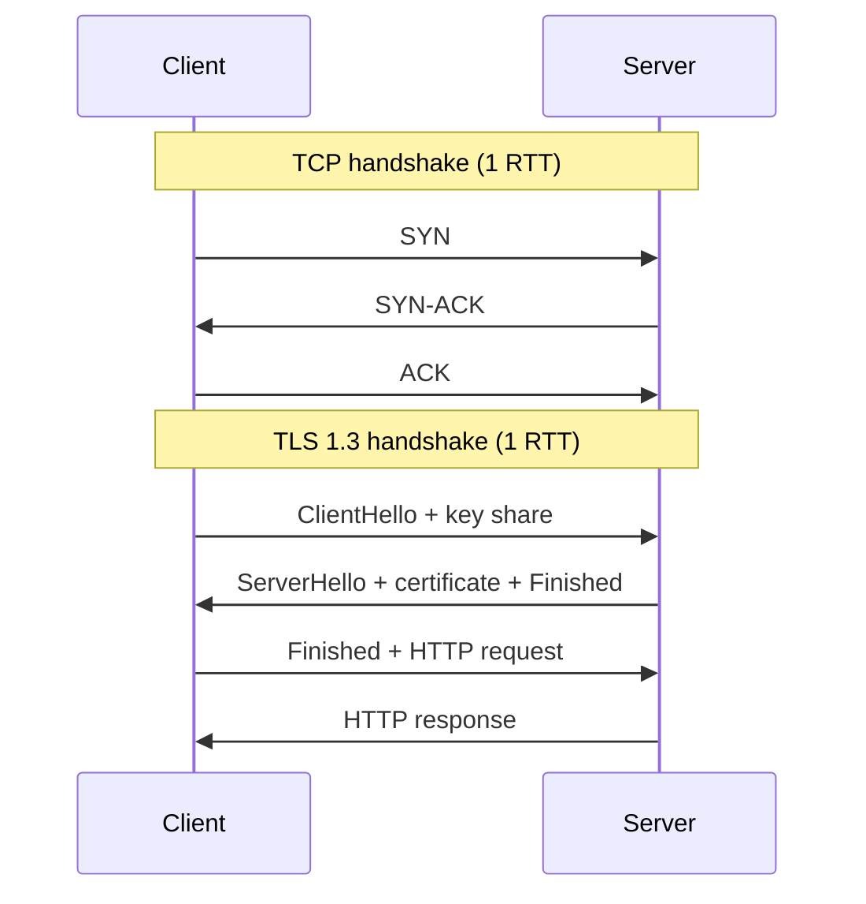
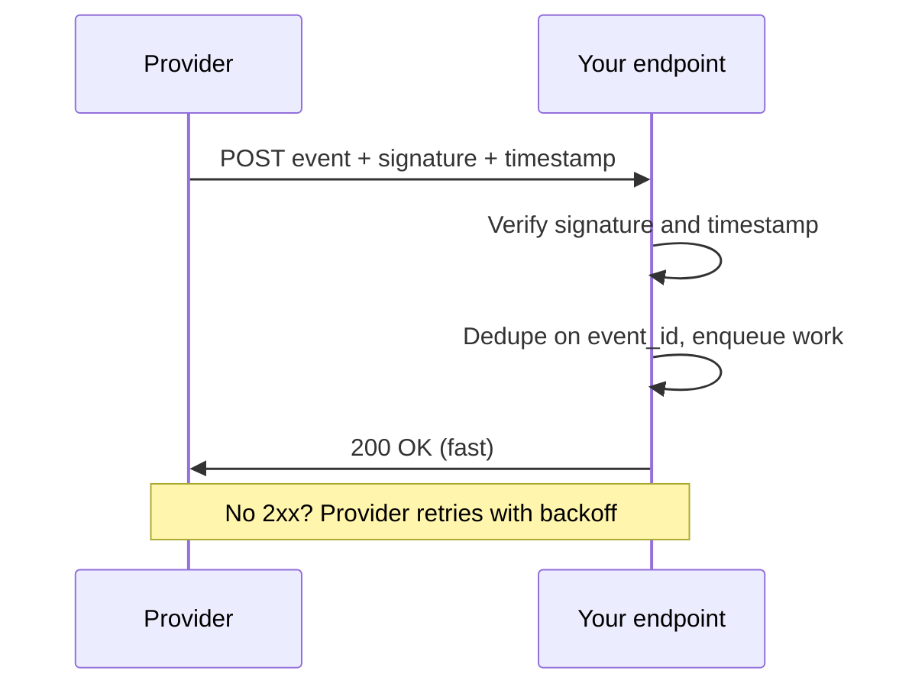
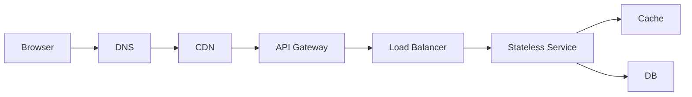

# Networking and APIs

> [!abstract] What this is
> A request is DNS → TCP → TLS → HTTP → your gateway, and every step costs round trips. This note covers that path, the HTTP versions, how to shape an API contract that can change without breaking clients, and how to push data back (realtime and webhooks).
>
> Defaults when nothing forces otherwise: **REST at the edge**, **gRPC inside the datacenter**, **reuse connections**, **version in the URL**, and **WebSockets only when both sides must talk continuously**.

---

## Why It Exists

Every design has an arrow from the client to your first box, and interviewers like to ask what is actually on that arrow. The answer matters for latency (handshakes cost round trips before any work starts), for scaling (long-lived connections change how you load balance), and for evolution (a public API you can't change without breaking customers is a permanent constraint).

It also covers the questions that come up in almost every round in some form: "walk a request from the browser", "PUT vs POST", "301 vs 302", "how does the client get updates", "how do you version this API".

---

## What Happens When You Type a URL

Before your code sees anything, four things happen in order. Each one depends on the one before it, which is why a cold connection is slow and a reused one is fast.

1. **DNS** turns a name into an IP. The answer is cached at the browser, the OS, and the recursive resolver; on a miss the resolver asks the root, then the TLD, then the authoritative name server. The **TTL** on the record is why DNS changes take time to spread. **Geo-DNS** can send `api.foo.com` to the nearest region.
2. **TCP** opens a reliable, ordered connection with a 3-way handshake. That costs one extra round trip before HTTP can start. It hurts less with TLS 1.3 and with HTTP/2 connection reuse.
3. **TLS** encrypts the pipe. The server's certificate proves you are talking to the right host. HTTPS is simply HTTP over TLS.
4. **HTTP** carries the actual request.

After that the request reaches your edge: CDN, gateway, load balancer, then service. That part is covered in [[04 - Load Balancing CDN and Gateway]].

> [!tip] If they ask "walk a request from the browser," this sequence **is** the answer. Then LB, then service. Say "all public traffic is TLS" and move on unless they push on certificates.

---

## TCP vs UDP

TCP and UDP are the two transports everything else is built on. TCP gives you ordering and retransmission, at the cost of a handshake and of stalling when a packet is lost. UDP gives you raw datagrams and leaves reliability to the application.

| | TCP | UDP |
|---|---|---|
| Guarantee | Ordered delivery, retransmits lost packets | Best effort, no ordering |
| Cost | Handshake; a lost packet stalls everything behind it | App must handle loss if it cares |
| Typical use | APIs, databases, HTTP/1.1 and HTTP/2 | Video and voice, DNS, games, and QUIC (HTTP/3) |
| Pick when | Default for anything request/response | Late data is useless, so resending it is pointless: "I'll use UDP for media, with an app-level retry if needed" |

---

## Handshake Cost and Connection Reuse

A brand-new HTTPS connection pays for TCP and TLS before the first byte of the request is sent. With TLS 1.3 that is one round trip for TCP and one for TLS, so the response arrives after about three round trips. TLS 1.2 needed two round trips for its handshake, so it was one slower.



Inside one datacenter a round trip is well under a millisecond, so this barely matters. Across a continent a round trip is 50–200 ms, so a cold connection can add a few hundred milliseconds before any work happens (rough figure). TLS also costs CPU on the server for the key exchange.

That is why every serious system avoids opening new connections per request.

| Technique                          | What it does                                                                                         | Pick when                                                                              |
| ---------------------------------- | ---------------------------------------------------------------------------------------------------- | -------------------------------------------------------------------------------------- |
| **Keep-alive**                     | Keeps the TCP + TLS connection open for many requests                                                | Always; it is the default in HTTP/1.1 and later                                        |
| **Connection pooling**             | A client keeps a set of warm connections and hands them out                                          | Service → database, service → service, gateway → backends                              |
| **TLS session resumption / 0-RTT** | A returning client skips most of the handshake; with TLS 1.3 0-RTT it sends data in the first flight | Repeat clients. 0-RTT data can be **replayed**, so only use it for idempotent requests |
| **Terminate TLS at the edge**      | CDN or load balancer does the expensive handshake close to the user                                  | Global users; the edge keeps warm connections back to your origin                      |

Pool size is a Little's Law question: in-flight requests = arrival rate × latency. See [[02 - Fundamentals]].

---

## HTTP/1.1 vs HTTP/2 vs HTTP/3

The three versions carry the same methods, status codes, and headers. What changes is how requests share a connection, and that decides how badly one slow or lost response holds up the others. This problem is called **head-of-line (HOL) blocking**, and it exists at two levels.

- **HTTP-level HOL.** In HTTP/1.1 a connection handles one request at a time. A slow response blocks every request queued behind it on that connection. Pipelining was meant to fix this but was never usable in practice, so browsers open several parallel connections per host instead (commonly around six).
- **TCP-level HOL.** TCP delivers bytes in order. If one packet is lost, everything after it waits for the retransmit, even bytes belonging to unrelated requests.

**HTTP/2** fixes the first problem. It uses binary framing and **multiplexes** many streams over one TCP connection, so a slow response no longer blocks others at the HTTP layer. It also adds **header compression** (HPACK), which matters because headers such as cookies repeat on every request. But all streams still share one TCP connection, so a lost packet stalls all of them.

A "stream" is not a second parallel connection; it's a label. A request or a file is cut into frames, each frame tagged with a **stream ID**, and the frames from many streams are interleaved onto the one TCP connection. The receiving end sorts frames back into their streams by that ID. This is why HTTP/2's fix is only partial: TCP itself has no concept of streams, just one ordered byte sequence. If a packet carrying bytes for stream 5 is lost, TCP won't hand *any* bytes to the application past that point, including bytes for streams 7 and 9 that already arrived fine, until the lost packet is retransmitted. The streams were multiplexed at the HTTP layer, but TCP still blocks on them as a single ordered unit.

TCP itself has separate send and receive directions on the same connection, so request bytes and response bytes can be in flight at once. HTTP/1.1 uses that but only halfway: one request at a time and one response at a time per connection, so there's nothing to multiplex yet. HTTP/2's stream IDs are what let many requests and many responses overlap on both directions simultaneously, which is what makes real streaming possible.

**HTTP/3** fixes the second problem by replacing TCP with **QUIC**, which runs over **UDP**. The streams are the same idea, labelled chunks of a request multiplexed together, but QUIC tracks loss and ordering **per stream ID** instead of for the connection as a whole. A lost packet only blocks the stream it belonged to; frames for other streams that already arrived are delivered immediately. That per-stream accounting, not UDP itself, is what actually removes transport-level head-of-line blocking. TLS 1.3 is built in, so the transport and crypto handshakes are combined into one round trip, and returning clients can use **0-RTT**. QUIC identifies a connection by an ID rather than by IP and port, which gives **connection migration**: a phone moving from Wi-Fi to cellular keeps its connection.

| Version | Connection model | HOL blocking | Extras | Pick when |
|---|---|---|---|---|
| **HTTP/1.1** | One request at a time per connection; keep-alive reuses it | At HTTP and TCP level | Text headers, no compression | Simple internal traffic, legacy clients, debugging with plain tools |
| **HTTP/2** | Many multiplexed streams over one TCP connection | TCP level only | HPACK header compression, binary framing | Default for browsers and APIs; required by gRPC |
| **HTTP/3** | Many streams over QUIC on UDP | None across streams | TLS 1.3 built in, 0-RTT, connection migration | Mobile users on lossy networks, global audiences; usually switched on at the CDN |

> [!info] You don't need to design HTTP/3 in an interview. Know that multiplexing exists, why HTTP/2 still suffers from packet loss, and that HTTP/3 fixes it by moving to UDP. Some networks block UDP, so clients fall back to HTTP/2.

---

## HTTP Methods, Status Codes, Idempotency

Methods and status codes are the shared vocabulary between client and server. Using them correctly means caches, proxies, and client libraries behave sensibly without special cases.

| Method | Meaning | Idempotent? | Pick when |
|---|---|---|---|
| **GET** | Read | Yes, and cacheable | Fetching a resource |
| **POST** | Create, or any non-idempotent action | No, unless you make it so | Creating something or triggering an action |
| **PUT** | Replace the whole resource | Yes | Client knows the full new state |
| **PATCH** | Partial update | Not by default | Changing a few fields |
| **DELETE** | Remove | Yes | Deleting a resource |

The status codes worth knowing are 200, 201, 204, **301 vs 302** (permanent vs temporary redirect; a URL shortener cares because browsers cache 301), 400, 401, 403, **404**, **409** conflict, **429** rate limited, 500, and 503.

**Idempotency** means sending the same request twice has the same effect as sending it once. PUT and DELETE are idempotent by nature. POST needs an **`Idempotency-Key`** header when a duplicate would be harmful, such as a payment: the server stores key → response and returns the stored response for a repeat. Details in [[08 - Reliability]] and [[07 - Async Messaging]].

---

## REST vs GraphQL vs gRPC

These are three styles for the same job: letting one program call another. The usual pattern is REST at the edge and gRPC inside.

| Style | How it works | Strength | Cost | Pick when |
|---|---|---|---|---|
| **REST** | Resources as URLs, HTTP methods as verbs, usually JSON | Easy to cache, debug, and put a CDN in front of | Clients may over- or under-fetch | Default for public APIs |
| **GraphQL** | Client sends a query describing the shape it wants | One endpoint serves many client types | Easy to write a **nasty query** that joins the world; harder to cache | Many different clients (web, mobile, partners) needing different shapes. Don't lead with it |
| **gRPC** | Protobuf over HTTP/2, generated typed clients | Fast, typed, streaming | Browsers don't speak it natively | **Service-to-service** calls inside the datacenter |

> [!warning] Spending 12 minutes designing endpoints is a fail. Write four endpoints, then move to architecture.

---

## API Contracts: Versioning, Compatibility, Errors

An API is a contract. Once clients depend on it, you can't change it freely, because you don't control when they upgrade. Mobile apps in particular stay on old versions for months. So the question is not "how do I design the perfect API" but "how do I change it later without breaking anyone".

### Versioning strategies

A version tells the server which contract the client expects. There are three common approaches.

| Strategy | Example | Cost | Pick when |
|---|---|---|---|
| **URL version** | `/v1/orders`, `/v2/orders` | Two code paths to maintain; URLs change on upgrade | Public APIs. Visible, easy to route at the gateway, easy to cache and test. The interview default |
| **Header version** | `API-Version: 2025-01-15` or `Accept: application/vnd.foo.v2+json` | Harder to test in a browser; caches must vary on the header | You want stable URLs and fine-grained versions. Stripe uses dated versions this way |
| **No version, additive changes only** | Add fields, never remove or rename | Requires discipline; old fields live forever | Internal APIs where you control every client; protobuf/gRPC with reserved field numbers |

### Compatible vs breaking changes

The rule of thumb is that **adding is safe and changing or removing is breaking**. Clients must also be written to ignore fields they don't recognise, or even additions will break them.

| Change | Compatible? | Why |
|---|---|---|
| Add an optional request field | Yes | Old clients don't send it; server uses a default |
| Add a response field | Yes | Old clients ignore it |
| Add a new endpoint | Yes | Nobody calls it yet |
| Add a new enum value | Risky | Old clients with a strict `switch` may crash |
| Remove or rename a field | **Breaking** | Old clients read a field that is gone |
| Change a field's type or meaning | **Breaking** | Old clients parse it wrongly |
| Make an optional field required | **Breaking** | Old requests start failing |
| Change status codes or error shape | **Breaking** | Client error handling stops matching |

A breaking change goes into a new version. The old version is deprecated with a date, and you watch traffic on it until it drops to near zero before switching it off.

### Error model

Every error from every endpoint should have the same body shape, so clients write error handling once. A common shape is a code a machine can match on, a message a human can read, and a request ID to find the logs. RFC 9457 ("problem details", `application/problem+json`) is a standard version of this.

A client that gets an error (or times out) needs to know whether retrying is safe. **Idempotent requests are the ones safe to repeat.** For a request that isn't naturally idempotent, such as a POST that creates something, the **`Idempotency-Key`** is the unique identifier the server uses to recognise a repeat and return the original result instead of doing it twice.

```json
{
  "error": {
    "code": "INSUFFICIENT_FUNDS",
    "message": "Wallet balance is lower than the order total.",
    "request_id": "req_8f2c"
  }
}
```

The status code carries the category, and the body carries the detail. **4xx** means the client did something wrong and retrying the same request won't help. **5xx** means the server failed and a retry may succeed. **429** and **503** may include a `Retry-After` header. Clients should retry only on 5xx, 429, and timeouts, and only if the request is idempotent or carries an idempotency key.

---

## Pagination

Any endpoint that returns a list needs pagination, because the list will eventually be too large for one response. The two approaches differ in how they behave when the data changes underneath.

| Approach | How it works | Cost | Pick when |
|---|---|---|---|
| **Offset** | `LIMIT 20 OFFSET 40` | Breaks when rows are inserted at the top (a feed shows duplicates or skips); slow on large offsets because the DB still scans skipped rows | Small, stable lists; admin tables with page numbers |
| **Cursor** | "Give me items after `id=...`", or after a `(timestamp, id)` pair | No jumping to page 7 | The right default for feeds and anything large or changing |

Cursor pagination fetches the next batch by referencing the marker from the last item returned, instead of counting rows from the start. The reason this is fast is that the marker column (or pair) has an **index** on it, so the rows are already sorted in that order ahead of time; the database just jumps straight to the marker's position in the index and reads forward, rather than re-sorting or scanning the table on every request. That's what keeps performance flat regardless of how large the table gets, and it also avoids the duplicate-or-skipped-item problem offset has when rows are inserted while someone pages through. The cost is not being able to jump to an arbitrary page number, and that's not just a missing feature: you can't know the marker for "page 7" in advance, because deletions leave gaps and inserts keep shifting which row would be the 60th, so the only way to find that marker is to count 60 rows in order first, which is the exact scan a cursor exists to avoid.

---

## Realtime: Pick the Simplest Thing That Works

When the server has something new to tell the client, there's a ladder of options from simple to complex. Each step up costs more infrastructure, so pick the lowest step that meets the need.

| Need | Pick |
|---|---|
| Client asks, server answers | Plain HTTP |
| Client checks every few seconds (notification badge) | **Short polling** |
| Client waits, server answers when something is ready | **Long polling** |
| Server pushes, client only listens (scores, order status) | **SSE** (Server-Sent Events) |
| Both sides talk continuously (chat) | **WebSocket** |

SSE is still a normal HTTP request and response, just one where the server never closes the response and keeps writing new chunks into it over time, so it works with an ordinary load balancer and reconnects automatically. A WebSocket is a persistent TCP connection, which changes the design: a message for a user must reach the specific node holding that user's connection, since another node can't write into a socket it doesn't hold. That needs **sticky sessions** (pin each user to one node) or a **pub/sub** layer (such as Redis, so the node that generates an update can hand it to the node holding the connection), plus an L4 load balancer or a WebSocket gateway, since ordinary HTTP load balancers tend to close connections that stay open too long.

> [!tip] "Realtime" in the prompt does **not** mean WebSockets. Order tracking can be SSE or even polling every 2 s. Chat needs WebSockets.

---

## Webhooks

A webhook is the server-to-server version of a push. Instead of your system polling a provider ("has the payment finished yet?"), the provider sends an HTTP POST to a URL you registered when an event happens. Payment gateways, Git hosts, and messaging providers all work this way. You may be the receiver, the sender, or both.



Webhooks cross the public internet, so four properties make them safe and reliable.

- **Signing.** The sender computes an **HMAC** of the body with a shared secret and sends it in a header. The receiver recomputes it and compares with a constant-time check. Anyone can POST to a public URL; only the provider knows the secret.
- **Retries with backoff.** If the receiver doesn't return 2xx in time, the sender retries with exponential backoff over hours or days. So the receiver should return 200 quickly and do the real work asynchronously from a queue.
	- **Idempotent receiver.** Retries mean the same event **will** arrive more than once. Store the `event_id` with a unique constraint and skip duplicates. Also check the current state: if the order is already paid, a second "paid" event is a no-op.
- **Replay protection.** Include a timestamp in the signed payload and reject events older than a few minutes. This stops an attacker who captured a valid signed request from resending it later.

Signing matters even though the connection is already HTTPS. TLS only secures the *pipe*: it stops eavesdropping and tampering in transit, but it says nothing about *who* is on the other end of that pipe. Anyone, including an attacker, can open a perfectly valid, secure TLS connection to your public webhook URL and POST a fake payload through it. The thing that actually needs checking is the **source** of the request, not the transport, and that's exactly what the HMAC signature verifies: only whoever holds the shared secret can produce a signature your server accepts. That secret is typically a long-lived string the provider generates once when you register the webhook URL in their dashboard; you store it in your own secrets manager, and it stays valid indefinitely until you manually rotate it, unlike a short-lived OAuth token.

Replay protection covers a gap signing alone leaves open. A signature doesn't expire by itself, so if an attacker ever gets hold of one complete, validly signed request, for instance from a server log, resending that exact request later would still pass the HMAC check untouched. The timestamp fixes this because it's included inside the signed payload itself, not sent alongside it. The server rejects anything older than a few minutes, and the attacker can't just bump the timestamp to look recent, because changing it changes the payload, which breaks the existing signature, and producing a new valid signature for the updated timestamp requires the secret they don't have.

> [!warning] Don't trust only the client redirect after a payment. The webhook is the source of truth, and it must be idempotent. See [[12 - Mini Designs]].

---

## Authentication and Authorization

**Authentication** (AuthN) is who you are. **Authorization** (AuthZ) is what you're allowed to do, often as roles (RBAC). In a design, authentication usually happens once at the gateway, and authorization happens in the service that owns the data. The main options are summarised here; the deeper treatment (token lifetimes, OAuth flows, secrets, encryption) is in [[18 - Security]].
	
| Mechanism | How it works | Cost | Pick when |
|---|---|---|---|
| **Session cookie** | Server stores a session ID (e.g. in Redis); the cookie carries only the ID | Needs a shared session store or sticky sessions; cookies bring CSRF risk | Web apps where easy revocation matters |
| **JWT** | A signed token on the client; servers verify it without a lookup | **Hard to revoke** before expiry (needs a denylist). The payload is only base64, not encrypted, so no secrets in it | Stateless services, mobile clients, short-lived access tokens |
| **OAuth2 / SSO** | "Login with Google": you are a client of an identity provider | Extra redirects and provider dependency | Third-party login or enterprise SSO. Know the authorization-code flow exists; don't derive the spec live |
| **API keys** | A long secret per customer or service | Leaked keys need rotation | Public API customers, service-to-service. Pair with [[08 - Reliability\|rate limiting]] |
| **mTLS** | Both sides present certificates | Certificate management | Internal service mesh. Name-drop only |

In standard TLS, only the server presents a certificate; the client doesn't prove its identity at the network level at all. The session cookie, JWT, OAuth token and API key rows above are exactly how client identity gets checked instead, but all of them happen one layer up, at the **application** level, after the TLS handshake has already finished. **mTLS** is what moves client authentication down to the **network** level itself: the client also presents a certificate during the handshake, and the connection isn't established at all unless the server accepts it. That's why it's the odd one out in this table and why it's the default for a service mesh, where you want every connection between services verified before a single application-layer byte is exchanged.

---

## A Request Through Your System

This is the diagram interviewers want when they ask how a request reaches your service. The CDN may sit only in front of static content. The gateway does authentication and rate limiting.



Details of each edge box are in [[04 - Load Balancing CDN and Gateway]].

---

## Failure Modes

| Failure | What happens | Mitigation |
|---|---|---|
| **New connection per request** | Every call pays TCP + TLS round trips and server CPU; latency and load rise | Keep-alive, connection pools, TLS at the edge |
| **Pool exhaustion** | A slow downstream holds connections; new requests queue or fail | Size pools with Little's Law, set timeouts, circuit breakers. See [[08 - Reliability]] |
| **Packet loss on HTTP/2** | One lost packet stalls every multiplexed stream on the connection | HTTP/3 for lossy mobile networks |
| **Breaking API change** | Old mobile clients crash or misbehave | Additive changes only; breaking changes go in a new version with a deprecation window |
| **Duplicate POST on retry** | Double charge or double order | `Idempotency-Key` stored with the response |
| **Webhook duplicates or forgery** | Same event processed twice, or an attacker fakes an event | Dedupe on `event_id`, verify HMAC, reject old timestamps |
| **WebSocket node dies** | All users on that node disconnect | Clients reconnect with backoff; pub/sub so any node can deliver |
| **Long DNS TTL during failover** | Clients keep hitting the dead region | Short TTLs on records you may need to move; failover at the load balancer where possible |
| **Offset pagination on a feed** | Users see duplicates or miss items as new rows arrive | Cursor pagination |

---

## Interview Lines

> [!tip] Say it like this
> - "A request goes DNS, TCP, TLS, then HTTP to the gateway, load balancer, and a stateless service."
> - "REST at the edge because it's cacheable and debuggable; gRPC between services because it's typed and fast."
> - "A cold HTTPS connection is about three round trips before the response, so I reuse connections with keep-alive and pools."
> - "HTTP/2 removes head-of-line blocking at the HTTP layer; HTTP/3 removes it at the transport layer by running QUIC over UDP."
> - "I version in the URL, keep changes additive, and put breaking changes in `/v2` with a deprecation window."
> - "Webhooks are signed with HMAC, retried with backoff, and the receiver dedupes on `event_id`."
> - "Realtime doesn't mean WebSockets. Order status is SSE; chat needs WebSockets."

## Related Notes

- [[02 - Fundamentals]]
- [[04 - Load Balancing CDN and Gateway]]
- [[07 - Async Messaging]]
- [[08 - Reliability]]
- [[11 - Services and Observability]]
- [[12 - Mini Designs]]
- [[18 - Security]]
