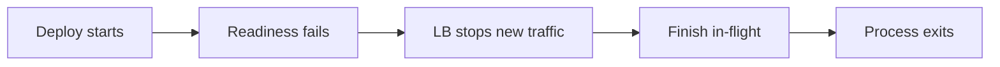
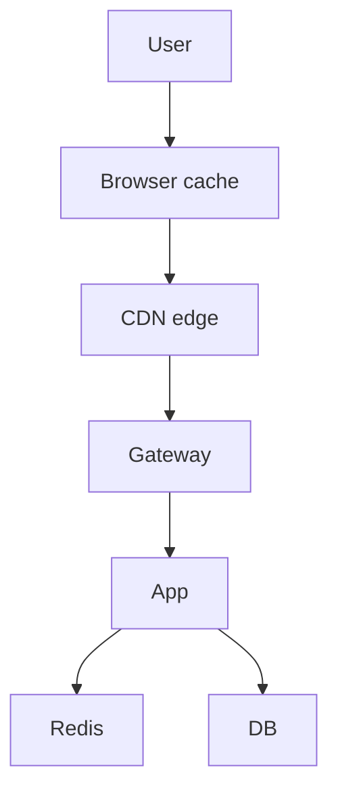
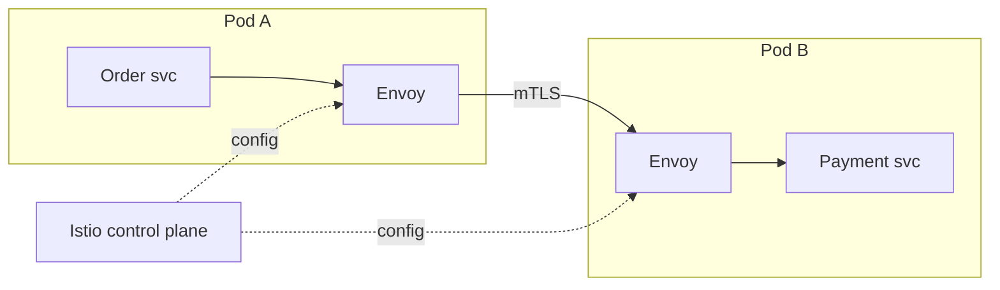

# Load Balancing, CDN, and Gateway

> [!abstract] What this is
> Three boxes that people often mix up. A **load balancer** spreads work across servers. A **reverse proxy or API gateway** is the front door that handles auth, routing, and rate limits. A **CDN** is a cache that sits close to the user.
>
> On a diagram, draw at most one of each and explain the rest in words.

---

## Why It Exists

A single server has a fixed amount of CPU and memory and can fail at any time. To scale and survive failures, you run many identical stateless servers. Once you have many, something has to decide which server gets each request, something has to check who the caller is before the request reaches your code, and something has to keep users far from your origin from paying the full network round trip for static files.

Those three jobs are the load balancer, the gateway, and the CDN. They are often provided by overlapping products, which is why they get confused.

---

## Load Balancer

A load balancer receives every incoming request and picks one of many identical stateless servers to handle it. The two decisions are which network layer it works at and which algorithm it uses to pick a server.

### L4 vs L7

An L4 balancer works at the TCP level and only sees IP addresses and ports. An L7 balancer works at the HTTP level and can read the URL, headers, cookies, and path, so it can route `/api` and `/static` to different places. L4 is faster but less capable.

| | L4 (TCP) | L7 (HTTP) |
|---|---|---|
| Sees | IP and port | URL, headers, cookies, path |
| Speed | Faster, but cannot inspect requests | Slower, but can route by path |
| Pick when | WebSockets, non-HTTP protocols, TLS passthrough | Almost every HTTP API |

The rule of thumb: **HTTP APIs go behind an L7 balancer. Persistent connections such as WebSockets go behind an L4 balancer or a dedicated WebSocket gateway.**

### Algorithms

There are four algorithms worth knowing. The right one depends on whether requests cost roughly the same and whether a client needs to keep hitting the same server.

| Algorithm | How it picks | Pick when |
|---|---|---|
| **Round robin** | Each server in turn | Default. Works badly when requests vary a lot in cost. |
| **Least connections** | The server with the fewest open connections | Request costs are mixed |
| **Weighted** | Bigger servers get a larger share | Servers have different sizes |
| **Consistent hashing / sticky** | The same client always goes to the same server | WebSockets or in-memory sessions. Try to design so you don't need this. |

### Removing the LB as a single point of failure

If there is only one load balancer, it becomes the single point of failure. The fix is to run two, either **active-passive** (one takes over when the other dies) or **active-active** (both serve traffic). A cloud managed load balancer such as AWS ELB already provides this as a service, so in an interview you can say "managed LB, multi-AZ" and move on.

---

## Health Checks and Connection Draining

A load balancer is only useful if it knows which servers are healthy. Without health checks, it keeps sending traffic to dead servers and turns into a random outage machine. When a server fails its check, the balancer takes it out of rotation.

### Active vs passive checks

There are two ways a balancer can learn that a server is unhealthy. Most production setups use both.

| Type | How it works | Pick when |
|---|---|---|
| **Active** | The LB calls a health endpoint (for example `/healthz`) on each server every few seconds | Default. Catches dead servers even when there is no traffic. |
| **Passive** | The LB watches real responses and ejects a server after repeated errors or timeouts | As an addition, to catch servers that pass the health endpoint but fail real requests |

### Liveness vs readiness

These two probes answer different questions, and mixing them up causes outages. **Liveness** asks "is this process stuck and should it be restarted?" **Readiness** asks "should this server receive traffic right now?" A server that is still warming its cache or connecting to the database is alive but not ready.

| Probe | Failure means | Action taken |
|---|---|---|
| Liveness | The process is broken | Restart it |
| Readiness | The process can't serve yet, or is shutting down | Stop sending traffic, but don't restart |

> [!warning] Don't make the liveness probe check the database. If the database has a blip, every server fails liveness at once and gets restarted, which turns a small problem into a full outage.

### Connection draining during deploys

When a server is about to be stopped during a deploy, it may still have requests in flight. Connection draining means the server first fails its readiness probe so the balancer stops sending new requests, then finishes the requests it already has, and only then shuts down. Without draining, every deploy cuts off some users mid-request. Deploy mechanics are covered in [[08 - Reliability]].

---

## Global Traffic Routing

A load balancer spreads traffic across servers inside one region. When a system runs in several regions, something must first decide which region a user goes to. Three techniques do this, and they work at different layers.

**GeoDNS** returns a different IP address depending on where the DNS query comes from, so a user in India gets the Mumbai IP and a user in the US gets the Virginia IP. It is simple, but DNS answers are cached by clients and resolvers, so failover is only as fast as the DNS TTL allows.

**Anycast** announces the same IP address from many locations. Internet routing (BGP) delivers each packet to the nearest location that announces it. Failover is fast because when one location stops announcing, routes shift automatically. CDNs and DNS providers such as Cloudflare use it heavily.

**GSLB** (global server load balancing) is a product layer, usually built on GeoDNS or anycast, that adds health checks and policies across regions. It can send traffic away from an unhealthy region, or split traffic by weight or by latency.

| Technique   | How it routes                                                    | Failover speed                                | Pick when                                                                                                                   |
| ----------- | ---------------------------------------------------------------- | --------------------------------------------- | --------------------------------------------------------------------------------------------------------------------------- |
| **GeoDNS**  | DNS answer depends on the client's location                      | Slow, limited by DNS TTL                      | Simple multi-region setup where minutes of failover are acceptable                                                          |
| **Anycast** | Same IP announced from many sites; the network picks the nearest | Fast, seconds                                 | Edge networks, CDNs, DNS, DDoS absorption                                                                                   |
| **GSLB**    | Health-aware policies across regions on top of DNS or anycast    | Depends on the layer underneath, usually fast | Active-active multi-region apps that need health-based failover. Managed examples: AWS Route 53, Cloudflare Load Balancing. |

For regional failover strategy and DR tiers, see [[08 - Reliability]].

---

## Reverse Proxy vs LB vs API Gateway

These three are separate jobs, but one process often does all of them.

- **Reverse proxy** (for example nginx) sits in front of your servers, terminates TLS, may cache responses, and may also act as the load balancer.
- **Load balancer** does the spreading job. It is often the same process as the reverse proxy.
- **API gateway** is a reverse proxy **plus product features**: routing to microservices, auth, rate limiting, adding a request ID, and sometimes transforming requests.

The gateway is also where **TLS termination**, a **WAF** (web application firewall), and **IP allowlists** usually live.

> [!tip] In an interview, one box at the edge labelled **API Gateway (auth, rate limit, routing)** is enough. Don't draw Kong *and* nginx *and* ELB unless you're asked.

---

## CDN

A CDN is a **globally distributed cache**. A user in Pune hits an edge server in Mumbai instead of your origin in `us-east`, which removes most of the network latency for content that can be cached.

| Content | Put it on the CDN? |
|---|---|
| Images, video segments, JS and CSS | Always |
| Public, cacheable API `GET` responses with a TTL | Sometimes |
| HTML that changes on every request | Usually not |

You own freshness through `Cache-Control` headers and TTLs. The CDN only serves what you told it is cacheable, for as long as you told it.

A company like Netflix runs its own CDN, but that is not what an interview wants. "CloudFront or Cloudflare in front of S3" is the right answer.

### Push vs pull

A **pull** CDN fetches a file from your origin the first time an edge gets a request for it, then caches it. A **push** CDN has you upload content to the edges ahead of time.

| Mode | How content gets to the edge | Pick when |
|---|---|---|
| **Pull** | Edge fetches from origin on a cache miss | Default. Almost everything. |
| **Push** | You preload the edges before users ask | You know a specific file is about to get huge traffic, such as a video launch, and don't want the first requests to all miss |

### Invalidation

Once a file is cached at hundreds of edges, changing it is the hard part. There are two approaches: purge the cached copy, or change the file's name so the old copy no longer matters.

**Purging** tells the CDN to drop cached copies. You can purge by **path** (one URL, or a wildcard) or by **tag** (every object labelled, for example, `product-42`, which some CDNs such as Fastly and Cloudflare support). Purges take time to reach every edge, may be rate-limited or billed, and browsers that already cached the file won't see the purge at all.

**Versioned filenames** put a content hash or version in the file name, such as `app.3f9a1c.js`. When the file changes, the HTML points to a new name, so there is nothing to invalidate. The old file can be cached for a year with `Cache-Control: immutable`.

| Approach | How it works | Pick when |
|---|---|---|
| **Versioned filenames** | New content gets a new URL | **Default** for JS, CSS, images, and any build asset |
| **Purge by path** | Drop specific URLs from all edges | A fixed URL had to change, such as `/logo.png` or a bad file shipped by mistake |
| **Purge by tag** | Drop every object with a given tag | Many URLs depend on one entity, such as all pages showing product 42 |

> [!tip] Say "versioned filenames, long TTL, purge only as an emergency tool." Purge on deploy only if you must.

### Cache keys and Vary

An edge decides whether two requests are "the same" by building a **cache key**. By default the key is roughly the host plus the path, and often the query string. Two requests with the same key get the same cached response, so anything that changes the response has to be part of the key, and anything that doesn't should be left out.

Leaving too much in the key hurts the hit rate. If tracking parameters such as `?utm_source=...` are in the key, every campaign link becomes a separate cache entry for the same file. Leaving too little out is worse: if the response depends on a header that isn't in the key, one user's version gets served to another.

The `Vary` response header tells caches which request headers change the response. `Vary: Accept-Encoding` means the gzip and brotli versions are cached separately, which is normal and safe. `Vary: Cookie` or `Vary: User-Agent` splits the cache into so many variants that it is effectively turned off.

| Key choice | Effect | Pick when |
|---|---|---|
| **Path only, ignore query string** | Highest hit rate | Versioned static assets where the query string means nothing |
| **Path + selected query params** | Keeps useful params, drops tracking noise | Public API `GET`s like `/products?page=2` |
| **`Vary: Accept-Encoding`** | One copy per compression format | Default for text assets |
| **`Vary` on Cookie / Authorization** | Near-zero hit rate | Almost never. Mark personal responses `Cache-Control: private` instead. |

---

## Where Caching Lives

It's easy to put Redis inside the CDN box by mistake. There are four separate caching layers between the user and the database, and each one is a different system.

The CDN is not Redis, and Redis is not the database's buffer pool. See [[06 - Caching]] for the full breakdown.

---

## TLS at the Edge

The usual setup terminates TLS at the load balancer or gateway, so app servers receive plain HTTP inside the private network (VPC). If the interviewer cares about internal security, you can re-encrypt from the gateway to the app, which is called "TLS everywhere." You won't design certificate rotation in 45 minutes. Mention HTTPS and move on.

---

## Service Mesh and Sidecars

In a microservices system, every service needs the same networking features for internal calls: encryption, retries, timeouts, and metrics. A service mesh moves those features out of application code and into a proxy that runs next to each service, called a **sidecar**. The application talks to its local sidecar, and the sidecars talk to each other.

**Envoy** is the most common sidecar proxy. **Istio** (and Linkerd) is the control plane that configures all the Envoy sidecars from one place.

What the mesh gives you without changing application code:

- **mTLS** between services, so every internal call is encrypted and both sides prove their identity.
- **Retries and timeouts** configured centrally, with the same limits for every service.
- **Traffic splitting**, such as sending 5% of traffic to a new version for a canary release.
- **Metrics and traces** for every call, emitted by the sidecar.

The cost is real. Every call passes through two extra proxies, which adds latency and CPU, and the mesh itself is a complex system that someone has to operate and debug.

| Situation | Mesh worth it? |
|---|---|
| Dozens of services, several languages, strict security requirements such as zero-trust | Yes |
| A handful of services in one language | Overkill. A shared client library and the load balancer are enough. |
| A monolith or modular monolith | No |

> [!warning] Don't add a service mesh to an interview design by default. Mention it only when there are many services and the interviewer asks about internal security, retries, or canaries. See [[11 - Services and Observability]].

---

## Failure Modes

| Failure | What happens | Mitigation |
|---|---|---|
| **No health checks** | LB keeps sending traffic to dead servers | Active plus passive checks, eject failing servers |
| **Liveness probe checks a dependency** | A DB blip restarts every server at once | Liveness checks only the process; readiness checks dependencies |
| **Deploy without draining** | In-flight requests get cut off | Fail readiness first, drain, then exit |
| **Single load balancer** | LB itself is the single point of failure | Active-passive or active-active pair, or a managed multi-AZ LB |
| **Stale CDN content** | Users see an old file after a deploy | Versioned filenames; purge as a fallback |
| **Private data on the CDN** | One user's data is served to another | Only cache public content at the edge; `Cache-Control: private` for anything personal |
| **Bad cache key** | Tracking params or `Vary: Cookie` kill the hit rate and flood the origin | Strip noise params from the key; vary only on headers that really change the response |
| **GeoDNS failover too slow** | Users keep hitting a dead region until DNS caches expire | Low TTLs, or anycast / GSLB with health checks |

---

## Interview Lines

> [!tip] Say it like this
> - "HTTP APIs go behind an L7 load balancer; WebSockets go behind L4 or a dedicated WS gateway."
> - "One edge box: API gateway for auth, rate limiting, and routing, behind a managed multi-AZ load balancer."
> - "Readiness fails first, the LB drains the server, then the process exits. That's a zero-downtime deploy."
> - "CloudFront in front of S3 for static assets, with versioned filenames so I never need to purge."
> - "GeoDNS or a GSLB picks the region; the load balancer picks the server inside it."
> - "A service mesh is worth it at dozens of services. For a handful, it's overhead."

## Related Notes

- [[03 - Networking and APIs]]
- [[06 - Caching]]
- [[08 - Reliability]]
- [[11 - Services and Observability]]
