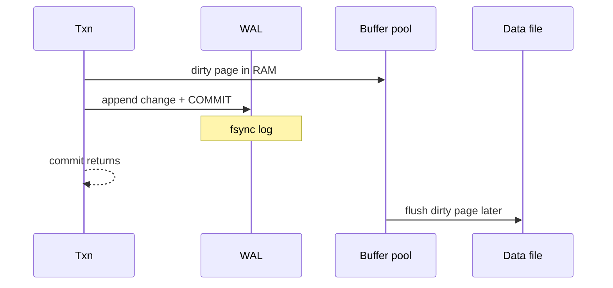
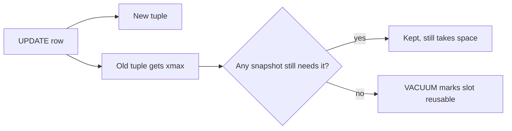

# Storage Engine and Disk I/O

> [!abstract] What this is
> This is the bottom layer of a database: how a row **sits on disk**, how it gets into **RAM**, and how a crash doesn't lose a committed write. Disk is organised in **pages** (4–16 KB), so you never update "one byte of a row" on disk; you rewrite a page. The RAM cache of pages is the **buffer pool**, durability comes from the **WAL** rather than the data file, ARIES is how the engine comes back after a crash, and vacuum/purge is how old row versions get cleaned up. The ten-minute overview is [[05 - Databases]].

---

## Why It Exists

Every higher-level question ("what does commit mean?", "why is this table 3× bigger than its data?", "why is the replica behind?") is answered at this layer. You won't implement any of it on a whiteboard, but knowing that commit means "the WAL is on disk" and that updates leave dead versions behind lets you reason about durability, replication, and bloat instead of guessing.

---

## Page Layout (Slotted Pages)

Disk and the OS think in **blocks**. The engine thinks in **pages**, usually **8 KB** in Postgres or **16 KB** in InnoDB. Reading or writing a row always means "bring this page in, maybe dirty it, maybe flush it later." You do **not** `pwrite` three bytes in the middle of a 200-byte row.

Most engines lay a page out as a **slotted page**:

```
┌──────────────────────────────────────────┐
│ page header (LSN, free-space, flags)     │
├──────────────────────────────────────────┤
│ slot 0 → | slot 1 → | slot 2 → |  …      │  line pointer array, grows ↓
│                                          │
│              free space                  │
│                                          │
│         ← tuple / row data grows         │
└──────────────────────────────────────────┘
```

| Part | What it holds | Notes |
|---|---|---|
| **Header** | Checksum, page LSN (the last WAL record that touched this page), lower/upper pointers into free space, page type (heap, btree, …) | The page LSN is what recovery compares against |
| **Line pointers (slots)** | Fixed-size entries growing **down** from the header; each is offset + length (+ flags: dead, redirected) | The slot number **is** the last part of a physical RID: `(page_id, slot)` |
| **Tuples** | Variable-length rows growing **up** from the bottom: header + null bitmap + columns | |
| **Free space** | The **gap in the middle** | Deleting a row marks its slot dead, so the gap can be reused without rewriting the whole page |

> [!tip] Why slots, not "just append rows"
> A row can grow (an UPDATE makes it longer), and a row can move to another page, in which case its slot becomes a **redirect**. Indexes point at `(page, slot)`, not a raw byte offset that would break on every compaction.

Over time a page collects dead slots and tiny holes, so it looks "full" but is mostly garbage. This is fragmentation, and vacuum/purge (below) is what reclaims it.

---

## Buffer Pool

The buffer pool is an in-memory cache of **pages**. It's the engine's answer to "don't hit the disk for every query." Its size is a knob, and the two big engines tune it differently.

| Engine | Setting | Guidance |
|---|---|---|
| Postgres | `shared_buffers` | Often 25% of RAM, **not** 90%. The OS page cache still does a lot of the work (same idea as Kafka) |
| InnoDB | `innodb_buffer_pool_size` | This **is** the cache; give it most of RAM |

### Hit, miss, and dirty pages

On a **hit** the page is already in the pool: pin it, read or write, unpin. On a **miss** the engine evicts a victim and reads the page from disk into that frame. A page with pin count > 0 **can't be evicted**, because someone is looking at it.

A **dirty page** is a page in RAM that doesn't match the copy on disk. An `UPDATE` dirties the page in the pool. It does **not** immediately `fsync` the data file, but it **does** append to the WAL first. A **checkpoint** or background flusher writes dirty pages back later. If the machine crashes with dirty pages in RAM, those bytes are gone, and the WAL plus ARIES put them back.

### Eviction

| Policy | How it works | Pick when / what you say |
|---|---|---|
| **LRU** | Evict the page unused for the longest | Simple, but not scan-resistant: a seq scan can evict the working set |
| **Clock sweep** | Approximate LRU with a reference bit; a "hand" sweeps and clears bits | The Postgres / InnoDB flavour. Cheap, good enough |
| **Midpoint / 2Q** | New pages enter a "young" region and are promoted only if reused | Stops a one-pass scan from wiping out the cache |

> [!warning] Seq scan vs the pool
> A 100 GB table scan can evict **every** hot page if eviction is naive LRU. Grown-up engines use **ring buffers** so a scan can't take the whole pool. The interview point: "the buffer pool is why we care about the working set fitting in RAM."

---

## Write-Ahead Logging (WAL)

The rule is **log first, data page later**. Before a dirty page is allowed to reach the data file, the WAL records that describe that change must already be **on stable storage** (the log has been `fsync`'d). Commit returns once the log is durable; the data page flushes whenever convenient.



This is faster than "`fsync` every page" because the WAL is **append-only and sequential**, while data pages are random (page 8, page 4001, page 12). One sequential `fsync` of the log commits many random page changes that flush **later**.

### Force and steal

These are the textbook words for "when do data pages hit disk relative to commit."

| Policy | Meaning | What engines actually do |
|---|---|---|
| **Force** | On commit, flush **data pages** too | Slow. Almost nobody |
| **No-force** | On commit, only the **WAL** is durable | Default. Dirty pages flush later |
| **No-steal** | A dirty page of an **uncommitted** txn may not be written to the data file | Simpler undo, less RAM flexibility |
| **Steal** | The pool **may** evict (write) a dirty page of an uncommitted txn | Default. Undo must be able to roll that page back |

Postgres and InnoDB are **steal + no-force**. Commit is a WAL `fsync`, and uncommitted dirty pages **can** reach disk. Therefore recovery must **undo** those stolen pages, and **redo** committed work whose data pages never flushed.

> [!tip] Interview line
> "Committed means the WAL is on disk, not that the heap page is." Replicas, CDC, and point-in-time recovery all **tail this log**. Debezium is "someone else reading our WAL"; see [[06 - Ecosystem Resilience and Design Patterns]].

### Checkpoints

Periodically the engine flushes a batch of dirty pages and writes a **checkpoint record** into the WAL. That way recovery doesn't replay from the beginning of time: it starts from the last checkpoint, redoes forward, and undoes whatever was uncommitted. Backups and PITR built on the same log are in [[12 - Schema Changes and Backups]].

---

## ARIES (Crash Recovery)

After a crash, RAM is gone and the data files are a mix of three things: old pages, stolen dirty pages from **uncommitted** transactions, and missing changes from **committed** transactions (because of no-force). The WAL on disk is the truth of what was intended. ARIES rebuilds a correct state from it in three passes.


| Pass | Walks | Does |
|---|---|---|
| **Analysis** | WAL forward from the last checkpoint | Rebuilds the dirty-page table and the list of **loser** (uncommitted) txns, and works out where redo must start |
| **Redo** | WAL forward | Replays **every** logged change whose page is stale (page LSN < log LSN). Recreates the state **at the moment of the crash**, including losers' dirty pages. This is "repeating history" |
| **Undo** | WAL backward, losers only | Rolls back uncommitted txns, writing **compensation log records** (CLRs) so a crash *during* undo doesn't undo twice |

> [!info] Why redo *everything*, including losers
> Steal already put some loser bytes on disk. Redoing everything brings the database to a known point, and undo then cleanly rolls the losers back. That's the ARIES trick compared with "only redo winners."

You won't implement ARIES on a whiteboard. You **will** say: WAL + steal/no-force + three passes. And if someone says "we lost committed data," the answer is that the WAL wasn't `fsync`'d, or the disk lied about it.

---

## MVCC Garbage: Vacuum, Purge, and Bloat

MVCC (explained in [[03 - Concurrency Control]]) never overwrites a row in place for readers' sake; it keeps old versions around so each transaction can see its snapshot. Those old versions become garbage once no transaction can see them any more, and something has to clean them up. Postgres and InnoDB put the garbage in different places, so they clean it differently.

### Postgres: dead tuples and vacuum

In Postgres an `UPDATE` inserts a new tuple and marks the old one with `xmax`; a `DELETE` just sets `xmax`. Once every transaction that could see the old version has finished, it becomes a **dead tuple**: it still takes up space in the heap page, and indexes still point at it. **VACUUM** scans for dead tuples, removes their index entries, and marks their slots reusable. **Autovacuum** is the background worker that runs this automatically when a table's dead-tuple count crosses a threshold.

Plain `VACUUM` makes space reusable inside the table but generally doesn't shrink the file. `VACUUM FULL` rewrites the table compactly but takes an exclusive lock for the whole rewrite, which is why tools like `pg_repack` exist. **HOT updates** (heap-only tuples) reduce the damage: if no indexed column changed and the page has room, the new version goes on the same page and no new index entry is written. A lower fill factor leaves that room.

**Bloat** is what you get when dead tuples pile up faster than vacuum clears them: the table and its indexes grow far beyond the live data, scans read more pages, and the buffer pool holds more garbage.



> [!warning] Long-running transactions block cleanup
> Vacuum can only remove a dead tuple if **no** open transaction's snapshot might still need it. One transaction left open for hours (an idle-in-transaction session, a long analytics query, a stale replication slot) holds back that horizon for the whole database, so dead tuples accumulate everywhere and bloat grows even though autovacuum is running.

### Transaction ID wraparound

Postgres transaction IDs (XIDs) are 32-bit, so they run out after about 4 billion and wrap around; visibility compares XIDs within a window of about 2 billion. To stay safe, vacuum **freezes** old tuples, marking them visible to everyone so their XID no longer matters. If freezing falls too far behind, Postgres warns and eventually refuses new writes until a vacuum finishes, to avoid old rows suddenly appearing to be "in the future." This is **transaction ID wraparound**, and it's the most serious reason never to disable autovacuum or leave transactions open forever.

### InnoDB: undo logs and purge

InnoDB updates the clustered row **in place** and writes the previous version into the **undo log**. A reader whose snapshot is older than the current row walks the undo chain to reconstruct its version. Once no active read view needs an old undo record, a background **purge** thread removes it and also cleans up delete-marked index entries.

The failure mode is the same shape as in Postgres: a long-running transaction keeps an old read view alive, purge can't advance, the **history list length** grows, undo space swells, and readers walk longer undo chains.

| Engine | Where old versions live | Cleaner | What blocks it | Symptom |
|---|---|---|---|---|
| Postgres | Dead tuples in the heap and index entries | VACUUM / autovacuum | Long-running or idle-in-transaction sessions, stale replication slots | Table and index bloat, wraparound warnings |
| InnoDB | Undo log records | Purge thread | Long-running transactions holding old read views | Growing history list length, big undo space, slower reads |

---

## Failure Modes

| Failure | What happens | Mitigation |
|---|---|---|
| **WAL not `fsync`'d** | "Committed" data disappears after a crash | Keep `fsync` on; use disks that honour flushes |
| **Seq scan floods the pool** | Hot pages evicted; every query goes to disk | Scan-resistant eviction (ring buffers, midpoint insertion); run big scans on a replica |
| **Working set bigger than RAM** | Constant misses, latency jumps | Size the buffer pool; shrink the working set with better indexes |
| **Table / index bloat** | Tables grow far beyond live data; scans slow down | Tune autovacuum, HOT updates via fill factor, `pg_repack` |
| **Long-running transaction** | Vacuum / purge can't clean anything newer than its snapshot | Statement and idle-in-transaction timeouts; move analytics to a replica |
| **XID wraparound** | Postgres refuses writes until an emergency vacuum finishes | Never disable autovacuum; monitor XID age |

---

## Interview Lines

> [!tip] Say it like this
> - "Committed means the WAL is on disk, not that the heap page is."
> - "WAL turns many random page writes into one sequential log `fsync`; the pages flush later."
> - "Postgres and InnoDB are steal + no-force, so recovery has to redo committed work and undo uncommitted work. That's ARIES."
> - "The buffer pool is why we care about the working set fitting in RAM."
> - "MVCC leaves old versions behind. Vacuum or purge cleans them, and a long-running transaction blocks that cleanup for everyone."

## Related Notes

- [[README]]
- [[02 - Indexing]]: those B+ pages live in the same pool
- [[03 - Concurrency Control]]: MVCC itself, which creates the versions vacuum cleans up
- [[08 - Replication]]: replicas apply WAL
- [[12 - Schema Changes and Backups]]: backups and PITR built on the WAL
- [[02 - Low-Level Storage and Performance IO]]: Kafka's page cache is the OS cousin of this pool
- [[06 - Ecosystem Resilience and Design Patterns]]
- [[11 - Interview Questions]]
