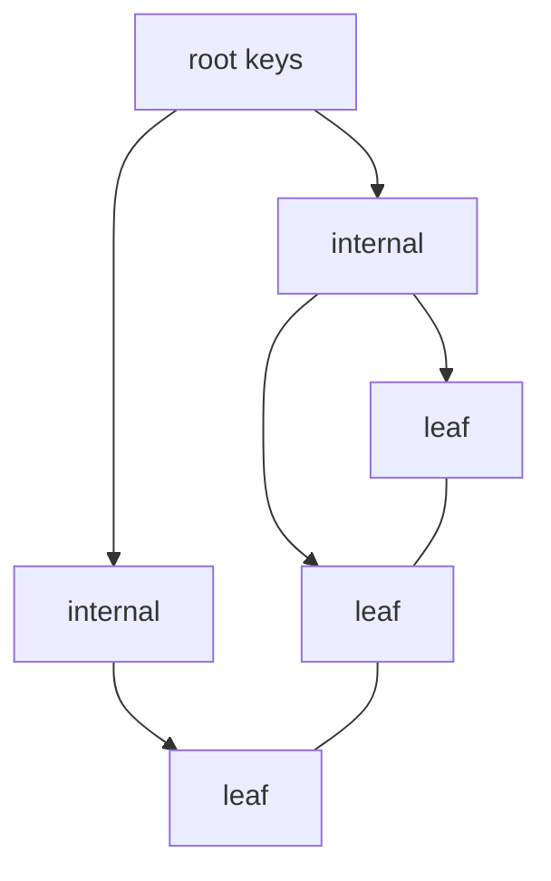

# Indexing

> [!abstract] What this is
> An index is an **extra data structure** that buys faster reads and costs **writes and disk**. The relational default is the **B+ tree**, which handles equality and range. Write-heavy stores use **LSM trees** (memtable → SSTable → compact), hash indexes give `O(1)` equality but are useless for `WHERE created_at >`, and the clustered vs secondary split decides whether the table *is* the index or just points back to it. The ten-minute overview is [[05 - Databases]].

---

## Why It Exists

Without an index, a lookup is a **full table scan**. With one, `WHERE id =` or `WHERE created_at BETWEEN` can jump straight to the rows. The price is that every `INSERT` or `UPDATE` of an indexed column must also **maintain** the tree or LSM. So you index what you **query**, not every column. Note that a unique constraint **is** an index too (email login is the classic case).

---

## B+ Trees

A B+ tree keeps only **keys and child pointers** in its internal nodes, which gives a high fanout and very few levels. All the **data or row pointers live in the leaves**, and the leaves form a **doubly-linked list**. A range scan finds the left-most matching leaf and then walks `next`. That leaf chain is why a B+ tree beats a plain B-tree (which stores data in internal nodes too) for `WHERE created_at >`.

On disk, **one node is exactly one page** (8 KB in Postgres, 16 KB in InnoDB): the root, every internal node, and every leaf is a single page, and a child pointer is just a page number. So a **node split and a page split are the same event**: when a leaf node overflows, the engine allocates a new page, moves half the entries into it, and adds a separator key to the parent page.

### Height

Fanout is in the hundreds, because an 8 KB page holds many `(key, child)` pairs. That means a billion rows is still only about 3–4 levels deep. The top levels sit in the **buffer pool**, so a point lookup is often just **one disk I/O**, for the leaf.

### Insert and split

To insert, the engine finds the right leaf. If there's room, the key goes there in order. If the leaf is full, it **splits**: two leaves are created and a separator key is copied up to the parent. If the parent is full, it splits too, possibly all the way up to a new root, which adds one to the height.

This is the write cost people mean by "B-tree random writes." A page split dirties two leaves plus a parent, and each of those changes also goes to the WAL (see [[01 - Storage Engine and Disk IO]]).

### Fill factor

Fill factor leaves **slack** on each page so the next insert doesn't immediately split it.

| Fill | Effect | Pick when |
|---|---|---|
| Packed tight (~100%) | Least disk and RAM | Bulk load of data that won't change |
| ~70% | Room for inserts before splits | Typical OLTP |
| Too tight on a busy table | Split storm, especially on a sequential key | Avoid |
| Too loose | Wasted RAM and disk | Avoid |

Index fill factor (Postgres B-tree default is 90) is applied when the index is **built** or rebuilt with `REINDEX`, not as a permanent cap. Later inserts and non-HOT updates drop their new entries into the leftover slack and keep filling the page until it's physically full; only then does it split. So the slack is there to be used up by future writes, which delays the split instead of making the page permanently smaller. (One exception: when the rightmost leaf splits, as with a sequential key, Postgres leaves the left page at the fill factor.)

> [!tip] Interview: "why B+ not hash for `created_at`"
> Hash has no order. The B+ leaf chain **is** the order, so after the first seek a range scan is a sequential walk.

---

## LSM Trees

A B+ tree updates **in place**, which means random page I/O on every write. An LSM tree **appends** instead, which is why write-heavy stores use it: Cassandra, RocksDB, LevelDB, and the Lucene flavour in Elasticsearch. Kafka is a log, not an LSM, so don't mix them up.

| Stage          | What it is                                     | Detail                                                                                                                      |
| -------------- | ---------------------------------------------- | --------------------------------------------------------------------------------------------------------------------------- |
| **Memtable**   | In-memory sorted structure (skip list or tree) | Every write is appended to the **commit log** (WAL) and inserted here. Reads check it first                                 |
| **SSTable**    | Immutable sorted file on disk                  | A full memtable is flushed into a new SSTable. Never updated in the middle: a newer file **shadows** an older copy of a key |
| **Compaction** | Background merge of files                      | Drops overwritten keys and **tombstones**, so fewer files and cheaper reads. Costs CPU and disk write amplification         |

Every file at every level, L0 and L1+ alike, is the same thing: an **SSTable** (Sorted String Table), a strictly sorted list of the key-value pairs that were written, with a small **index block** at the end so a read can jump straight to the right block. What differs between L0 and L1+ is not what's inside the files but **whether files in the same level may overlap** in key range.

**L0 is overlapping.** Each memtable flush lands in L0 as-is, so every file covers whatever keys happened to arrive in that window:

- Minute 1: the app writes `Apple = ₹50` and `Mango = ₹80`. The memtable fills and flushes as `L0_File_1`, range **A–M**.
- Minute 2: the app writes `Banana = ₹40` and updates `Mango = ₹120`. This flushes as `L0_File_2`, range **B–M**.

Both files claim the range containing Mango. L0 files are ordered by flush time, so a read checks the newest first and stops at the first hit, but it can't rule any L0 file out by range. Any of them might hold the key, so every L0 file is a candidate for every lookup, and the more L0 files pile up, the slower reads get.

**Compaction turns L0 into a partitioned L1.** When L0 has too many files, compaction kicks in:

1. **Merge:** it reads `L0_File_1` and `L0_File_2` (plus any L1 files whose ranges overlap them) and merge-sorts the already-sorted lists.
2. **Clean up:** it sees Apple, Banana, and two Mangos, keeps the newest `Mango = ₹120`, and drops `Mango = ₹80`.
3. **Split:** it writes the result into L1 as **non-overlapping** files, e.g. `L1_File_1` covering **A–C** (Apple, Banana) and `L1_File_2` covering **M–Z** (Mango).
4. **Delete:** the old L0 files are removed.

Now a lookup for Mango in L1 sees that `L1_File_1` only covers A–C, skips it, and goes straight to `L1_File_2`, which is one file read. From L1 downward every level enforces this rule: **no two files in the same level overlap**, so a read touches at most one file per level.

Each level is about **10× larger** than the one above it (L1 ≈ 10× L0, L2 ≈ 10× L1, …), and compaction keeps pushing data down. The deep levels become a large, durable, well-partitioned archive of old data, while the levels nearest the read path (memtable → L0 → L1 → …) stay small and keep being emptied so they can absorb new writes and the next round of compactions. This is **leveled compaction** (RocksDB, LevelDB, Cassandra's LCS). Cassandra's long-standing default, size-tiered compaction (STCS), instead merges similar-sized files without the non-overlap rule, so it does less write work but reads may touch more files.

### Reads and tombstones

A read may have to look in the memtable plus **several** SSTables. **Bloom filters** let it skip files that definitely don't contain the key (see [[10 - Distributed Building Blocks]]). Even so, that's why LSM reads can be slower than a warm B+ tree.

A delete is a write of `key → null`, called a **tombstone**, the same idea as Kafka compaction. The key is really gone only after compaction drops it.

> [!tip] One sentence
> Write-heavy firehose → **LSM**. Point-read transactional → **B+**. The product pick in depth: [[10 - Engine Choice]].

---

## Hash Indexes

A hash index gives `O(1)` equality, as in `WHERE email =`. It has **no** range queries, **no** `ORDER BY` that can use the index, and **no** prefix scan. In memory, Redis is essentially a hash index. On disk some engines offer hash indexes, but you almost never ask for one by name in Postgres, because the B+ default already does equality well.

| Structure | Equality | Range / order | Writes | Pick when |
|---|---|---|---|---|
| **B+ tree** | Yes | Yes | In-place, random I/O, splits | Default for OLTP |
| **LSM tree** | Yes (may read several files) | Yes, within sorted files | Sequential appends, compaction later | Write-heavy firehose |
| **Hash** | `O(1)` | No | Cheap | Pure key lookup, usually in memory |

---

## Clustered vs Non-Clustered

**1. The heap.** The heap is the primary physical storage file where rows are stored in a completely unsorted, unordered pile. When new data is inserted, the database engine does not sort it; it simply checks an internal **Free Space Map** and drops the row into the first available 8 KB page on the disk.

**2. Clustered vs non-clustered indexes.**

- **Clustered index:** permanently dictates the physical storage order of a table. The primary B+ tree does not just hold pointers; the **leaf nodes contain the actual, complete row data**. Because the data is embedded directly in the tree, it strictly maintains its sorted order.
- **Non-clustered (secondary) index:** a separate, detached data structure. It holds the search key alongside a **pointer** (or reference) that tells the database exactly where to jump to find the actual row data.

**3. PostgreSQL architecture (heap-based).**

- **No default clustering:** PostgreSQL relies entirely on a disorganized heap by default.
- **The PK is just a pointer:** the primary key B+ tree is fundamentally a secondary structure. It does not contain the row data; it holds the search key and a **Tuple Identifier (TID)**, a physical pointer containing the exact `(page, slot)` in the heap where the real data lives. Every other index in PostgreSQL works exactly the same way.
- **The `CLUSTER` command:** to physically sort the table you must run `CLUSTER`, a one-shot, manual maintenance operation that rewrites the entire heap file from scratch to match a chosen index. This ordered state is temporary; subsequent `INSERT`s drop data into whatever free space exists, breaking the cluster.

**4. InnoDB architecture (index-organized).**

- **The index is the table:** in InnoDB (MySQL) there is no separate heap file. The primary key B+ tree is the sole storage container for the table.
- **Direct writes:** every write goes directly into the leaf nodes of the PK B+ tree. The complete row lives permanently inside this tree, kept sorted by the primary key.
- **Secondary indexes:** because the actual rows are locked inside the primary B+ tree, secondary indexes can't point to a heap location. Instead they map the search key to the associated **primary key**. A lookup via a secondary index traverses **two trees**: the secondary tree to find the PK, then the primary tree to fetch the full row.

A **clustered** index means the table's physical order *is* the index order. A **non-clustered** (secondary) index is an extra structure mapping key → **pointer** back to the row. Postgres and InnoDB make opposite choices here.

|                          | Clustered                                                                                             | Non-clustered (secondary)                                  |
| ------------------------ | ----------------------------------------------------------------------------------------------------- | ---------------------------------------------------------- |
| What it is               | The **table's physical order** *is* this index                                                        | Extra structure: key → **pointer**                         |
| Postgres                 | The heap is **not** clustered by default. `CLUSTER` is a one-shot rewrite. The PK is just a unique B+ | Every index is "secondary" on a heap                       |
| InnoDB                   | The primary key **is** clustered. Rows live in the PK B+                                              | Secondary stores `(sec_key → PK)`, then you look up the PK |
| Range on the cluster key | Sequential I/O                                                                                        | Jumps around the heap / PK                                 |

In a **heap** (the Postgres default), rows land wherever there's free space and indexes hold TIDs `(page, slot)`. In an **index-organised / clustered** table (the InnoDB PK), the row **is** in the leaf, so a secondary lookup walks **two** trees: secondary → PK → row. A covering secondary index (below) can skip that second hop.

### Why a random UUID PK hurts in InnoDB

Because InnoDB secondary indexes store the **primary key** instead of a row location, the PK's size and randomness leak into every index and every lookup:

- **Fatter secondary indexes:** every secondary index entry carries a copy of the PK. A 16-byte UUID (36 bytes if stored as a string) instead of an 8-byte `bigint` means fewer entries per page, bigger indexes, and less of them fitting in the buffer pool.
- **Scattered second hop:** a secondary lookup walks two trees, and with random PKs the second walk lands on an unrelated part of the PK tree each time, so those leaf pages are less likely to be cached and more lookups hit disk.
- **Random inserts:** new rows land all over the clustered tree instead of at its right edge, causing page splits everywhere (callout below).

Postgres feels this less: its secondary indexes point at a heap `(page, slot)`, not the PK, and the heap isn't ordered by the PK. A UUID there still makes the PK index itself bigger and its inserts random, but the cost doesn't spread into every other index. UUID v7 (time-ordered) keeps the uniqueness while restoring right-edge inserts.

> [!warning] Random PK on a clustered table
> A UUID v4 as the InnoDB PK means random inserts all over the B+ tree, and page splits everywhere. Snowflake IDs, ULIDs, or `bigserial` keep inserts at the **right edge**. See [[10 - Distributed Building Blocks]].

---

## Composite, Covering, and the Rest

### Composite indexes and the leftmost prefix

A composite index on `(user_id, created_at)` is sorted by `user_id` first, then by `created_at` within each user. So it can only be used from the left.

| Query | Uses `(user_id, created_at)`? |
|---|---|
| `WHERE user_id = ?` | Yes |
| `WHERE user_id = ? AND created_at > ?` | Yes |
| `WHERE user_id = ? ORDER BY created_at` | Yes |
| `WHERE created_at > ?` alone | **No** |

The leftmost prefix rule is the thing interviewers want to hear.

**Leaf node architecture and hierarchical sorting.** In a composite index the column values are concatenated into a **single search key**. The leaf nodes hold the actual index entries: the search key paired with its pointer (or, in a clustered index, the row data). The leaves enforce a strict **hierarchical sort**: on `(Column_A, Column_B)` every page is ordered entirely by `Column_A` first, and `Column_B` is only a **tie-breaker**, sorted within the local runs where `Column_A` is identical. The leaves are linked in a **doubly linked list** so that once a query reaches the bottom of the tree it can scan horizontally.

**Intermediate nodes and separator keys.** The internal nodes above the leaves act as a **directory**. Instead of pointing at row data, they store a subset of composite keys that act as **separators**, the boundaries of each child page. Just as in a single-column B+ tree, comparing the search key against these separators rules out irrelevant branches and routes the search down the single correct path to the target leaf.

**Left-to-right traversal and the prefix rule.** Because of the hierarchical sort, the engine has to use the tree strictly left to right:

- **Vertical traversal:** at each internal page the engine compares the first column of the composite key; when it ties, it compares the second, and so on, descending page by page to the right leaf.
- **Partial queries:** an index on `(A, B, C)` fully supports filters on `(A)` or `(A, B)`, since those are prefixes of the key.
- **Leftmost prefix limitation:** a traversal can't start from the middle or right of the key. A filter on only `B` or `C` can't navigate the internal nodes, because the whole tree is partitioned by `A` first. Without the leftmost prefix the descent is useless and the engine falls back to a heavy horizontal scan across pages (or a full table scan).

**Rules for ordering composite keys.** Build the index around the query pattern, not an arbitrary column order:

1. **Equality first:** columns matched exactly (`=` or `IN`) go at the front, so the descent lands on a narrow, specific run of leaves.
2. **High cardinality first among equalities:** if several columns are equality-matched, put the most unique one first. Filtering by a highly unique column narrows the tree immediately, whereas a low-cardinality column (like a boolean status) first leaves a much wider slice to work through.
3. **Sort / `ORDER BY` next:** columns used to sort the result follow the equality columns. Within the equality boundary the leaves are already sorted by that column, so the engine reads them in order and **skips the in-memory sort**.
4. **Range last:** columns filtered with inequalities (`>`, `<`, `BETWEEN`, prefix `LIKE`) go at the end. The moment the engine hits a range condition, vertical traversal stops and the horizontal scan along the leaf chain begins. Any column placed **after** a range column can't be used to narrow the descent; it's only checked entry by entry during the scan.

> [!note] Nuance on cardinality
> When a query gives equality on **all** of those columns, the descent is one root-to-leaf path whichever order they're in, because the full concatenated key is compared at each level. Cardinality ordering matters more for **reuse**: queries that filter on only the first column, or engines with **skip scan** (MySQL 8.0.13+, Postgres 18), which can partly work around a missing low-cardinality leading column.

### Covering / index-only scan

A covering index contains **every column the query needs**, so the engine never fetches the heap or clustered row. `SELECT user_id, created_at FROM … WHERE user_id = ?` on `(user_id, created_at)` can be index-only. Postgres has one catch: it still needs to know the heap page is visible, via the **visibility map**. If the page isn't marked all-visible, it peeks at the heap anyway. So say "index-only when the VM says the page is all-visible."

**What a covering index is.** Normally an index only holds the search key and a pointer to the heap. For `SELECT user_id, created_at` with an index on just `user_id`, the engine finds `user_id` in the index and then has to jump to the disorganized heap to fetch `created_at`. With a composite index on `(user_id, created_at)`, both values sit directly in the B+ tree leaf entries. Because the index **covers every column the query asked for**, the engine in principle never needs to visit the heap and can read the answer straight from the index. That shortcut is an **index-only scan**.

**The Postgres catch: row visibility.** Postgres handles concurrent edits with MVCC, keeping older, hidden versions of rows alive until it's safe to remove them. But a Postgres B+ tree stores only the **key values, not their visibility**: index entries carry no `xmin`/`xmax`. If the index finds `[user_id: 101, created_at: Jan 1]`, the index itself can't tell whether another transaction deleted that row five seconds ago.

**The visibility map (VM).** To solve this without losing the index's speed, Postgres keeps a small, fast lookup structure called the **visibility map**. It doesn't track individual rows; it tracks whole 8 KB heap pages and flags each one as **all-visible** (every tuple on it is visible to every transaction) or not.

**How the engine decides.** For a query that qualifies for an index-only scan, Postgres checks the VM for the heap page each index entry points to:

- **Page is all-visible:** it trusts the values in the B+ tree, skips the heap entirely, and returns the data directly.
- **Page is not all-visible:** it can't safely hand back the index values. It follows the pointer and reads the heap page to check whether that row version is still visible. This "peek at the heap" costs extra I/O and, if it happens often, wipes out the advantage of the index-only scan.

Pages get marked all-visible by **vacuum**, and any write to a page clears the bit, so index-only scans work best on tables that are mostly read and well vacuumed.

### Unique, partial, GIN, GiST

| Index | What it's for | Pick when |
|---|---|---|
| **Unique** | Constraint + index | A column must not repeat (email) |
| **Partial** | Indexes only matching rows, e.g. `WHERE deleted_at IS NULL` | The query always has the same filter; smaller index |
| **GIN / GiST** | Arrays, JSONB, full text, geo | "Postgres can do this" is enough unless they push. Geo depth: [[09 - Storage Search and Geo]] |

These four solve problems a plain B-tree can't handle on its own:

- **Unique index:** both a fast lookup structure (an index) and a strict rule (a constraint). Pick it when a column must never contain duplicates, such as an email address; the database rejects any insert or update that would repeat a value. The constraint is backed by an index so that each write can check for a duplicate with one fast tree lookup instead of scanning the table, which keeps the constraint from slowing inserts and updates down.
- **Partial index:** instead of spending disk and memory indexing every row of a huge table, it stores only the rows that match a condition. Pick it when the application keeps running queries with the same filter, so the index stays much smaller and faster. If you mostly query active records, an index with `WHERE deleted_at IS NULL` ignores every deleted row. The planner only uses it when the query's `WHERE` clause implies that same condition.
- **GIN and GiST:** a B-tree sorts **whole values** (an integer, a string), so it's useless for searching *inside* a complex value. GIN and GiST exist to index arrays, JSONB documents, full-text search, and geo coordinates.
  - **GIN (Generalized Inverted Index):** works like the index at the back of a textbook. For a JSONB column it maps the individual keys and values inside each document to the rows containing them, so you can search inside the object, e.g. every payload where `status = "failed"` (`payload @> '{"status": "failed"}'`).
  - **GiST (Generalized Search Tree):** for overlapping or intersecting data, mainly spatial. A tree of bounding boxes lets a query like "find all Delhivery hubs within 15 km of this GPS coordinate" (PostGIS) locate the matching points without scanning the whole heap. It also backs range-overlap queries and exclusion constraints.

In most system design interviews, knowing that Postgres **can** index these complex types is enough.

---

## Secondary Indexes on a Sharded DB

On a sharded database, a secondary lookup becomes "which shard has `email = ?`" If you don't know, you **scatter-gather** across every shard. That's why "search" is often **Elasticsearch**, not `LIKE %foo%` on the sharded OLTP store. A local secondary index (one per shard) only helps when the shard key is already in the query. Depth: [[09 - Sharding]].

**Routing by shard key.** A sharded database splits rows across servers by one rule, the **shard key** (typically an identifier like `user_id`). For `WHERE user_id = 505` the router knows exactly which server holds the row and sends the request straight there.

**The secondary lookup problem.** For `WHERE email = 'test@example.com'` that routing breaks. Rows were placed by `user_id`, so the router has no way to work out which server happens to hold that email.

**Scatter-gather.** Blind to the email's location, the router falls back to:

1. **Scatter:** broadcast the same query to every shard in the cluster at once.
2. **Gather:** wait for every shard to run it, collect the responses (most of them empty), merge them, and return the result.

On a 50-shard OLTP database a single point lookup now costs the CPU, RAM, and network of 50 servers. At high concurrency these queries can quickly overwhelm the cluster, and the slowest shard sets the latency of every one of them.

**The limit of local secondary indexes.** You can index `email`, but on a sharded database that index is **local**: shard 1 has a B+ tree of its own emails, shard 2 has its own, and so on. A local index makes the search fast once the query reaches the right shard, but it does nothing to tell the router which shard to ask. It only avoids scatter-gather when the shard key is already in the query (e.g. `WHERE user_id = 505 AND email = ...`).

**The global search solution (Elasticsearch).** Running scatter-gather on a live OLTP database, especially heavy string matching like `LIKE '%foo%'`, degrades the critical transactional traffic, so large systems offload it:

- Database changes are streamed out, typically via **CDC** and a broker like **Kafka**, into a search engine such as **Elasticsearch**.
- Elasticsearch acts as a unified **global secondary index**, indexing the text fields from all shards into one optimized structure.
- To search by email or a partial string, the app queries Elasticsearch first, gets back the `user_id`, then does a precise **single-shard lookup** against the OLTP database.

The global index is fed asynchronously, so it can lag the database by the CDC delay; treat it as eventually consistent. For a pure exact-match key like email, a small **lookup table** (`email → user_id`, itself sharded by email) does the same job without a search cluster.

---

## Failure Modes

| Failure | What happens | Mitigation |
|---|---|---|
| **Missing index** | Full table scan on a hot query | Index the columns you filter and sort on |
| **Too many indexes** | Every write maintains every index; writes slow, disk grows | Index what you query, drop unused ones |
| **Wrong column order** | Composite index can't serve a query that skips the leading column | Follow the leftmost prefix rule |
| **Random PK on clustered table** | Page splits everywhere, fragmented index | Time-ordered IDs (Snowflake, ULID, `bigserial`) |
| **LSM tombstone pile-up** | Reads scan through deleted keys until compaction | Tune compaction; avoid delete-heavy patterns |
| **Secondary lookup on shards** | Scatter-gather to every shard | Put the shard key in the query, or use a search index |

---

## Interview Lines

> [!tip] Say it like this
> - "B+ tree by default: equality and range, and the leaf chain gives me order."
> - "A billion rows is about 3–4 levels, and the top levels are in the buffer pool, so a point lookup is roughly one disk I/O."
> - "LSM for a write-heavy firehose: append to a memtable, flush SSTables, compact later; bloom filters keep reads sane."
> - "Composite index follows the leftmost prefix: `(user_id, created_at)` doesn't help `created_at` alone."
> - "In InnoDB a secondary lookup is two trees, so a random UUID primary key hurts."

## Related Notes

- [[README]]
- [[01 - Storage Engine and Disk IO]]: splits dirty pages in the buffer pool
- [[05 - Query Execution and Optimization]]: which access path the CBO picks
- [[09 - Sharding]]
- [[10 - Engine Choice]]
- [[10 - Distributed Building Blocks]]
- [[11 - Interview Questions]]
