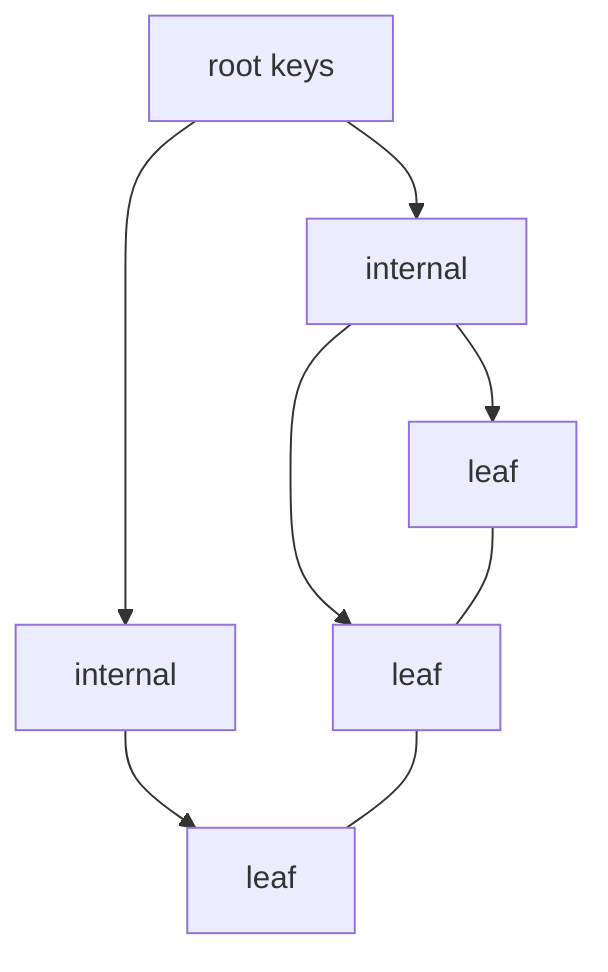

# Indexing

> [!abstract] What this is
> An index is an **extra data structure** that buys faster reads and costs **writes and disk**. The relational default is the **B+ tree**, which handles equality and range. Write-heavy stores use **LSM trees** (memtable → SSTable → compact), hash indexes give `O(1)` equality but are useless for `WHERE created_at >`, and the clustered vs secondary split decides whether the table *is* the index or just points back to it. The ten-minute overview is [[05 - Databases]].

---

## Why It Exists

Without an index, a lookup is a **full table scan**. With one, `WHERE id =` or `WHERE created_at BETWEEN` can jump straight to the rows. The price is that every `INSERT` or `UPDATE` of an indexed column must also **maintain** the tree or LSM. So you index what you **query**, not every column. Note that a unique constraint **is** an index too (email login is the classic case).

---

## B+ Trees

A B+ tree keeps only **keys and child pointers** in its internal nodes, which gives a high fanout and very few levels. All the **data or row pointers live in the leaves**, and the leaves form a **doubly-linked list**. A range scan finds the left-most matching leaf and then walks `next`. That leaf chain is why a B+ tree beats a plain B-tree (which stores data in internal nodes too) for `WHERE created_at >`.

### Height

Fanout is in the hundreds, because an 8 KB page holds many `(key, child)` pairs. That means a billion rows is still only about 3–4 levels deep. The top levels sit in the **buffer pool**, so a point lookup is often just **one disk I/O**, for the leaf.

### Insert and split

To insert, the engine finds the right leaf. If there's room, the key goes there in order. If the leaf is full, it **splits**: two leaves are created and a separator key is copied up to the parent. If the parent is full, it splits too, possibly all the way up to a new root, which adds one to the height.

This is the write cost people mean by "B-tree random writes." A page split dirties two leaves plus a parent, and each of those changes also goes to the WAL (see [[01 - Storage Engine and Disk IO]]).

### Fill factor

Fill factor leaves **slack** on each page so the next insert doesn't immediately split it.

| Fill | Effect | Pick when |
|---|---|---|
| Packed tight (~100%) | Least disk and RAM | Bulk load of data that won't change |
| ~70% | Room for inserts before splits | Typical OLTP |
| Too tight on a busy table | Split storm, especially on a sequential key | Avoid |
| Too loose | Wasted RAM and disk | Avoid |

> [!tip] Interview: "why B+ not hash for `created_at`"
> Hash has no order. The B+ leaf chain **is** the order, so after the first seek a range scan is a sequential walk.

---

## LSM Trees

A B+ tree updates **in place**, which means random page I/O on every write. An LSM tree **appends** instead, which is why write-heavy stores use it: Cassandra, RocksDB, LevelDB, and the Lucene flavour in Elasticsearch. Kafka is a log, not an LSM, so don't mix them up.

| Stage | What it is | Detail |
|---|---|---|
| **Memtable** | In-memory sorted structure (skip list or tree) | Every write is appended to the **commit log** (WAL) and inserted here. Reads check it first |
| **SSTable** | Immutable sorted file on disk | A full memtable is flushed into a new SSTable. Never updated in the middle: a newer file **shadows** an older copy of a key |
| **Compaction** | Background merge of files | Drops overwritten keys and **tombstones**, so fewer files and cheaper reads. Costs CPU and disk write amplification |

### Reads and tombstones

A read may have to look in the memtable plus **several** SSTables. **Bloom filters** let it skip files that definitely don't contain the key (see [[10 - Distributed Building Blocks]]). Even so, that's why LSM reads can be slower than a warm B+ tree.

A delete is a write of `key → null`, called a **tombstone**, the same idea as Kafka compaction. The key is really gone only after compaction drops it.

> [!tip] One sentence
> Write-heavy firehose → **LSM**. Point-read transactional → **B+**. The product pick in depth: [[10 - Engine Choice]].

---

## Hash Indexes

A hash index gives `O(1)` equality, as in `WHERE email =`. It has **no** range queries, **no** `ORDER BY` that can use the index, and **no** prefix scan. In memory, Redis is essentially a hash index. On disk some engines offer hash indexes, but you almost never ask for one by name in Postgres, because the B+ default already does equality well.

| Structure | Equality | Range / order | Writes | Pick when |
|---|---|---|---|---|
| **B+ tree** | Yes | Yes | In-place, random I/O, splits | Default for OLTP |
| **LSM tree** | Yes (may read several files) | Yes, within sorted files | Sequential appends, compaction later | Write-heavy firehose |
| **Hash** | `O(1)` | No | Cheap | Pure key lookup, usually in memory |

---

## Clustered vs Non-Clustered

A **clustered** index means the table's physical order *is* the index order. A **non-clustered** (secondary) index is an extra structure mapping key → **pointer** back to the row. Postgres and InnoDB make opposite choices here.

| | Clustered | Non-clustered (secondary) |
|---|---|---|
| What it is | The **table's physical order** *is* this index | Extra structure: key → **pointer** |
| Postgres | The heap is **not** clustered by default. `CLUSTER` is a one-shot rewrite. The PK is just a unique B+ | Every index is "secondary" on a heap |
| InnoDB | The primary key **is** clustered. Rows live in the PK B+ | Secondary stores `(sec_key → PK)`, then you look up the PK |
| Range on the cluster key | Sequential I/O | Jumps around the heap / PK |

In a **heap** (the Postgres default), rows land wherever there's free space and indexes hold TIDs `(page, slot)`. In an **index-organised / clustered** table (the InnoDB PK), the row **is** in the leaf, so a secondary lookup walks **two** trees: secondary → PK → row. A covering secondary index (below) can skip that second hop.

> [!warning] Random PK on a clustered table
> A UUID v4 as the InnoDB PK means random inserts all over the B+ tree, and page splits everywhere. Snowflake IDs, ULIDs, or `bigserial` keep inserts at the **right edge**. See [[10 - Distributed Building Blocks]].

---

## Composite, Covering, and the Rest

### Composite indexes and the leftmost prefix

A composite index on `(user_id, created_at)` is sorted by `user_id` first, then by `created_at` within each user. So it can only be used from the left.

| Query | Uses `(user_id, created_at)`? |
|---|---|
| `WHERE user_id = ?` | Yes |
| `WHERE user_id = ? AND created_at > ?` | Yes |
| `WHERE user_id = ? ORDER BY created_at` | Yes |
| `WHERE created_at > ?` alone | **No** |

The leftmost prefix rule is the thing interviewers want to hear.

### Covering / index-only scan

A covering index contains **every column the query needs**, so the engine never fetches the heap or clustered row. `SELECT user_id, created_at FROM … WHERE user_id = ?` on `(user_id, created_at)` can be index-only. Postgres has one catch: it still needs to know the heap page is visible, via the **visibility map**. If the page isn't marked all-visible, it peeks at the heap anyway. So say "index-only when the VM says the page is all-visible."

### Unique, partial, GIN, GiST

| Index | What it's for | Pick when |
|---|---|---|
| **Unique** | Constraint + index | A column must not repeat (email) |
| **Partial** | Indexes only matching rows, e.g. `WHERE deleted_at IS NULL` | The query always has the same filter; smaller index |
| **GIN / GiST** | Arrays, JSONB, full text, geo | "Postgres can do this" is enough unless they push. Geo depth: [[09 - Storage Search and Geo]] |

---

## Secondary Indexes on a Sharded DB

On a sharded database, a secondary lookup becomes "which shard has `email = ?`" If you don't know, you **scatter-gather** across every shard. That's why "search" is often **Elasticsearch**, not `LIKE %foo%` on the sharded OLTP store. A local secondary index (one per shard) only helps when the shard key is already in the query. Depth: [[09 - Sharding]].

---

## Failure Modes

| Failure | What happens | Mitigation |
|---|---|---|
| **Missing index** | Full table scan on a hot query | Index the columns you filter and sort on |
| **Too many indexes** | Every write maintains every index; writes slow, disk grows | Index what you query, drop unused ones |
| **Wrong column order** | Composite index can't serve a query that skips the leading column | Follow the leftmost prefix rule |
| **Random PK on clustered table** | Page splits everywhere, fragmented index | Time-ordered IDs (Snowflake, ULID, `bigserial`) |
| **LSM tombstone pile-up** | Reads scan through deleted keys until compaction | Tune compaction; avoid delete-heavy patterns |
| **Secondary lookup on shards** | Scatter-gather to every shard | Put the shard key in the query, or use a search index |

---

## Interview Lines

> [!tip] Say it like this
> - "B+ tree by default: equality and range, and the leaf chain gives me order."
> - "A billion rows is about 3–4 levels, and the top levels are in the buffer pool, so a point lookup is roughly one disk I/O."
> - "LSM for a write-heavy firehose: append to a memtable, flush SSTables, compact later; bloom filters keep reads sane."
> - "Composite index follows the leftmost prefix: `(user_id, created_at)` doesn't help `created_at` alone."
> - "In InnoDB a secondary lookup is two trees, so a random UUID primary key hurts."

## Related Notes

- [[README]]
- [[01 - Storage Engine and Disk IO]]: splits dirty pages in the buffer pool
- [[05 - Query Execution and Optimization]]: which access path the CBO picks
- [[09 - Sharding]]
- [[10 - Engine Choice]]
- [[10 - Distributed Building Blocks]]
- [[11 - Interview Questions]]
