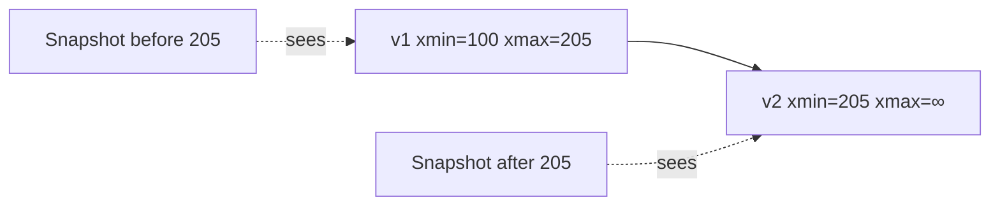
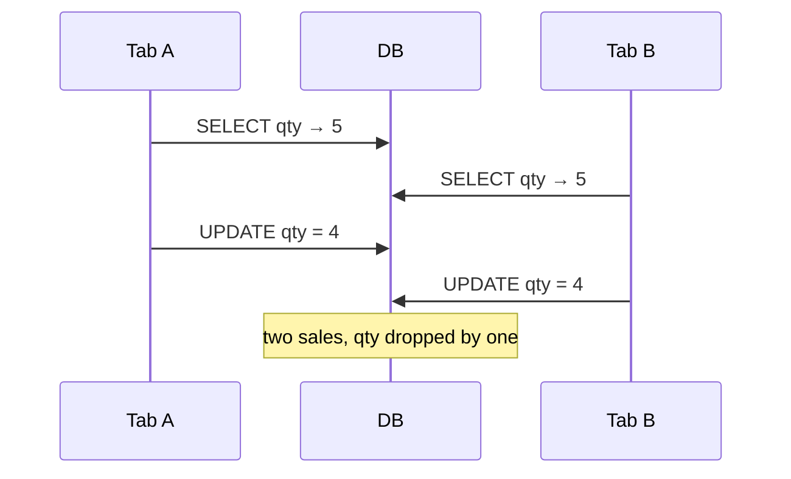
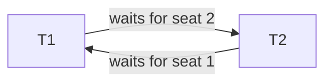

# Concurrency Control

> [!abstract] What this is
> Concurrency control is how thousands of sessions write to the same database without corrupting a row. There are two families: **locks (2PL)** and **versions (MVCC)**. Modern Postgres and InnoDB use MVCC so **readers don't block writers**, but you still lock on **write**, you can still deadlock, and you still lose updates if you read-then-write in the app. The isolation *levels* built on top are in [[04 - Isolation and Anomalies]]; locks you take in the app (`SKIP LOCKED`, Redis, fencing) are in [[14 - Coordination and Concurrency]].

---

## Why It Exists

Two transactions touching the same data at the same time can interleave in ways that neither would produce alone: one overwrites the other, or one reads the other's half-finished work. The engine needs a rule for who waits and who sees what. Knowing the rule tells you which bugs the database prevents for you and which ones you still have to fix yourself.

---

## Lock-Based: Two-Phase Locking (2PL)

2PL splits a transaction's life into two phases. In the **growing phase** it acquires locks and never releases any. In the **shrinking phase** it releases locks and never acquires any. Once it has dropped any lock, it can't take another. That rule is what makes a schedule **conflict-serializable**, which is the textbook guarantee.

What engines actually run is **strict 2PL**: **exclusive** locks are held until **commit or abort**. This stops another transaction from reading your dirty write just before you roll back. The growing/shrinking idea still holds; the shrink simply happens all at once at the end.

### Lock modes

| Mode | Who else can hold it | Use |
|---|---|---|
| **Shared (S)** | Other S | Read |
| **Exclusive (X)** | Nobody | Write |
| **Intention shared (IS)** | | "I will S-lock a row in this table" |
| **Intention exclusive (IX)** | | "I will X-lock a row in this table" |

Intention locks sit on the **table** (or a page) so the engine can decide whether a whole-table lock is safe without inspecting every row. A `LOCK TABLE` in X mode conflicts with a row UPDATE, which holds IX on the table plus X on the row. Without IS/IX, the engine would have to walk every row to check.

### Granularity

| Granularity | Trade-off | Pick when |
|---|---|---|
| Row | Most concurrency, most lock memory, most deadlock surface | Interview default for OLTP |
| Page | In between | Rarely discussed |
| Table | Simple, lots of blocking | Bulk operations, schema changes |
| Database | Simplest, blocks everything | Almost never |

---

## MVCC

MVCC avoids read locks by keeping versions. A write creates a **new version** of the row (or a new tuple), and a reader sees the version that was **committed before its snapshot**. In Postgres, readers don't take S-locks on the rows they read, so "readers don't block writers, and writers don't block readers." Writers still conflict with other writers on the same row.

### The Postgres picture

Every transaction has an **XID**. Each heap tuple carries `xmin` (the XID that created it) and `xmax` (the XID that deleted it, or the next writer). You see a tuple if its `xmin` committed before your snapshot and its `xmax` is not a delete that committed before you. That visibility rule **is** the isolation level's snapshot; see [[04 - Isolation and Anomalies]].

An `UPDATE` inserts a new tuple and sets `xmax` on the old one. The old versions sit around until **vacuum** removes them, which is where bloat comes from. How that cleanup works, and why long transactions block it, is in [[01 - Storage Engine and Disk IO]].

### The InnoDB picture

InnoDB keeps the current row in the clustered index and older versions in the **undo log**. A reader whose snapshot is older than the current row walks back through the undo records to rebuild the version it's allowed to see. Same idea as Postgres: versions, not S-locks on reads.

| | Postgres | InnoDB |
|---|---|---|
| Where the new version goes | New heap tuple | Updated in place in the clustered row |
| Where old versions live | Old tuples in the heap | Undo log |
| Cleanup | Vacuum | Purge |

> [!tip] The one-liner if they poke internals
> "Postgres uses MVCC so readers don't block writers." You don't draw the clog or the freeze map unless you're talking to a DB team.

---

## Lost Update

This is the concurrency bug you'll actually hit. Two tabs both read `qty = 5`, both compute and write `qty = 4`, and the last commit wins. One sale has vanished. MVCC doesn't save you here, because the read and the write were separate steps in the application.

Pick one fix and say why.

| Fix | How | Pick when |
|---|---|---|
| Atomic SQL | `UPDATE … SET qty = qty - 1 WHERE qty > 0` | Default for counters |
| Optimistic `version` | `UPDATE … WHERE id=? AND version=3`; 0 rows updated → 409 | Profiles, stock, issues |
| `SELECT FOR UPDATE` | Pessimistic row X-lock until commit | Short txn where you must **read, then branch** |

What you must **not** do is `SELECT` in the app, subtract, and `UPDATE` with no predicate. Which tool fits which HLD: [[14 - Coordination and Concurrency]].

---

## Deadlock

A deadlock is two transactions each holding what the other needs. T1 locks seat 1 and waits for seat 2; T2 locks seat 2 and waits for seat 1. That's a cycle in the **wait-for graph**.

The engine periodically builds or walks the wait-for graph. When it finds a cycle it picks a **victim**, usually the cheapest to undo (the youngest, or the one with the least undo), and that transaction fails with `ERROR: deadlock detected` and **rolls back**. The app then **retries** the whole transaction.

Prevention is mostly on you:

| Technique | How | Note |
|---|---|---|
| Sorted lock order | Lock rows in **sorted id order**, so both txns lock seat 1 then seat 2 | No cycle is possible |
| Tiny transactions | Never hold `FOR UPDATE` across a PSP (payment provider) call | Less time holding locks, fewer collisions |
| Timeouts | `lock_timeout` so you fail instead of sitting | Not a substitute for sort order |

> [!danger] Holding a row lock for 10 minutes
> That's not 2PL, that's a **product bug**. Seat booking uses **state + TTL**, not an open transaction. See [[06 - Seat Booking]] and [[14 - Coordination and Concurrency]].

---

## Hot Row

A hot row is when everyone updates the **same** counter or the same seat-map row. The lock, or the MVCC write conflict, **is** the bottleneck, and adding hardware doesn't help because the work is serialised on one row. It's the same family as a Kafka hot partition: one key, one lane. See [[04 - Producer Mechanics and Delivery Guarantees]] and [[09 - Sharding]].

| Fix | How | Pick when |
|---|---|---|
| Shard the counter | Split into, say, 10 buckets and sum on read | Exact count needed, high write rate |
| Redis `INCR` | Count in Redis, reconcile into the DB | You can reconcile later |
| Append events | Insert one row per event and sum | You want an audit trail anyway |

---

## Failure Modes

| Failure | What happens | Mitigation |
|---|---|---|
| **Lost update** | Read-then-write in the app; one write silently disappears | Atomic SQL, `version` column, or `FOR UPDATE` |
| **Deadlock** | Two txns wait on each other; one is killed | Sorted lock order, short txns, retry on deadlock error |
| **Long lock hold** | Everyone else queues behind one txn | Never hold locks across network calls; state + TTL |
| **Hot row** | One row serialises all writers | Sharded counter, Redis, append-and-sum |
| **Version bloat** | Old MVCC versions pile up | Keep transactions short so vacuum / purge can run |

---

## Interview Lines

> [!tip] Say it like this
> - "Postgres uses MVCC, so readers don't block writers, but writers on the same row still conflict."
> - "For a counter I use an atomic `UPDATE … SET qty = qty - 1 WHERE qty > 0`, not read-then-write in the app."
> - "For edits from two tabs I use an optimistic `version` column and return 409 on mismatch."
> - "I lock rows in sorted id order and keep transactions tiny, and the app retries on a deadlock error."
> - "A hot row is a lock bottleneck; I shard the counter or append events."

## Related Notes

- [[README]]
- [[04 - Isolation and Anomalies]]
- [[14 - Coordination and Concurrency]]
- [[01 - Storage Engine and Disk IO]]: steal means uncommitted pages can hit disk, so undo exists; vacuum and purge clean up MVCC versions
- [[06 - Seat Booking]]
- [[11 - Interview Questions]]
